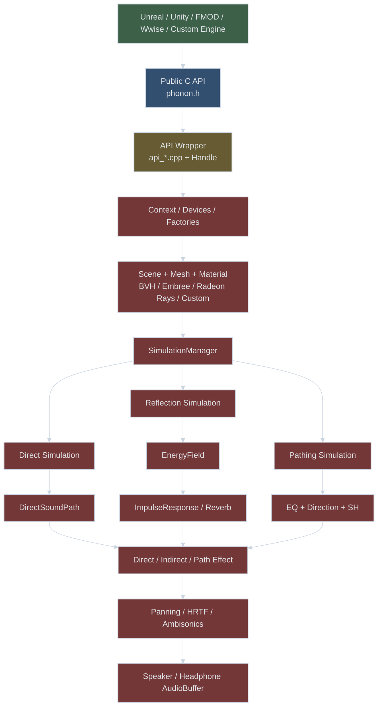
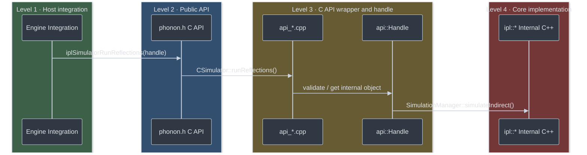
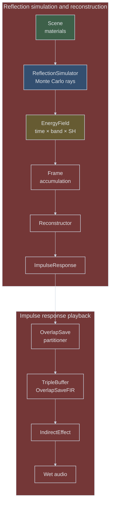
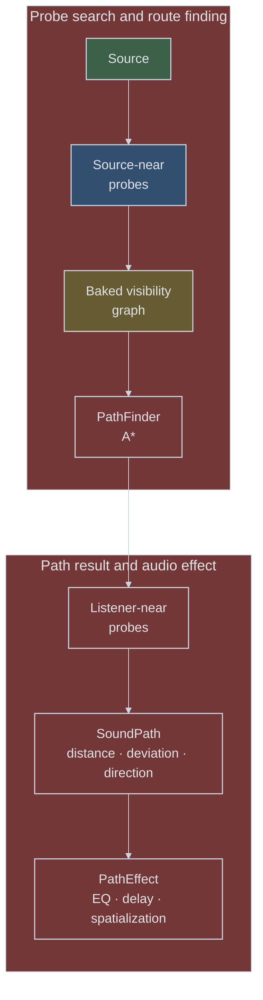
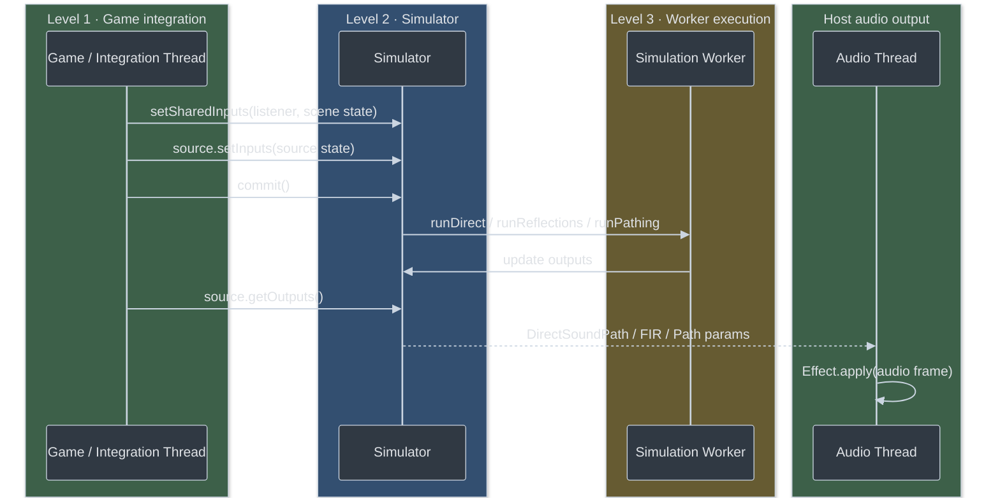

---

# 1. Introduction

`core/src/core`에는 수백 개의 파일이 한 폴더에 모여 있다.  파일명만 따라가면 `Scene`,
`Simulator`, `Effect`, `Probe`, `HRTF`가 서로 어떤 단계인지 구분하기 어렵다.
이 문서는 [[core_00_overview|Core Overview]]에서 나눈 네 단계를 실제 코드 실행 순서와 세부 파일 단위로
확장한다. 전체 개념을 빠르게 훑고 싶다면 `Core Overview`를 먼저 읽는 것이 좋다.

## 1.1 기준

이 문서에서는 Steam Audio Core를 다음 질문을 기준으로 나눈다.

1. 외부 엔진은 Core를 어디로 호출하는가?
2. <strong style="color:#b3f594">Scene</strong> geometry는 어떻게 <strong style="color:#b3f594">ray tracing</strong> 가능한 형태가 되는가?
3. Direct, <strong style="color:#b3f594">Reflections</strong>, <strong style="color:#b3f594">Pathing</strong> simulation은 각각 무엇을 계산하는가?
4. <strong style="color:#b3f594">Simulation</strong> 결과는 어떻게 실제 audio sample에 적용되는가?
5. CPU, Embree, Radeon Rays, OpenCL, TAN 구현은 어디에서 갈리는가?
6. 특정 기능을 더 공부하려면 어떤 소스, 문서, 테스트를 봐야 하는가?


> [!info] 분석 기준
> - Local source: `steam-audio` commit `ecce9cb` (2026-07-13)
> - 주요 기준 파일: `core/src/core/CMakeLists.txt`
> - 참고 사이트: [DeepWiki - ValveSoftware/steam-audio](https://deepwiki.com/ValveSoftware/steam-audio)
>
> DeepWiki는 2026-04-23의 `480dd6`을 기준으로 생성되어 현재 local source와 차이가
> 있을 수 있다. 동작 판단은 항상 local source를 우선한다.

---

# 2. 가장 먼저 구분해야 하는 것

## 2.1 Simulation과 Effect는 서로 다른 단계다

Steam Audio에서 가장 중요한 구분이다.

| 구분 | 역할 | 입력 | 출력 | 실행 위치의 성격 |
|---|---|---|---|---|
| Simulation | 음향 환경을 계산 | Scene, source, listener, material | 감쇠값, EnergyField, IR, path 정보 | 무겁고 비동기화 가능한 계산 |
| Effect | 계산 결과를 audio sample에 적용 | AudioBuffer + simulation 결과 | 처리된 AudioBuffer | 실시간 audio processing |

예를 들어 차폐를 처리할 때:

```text
DirectSimulator
└─ Scene에 ray를 쏴 occlusion = 0.3 계산

DirectEffect
└─ occlusion 0.3을 실제 audio buffer의 gain/EQ에 적용
```

`DirectSimulator`가 소리를 직접 가공하는 것이 아니며, `DirectEffect`가 ray tracing을 하는 것도 아니다.

## 2.2 Core에는 세 가지 propagation 경로가 있다

| 경로 | 계산 대상 | 대표 출력 | 적용 Effect |
|---|---|---|---|
| Direct | source에서 listener까지의 직접 경로 | 거리 감쇠, 공기 흡수, directivity, occlusion, transmission | `DirectEffect` |
| Reflections | 벽에 반사되어 도달하는 간접음 | `EnergyField`, `ImpulseResponse`, reverb parameter | `IndirectEffect` 내부 convolution/reverb |
| Pathing | 모서리, 문, 복도 등을 거치는 우회 경로 | EQ, 도착 방향, distance ratio, SH coefficients | `PathEffect` |

세 경로는 알고리즘과 결과 자료형이 다르므로 한 개의 “ray tracing 효과”로 묶어 이해하면 안 된다.

---

# 3. 전체 구조



코드를 읽을 때는 위에서 아래로 한 번에 내려가기보다 다음 네 층을 분리해서 보는 것이 좋다.

```text
API Layer        : 외부 ABI, handle, validation
Domain Layer     : Scene, Simulation, Probe, acoustic data
DSP Layer        : AudioBuffer와 Effect
Backend Layer    : SIMD, FFT, Embree, Radeon Rays, OpenCL, TAN
```

---

# 4. 외부 호출에서 실제 구현까지

## 4.1 C API 경계

외부 사용자는 `iplContextCreate`, `iplSceneCreate`, `iplSimulatorRunReflections` 같은 C 함수를
호출한다.



### 포함 파일

<strong style="color:#b3f594">Public ABI</strong>

- phonon.h [링크](https://github.com/ValveSoftware/steam-audio/blob/v4.8.1/core/src/core/phonon.h)
- phonon_interfaces.h [링크](https://github.com/ValveSoftware/steam-audio/blob/v4.8.1/core/src/core/phonon_interfaces.h)
- types.h [링크](https://github.com/ValveSoftware/steam-audio/blob/v4.8.1/core/src/core/types.h)
- docs.h [링크](https://github.com/ValveSoftware/steam-audio/blob/v4.8.1/core/src/core/docs.h)

<strong style="color:#b3f594">Context</strong> 생성과 수명 관리는 다음 파일을 통해 연결된다.

- api_context.h [링크](https://github.com/ValveSoftware/steam-audio/blob/v4.8.1/core/src/core/api_context.h)
- api_context.cpp [링크](https://github.com/ValveSoftware/steam-audio/blob/v4.8.1/core/src/core/api_context.cpp)
- context.h [링크](https://github.com/ValveSoftware/steam-audio/blob/v4.8.1/core/src/core/context.h)
- context.cpp [링크](https://github.com/ValveSoftware/steam-audio/blob/v4.8.1/core/src/core/context.cpp)
- library.h [링크](https://github.com/ValveSoftware/steam-audio/blob/v4.8.1/core/src/core/library.h)
- library.cpp [링크](https://github.com/ValveSoftware/steam-audio/blob/v4.8.1/core/src/core/library.cpp)

<strong style="color:#b3f594">Geometry와 Scene</strong>의 진입점은 다음 파일이다.

- api_geometry.cpp [링크](https://github.com/ValveSoftware/steam-audio/blob/v4.8.1/core/src/core/api_geometry.cpp)
- api_scene.h [링크](https://github.com/ValveSoftware/steam-audio/blob/v4.8.1/core/src/core/api_scene.h)
- api_scene.cpp [링크](https://github.com/ValveSoftware/steam-audio/blob/v4.8.1/core/src/core/api_scene.cpp)

<strong style="color:#b3f594">Serialized Scene</strong> 객체는 다음 wrapper가 담당한다.

- api_serialized_object.h [링크](https://github.com/ValveSoftware/steam-audio/blob/v4.8.1/core/src/core/api_serialized_object.h)
- api_serialized_object.cpp [링크](https://github.com/ValveSoftware/steam-audio/blob/v4.8.1/core/src/core/api_serialized_object.cpp)

<strong style="color:#b3f594">Simulation과 Baking</strong> wrapper는 다음과 같다.

- api_simulator.h [링크](https://github.com/ValveSoftware/steam-audio/blob/v4.8.1/core/src/core/api_simulator.h)
- api_simulator.cpp [링크](https://github.com/ValveSoftware/steam-audio/blob/v4.8.1/core/src/core/api_simulator.cpp)
- api_advanced_simulation.cpp [링크](https://github.com/ValveSoftware/steam-audio/blob/v4.8.1/core/src/core/api_advanced_simulation.cpp)
- api_baking.cpp [링크](https://github.com/ValveSoftware/steam-audio/blob/v4.8.1/core/src/core/api_baking.cpp)

<strong style="color:#b3f594">Effect</strong>, device, <strong style="color:#b3f594">probe</strong>, energy field, impulse response,
reconstructor용 wrapper의 역할과 내부 handle 연결은 [Public C API 분석](core_public_api.md)에서 주제별로 따라간다.
Validation layer는 api_validation_layer.cpp [링크](https://github.com/ValveSoftware/steam-audio/blob/v4.8.1/core/src/core/api_validation_layer.cpp)에서 확인할 수 있다.

### 왜 C API를 사용하는가?

C ABI는 C++ ABI보다 compiler와 언어 경계를 넘기 쉽다.

- Unity C#, Unreal C++, FMOD, Wwise가 같은 binary interface를 사용할 수 있다.
- public header에서 내부 template, STL container, concrete class를 숨길 수 있다.
- 구현 객체의 수명은 opaque handle과 retain/release로 통제할 수 있다.

### 특이사항

Public API의 `IPL*` 구조체와 내부 `ipl::*` 타입 사이에서 변환이 발생한다.

- `IPLMatrix4x4`는 row-major, 내부 `Matrix4x4f`는 column-major라 API boundary에서 transpose한다. 자세한 내용은 [[detail/system/core_matrix]] 참고.
- Validation layer는 항상 본 구현과 같은 의미를 가져야 하므로 API를 추가할 때 같이 갱신해야 한다.
- 대부분의 객체는 `Context`를 통해 만들어진다. allocator, logger, <strong style="color:#b3f594">SIMD</strong> 정책과 객체 수명 기반을 한곳에서 공유하기 위함이다.

### 더 공부할 곳

- Local docs: `core/doc/context.rst`, `types.rst`, `reference.rst`, `integration.rst`
- Source 시작점: phonon.h [링크](https://github.com/ValveSoftware/steam-audio/blob/v4.8.1/core/src/core/phonon.h) → api_context.cpp [링크](https://github.com/ValveSoftware/steam-audio/blob/v4.8.1/core/src/core/api_context.cpp) → context.cpp [링크](https://github.com/ValveSoftware/steam-audio/blob/v4.8.1/core/src/core/context.cpp)
- Official: [Steam Audio C API Programmer's Guide](https://valvesoftware.github.io/steam-audio/doc/capi/guide.html)
- DeepWiki: [Core Architecture](https://deepwiki.com/ValveSoftware/steam-audio/2-core-architecture)

---

# 5. 기반 계층: 메모리, Container, Math, Thread

이 계층은 직접적인 음향 기능은 아니지만 거의 모든 상위 모듈이 사용한다.

## 5.1 Runtime와 공통 기반

### 포함 파일

<strong style="color:#b3f594">Platform / runtime</strong>

- platform.h [링크](https://github.com/ValveSoftware/steam-audio/blob/v4.8.1/core/src/core/platform.h)
- types.h [링크](https://github.com/ValveSoftware/steam-audio/blob/v4.8.1/core/src/core/types.h)
- error.h [링크](https://github.com/ValveSoftware/steam-audio/blob/v4.8.1/core/src/core/error.h)
- log.h [링크](https://github.com/ValveSoftware/steam-audio/blob/v4.8.1/core/src/core/log.h) / log.cpp [링크](https://github.com/ValveSoftware/steam-audio/blob/v4.8.1/core/src/core/log.cpp)

<strong style="color:#b3f594">Memory</strong>

- memory_allocator.h [링크](https://github.com/ValveSoftware/steam-audio/blob/v4.8.1/core/src/core/memory_allocator.h)
- memory_allocator.cpp [링크](https://github.com/ValveSoftware/steam-audio/blob/v4.8.1/core/src/core/memory_allocator.cpp)

<strong style="color:#b3f594">Profiling</strong>

- profiler.h [링크](https://github.com/ValveSoftware/steam-audio/blob/v4.8.1/core/src/core/profiler.h)
- profiler.cpp [링크](https://github.com/ValveSoftware/steam-audio/blob/v4.8.1/core/src/core/profiler.cpp)
- null_profiler.h [링크](https://github.com/ValveSoftware/steam-audio/blob/v4.8.1/core/src/core/null_profiler.h)
- null_profiler.cpp [링크](https://github.com/ValveSoftware/steam-audio/blob/v4.8.1/core/src/core/null_profiler.cpp)

<strong style="color:#b3f594">Library / Context</strong>

- library.h [링크](https://github.com/ValveSoftware/steam-audio/blob/v4.8.1/core/src/core/library.h)
- library.cpp [링크](https://github.com/ValveSoftware/steam-audio/blob/v4.8.1/core/src/core/library.cpp)
- context.h [링크](https://github.com/ValveSoftware/steam-audio/blob/v4.8.1/core/src/core/context.h)
- context.cpp [링크](https://github.com/ValveSoftware/steam-audio/blob/v4.8.1/core/src/core/context.cpp)

<strong style="color:#b3f594">Utility</strong>

- util.h [링크](https://github.com/ValveSoftware/steam-audio/blob/v4.8.1/core/src/core/util.h)
- pch.h [링크](https://github.com/ValveSoftware/steam-audio/blob/v4.8.1/core/src/core/pch.h)
- pch.cpp [링크](https://github.com/ValveSoftware/steam-audio/blob/v4.8.1/core/src/core/pch.cpp)

### 왜 필요한가?

게임 엔진은 자체 allocator, logger, profiler를 사용하는 경우가 많다. Core가 OS 함수나 `new/delete`에 직접
묶이면 integration과 메모리 추적이 어려워지므로 callback과 공통 wrapper를 둔다.

기존 문서: [[detail/system/core_memory_allocator]], [[detail/system/core_util]]

## 5.2 Container와 데이터 교환

### 포함 파일

- array.h [링크](https://github.com/ValveSoftware/steam-audio/blob/v4.8.1/core/src/core/array.h), containers.h [링크](https://github.com/ValveSoftware/steam-audio/blob/v4.8.1/core/src/core/containers.h), stack.h [링크](https://github.com/ValveSoftware/steam-audio/blob/v4.8.1/core/src/core/stack.h)
- triple_buffer.h [링크](https://github.com/ValveSoftware/steam-audio/blob/v4.8.1/core/src/core/triple_buffer.h)
- serialized_object.h [링크](https://github.com/ValveSoftware/steam-audio/blob/v4.8.1/core/src/core/serialized_object.h) / serialized_object.cpp [링크](https://github.com/ValveSoftware/steam-audio/blob/v4.8.1/core/src/core/serialized_object.cpp)
- `.fbs` schema: `vector`, `sphere`, `triangle`, `material`, `mesh`,
    `static_mesh`, `scene`, `energy_field`, `reverb`, `probe_batch`, `baked_reflection_data`, `path_visibility`,
    `path_data`

### 특이사항과 이유

`Array<T, ...>`는 다차원 contiguous storage를 제공하며 DSP와 simulation buffer에 사용된다.

- `TripleBuffer<T>`는 simulation 쪽 writer와 audio 쪽 reader가 같은 IR을 동시에 수정하지 않도록 `write/share/read` 세 슬롯을 둔다.
- FlatBuffers는 Scene, Probe, Baked Data를 pointer가 없는 binary representation으로 저장한다. 다른 실행 시점에 다시 읽어야 하므로 runtime 객체와
    <strong style="color:#b3f594">serialization</strong> 객체가 분리되어 있다.

기존 문서: [[detail/system/core_Array]]

## 5.3 Math와 공간 표현

### 포함 파일

<strong style="color:#b3f594">Scalar와 vector</strong>

`math_functions`, `vector`, `polar_vector`

<strong style="color:#b3f594">Transform</strong>

- matrix.h [링크](https://github.com/ValveSoftware/steam-audio/blob/v4.8.1/core/src/core/matrix.h)
- quaternion.h [링크](https://github.com/ValveSoftware/steam-audio/blob/v4.8.1/core/src/core/quaternion.h)
- coordinate_space.h [링크](https://github.com/ValveSoftware/steam-audio/blob/v4.8.1/core/src/core/coordinate_space.h)

<strong style="color:#b3f594">Geometry primitive</strong>

- box.h [링크](https://github.com/ValveSoftware/steam-audio/blob/v4.8.1/core/src/core/box.h)
- sphere.h [링크](https://github.com/ValveSoftware/steam-audio/blob/v4.8.1/core/src/core/sphere.h)

<strong style="color:#b3f594">Sampling</strong>

- sampling.h [링크](https://github.com/ValveSoftware/steam-audio/blob/v4.8.1/core/src/core/sampling.h) / sampling.cpp [링크](https://github.com/ValveSoftware/steam-audio/blob/v4.8.1/core/src/core/sampling.cpp)

<strong style="color:#b3f594">SIMD</strong>

- float4.h [링크](https://github.com/ValveSoftware/steam-audio/blob/v4.8.1/core/src/core/float4.h)
- sse_float4.h [링크](https://github.com/ValveSoftware/steam-audio/blob/v4.8.1/core/src/core/sse_float4.h)
- neon_float4.h [링크](https://github.com/ValveSoftware/steam-audio/blob/v4.8.1/core/src/core/neon_float4.h)
- float8.h [링크](https://github.com/ValveSoftware/steam-audio/blob/v4.8.1/core/src/core/float8.h)
- avx_float8.h [링크](https://github.com/ValveSoftware/steam-audio/blob/v4.8.1/core/src/core/avx_float8.h)

<strong style="color:#b3f594">Vector math backend</strong>

- array_math.h [링크](https://github.com/ValveSoftware/steam-audio/blob/v4.8.1/core/src/core/array_math.h) / array_math.cpp [링크](https://github.com/ValveSoftware/steam-audio/blob/v4.8.1/core/src/core/array_math.cpp)
- ipp_array_math.cpp [링크](https://github.com/ValveSoftware/steam-audio/blob/v4.8.1/core/src/core/ipp_array_math.cpp)
- vdsp_array_math.cpp [링크](https://github.com/ValveSoftware/steam-audio/blob/v4.8.1/core/src/core/vdsp_array_math.cpp)

### 특이사항과 이유

같은 수학 연산을 scalar와 SIMD backend 양쪽에서 사용하도록 추상화한다.

- `CoordinateSpace3f`는 listener/source의 `right`, `up`, `ahead`, `origin`을 묶는다. 방향성,
    <strong style="color:#b3f594">HRTF</strong>, <strong style="color:#b3f594">Ambisonics</strong> 회전에서 기준축이 일치해야 하기 때문이다.
- compile option에 따라 SSE/AVX/NEON 구현이 달라지므로 특정 파일이 모든 platform에서 빌드되는 것은 아니다.

기존 문서: [[detail/system/core_matrix]], [[detail/system/core_simd]]

## 5.4 Job system

### 포함 파일

- job.h [링크](https://github.com/ValveSoftware/steam-audio/blob/v4.8.1/core/src/core/job.h)
- job_graph.h [링크](https://github.com/ValveSoftware/steam-audio/blob/v4.8.1/core/src/core/job_graph.h) / job_graph.cpp [링크](https://github.com/ValveSoftware/steam-audio/blob/v4.8.1/core/src/core/job_graph.cpp)
- thread_pool.h [링크](https://github.com/ValveSoftware/steam-audio/blob/v4.8.1/core/src/core/thread_pool.h) / thread_pool.cpp [링크](https://github.com/ValveSoftware/steam-audio/blob/v4.8.1/core/src/core/thread_pool.cpp)

### 왜 graph를 사용하는가?

Reflection simulation은 많은 ray job을 병렬로 처리한 후 thread-local EnergyField를 하나로 합쳐야
한다. 단순한 병렬 loop보다 “여러 simulate job이 끝난 뒤 finalize job 실행”이라는 의존 관계를 표현할 수 있어야
한다.

### 더 공부할 곳

- Unit tests: `Array.test.cpp`, `Matrix.test.cpp`, `CoordinateSpace.test.cpp`, `Sampling.test.cpp`
- Core 흐름: reflection_simulator.cpp [링크](https://github.com/ValveSoftware/steam-audio/blob/v4.8.1/core/src/core/reflection_simulator.cpp)의 job 생성과 `SimulationManager::simulateRealTimeReflections()`
- DeepWiki: [Math & Optimization](https://deepwiki.com/ValveSoftware/steam-audio/2.4-math-and-optimization)

---

# 6. Scene과 Ray Tracing

Scene 계층은 “게임 월드 전체”가 아니라 음향 계산에 필요한 geometry와 material을 ray query 가능한 형태로 제공한다.

## 6.1 포함 파일

<strong style="color:#b3f594">기하 기본형</strong>

- triangle.h [링크](https://github.com/ValveSoftware/steam-audio/blob/v4.8.1/core/src/core/triangle.h)
- mesh.h [링크](https://github.com/ValveSoftware/steam-audio/blob/v4.8.1/core/src/core/mesh.h) / mesh.cpp [링크](https://github.com/ValveSoftware/steam-audio/blob/v4.8.1/core/src/core/mesh.cpp)
- ray.h [링크](https://github.com/ValveSoftware/steam-audio/blob/v4.8.1/core/src/core/ray.h) / ray.cpp [링크](https://github.com/ValveSoftware/steam-audio/blob/v4.8.1/core/src/core/ray.cpp)
- hit.h [링크](https://github.com/ValveSoftware/steam-audio/blob/v4.8.1/core/src/core/hit.h)
- material.h [링크](https://github.com/ValveSoftware/steam-audio/blob/v4.8.1/core/src/core/material.h)

<strong style="color:#b3f594">기본 가속 구조</strong>

- box.h [링크](https://github.com/ValveSoftware/steam-audio/blob/v4.8.1/core/src/core/box.h)
- bvh.h [링크](https://github.com/ValveSoftware/steam-audio/blob/v4.8.1/core/src/core/bvh.h) /  bvh.cpp [링크](https://github.com/ValveSoftware/steam-audio/blob/v4.8.1/core/src/core/bvh.cpp)

<strong style="color:#b3f594">Scene 객체</strong>

- static_mesh.h [링크](https://github.com/ValveSoftware/steam-audio/blob/v4.8.1/core/src/core/static_mesh.h) / static_mesh.cpp [링크](https://github.com/ValveSoftware/steam-audio/blob/v4.8.1/core/src/core/static_mesh.cpp)
- instanced_mesh.h [링크](https://github.com/ValveSoftware/steam-audio/blob/v4.8.1/core/src/core/instanced_mesh.h)/  instanced_mesh.cpp [링크](https://github.com/ValveSoftware/steam-audio/blob/v4.8.1/core/src/core/instanced_mesh.cpp)
- scene.h [링크](https://github.com/ValveSoftware/steam-audio/blob/v4.8.1/core/src/core/scene.h) / scene.cpp [링크](https://github.com/ValveSoftware/steam-audio/blob/v4.8.1/core/src/core/scene.cpp)

<strong style="color:#b3f594">Custom backend 구현</strong>

- custom_scene.h [링크](https://github.com/ValveSoftware/steam-audio/blob/v4.8.1/core/src/core/custom_scene.h) / custom_scene.cpp [링크](https://github.com/ValveSoftware/steam-audio/blob/v4.8.1/core/src/core/custom_scene.cpp)

<strong style="color:#b3f594">Scene 종류 선택</strong>

- scene_factory.h [링크](https://github.com/ValveSoftware/steam-audio/blob/v4.8.1/core/src/core/scene_factory.h) / scene_factory.cpp [링크](https://github.com/ValveSoftware/steam-audio/blob/v4.8.1/core/src/core/scene_factory.cpp)

| Embree | `embree_device`, `embree_static_mesh`, `embree_instanced_mesh`, `embree_scene` |
| Radeon Rays | `radeonrays_device`, `radeonrays_static_mesh`, `radeonrays_scene` |

## 6.2 흐름

```text
Vertex + Triangle + Material
        ↓
StaticMesh 생성
        ↓
Scene에 add
        ↓
Scene::commit()
        ↓
BVH / Embree / Radeon Rays acceleration structure 사용 가능
        ↓
closestHit() / anyHit() / batched query
```

## 6.3 특이사항과 이유

### `commit()`이 따로 있다

`addStaticMesh()`를 호출할 때마다 BVH나 backend scene을 즉시 다시 만들면 여러 개의 변경을 적용할 때 비용이 반복된다.
변경을 모아 두었다가 `commit()`에서 읽기 가능한 snapshot으로 확정한다.

### `closestHit`과 `anyHit`을 나눈다

- `closestHit`: 반사 위치, normal, material이 필요할 때 가장 가까운 교차점을 구함
- `anyHit`: source-listener 사이가 막혔는지만 알면 될 때 첫 교차에서 종료 가능

Occlusion에 `closestHit`을 사용하면 필요 없는 계산이 늘어난다.

### InstancedMesh는 mesh가 아니라 ray를 변환한다

여러 instance에 대해 geometry/BVH를 복제하지 않는다. World-space ray를 inverse transform으로
sub-scene local space에 보낸 뒤 hit를 다시 world space로 돌린다.

자세한 내용

- [[detail/geometry/core_mesh]]
- [[detail/geometry/core_bvh]]
- [[detail/geometry/core_scene]]
- [[detail/geometry/core_instanced_mesh]]
- [[detail/system/core_matrix]]

## 6.4 더 공부할 곳

- Local docs: `core/doc/geometry.rst`, `scene.rst`, `embree.rst`, `radeon-rays.rst`
- Unit tests: `Mesh.test.cpp`, `BVH.test.cpp`, `Scene.test.cpp`, `RayTracerCompare.test.cpp`
- Interactive: `itest_bvh.cpp`, `itest_instancedmesh.cpp`, `itest_raytracer.cpp`
- Benchmark: benchmark_scene.cpp [링크](https://github.com/ValveSoftware/steam-audio/blob/v4.8.1/core/src/benchmark/benchmark_scene.cpp), benchmark_raytracer.cpp [링크](https://github.com/ValveSoftware/steam-audio/blob/v4.8.1/core/src/benchmark/benchmark_raytracer.cpp)
- Official: [Steam Audio Scene](https://valvesoftware.github.io/steam-audio/doc/capi/scene.html)

---

# 7. Direct Sound

Direct Sound는 source와 listener 사이의 한 경로에 대한 값을 계산한다.

## 7.1 포함 파일

### Simulation model

- propagation_medium.h [링크](https://github.com/ValveSoftware/steam-audio/blob/v4.8.1/core/src/core/propagation_medium.h)
- distance_attenuation.h [링크](https://github.com/ValveSoftware/steam-audio/blob/v4.8.1/core/src/core/distance_attenuation.h) / distance_attenuation.cpp [링크](https://github.com/ValveSoftware/steam-audio/blob/v4.8.1/core/src/core/distance_attenuation.cpp)
- air_absorption.h [링크](https://github.com/ValveSoftware/steam-audio/blob/v4.8.1/core/src/core/air_absorption.h) / air_absorption.cpp [링크](https://github.com/ValveSoftware/steam-audio/blob/v4.8.1/core/src/core/air_absorption.cpp)
- directivity.h [링크](https://github.com/ValveSoftware/steam-audio/blob/v4.8.1/core/src/core/directivity.h) / directivity.cpp [링크](https://github.com/ValveSoftware/steam-audio/blob/v4.8.1/core/src/core/directivity.cpp)
- direct_simulator.h [링크](https://github.com/ValveSoftware/steam-audio/blob/v4.8.1/core/src/core/direct_simulator.h) / direct_simulator.cpp [링크](https://github.com/ValveSoftware/steam-audio/blob/v4.8.1/core/src/core/direct_simulator.cpp)

### Audio 적용

- gain_effect.h [링크](https://github.com/ValveSoftware/steam-audio/blob/v4.8.1/core/src/core/gain_effect.h) / gain_effect.cpp [링크](https://github.com/ValveSoftware/steam-audio/blob/v4.8.1/core/src/core/gain_effect.cpp)
- eq_effect.h [링크](https://github.com/ValveSoftware/steam-audio/blob/v4.8.1/core/src/core/eq_effect.h) / eq_effect.cpp [링크](https://github.com/ValveSoftware/steam-audio/blob/v4.8.1/core/src/core/eq_effect.cpp)
- delay_effect.h [링크](https://github.com/ValveSoftware/steam-audio/blob/v4.8.1/core/src/core/delay_effect.h) / delay_effect.cpp [링크](https://github.com/ValveSoftware/steam-audio/blob/v4.8.1/core/src/core/delay_effect.cpp)
- direct_effect.h [링크](https://github.com/ValveSoftware/steam-audio/blob/v4.8.1/core/src/core/direct_effect.h) / direct_effect.cpp [링크](https://github.com/ValveSoftware/steam-audio/blob/v4.8.1/core/src/core/direct_effect.cpp)
- API: api_direct_effect.h [링크](https://github.com/ValveSoftware/steam-audio/blob/v4.8.1/core/src/core/api_direct_effect.h) / api_direct_effect.cpp [링크](https://github.com/ValveSoftware/steam-audio/blob/v4.8.1/core/src/core/api_direct_effect.cpp)

## 7.2 코드 흐름

```mermaid
%%{init: {"theme":"base","themeVariables":{"background":"#111827","darkMode":true,"primaryColor":"#3d6049","primaryTextColor":"#dfe2e6","primaryBorderColor":"#cbd5e1","secondaryColor":"#334f70","secondaryTextColor":"#dfe2e6","secondaryBorderColor":"#cbd5e1","tertiaryColor":"#665b32","tertiaryTextColor":"#dfe2e6","tertiaryBorderColor":"#cbd5e1","clusterBkg":"#743737","clusterBorder":"#cbd5e1","lineColor":"#cbd5e1","textColor":"#dfe2e6","nodeTextColor":"#dfe2e6","actorBkg":"#303943","actorBorder":"#cbd5e1","actorTextColor":"#dfe2e6","actorLineColor":"#cbd5e1","signalColor":"#cbd5e1","signalTextColor":"#dfe2e6","labelBoxBkgColor":"#743737","labelBoxBorderColor":"#cbd5e1","labelTextColor":"#dfe2e6","activationBkgColor":"#334f70","activationBorderColor":"#cbd5e1","noteBkgColor":"#665b32","noteBorderColor":"#cbd5e1","noteTextColor":"#dfe2e6"}}}%%
flowchart LR
    Input["Source + Listener + Scene"]
    Sim["DirectSimulator"]
    Result["DirectSoundPath"]
    Effect["DirectEffect"]
    Audio["AudioBuffer"]

    Input --> Sim
    Sim -->|distance| Result
    Sim -->|air absorption| Result
    Sim -->|directivity| Result
    Sim -->|occlusion/transmission| Result
    Result --> Effect
    Audio --> Effect --> Output["Processed Audio"]
    classDef level1 fill:#3d6049,stroke:#cbd5e1,color:#dfe2e6,stroke-width:1.5px;
    classDef level2 fill:#334f70,stroke:#cbd5e1,color:#dfe2e6,stroke-width:1.5px;
    classDef level3 fill:#665b32,stroke:#cbd5e1,color:#dfe2e6,stroke-width:1.5px;
    classDef level4 fill:#743737,stroke:#cbd5e1,color:#dfe2e6,stroke-width:1.5px;
    class Input,Audio level1;
    class Sim,Effect level2;
    class Result,Output level3;
```



## 7.3 특이사항과 이유

- <strong style="color:#b3f594">거리 감쇠</strong>, <strong style="color:#b3f594">directivity</strong>, scalar occlusion은 전체 gain으로 합칠 수 있다.
- 공기 흡수와 frequency-dependent transmission은 band별 값이 다르므로 EQ가 필요하다.
- `DirectEffect`는 EQ가 필요 없는 경우 `GainEffect`만 사용하여 불필요한 filtering을 피한다.
- Occlusion은 “막힘 정도”, transmission은 “막힌 물질을 통과하는 정도”이므로 같은 값이 아니다.
- Delay 값은 `DirectSoundPath`에 있지만 적용 여부와 integration 방식은 caller의 설정과 effect
pipeline을 함께 봐야 한다.

기존 문서

- [[detail/dsp/core_direct_effect]]
- [[detail/dsp/core_eqeffect]]
- [[detail/dsp/core_delay_effect]]

## 7.4 더 공부할 곳

- Local docs: `core/doc/simulation.rst`, `direct-effect.rst`
- Unit test: `DirectSimulator.test.cpp`
- Interactive: `itest_directsimulator.cpp`, `itest_directsoundeffect.cpp`, `itest_energycurves.cpp`
- Benchmark: benchmark_directsoundeffect.cpp [링크](https://github.com/ValveSoftware/steam-audio/blob/v4.8.1/core/src/benchmark/benchmark_directsoundeffect.cpp)
- Source 순서: direct_simulator.cpp [링크](https://github.com/ValveSoftware/steam-audio/blob/v4.8.1/core/src/core/direct_simulator.cpp) → `DirectSoundPath` → direct_effect.cpp [링크](https://github.com/ValveSoftware/steam-audio/blob/v4.8.1/core/src/core/direct_effect.cpp)

---

# 8. Reflections와 <strong style="color:#b3f594">Reverb</strong>

Reflection은 Core에서 가장 긴 pipeline이다. Ray tracing 결과를 즉시 audio sample로 쓰지 않고 중간
표현을 여러 번 바꾼다.

## 8.1 전체 흐름



## 8.2 포함 파일

### <strong style="color:#b3f594">EnergyField</strong> 표현과 생성

- energy_field.h [링크](https://github.com/ValveSoftware/steam-audio/blob/v4.8.1/core/src/core/energy_field.h) / energy_field.cpp [링크](https://github.com/ValveSoftware/steam-audio/blob/v4.8.1/core/src/core/energy_field.cpp)
- energy_field_factory.h [링크](https://github.com/ValveSoftware/steam-audio/blob/v4.8.1/core/src/core/energy_field_factory.h) /  energy_field_factory.cpp [링크](https://github.com/ValveSoftware/steam-audio/blob/v4.8.1/core/src/core/energy_field_factory.cpp)

### Ray simulation

- reflection_simulator.h [링크](https://github.com/ValveSoftware/steam-audio/blob/v4.8.1/core/src/core/reflection_simulator.h) / reflection_simulator.cpp [링크](https://github.com/ValveSoftware/steam-audio/blob/v4.8.1/core/src/core/reflection_simulator.cpp)
- reflection_simulator_factory.h [링크](https://github.com/ValveSoftware/steam-audio/blob/v4.8.1/core/src/core/reflection_simulator_factory.h) /  reflection_simulator_factory.cpp [링크](https://github.com/ValveSoftware/steam-audio/blob/v4.8.1/core/src/core/reflection_simulator_factory.cpp)

### CPU/accelerated simulator의 연결 - [Acceleration backend 문서](core_acceleration_backends.md)

### Impulse response 생성

- impulse_response.h [링크](https://github.com/ValveSoftware/steam-audio/blob/v4.8.1/core/src/core/impulse_response.h) / impulse_response.cpp [링크](https://github.com/ValveSoftware/steam-audio/blob/v4.8.1/core/src/core/impulse_response.cpp)
- mpulse_response_factory.h [링크](https://github.com/ValveSoftware/steam-audio/blob/v4.8.1/core/src/core/impulse_response_factory.h) / impulse_response_factory.cpp [링크](https://github.com/ValveSoftware/steam-audio/blob/v4.8.1/core/src/core/impulse_response_factory.cpp)

### Reconstruction 경로

- reconstructor.h [링크](https://github.com/ValveSoftware/steam-audio/blob/v4.8.1/core/src/core/reconstructor.h) /  reconstructor.cpp [링크](https://github.com/ValveSoftware/steam-audio/blob/v4.8.1/core/src/core/reconstructor.cpp)
- reconstructor_factory.h [링크](https://github.com/ValveSoftware/steam-audio/blob/v4.8.1/core/src/core/reconstructor_factory.h) /  reconstructor_factory.cpp [링크](https://github.com/ValveSoftware/steam-audio/blob/v4.8.1/core/src/core/reconstructor_factory.cpp) 및 OpenCL backend

### Reverb parameter estimation

- reverb_estimator.h [링크](https://github.com/ValveSoftware/steam-audio/blob/v4.8.1/core/src/core/reverb_estimator.h)/  reverb_estimator.cpp [링크](https://github.com/ValveSoftware/steam-audio/blob/v4.8.1/core/src/core/reverb_estimator.cpp)
- hybrid_reverb_estimator.h [링크](https://github.com/ValveSoftware/steam-audio/blob/v4.8.1/core/src/core/hybrid_reverb_estimator.h) / hybrid_reverb_estimator.cpp [링크](https://github.com/ValveSoftware/steam-audio/blob/v4.8.1/core/src/core/hybrid_reverb_estimator.cpp), `reverb.fbs`

### IR <strong style="color:#b3f594">convolution</strong> - overlap-add와 overlap-save effect를 거침

### Parametric/hybrid rendering

- delay.h [링크](https://github.com/ValveSoftware/steam-audio/blob/v4.8.1/core/src/core/delay.h)/ delay.cpp [링크](https://github.com/ValveSoftware/steam-audio/blob/v4.8.1/core/src/core/delay.cpp)
- reverb_effect.h [링크](https://github.com/ValveSoftware/steam-audio/blob/v4.8.1/core/src/core/reverb_effect.h)/ reverb_effect.cpp [링크](https://github.com/ValveSoftware/steam-audio/blob/v4.8.1/core/src/core/reverb_effect.cpp)
- hybrid_reverb_effect.h [링크](https://github.com/ValveSoftware/steam-audio/blob/v4.8.1/core/src/core/hybrid_reverb_effect.h)/ hybrid_reverb_effect.cpp [링크](https://github.com/ValveSoftware/steam-audio/blob/v4.8.1/core/src/core/hybrid_reverb_effect.cpp)

### Unified indirect rendering effect

- indirect_effect.h [링크](https://github.com/ValveSoftware/steam-audio/blob/v4.8.1/core/src/core/indirect_effect.h) /  indirect_effect.cpp [링크](https://github.com/ValveSoftware/steam-audio/blob/v4.8.1/core/src/core/indirect_effect.cpp)
- parameter들을 연결

### C API wrapper - api_indirect_effect.h [링크](https://github.com/ValveSoftware/steam-audio/blob/v4.8.1/core/src/core/api_indirect_effect.h) /  api_indirect_effect.cpp [링크](https://github.com/ValveSoftware/steam-audio/blob/v4.8.1/core/src/core/api_indirect_effect.cpp)


## 8.3 왜 EnergyField를 거치는가?

Ray tracing으로 얻는 것은 완성된 waveform이 아니라 **“언제, 어느 주파수 대역의 에너지가, 어느 방향에서 얼마나 도착했는가**”에
가깝다.

`EnergyField`는 이 통계적 결과를 저장하고 `Reconstructor`가 phase를 가진 time-domain IR로 변환한다.

```text
EnergyField: 물리 simulation에 유리한 통계 표현
ImpulseResponse: convolution에 필요한 신호 표현
```

두 책임을 분리하면 simulation backend와 audio convolution backend를 독립적으로 교체할 수 있다.

## 8.4 왜 여러 frame을 누적하는가?

Monte Carlo ray tracing은 ray 수가 유한해 noise가 생긴다.
`SimulationManager::accumulateEnergyFields()`는 여러 simulation frame을 평균하여 갑작스러운 변화와
noise를 줄인다.

대신 source/listener/scene이 크게 변하면 이전 결과를 계속 섞으면 ghosting이 생길 수 있으므로 변경 여부와 누적 상태를
관리한다.

## 8.5 Convolution, Parametric, Hybrid

| 방식 | 장점 | 비용/한계 |
|---|---|---|
| Convolution | 실제 IR의 early reflection과 공간 특성을 유지 | 긴 IR은 FFT와 memory 비용이 큼 |
| Parametric | 긴 reverb tail을 저렴하게 생성 | 실제 공간의 세부 reflection을 단순화 |
| Hybrid | early는 convolution, late는 parametric | transition과 EQ/delay 추정이 필요 |

`IndirectEffect`가 effect type에 따라 이 구현들을 선택한다.

## 8.6 왜 partition과 TripleBuffer가 필요한가?

긴 IR 전체를 매 audio frame마다 직접 convolution하면 비싸다.

- Overlap-save 방식은 IR을 <strong style="color:#b3f594">FFT</strong> block으로 partition하여 frame 기반 processing에 맞춘다.
- Simulation thread가 새 IR partition을 만드는 동안 audio thread가 기존 partition을 읽을 수 있어야 한다.
- `TripleBuffer<OverlapSaveFIR>`가 write/share/read 역할을 분리해 전달한다.

## 8.7 더 공부할 곳

- Local docs: `energy-field.rst`, `impulse-response.rst`, `reconstructor.rst`, `reflections-effect.rst`
- Unit tests: `EnergyField.test.cpp`, `ImpulseResponse.test.cpp`, `ReflectionSimulator.test.cpp`, `ConvolutionEffect.test.cpp`
- Interactive: `itest_energyfield.cpp`, `itest_impulseresponse.cpp`, `itest_convolutioneffect.cpp`, `itest_hybridreverbeffect.cpp`, `itest_parametricreverb.cpp`
- Benchmark: benchmark_reflections.cpp [링크](https://github.com/ValveSoftware/steam-audio/blob/v4.8.1/core/src/benchmark/benchmark_reflections.cpp), benchmark_reconstruction.cpp [링크](https://github.com/ValveSoftware/steam-audio/blob/v4.8.1/core/src/benchmark/benchmark_reconstruction.cpp),
    benchmark_convolution.cpp [링크](https://github.com/ValveSoftware/steam-audio/blob/v4.8.1/core/src/benchmark/benchmark_convolution.cpp), benchmark_reverb.cpp [링크](https://github.com/ValveSoftware/steam-audio/blob/v4.8.1/core/src/benchmark/benchmark_reverb.cpp)
- DeepWiki: [Simulation Engine](https://deepwiki.com/ValveSoftware/steam-audio/2.2-simulation-engine)

---

# 9. Probe와 Baking

Probe는 공간의 특정 위치에 미리 계산한 acoustic data를 저장하기 위한 sample point다.

## 9.1 포함 파일

### Probe 구조

- probe.h [링크](https://github.com/ValveSoftware/steam-audio/blob/v4.8.1/core/src/core/probe.h)
- probe_generator.h [링크](https://github.com/ValveSoftware/steam-audio/blob/v4.8.1/core/src/core/probe_generator.h) / probe_generator.cpp [링크](https://github.com/ValveSoftware/steam-audio/blob/v4.8.1/core/src/core/probe_generator.cpp)
- octree_probes.h [링크](https://github.com/ValveSoftware/steam-audio/blob/v4.8.1/core/src/core/octree_probes.h) / octree_probes.cpp [링크](https://github.com/ValveSoftware/steam-audio/blob/v4.8.1/core/src/core/octree_probes.cpp)
- probe_tree.h [링크](https://github.com/ValveSoftware/steam-audio/blob/v4.8.1/core/src/core/probe_tree.h) / probe_tree.cpp [링크](https://github.com/ValveSoftware/steam-audio/blob/v4.8.1/core/src/core/probe_tree.cpp)
- probe_data.h [링크](https://github.com/ValveSoftware/steam-audio/blob/v4.8.1/core/src/core/probe_data.h)
- probe_batch.h [링크](https://github.com/ValveSoftware/steam-audio/blob/v4.8.1/core/src/core/probe_batch.h), probe_batch.cpp [링크](https://github.com/ValveSoftware/steam-audio/blob/v4.8.1/core/src/core/probe_batch.cpp), probe_batch.fbs
- probe_manager.h [링크](https://github.com/ValveSoftware/steam-audio/blob/v4.8.1/core/src/core/probe_manager.h) / probe_manager.cpp [링크](https://github.com/ValveSoftware/steam-audio/blob/v4.8.1/core/src/core/probe_manager.cpp)

### Reflection baking

- baked_reflection_data.h [링크](https://github.com/ValveSoftware/steam-audio/blob/v4.8.1/core/src/core/baked_reflection_data.h), baked_reflection_data.cpp [링크](https://github.com/ValveSoftware/steam-audio/blob/v4.8.1/core/src/core/baked_reflection_data.cpp), baked_reflection_data.fbs
- reflection_baker.h [링크](https://github.com/ValveSoftware/steam-audio/blob/v4.8.1/core/src/core/reflection_baker.h) / reflection_baker.cpp [링크](https://github.com/ValveSoftware/steam-audio/blob/v4.8.1/core/src/core/reflection_baker.cpp)
- baked_reflection_simulator.h [링크](https://github.com/ValveSoftware/steam-audio/blob/v4.8.1/core/src/core/baked_reflection_simulator.h) / baked_reflection_simulator.cpp [링크](https://github.com/ValveSoftware/steam-audio/blob/v4.8.1/core/src/core/baked_reflection_simulator.cpp)
- API: `api_probes`, api_baking.cpp [링크](https://github.com/ValveSoftware/steam-audio/blob/v4.8.1/core/src/core/api_baking.cpp)

## 9.2 흐름

```text
Scene volume
   ↓ ProbeGenerator
Probe positions
   ↓ ReflectionBaker / Path bake
Probe별 baked acoustic data
   ↓ serialize ProbeBatch
Runtime listener/source 주변 probe lookup
   ↓ interpolation
Reflection 또는 Pathing output
```

## 9.3 특이사항과 이유

Baking은 runtime CPU 비용을 저장 공간과 authoring 시간으로 옮긴다.

- Probe 간격이 작으면 정확도와 data 크기가 증가하고, 크면 공간 변화가 뭉개진다.
- Runtime에서는 listener 한 점과 정확히 일치하는 probe를 찾는 것이 아니라 주변 probe의 결과를 보간한다.
- `ProbeTree`는 많은 probe 중 근처 probe를 빠르게 찾기 위한 공간 검색 구조다.
- Baked reflection과 realtime reflection은 입력 source/listener의 움직임 조건과 baked data variation이 다르므로 identifier를 정확히 맞춰야 한다.

## 9.4 더 공부할 곳

- Local docs: `probes.rst`, `baking.rst`, `serialization.rst`
- Unit test: `ProbeTree.test.cpp`
- Interactive: `itest_probes.cpp`, `itest_bakedindirect.cpp`
- Benchmark: benchmark_baking.cpp [링크](https://github.com/ValveSoftware/steam-audio/blob/v4.8.1/core/src/benchmark/benchmark_baking.cpp), benchmark_probelookup.cpp [링크](https://github.com/ValveSoftware/steam-audio/blob/v4.8.1/core/src/benchmark/benchmark_probelookup.cpp)
- Official: [Steam Audio Probes](https://valvesoftware.github.io/steam-audio/doc/capi/probes.html)

---

# 10. Pathing

Pathing은 source와 listener 사이에 직선이 없을 때 <strong style="color:#b3f594">probe graph</strong> 위에서 소리가 돌아오는 경로를 계산한다.

## 10.1 포함 파일

- Cost/model: deviation.h [링크](https://github.com/ValveSoftware/steam-audio/blob/v4.8.1/core/src/core/deviation.h) / deviation.cpp [링크](https://github.com/ValveSoftware/steam-audio/blob/v4.8.1/core/src/core/deviation.cpp)
- Graph visibility: path_visibility.h [링크](https://github.com/ValveSoftware/steam-audio/blob/v4.8.1/core/src/core/path_visibility.h), path_visibility.cpp [링크](https://github.com/ValveSoftware/steam-audio/blob/v4.8.1/core/src/core/path_visibility.cpp), path_visibility.fbs
- Search: path_finder.h [링크](https://github.com/ValveSoftware/steam-audio/blob/v4.8.1/core/src/core/path_finder.h) / path_finder.cpp [링크](https://github.com/ValveSoftware/steam-audio/blob/v4.8.1/core/src/core/path_finder.cpp)
- Result: path_data.h [링크](https://github.com/ValveSoftware/steam-audio/blob/v4.8.1/core/src/core/path_data.h), path_data.cpp [링크](https://github.com/ValveSoftware/steam-audio/blob/v4.8.1/core/src/core/path_data.cpp), path_data.fbs
- Simulation: path_simulator.h [링크](https://github.com/ValveSoftware/steam-audio/blob/v4.8.1/core/src/core/path_simulator.h) / path_simulator.cpp [링크](https://github.com/ValveSoftware/steam-audio/blob/v4.8.1/core/src/core/path_simulator.cpp)
- Audio processing: path_effect.h [링크](https://github.com/ValveSoftware/steam-audio/blob/v4.8.1/core/src/core/path_effect.h) / path_effect.cpp [링크](https://github.com/ValveSoftware/steam-audio/blob/v4.8.1/core/src/core/path_effect.cpp), api_path_effect.h [링크](https://github.com/ValveSoftware/steam-audio/blob/v4.8.1/core/src/core/api_path_effect.h) /
    api_path_effect.cpp [링크](https://github.com/ValveSoftware/steam-audio/blob/v4.8.1/core/src/core/api_path_effect.cpp)
- Probe 연동: `probe_batch`, `probe_manager`, api_baking.cpp [링크](https://github.com/ValveSoftware/steam-audio/blob/v4.8.1/core/src/core/api_baking.cpp)

## 10.2 흐름



## 10.3 특이사항과 이유

- Geometry triangle 전체를 search node로 쓰지 않고 probe graph를 사용한다. Runtime path search 규모를 제한하기 위함이다.
- A* heuristic은 빠른 탐색을 위한 것이며 path cost 정의가 실제 음향 품질에 직접 영향을 준다.
- `simplifyPaths`는 불필요한 중간 node를 제거하지만 visibility validation과 함께 이해해야 한다.
- Pathing이 geometric <strong style="color:#b3f594">diffraction</strong> wave equation을 직접 푸는 것은 아니다. Probe visibility와 deviation
    model을 이용한 실용적 근사다.
- 출력에는 단순 gain뿐 아니라 도착 방향과 SH coefficient가 포함된다. 소리가 실제 source 방향이 아니라 문이나 코너 방향에서 들리게 해야 하기 때문이다.

기존 문서: [[detail/pathing/core_path_finder]]

## 10.4 더 공부할 곳

- Local docs: `path-effect.rst`, `baking.rst`
- Interactive: `itest_pathing.cpp`
- Benchmark: benchmark_astar.cpp [링크](https://github.com/ValveSoftware/steam-audio/blob/v4.8.1/core/src/benchmark/benchmark_astar.cpp), benchmark_pathing.cpp [링크](https://github.com/ValveSoftware/steam-audio/blob/v4.8.1/core/src/benchmark/benchmark_pathing.cpp), benchmark_pathingbake.cpp
    [링크](https://github.com/ValveSoftware/steam-audio/blob/v4.8.1/core/src/benchmark/benchmark_pathingbake.cpp), benchmark_patheffect.cpp [링크](https://github.com/ValveSoftware/steam-audio/blob/v4.8.1/core/src/benchmark/benchmark_patheffect.cpp)
- Source 순서: `path_visibility` → `path_finder` → `path_data` → `path_simulator` → `path_effect`

---

# 11. Audio Buffer와 공간 렌더링

Simulation 결과가 준비된 뒤 실제 sample을 처리하는 계층이다.

## 11.1 DSP 기반 파일

- Audio data
	- audio_buffer.h [링크](https://github.com/ValveSoftware/steam-audio/blob/v4.8.1/core/src/core/audio_buffer.h) / audio_buffer.cpp [링크](https://github.com/ValveSoftware/steam-audio/blob/v4.8.1/core/src/core/audio_buffer.cpp)

- Frequency bands
	- bands.h [링크](https://github.com/ValveSoftware/steam-audio/blob/v4.8.1/core/src/core/bands.h) / bands.cpp [링크](https://github.com/ValveSoftware/steam-audio/blob/v4.8.1/core/src/core/bands.cpp)

- Filter/window
	- `window_function`, `iir`

FFT interface/backend

- fft.h [링크](https://github.com/ValveSoftware/steam-audio/blob/v4.8.1/core/src/core/fft.h), ipp_fft.cpp [링크](https://github.com/ValveSoftware/steam-audio/blob/v4.8.1/core/src/core/ipp_fft.cpp), ffts_fft.cpp [링크](https://github.com/ValveSoftware/steam-audio/blob/v4.8.1/core/src/core/ffts_fft.cpp), pffft_fft.cpp [링크](https://github.com/ValveSoftware/steam-audio/blob/v4.8.1/core/src/core/pffft_fft.cpp),
    vdsp_fft.cpp [링크](https://github.com/ValveSoftware/steam-audio/blob/v4.8.1/core/src/core/vdsp_fft.cpp)
- Basie Effect
- `gain_effect`, `eq_effect`, `delay_effect`, `delay`

- AVX specialization - float8_iir.cpp [링크](https://github.com/ValveSoftware/steam-audio/blob/v4.8.1/core/src/core/float8_iir.cpp), float8_delay.cpp [링크](https://github.com/ValveSoftware/steam-audio/blob/v4.8.1/core/src/core/float8_delay.cpp), float8_reverb_effect.cpp
[링크](https://github.com/ValveSoftware/steam-audio/blob/v4.8.1/core/src/core/float8_reverb_effect.cpp)

## 11.2 Panning과 HRTF

### 포함 파일

- Speaker: speaker_layout.h [링크](https://github.com/ValveSoftware/steam-audio/blob/v4.8.1/core/src/core/speaker_layout.h) / speaker_layout.cpp [링크](https://github.com/ValveSoftware/steam-audio/blob/v4.8.1/core/src/core/speaker_layout.cpp)
- panning_effect.h [링크](https://github.com/ValveSoftware/steam-audio/blob/v4.8.1/core/src/core/panning_effect.h) / panning_effect.cpp [링크](https://github.com/ValveSoftware/steam-audio/blob/v4.8.1/core/src/core/panning_effect.cpp)
- HRTF loading
- `hrtf_map`, `sofa_hrtf_map`, `hrtf_map_factory`
- `hrtf_database`, `cipic_124.inl`, hrtf.cpp [링크](https://github.com/ValveSoftware/steam-audio/blob/v4.8.1/core/src/core/hrtf.cpp)
- Binaural
- binaural_effect.h [링크](https://github.com/ValveSoftware/steam-audio/blob/v4.8.1/core/src/core/binaural_effect.h) / binaural_effect.cpp [링크](https://github.com/ValveSoftware/steam-audio/blob/v4.8.1/core/src/core/binaural_effect.cpp)
- Multi-channel binaural
- virtual_surround_effect.h [링크](https://github.com/ValveSoftware/steam-audio/blob/v4.8.1/core/src/core/virtual_surround_effect.h) / virtual_surround_effect.cpp [링크](https://github.com/ValveSoftware/steam-audio/blob/v4.8.1/core/src/core/virtual_surround_effect.cpp)

### 이유와 특이사항

Panning은 speaker gain을 계산하는 반면 Binaural은 귀별 HRTF convolution을 수행한다.

- HRTF는 방향마다 다르므로 nearest-neighbor 또는 interpolation 정책이 필요하다.
- `VirtualSurroundEffect`는 각 virtual speaker를 개별 binaural source처럼 처리한 뒤 stereo로 합친다.
- HRTF 교체나 방향 변화 시 filter가 급변하면 click이 날 수 있어 convolution state와 interpolation/crossfade가 중요하다.

기존 문서: [[detail/dsp/core_audiobuffer]], [[detail/dsp/core_panning_effect]]

## 11.3 Ambisonics

### 포함 파일

Spherical harmonics

- sh.h [링크](https://github.com/ValveSoftware/steam-audio/blob/v4.8.1/core/src/core/sh.h) / sh.cpp [링크](https://github.com/ValveSoftware/steam-audio/blob/v4.8.1/core/src/core/sh.cpp)
- sh/spherical_harmonics.h [링크](https://github.com/ValveSoftware/steam-audio/blob/v4.8.1/core/src/core/sh/spherical_harmonics.h) / spherical_harmonics.cc [링크](https://github.com/ValveSoftware/steam-audio/blob/v4.8.1/core/src/core/sh/spherical_harmonics.cc)

- Encode
	- `ambisonics_encode_effect`

- Rotate
	- `ambisonics_rotate_effect`

- Speaker decode
	- `ambisonics_panning_effect`

- Binaural decode
	- `ambisonics_binaural_effect`

- Unified decode
	- `ambisonics_decode_effect`

- 각 effect
	- `api_ambisonics_*` wrapper

### 처리 순서

```text
Mono point source
   ↓ Encode
Ambisonics channels
   ↓ Rotate by listener orientation
Rotated Ambisonics
   ├─ Panning decode → speakers
   └─ Binaural decode → headphones
```

### 특이사항과 이유

Ambisonics order가 올라가면 방향 해상도가 좋아지지만 channel 수는 $(order + 1)^2$로 증가한다.

- `DynamicMatrixf`는 order와 speaker layout에 따라 달라지는 decode matrix에 사용된다.
- channel ordering과 normalization(SN3D/N3D)을 혼동하면 방향과 gain이 틀어진다. `AudioBuffer`의 변환 함수도 함께 봐야 한다.

## 11.4 Effect 공통 패턴

대부분의 Effect는 다음 구조를 가진다.

```text
Settings : 생성 후 바뀌지 않는 최대 크기/채널/format
Params   : 매 apply마다 바뀌는 방향/gain/filter/IR
apply()  : 입력 frame 처리
tail()   : 입력 종료 후 남은 delay/reverb 출력
reset()  : 내부 history 초기화
```

고정 설정과 frame별 parameter를 분리하면 audio callback 안에서 재할당과 객체 재생성을 피할 수 있다.

`tail()`이 필요한 이유는 convolution, delay, reverb 내부에 이전 sample의 에너지가 남기 때문이다.
입력이 끝났다고 출력을 즉시 끄면 반사음과 잔향이 잘린다.

## 11.5 더 공부할 곳

Local docs

- `audio-buffers.rst`, `hrtf.rst`, `panning-effect.rst`, `binaural-effect.rst`, `ambisonics-*.rst`, `virtual-surround-effect.rst`
- Unit tests
- `AudioBuffer.test.cpp`, `BinauralEffect.test.cpp`, `HRTFDatabase.test.cpp`, `SphericalHarmonics.test.cpp`
- Interactive
- `itest_binauraleffect.cpp`, `itest_panningeffect.cpp`, `itest_ambisonics*.cpp`, `itest_virtualsurroundeffect.cpp`
- DeepWiki: [Audio Effects](https://deepwiki.com/ValveSoftware/steam-audio/2.3-audio-effects)

---

# 12. <strong style="color:#b3f594">SimulationManager</strong>: 세 경로를 묶는 중앙 조정자

## 12.1 포함 파일

- simulation_data.h [링크](https://github.com/ValveSoftware/steam-audio/blob/v4.8.1/core/src/core/simulation_data.h) / simulation_data.cpp [링크](https://github.com/ValveSoftware/steam-audio/blob/v4.8.1/core/src/core/simulation_data.cpp)
- simulation_manager.h [링크](https://github.com/ValveSoftware/steam-audio/blob/v4.8.1/core/src/core/simulation_manager.h) / simulation_manager.cpp [링크](https://github.com/ValveSoftware/steam-audio/blob/v4.8.1/core/src/core/simulation_manager.cpp)
- api_simulator.h [링크](https://github.com/ValveSoftware/steam-audio/blob/v4.8.1/core/src/core/api_simulator.h) / api_simulator.cpp [링크](https://github.com/ValveSoftware/steam-audio/blob/v4.8.1/core/src/core/api_simulator.cpp)
- Factories: `scene_factory`, `energy_field_factory`, `impulse_response_factory`, `reflection_simulator_factory`, `reconstructor_factory`, `hrtf_map_factory`
- Scheduling: `job`, `job_graph`, `thread_pool`

## 12.2 Public API 실행 순서



## 12.3 `commit()`이 중요한 이유

Input update와 simulation read가 같은 container를 동시에 만지지 않도록 작성 중인 source/probe 목록과
simulation이 읽는 목록을 분리한다.

```text
setInputs / addSource / addProbeBatch
               ↓
          editing state
               ↓ commit
         simulation state
```

`commit()`은 “GPU에 보낸다”는 뜻으로만 이해하면 안 된다. 여러 subsystem에서 변경 사항을 읽기 가능한 snapshot으로
확정하는 synchronization boundary 역할을 한다.

## 12.4 Reflection 결과 전달

```text
SimulationManager
  → EnergyField 누적
  → IR reconstruction
  → OverlapSave partition
  → TripleBuffer.writeBuffer
  → commitWriteBuffer()

Audio Effect
  → updateReadBuffer()
  → 새 FIR이 있으면 교체
  → convolution
```

무거운 IR 생성과 실시간 audio processing을 같은 thread에서 수행하지 않기 위한 구조다.

## 12.5 더 공부할 곳

- 가장 중요한 source: api_simulator.cpp [링크](https://github.com/ValveSoftware/steam-audio/blob/v4.8.1/core/src/core/api_simulator.cpp), simulation_data.h [링크](https://github.com/ValveSoftware/steam-audio/blob/v4.8.1/core/src/core/simulation_data.h), simulation_manager.cpp
    [링크](https://github.com/ValveSoftware/steam-audio/blob/v4.8.1/core/src/core/simulation_manager.cpp)
- 흐름 확인용: benchmark_convolution.cpp [링크](https://github.com/ValveSoftware/steam-audio/blob/v4.8.1/core/src/benchmark/benchmark_convolution.cpp)
- 전체 integration 예시: `core/doc/guide.rst`, `integration.rst`, `simulation.rst`

---

# 13. Backend와 Hardware Acceleration

Backend 파일은 독립된 기능 카테고리라기보다 Scene, Reflection, Reconstruction,
Convolution의 대체 구현이다.

<strong style="color:#b3f594">Built-in CPU</strong>

- <strong style="color:#b3f594">BVH</strong>, Scene, reflection, reconstruction의 기본 구현을 제공한다.
- 주요 내부 구성은 `bvh`, `scene`, `reflection_simulator`, `reconstructor`

<strong style="color:#b3f594">Embree</strong>

- CPU ray tracing backend
- `embree_device`, `embree_scene`, `embree_*mesh`를 사용
- ray <strong style="color:#b3f594">simulator</strong>
- embree_reflection_simulator.cpp [링크](https://github.com/ValveSoftware/steam-audio/blob/v4.8.1/core/src/core/embree_reflection_simulator.cpp)
- embree_reflection_simulator.ispc [링크](https://github.com/ValveSoftware/steam-audio/blob/v4.8.1/core/src/core/embree_reflection_simulator.ispc)

<strong style="color:#b3f594">Radeon Rays</strong>

- OpenCL GPU ray tracing 경로
- `radeonrays_device`, `radeonrays_scene`, `radeonrays_static_mesh`를 사용
- reflection kernel
- radeonrays_reflection_simulator.cpp [링크](https://github.com/ValveSoftware/steam-audio/blob/v4.8.1/core/src/core/radeonrays_reflection_simulator.cpp)
- radeonrays_reflection_simulator.cl [링크](https://github.com/ValveSoftware/steam-audio/blob/v4.8.1/core/src/core/radeonrays_reflection_simulator.cl)에서 확인

<strong style="color:#b3f594">OpenCL</strong>

- GPU buffer, IR, reconstruction을 지원
- 구현 `opencl_device`, `opencl_buffer`, `opencl_kernel`, `opencl_energy_field`, `opencl_impulse_response`, `opencl_reconstructor`

<strong style="color:#b3f594">TrueAudio Next</strong>

- GPU convolution을 담당
- `tan_device`와 `tan_convolution_effect`가 주요 구성

<strong style="color:#b3f594">FFT backend</strong>에는 `ipp_fft`, `ffts_fft`, `pffft_fft`, `vdsp_fft` 경로가 있다.

<strong style="color:#b3f594">SIMD</strong>

- CPU DSP/math를 vectorize
- `sse_float4`, `neon_float4`, `avx_float8`, `float8_*` 구현으로 나뉨

## 13.1 Factory를 두는 이유

상위 `SimulationManager`가 `if Embree`, `if RadeonRays`를 모든 함수에 반복하지 않도록 생성 시점에 interface
구현을 선택한다.

```text
SceneFactory::create(SceneType)
   ├─ Scene
   ├─ EmbreeScene
   ├─ RadeonRaysScene
   └─ CustomScene
```

Factory와 interface 분리는 algorithm code를 유지한 채 storage/device backend만 바꿀 수 있게 한다.

## 13.2 특이사항

Backend는 compile-time option과 runtime setting 양쪽의 영향을 받는다.

- CMake option이 꺼져 있으면 enum 값이 있어도 concrete implementation이 binary에 없을 수 있다.
- GPU ray tracing과 GPU convolution은 같은 기능이 아니다. Radeon Rays와 TAN을 구분해야 한다.
- 결과 비교는 성능 benchmark만으로 부족하다. `RayTracerCompare.test.cpp`처럼 backend 간 수치 결과도 확인해야 한다.

## 13.3 더 공부할 곳

- Build selection
	- `core/src/core/CMakeLists.txt`

- Local docs
	- `embree.rst`, `opencl.rst`, `radeon-rays.rst`, `trueaudio-next.rst`

- Test
	- `RayTracerCompare.test.cpp`

Benchmark

- benchmark_raytracer.cpp [링크](https://github.com/ValveSoftware/steam-audio/blob/v4.8.1/core/src/benchmark/benchmark_raytracer.cpp)
- benchmark_reflections.cpp [링크](https://github.com/ValveSoftware/steam-audio/blob/v4.8.1/core/src/benchmark/benchmark_reflections.cpp)
- benchmark_convolution.cpp [링크](https://github.com/ValveSoftware/steam-audio/blob/v4.8.1/core/src/benchmark/benchmark_convolution.cpp)

---

# 14. 추천 학습 순서


## 단계 1: API 사용 흐름

목표: 객체 생성 순서와 `Settings → Create → Params → Apply/Run → Release` 패턴 이해.

1. `core/doc/getting-started.rst`
2. `core/doc/guide.rst`
3. phonon.h [링크](https://github.com/ValveSoftware/steam-audio/blob/v4.8.1/core/src/core/phonon.h)
4. api_context.cpp [링크](https://github.com/ValveSoftware/steam-audio/blob/v4.8.1/core/src/core/api_context.cpp), api_scene.cpp [링크](https://github.com/ValveSoftware/steam-audio/blob/v4.8.1/core/src/core/api_scene.cpp), api_simulator.cpp [링크](https://github.com/ValveSoftware/steam-audio/blob/v4.8.1/core/src/core/api_simulator.cpp)


## 단계 2: Geometry와 Direct Sound

목표: Scene ray query 결과가 audio gain/EQ가 되는 가장 짧은 end-to-end 경로 이해.

1. [[detail/geometry/core_mesh]]
2. [[detail/geometry/core_bvh]]
3. [[detail/geometry/core_scene]]
4. [[detail/geometry/core_instanced_mesh]]
5. direct_simulator.cpp [링크](https://github.com/ValveSoftware/steam-audio/blob/v4.8.1/core/src/core/direct_simulator.cpp)
6. [[detail/dsp/core_direct_effect]]


## 단계 3: Audio rendering

목표: 위치와 방향이 speaker/headphone sample로 바뀌는 과정 이해.

1. [[detail/dsp/core_audiobuffer]]
2. [[detail/dsp/core_panning_effect]]
3. hrtf_map.cpp [링크](https://github.com/ValveSoftware/steam-audio/blob/v4.8.1/core/src/core/hrtf_map.cpp), hrtf_database.cpp [링크](https://github.com/ValveSoftware/steam-audio/blob/v4.8.1/core/src/core/hrtf_database.cpp)
4. binaural_effect.cpp [링크](https://github.com/ValveSoftware/steam-audio/blob/v4.8.1/core/src/core/binaural_effect.cpp)
5. `ambisonics_*_effect.cpp`


## 단계 4: Reflection

목표: Ray → EnergyField → IR → FIR partition → wet audio 전체 연결.

1. reflection_simulator.cpp [링크](https://github.com/ValveSoftware/steam-audio/blob/v4.8.1/core/src/core/reflection_simulator.cpp)
2. energy_field.cpp [링크](https://github.com/ValveSoftware/steam-audio/blob/v4.8.1/core/src/core/energy_field.cpp)
3. reconstructor.cpp [링크](https://github.com/ValveSoftware/steam-audio/blob/v4.8.1/core/src/core/reconstructor.cpp)
4. impulse_response.cpp [링크](https://github.com/ValveSoftware/steam-audio/blob/v4.8.1/core/src/core/impulse_response.cpp)
5. overlap_save_convolution_effect.cpp [링크](https://github.com/ValveSoftware/steam-audio/blob/v4.8.1/core/src/core/overlap_save_convolution_effect.cpp)
6. indirect_effect.cpp [링크](https://github.com/ValveSoftware/steam-audio/blob/v4.8.1/core/src/core/indirect_effect.cpp)
7. simulation_manager.cpp [링크](https://github.com/ValveSoftware/steam-audio/blob/v4.8.1/core/src/core/simulation_manager.cpp)


## 단계 5: Baking과 Pathing

목표: offline 계산 결과를 runtime에서 lookup/interpolation하는 구조 이해.

1. probe_generator.cpp [링크](https://github.com/ValveSoftware/steam-audio/blob/v4.8.1/core/src/core/probe_generator.cpp), probe_tree.cpp [링크](https://github.com/ValveSoftware/steam-audio/blob/v4.8.1/core/src/core/probe_tree.cpp), probe_batch.cpp [링크](https://github.com/ValveSoftware/steam-audio/blob/v4.8.1/core/src/core/probe_batch.cpp)
2. reflection_baker.cpp [링크](https://github.com/ValveSoftware/steam-audio/blob/v4.8.1/core/src/core/reflection_baker.cpp), baked_reflection_simulator.cpp [링크](https://github.com/ValveSoftware/steam-audio/blob/v4.8.1/core/src/core/baked_reflection_simulator.cpp)
3. path_visibility.cpp [링크](https://github.com/ValveSoftware/steam-audio/blob/v4.8.1/core/src/core/path_visibility.cpp)
4. [[detail/pathing/core_path_finder]]
5. path_simulator.cpp [링크](https://github.com/ValveSoftware/steam-audio/blob/v4.8.1/core/src/core/path_simulator.cpp), path_effect.cpp [링크](https://github.com/ValveSoftware/steam-audio/blob/v4.8.1/core/src/core/path_effect.cpp)


## 단계 6: Optimization과 Backend

목표: 동일한 기능이 platform과 device에 따라 어떻게 교체되는지 이해.

1. [[detail/system/core_simd]]
2. job_graph.cpp [링크](https://github.com/ValveSoftware/steam-audio/blob/v4.8.1/core/src/core/job_graph.cpp), thread_pool.cpp [링크](https://github.com/ValveSoftware/steam-audio/blob/v4.8.1/core/src/core/thread_pool.cpp)
3. scene_factory.cpp [링크](https://github.com/ValveSoftware/steam-audio/blob/v4.8.1/core/src/core/scene_factory.cpp), reflection_simulator_factory.cpp [링크](https://github.com/ValveSoftware/steam-audio/blob/v4.8.1/core/src/core/reflection_simulator_factory.cpp)
4. Embree/Radeon Rays/OpenCL/TAN 구현 비교
5. `benchmark/` 결과 확인


--- # 15. 문서를 읽는 방법

## 구현을 알고 싶을 때

```text
public function in phonon.h
    ↓ 같은 이름의 api_*.cpp
internal class/interface
    ↓ factory 또는 concrete implementation
unit test / itest / benchmark
```

## 이론을 알고 싶을 때

**BVH/ray tracing**

- **먼저 볼 문서:** [core_bvh](core_bvh.md)
- **그 다음 볼 코드:** bvh.cpp [링크](https://github.com/ValveSoftware/steam-audio/blob/v4.8.1/core/src/core/bvh.cpp), `RayTracerCompare.test.cpp`
- **좌표 변환**
- **먼저 볼 문서:** [core_matrix](core_matrix.md), [core_instanced_mesh](core_instanced_mesh.md)
- **그 다음 볼 코드:** matrix.h [링크](https://github.com/ValveSoftware/steam-audio/blob/v4.8.1/core/src/core/matrix.h)instanced_mesh.cpp [링크](https://github.com/ValveSoftware/steam-audio/blob/v4.8.1/core/src/core/instanced_mesh.cpp)
- **Direct sound**
- **먼저 볼 문서:** `simulation.rst`, [core_direct_effect](core_direct_effect.md)
- **그 다음 볼 코드:** direct_simulator.cpp [링크](https://github.com/ValveSoftware/steam-audio/blob/v4.8.1/core/src/core/direct_simulator.cpp)<br>direct_effect.cpp [링크](https://github.com/ValveSoftware/steam-audio/blob/v4.8.1/core/src/core/direct_effect.cpp)
- **HRTF**
- **먼저 볼 문서:** `hrtf.rst`, `binaural-effect.rst`
- **그 다음 볼 코드:** hrtf_database.cpp [링크](https://github.com/ValveSoftware/steam-audio/blob/v4.8.1/core/src/core/hrtf_database.cpp)<br>binaural_effect.cpp [링크](https://github.com/ValveSoftware/steam-audio/blob/v4.8.1/core/src/core/binaural_effect.cpp)
- **Ambisonics**
- **먼저 볼 문서:** `ambisonics-*.rst`
- **그 다음 볼 코드:** sh.cpp [링크](https://github.com/ValveSoftware/steam-audio/blob/v4.8.1/core/src/core/sh.cpp)<br>`ambisonics_*_effect.cpp`
- **Reflection/IR**
- **먼저 볼 문서:** `energy-field.rst`, `reconstructor.rst`
- **그 다음 볼 코드:** reflection_simulator.cpp [링크](https://github.com/ValveSoftware/steam-audio/blob/v4.8.1/core/src/core/reflection_simulator.cpp), reconstructor.cpp [링크](https://github.com/ValveSoftware/steam-audio/blob/v4.8.1/core/src/core/reconstructor.cpp)
- **Convolution**
- **먼저 볼 문서:** `reflections-effect.rst`
- **그 다음 볼 코드:** overlap_save_convolution_effect.cpp [링크](https://github.com/ValveSoftware/steam-audio/blob/v4.8.1/core/src/core/overlap_save_convolution_effect.cpp)
- **Reverb**
- **먼저 볼 문서:** Reflection/IR 문서
- **그 다음 볼 코드:** reverb_estimator.cpp [링크](https://github.com/ValveSoftware/steam-audio/blob/v4.8.1/core/src/core/reverb_estimator.cpp), reverb_effect.cpp [링크](https://github.com/ValveSoftware/steam-audio/blob/v4.8.1/core/src/core/reverb_effect.cpp)
- **Probe/Baking**
- **먼저 볼 문서:** `probes.rst`, `baking.rst`
- **그 다음 볼 코드:** `probe_*`, reflection_baker.cpp [링크](https://github.com/ValveSoftware/steam-audio/blob/v4.8.1/core/src/core/reflection_baker.cpp)
- **A*/Pathing**
- **먼저 볼 문서:** [core_path_finder](core_path_finder.md)
- **그 다음 볼 코드:** path_finder.cpp [링크](https://github.com/ValveSoftware/steam-audio/blob/v4.8.1/core/src/core/path_finder.cpp),<br>path_simulator.cpp [링크](https://github.com/ValveSoftware/steam-audio/blob/v4.8.1/core/src/core/path_simulator.cpp)
- **Thread handoff**
- **먼저 볼 문서:** 이 문서 12장
- **그 다음 볼 코드:** simulation_manager.cpp [링크](https://github.com/ValveSoftware/steam-audio/blob/v4.8.1/core/src/core/simulation_manager.cpp), triple_buffer.h [링크](https://github.com/ValveSoftware/steam-audio/blob/v4.8.1/core/src/core/triple_buffer.h)

## 결과를 눈과 귀로 확인하고 싶을 때

`src/test`: 작은 수학적/구조적 정답 검증

- `src/itest`: 시각화 또는 실제 audio 청취
- `src/benchmark`: 설정 변화에 따른 비용 측정
- `src/samples`: 최소 API 사용 예시

소리 관련 코드는 구현만 읽는 것보다 `itest`의 입력 설정과 출력 파형/청취 결과를 함께 보는 편이 훨씬 이해가 빠르다.

---

# 16. 핵심 정리

Steam Audio Core의 중심은 다음 한 문장으로 정리할 수 있다.

> Scene geometry에서 음향 propagation parameter를 계산하고, 그 결과를 audio thread에 안전하게 전달하여 DSP Effect로
> 적용하는 library다.

전체 구조를 다시 축약하면 다음과 같다.

```text
phonon.h / api_*        외부 언어와 Core의 경계
Context / Factory      수명, allocator, backend 선택
Scene / Mesh / BVH     음향 geometry와 ray query
SimulationManager      Direct / Reflection / Pathing 조정
EnergyField / IR       반사 결과의 중간 표현
Probe / Baking         offline 계산과 runtime lookup
Effect / AudioBuffer   실제 sample 처리
SIMD / FFT / GPU       같은 계산을 빠르게 수행하는 backend
```

처음부터 모든 파일을 읽기보다 `Direct Sound`로 가장 짧은 전체 흐름을 익힌 뒤 `Reflection`, `Baking`,
`Pathing` 순으로 확장하는 것이 좋다.

---
