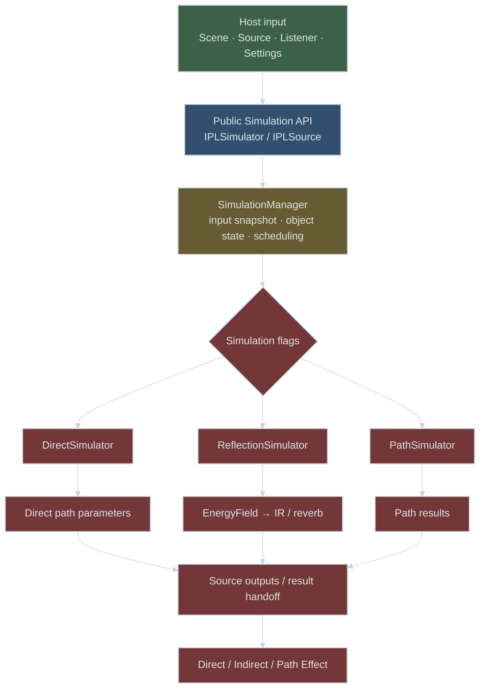
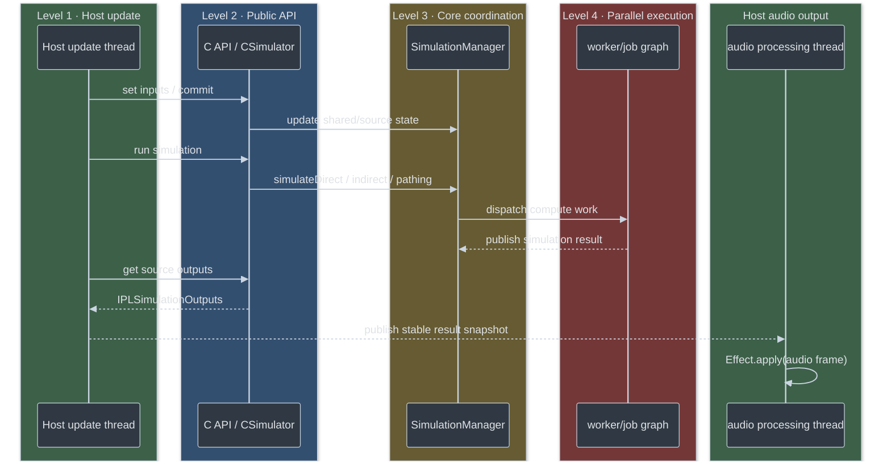

---

# 1. Simulation이 하는 일

Steam Audio Core의 Simulation은 Scene에서 음향이 어떻게 전파되는지 계산해 Effect가 사용할 **결과 데이터**를 만든다.
<strong style="color:#b3f594">Simulation</strong> 자체가 input PCM을 필터링하거나  출력 스피커 신호를 생성하는 것은 아니다. PCM을 처리하는 단계는
[[core_04_effect_overview|Effect & Rendering Overview]]에 설명되어 있다.

Core Simulation은 음향 문제의 성격에 따라 세 경로로 나뉜다.

- **<strong style="color:#b3f594">Direct (이미지 속 그 색상)</strong>** - **주요 질문:** 소스에서 리스너로 곧장 오는 소리가<br>얼마나
감쇠/차폐되는가? - **주 결과:** `IPLDirectEffectParams` / `DirectSoundPath` - **<strong style="color:#b3f594">Reflections</strong>** - **주요 질문:**
주변 표면에서 반사된 에너지가 <br>어떤 시간·방향·대역 분포를 갖는가? - **주 결과:** `EnergyField`, IR,
<strong style="color:#b3f594">reverb</strong> parameters  - **<strong style="color:#b3f594">Pathing</strong>** - **주요 질문:**
<strong style="color:#b3f594">probe</strong> 기반으로 우회 전파를 어떻게 표현하고 현재 위치에 맞출 것인가? - **주 결과:** path EQ/방향/지연 관련 데이터

최상위 안내: [[core_00_overview|Core 전체 구조와 문서 안내]] · 실제 코드 호출 순서: [[core_01_architecture_flow|Architecture Flow]]

---

# 2. 공통 처리 흐름



공통으로 중요한 데이터는 다음과 같다.

- <strong style="color:#b3f594">Scene</strong>
	- ray query와 재질을 제공
- <strong style="color:#b3f594">Source</strong>
	- 위치/방향 및 source별 모델 설정
- <strong style="color:#b3f594">Listener</strong>
	- 공유 위치/방향과 반사 simulation 설정을 제공
- <strong style="color:#b3f594">Probe Batch</strong>
	- bake data와 pathing에 필요한 공간 표본/연결 정보를 제공
- <strong style="color:#b3f594">Simulation outputs</strong>
	- <strong style="color:#b3f594">Effect</strong> 또는 후속 reconstruction 단계가 소비

`IPLSimulationFlags`는 어떤 큰 Simulation 종류를 실행/설정하는지 선택하고, `IPLDirectSimulationFlags`는
Direct 내부에서 어떤 모델을 계산할지 선택한다. 상위 flags와 하위 모델 flags는 서로 다른 축이다.

---

# 3. <strong style="color:#b3f594">Direct Simulation</strong>

## 3.1 계산 대상

Direct 경로는 source에서 listener로 곧바로 향하는 경로를 평가한다. 기본적으로 source/listener의 거리와 방향을
사용하고, 설정에 따라
<strong style="color:#b3f594">Scene</strong> ray query 및 material 특성을 더한다.

| 모델                                                          | 역할                                  | 값의 성격                       |
| ----------------------------------------------------------- | ----------------------------------- | --------------------------- |
| <strong style="color:#b3f594">Distance attenuation</strong> | 거리에 따른 전체 level 감소                  | scalar gain                 |
| <strong style="color:#b3f594">Air absorption</strong>       | 공기를 이동하며 생기는 대역별 감쇠                 | 대역별 gain                    |
| <strong style="color:#b3f594">Directivity</strong>          | Source orientation에 따른 <br>방사량 변화   | scalar 또는 custom model gain |
| <strong style="color:#b3f594">Occlusion</strong>            | 중간 geometry가 직접 경로를 <br>막는지 평가      | occlusion factor            |
| <strong style="color:#b3f594">Transmission</strong>         | 막힌 경로에서 표면을 통과하는 <br>대역별 성분         | 대역별 transmission            |
| <strong style="color:#b3f594">Delay</strong>                | source-listener 경로 길이에 따른 <br>전파 지연 | 시간/샘플 단위 parameter          |

모델들은 하나의 “볼륨 값”으로 합치기 전에 각자의 의미로 계산된다. 사용 여부는 source input flags와 시뮬레이션 설정에 의해
제어된다.

## 3.2 입력에서 결과까지

```text
IPLSimulationSharedInputs.listener
IPLSimulationInputs.source + models + directFlags
                         │
                         ▼
                 CSource::setInputs
                         │ IPL* → ipl::* conversion
                         ▼
                  DirectSimulator
       ┌─────────────────┼──────────────────┐
       ▼                 ▼                  ▼
 distance/direction   scene ray query   air absorption / directivity
       └─────────────────┴──────────────────┘
                         ▼
                    DirectSoundPath
                         ▼
              IPLSimulationOutputs.direct
```

`DirectSimulator`는 결과를 내부 `DirectSoundPath`에 기록한다. API wrapper의 `CSource::getOutputs`는
이 내부 객체를 `IPLSimulationOutputs::direct` 에 복사한다. 이 public struct는
`iplDirectEffectApply`의 parameter 타입과 동일해 Host가 바로 연결할 수 있다.

개념 및 구현 상세:

- [[detail/simulation/core_air_absorption|Air Absorption]]
- [[detail/dsp/core_direct_effect|DirectEffect: 결과를 샘플에 적용]]
- 구현 파일: `direct_simulator.*`, `distance_attenuation.*`, `air_absorption.*`, `directivity.*`, `deviation.*`

## 3.3 Direct는 언제 다시 계산해야 하나

source/listener 위치·방향이 달라지거나 geometry가 동적으로 바뀌면 Direct 결과도 달라질 수 있다.
Host는 엔진의 update 주기와 품질 요구에 따라 시뮬레이션 빈도를 결정한다. 특히 <strong style="color:#b3f594">occlusion</strong>/<strong style="color:#b3f594">transmission</strong> ray
query가 활성화된 호출은 audio callback에서 수행하지 않는다.

---

# 4. <strong style="color:#b3f594">Reflections</strong> Simulation

Reflections는 Scene 표면에 반사된 여러 경로의 에너지를 계산한다. 이 계산 결과는 단일 gain보다 훨씬 큰 시공간 데이터이므로
중간 표현인 `EnergyField`에 축적한 뒤 재생에 알맞은 형식으로 바꾼다.

```text
Scene + Material + Source + Listener/Probe
                 │
                 ▼
       ReflectionSimulator backend
                 │ trace rays / process surface hits
                 ▼
           EnergyField accumulation
                 │
          ┌──────┴──────┐
          ▼             ▼
   Reconstructor    ReverbEstimator
          │             │
          ▼             ▼
 ImpulseResponse   reverb parameters
          └──────┬──────┘
                 ▼
           IndirectEffect
```

EnergyField는 시간 구간, 주파수 대역, <strong style="color:#b3f594">Ambisonics</strong> 방향 채널로 반사 에너지를 보관한다. 이 중간 구조는 ray
simulation과 최종 재생 알고리즘을 분리한다. 같은 결과에서 <strong style="color:#b3f594">convolution</strong> IR이나 parametric reverb 계수를 만들
수 있다.

반사 ray simulation은 CPU/GPU 계산량이 클 수 있어 별도 worker thread에서 수행한다.
Probe data가 준비되어 있으면 baked reflections를 조회하는 경로도 가능하다. Runtime-only와 baked flow의
차이,
<strong style="color:#b3f594">EnergyField</strong>/IR/reverb 재구성은 [[core_05_reflections_reverb_overview|Reflections & Reverb Overview]]에서 별도로 설명한다.

---

# 5. <strong style="color:#b3f594">Pathing</strong> Simulation

Pathing은 주변 probe들을 통해 source에서 listener로 이어질 수 있는 우회 경로를 찾고 평가한다.
Baked path와 visibility 정보는 사전에 준비하고, runtime에서는 source/listener 주변의 probe
neighborhood와 현재 Scene 상태를 사용해 결과를 갱신한다.

```text
Probe Batch / baked connections
             │
Source position ──► source probe neighborhood
Listener position ─► listener probe neighborhood
             │
             ▼
       PathFinder / visibility checks
             │ selected probe paths
             ▼
         PathSimulator
             │ per-path gain, EQ, distance/direction data
             ▼
           PathEffect
```

동적 geometry로 bake된 경로가 가려진 경우 validation이나 alternate-path search를 설정할 수 있다.
따라서 Pathing은 단순히 bake data를 재생하는 단계만이 아니라, 저장 경로의 현재 유효성 확인과 fallback search를
포함할 수 있다.

Path 탐색 구조: [[detail/pathing/core_path_finder|PathFinder]] · 전체 흐름: [[core_06_pathing_overview|Pathing Overview]]

---

# 6. SimulationManager의 역할과 상태 경계

`SimulationManager`는 개별 음향 모델을 모두 구현하는 클래스가 아니라 여러 simulator와 상태 객체를 조정하는
orchestration 계층이다. 소유/관리 대상에는 Scene, ProbeManager, DirectSimulator,
ReflectionSimulator, Reconstructor, worker thread pool,
<strong style="color:#b3f594">JobGraph</strong>, 결과 buffer들이 포함된다.

대표 입력/실행 순서는 다음과 같다.

1. Scene과 probe batch를 설정한다.
2. source를 만들고 simulation flags로 등록한다.
3. shared listener input과 source별 input을 갱신한다.
4. 필요한 구조 변경은 commit하여 simulation에서 사용할 상태를 확정한다.
5. direct/reflections/pathing 계산을 실행한다.
6. 결과를 source output 또는 effect와 공유하는 결과 구조에 기록한다.
7. 오디오 처리 경로는 준비된 결과를 읽어 DSP를 수행한다.



`iplSimulatorCommit`은 Scene/probe batch 관계 변경을 확정하는 API다. Source input을 설정하는 함수와
역할이 다르다. 또 simulation result와 audio callback 사이의 안전한 handoff는 API를 호출하는 Host의
thread architecture와 함께 설계해야 한다. 자세한 객체와 method 순서는 [[core_01_architecture_flow#12.
SimulationManager: 세 경로를 묶는 중앙 조정자|SimulationManager 코드 흐름]]에서 확인한다.

---

# 7. Simulation과 Bake의 경계

Bake는 Scene/Probe처럼 상대적으로 정적인 정보를 바탕으로 경로/반사 정보를 미리 계산해 저장한다.
Runtime Simulation은 현재 source/listener와 Scene 상태를 반영한다.

| 데이터 | 주된 시점 | 설명 |
|---|---|---|
| Scene mesh/material | Scene 로드/변경 때 | ray query와 표면 음향 특성에 쓰인다. |
| Probe placement | Bake 또는 Scene 준비 때 | 공간을 표본화해 runtime lookup 범위를 만든다. |
| probe connectivity/visibility | Bake 가능 | 경로 탐색을 줄이기 위한 정적 관계 정보다. |
| baked reflection data | Bake 가능 | 위치별 반사 결과를 runtime에 조회한다. |
| source/listener transforms | Runtime | 움직이는 현재 위치와 방향을 반영한다. |
| dynamic geometry validation | Runtime | 문, 가구, 움직이는 객체 등으로 bake 경로가 변했는지 확인할 수 있다. |

Bake가 runtime 계산을 완전히 제거하지는 않는다. 적절한 위치의 bake data 조회, interpolation,
dynamic visibility validation 등이 남을 수 있다.

---

# 8. 주요 클래스와 파일 지도

- **public API simulation structs/functions** - **대표 구현:** phonon.h [링크](https://github.com/ValveSoftware/steam-audio/blob/v4.8.1/core/src/core/phonon.h),
phonon_interfaces.h [링크](https://github.com/ValveSoftware/steam-audio/blob/v4.8.1/core/src/core/phonon_interfaces.h) - **API input/output adapter** - **대표 구현:** `api_simulator.*`,
api_advanced_simulation.cpp [링크](https://github.com/ValveSoftware/steam-audio/blob/v4.8.1/core/src/core/api_advanced_simulation.cpp) - **per-source state** - **대표 구현:** `simulation_data.*` -
**orchestration** - **대표 구현:** `simulation_manager.*`, `job.*`, `job_graph.*`, `thread_pool.*`  - **direct
sound** - **대표 구현:** `direct_simulator.*`, `distance_attenuation.*`, `air_absorption.*`,
`directivity.*` - **reflections** -
**대표 구현:** `reflection_simulator.*`, `reflection_simulator_factory.*`  - **baked reflections** - **대표 구현:** `reflection_baker.*`,
`baked_reflection_*` - **energy representation** - **대표 구현:** `energy_field.*`,
`energy_field_factory.*` - **IR reconstruction** - **대표 구현:** `reconstructor.*`,
`impulse_response.*`, their factories - **reverb estimates**
- **대표 구현:** `reverb_estimator.*`, `hybrid_reverb_estimator.*`  - **pathing** - **대표 구현:** `path_finder.*`, `path_visibility.*`,
`path_simulator.*`

---
