---

# 1. 반사음과 잔향은 어떤 문제인가

소리가 벽이나 바닥에 부딪힌 뒤 리스너에게 도달하면 직접 경로와 다른 시간·방향·에너지의 
성분이 된다. 초기의 분리된 반사는 공간의 크기와 표면 배치를 드러내고, 이후 밀집한 반사 tail은
공간의 잔향감으로 인식된다.

Steam Audio Core는 이 과정을 단일 `reverb` 숫자로 계산하지 않는다. 
여러 반사 ray를 추적해 **시간·주파수·방향별 에너지**를 누적하고, 이후 IR 또는 잔향 parameter로
변환한다. 이 문서는 그 전체 흐름의 개념 지도다.

- 상위 구조 [[core_00_overview|Core Overview]] 
- Simulation 경계: [[core_03_simulation_overview|Simulation Overview]] 
- PCM 재생: [[core_04_effect_overview|Effect Overview]]

---

# 2. 전체 데이터 경로

```mermaid
%%{init: {"theme":"base","themeVariables":{"background":"#111827","darkMode":true,"primaryColor":"#3d6049","primaryTextColor":"#dfe2e6","primaryBorderColor":"#cbd5e1","secondaryColor":"#334f70","secondaryTextColor":"#dfe2e6","secondaryBorderColor":"#cbd5e1","tertiaryColor":"#665b32","tertiaryTextColor":"#dfe2e6","tertiaryBorderColor":"#cbd5e1","clusterBkg":"#743737","clusterBorder":"#cbd5e1","lineColor":"#cbd5e1","textColor":"#dfe2e6","nodeTextColor":"#dfe2e6","actorBkg":"#303943","actorBorder":"#cbd5e1","actorTextColor":"#dfe2e6","actorLineColor":"#cbd5e1","signalColor":"#cbd5e1","signalTextColor":"#dfe2e6","labelBoxBkgColor":"#743737","labelBoxBorderColor":"#cbd5e1","labelTextColor":"#dfe2e6","activationBkgColor":"#334f70","activationBorderColor":"#cbd5e1","noteBkgColor":"#665b32","noteBorderColor":"#cbd5e1","noteTextColor":"#dfe2e6"}}}%%
flowchart LR
    Geometry[Scene geometry + material]
    Probes[Source / Listener / Probe data]
    Config[Ray count · bounce count · duration · order]
    Sim[ReflectionSimulator]
    Energy[EnergyField<br/>time × band × direction]
    Reconstructor[Reconstructor]
    IR[ImpulseResponse]
    Estimator[ReverbEstimator / Hybrid estimator]
    Params[Reverb times · EQ · delay]
    Renderer{Indirect rendering mode}
    Conv[Convolution effect]
    Param[Parametric reverb effect]
    Hybrid[Hybrid reverb effect]
    Output[Indirect audio contribution]

    Geometry --> Sim
    Probes --> Sim
    Config --> Sim
    Sim --> Energy
    Energy --> Reconstructor --> IR
    Energy --> Estimator --> Params
    IR --> Renderer
    Params --> Renderer
    Renderer --> Conv --> Output
    Renderer --> Param --> Output
    Renderer --> Hybrid --> Output
    classDef level1 fill:#3d6049,stroke:#cbd5e1,color:#dfe2e6,stroke-width:1.5px;
    classDef level2 fill:#334f70,stroke:#cbd5e1,color:#dfe2e6,stroke-width:1.5px;
    classDef level3 fill:#665b32,stroke:#cbd5e1,color:#dfe2e6,stroke-width:1.5px;
    classDef level4 fill:#743737,stroke:#cbd5e1,color:#dfe2e6,stroke-width:1.5px;
    class Geometry,Probes,Config level1;
    class Sim level2;
    class Energy level3;
    class Reconstructor,IR,Estimator,Params,Renderer,Conv,Param,Hybrid,Output level4;
```



Simulation은 EnergyField를 생성한다. Reconstructor와 Estimator는 이 데이터를 
각 재생 전략에 맞는 표현으로 바꾼다. `IndirectEffect`와 하위 DSP가 실제 input audio를 
처리한다.

---

# 3. Reflection ray simulation

## 3.1 Ray가 누적하는 것

Reflection simulator는 listener를 기준으로 ray들을 공간에 분포시키고 표면과의 충돌을 추적한다.
표면에 도달하면 material absorption/scattering과 현재 ray의 누적 에너지, 이동 시간,
방향을 고려해 반사 결과를 만든다. 

각 ray의 에너지는 시간 bin과 방향 표현에 분배되어 EnergyField에 누적된다.
개념적으로 한 bounce에서 에너지에 관여하는 항은 다음과 같다.

```text
다음 bounce의 에너지
  = 현재 ray 에너지
  × 표면에서 살아남은 반사 비율
  × 거리/전파 관련 계수
  × 방향/샘플링 가중치
```

재질의 absorption은 표면에 도달한 에너지 중 흡수되는 부분을 나타낸다. 
scattering은 반사 에너지가 어느 방향으로 분배되는지에 영향을 준다. 
Air absorption은 표면 반사와 다른 현상으로, 공기를 이동하는 동안 대역별 에너지를 줄인다.

## 3.2 Ray 수와 bounce 수

- `numRays`가 많아지면 방향/시간 샘플링 오차가 줄 수 있지만 계산량이 증가한다.
- `numBounces`가 많아지면 더 긴 경로와 잔향 tail을 반영할 수 있지만 실행 비용도 커진다.
- `duration`은 결과 IR의 최대 길이에 영향을 준다.
- `order`는 Ambisonic 방향 표현의 정밀도와 관련된다.
- material과 ray distribution은 반사 에너지와 공간적 균일도에 영향을 준다.

<strong style="color:#ffb15b">값을 늘린다고 모든 장면에서 체감 품질이 같은 비율로 좋아지는 것은 아니다.</strong> 
장면 크기와 반사 특성, CPU/GPU 예산, 사용할 재생 방식에 맞춰 정한다.

---

# 4. <strong style="color:#b3f594">EnergyField</strong>: 시뮬레이션과 재생 사이의 중간 표현

EnergyField는 reflected energy를 bin 단위로 누적한다. 여러 축을 유지한다.

| 축 | 의미 |
|---|---|
| Time bin | 반사가 도달하는 시간 범위 |
| Frequency band | 대역별 흡수와 에너지 차이 |
| Ambisonics/channel order | 방향에 따른 분포 |
| Source/probe context | 어느 입력/공간 지점의 결과인지 |

중간 표현을 쓰면 <strong style="color:#b3f594">ray tracing</strong> backend가 최종 <strong style="color:#b3f594">convolution</strong> 구현을 몰라도 되고,
reconstruction/estimation은 ray tracing 구현을 직접 소유하지 않아도 된다.
또한 CPU와 GPU backend가 공통 개념의 결과 자료를 생성할 수 있다.


```text
Reflection backend details
        │
        ▼
    EnergyField (shared semantic result)
        ├─► reconstruct IR
        ├─► estimate decay/reverb
        └─► transfer/copy to another backend for processing
```

---

# 5. Baked reflections와 Runtime <strong style="color:#b3f594">reflections</strong>

반사 계산은 비쌀 수 있으므로 Core는 bake된 data를 사용할 수 있다. 
Bake에서는 특정 <strong style="color:#b3f594">probe</strong> 위치/identifier와 연결된 반사 결과를 사전에 계산해 저장한다. 
Runtime에서는 source/listener의 현재 위치와 설정을 보고 해당 결과를 조회하거나
simulation을 실행한다.

| 경로 | 계산 시점 | Runtime에서 필요한 일 |
|---|---|---|
| Real-time reflections | 게임 실행 중 | 매 실행 시 ray simulation과 에너지 결과 생성 |
| Baked reflections | 오프라인/콘텐츠 빌드 | probe/baked identifier에 맞는 저장 데이터 lookup 및 적절한 결과 사용 |
| Mixed/hybrid workflow | 일부는 미리 계산, 일부는 runtime 검증/갱신 | 움직이는 입력과 정적 공간 정보 결합 |

Bake는 source/listener가 어디로 움직여도 하나의 결과를 그대로 재생한다는 뜻이 아니다. 
probe placement, baked layer identifier, data lookup/interpolation, <strong style="color:#b3f594">scene</strong> version 변화 등 
별도 조건이 사용된다. 

Bake lifecycle 관련
- `reflection_baker.*`
- `baked_reflection_data.*` 
- `baked_reflection_simulator.*

---

# 6. EnergyField에서 IR과 Reverb로

## 6.1 Impulse Response 복원

`Reconstructor`는 EnergyField의 시간·방향·대역 분포를 
impulse response sample sequence로 복원한다. IR은 입력 신호와 convolution할 수 있는
시간영역 응답이다. 방향 채널이 포함되면 단순 mono response보다 공간적인 방향
변화도 표현할 수 있다.

```text
EnergyField bins
    │ time-domain reconstruction / normalization / filtering
    ▼
ImpulseResponse samples
    │ partition for efficient convolution
    ▼
Overlap-save / overlap-add convolution input
```

## 6.2 Parametric <strong style="color:#b3f594">reverb</strong> 추정

`ReverbEstimator` 계열은 EnergyField의 decay를 분석해 
대역별 decay time 및 관련 파라미터를 추정한다. Parametric reverb effect는 긴 공간 반응을 
무한 길이 IR처럼 저장하지 않고, filter/delay 기반 DSP로 잔향 tail을 생성한다.

IR 복원과 parametric reverb 추정은 같은 EnergyField를 사용하지만 목적과 
output representation이 다르다.

## 6.3 Hybrid 방식

Hybrid reverb는 앞부분의 중요한 반사를 convolution으로 재생하고, 
이후 긴 tail은 parametric reverb로 잇는다.

```text
time 0 ─────────────── transition ───────────────────► tail
       convolution IR       crossfade                 parametric reverb
       초기 반사 detail     경계 부드럽게             긴 decay를 효율적으로 생성
```

Transition time과 overlap은 어느 구간을 convolution으로 유지하고 어디서 
parametric tail과 섞을지 결정한다. 
이 설정은 정확도와 CPU/memory 부담의 균형을 바꾼다.

---

# 7. Convolution implementation과 Thread handoff

긴 IR을 매 sample마다 직접 convolution 하면 비용이 커진다.
<strong style="color:#b3f594">Core의 convolution 구현</strong>은  <strong style="color:#b3f594">FFT/partitioned processing</strong>으로 계산을 나누고
platform FFT backend와 CPU/GPU 처리 경로를 선택할 수 있다.

IR 생성이나 partition 갱신은 audio callback에서 긴 시간을 점유하지 않도록 별도 
계산 흐름에 둘 수 있다. 새 impulse response partition을 audio effect가 읽는 쪽으로 
넘길 때는 read/write buffer 교환 경계가 필요하다.

```text
simulation/reconstruction thread
   └─ create IR → partition → publish completed buffer
                                          │ swap/commit
audio processing thread                    ▼
   └─ read stable partition → convolution → output frame
```

`TripleBuffer` 등은 writer와 reader가 서로의 작업 중인 버퍼를 동시에 덮어쓰지 않도록 
데이터 를 교환하는 데 사용된다.
정확한 handoff sequence는 [[core_01_architecture_flow#12.4 Reflection 결과 전달|Reflection
결과 전달 흐름]]에서 확인한다.

---

# 8. 구현 파일 지도

<strong style="color:#b3f594">Reflection runtime과 backend 선택</strong>

- reflection_simulator.h [링크](https://github.com/ValveSoftware/steam-audio/blob/v4.8.1/core/src/core/reflection_simulator.h) / reflection_simulator.cpp [링크](https://github.com/ValveSoftware/steam-audio/blob/v4.8.1/core/src/core/reflection_simulator.cpp)
- reflection_simulator_factory.h [링크](https://github.com/ValveSoftware/steam-audio/blob/v4.8.1/core/src/core/reflection_simulator_factory.h) / reflection_simulator_factory.cpp [링크](https://github.com/ValveSoftware/steam-audio/blob/v4.8.1/core/src/core/reflection_simulator_factory.cpp)

<strong style="color:#b3f594">Built-in CPU / BVH reflection</strong>

- bvh.h [링크](https://github.com/ValveSoftware/steam-audio/blob/v4.8.1/core/src/core/bvh.h) / bvh.cpp [링크](https://github.com/ValveSoftware/steam-audio/blob/v4.8.1/core/src/core/bvh.cpp)

<strong style="color:#b3f594">Embree CPU / ISPC</strong>

- embree_reflection_simulator.h [링크](https://github.com/ValveSoftware/steam-audio/blob/v4.8.1/core/src/core/embree_reflection_simulator.h) / embree_reflection_simulator.cpp [링크](https://github.com/ValveSoftware/steam-audio/blob/v4.8.1/core/src/core/embree_reflection_simulator.cpp)
- embree_reflection_simulator.ispc [링크](https://github.com/ValveSoftware/steam-audio/blob/v4.8.1/core/src/core/embree_reflection_simulator.ispc)

<strong style="color:#b3f594">Radeon Rays / OpenCL</strong>

- radeonrays_reflection_simulator.h [링크](https://github.com/ValveSoftware/steam-audio/blob/v4.8.1/core/src/core/radeonrays_reflection_simulator.h) / radeonrays_reflection_simulator.cpp [링크](https://github.com/ValveSoftware/steam-audio/blob/v4.8.1/core/src/core/radeonrays_reflection_simulator.cpp)
- radeonrays_reflection_simulator.cl [링크](https://github.com/ValveSoftware/steam-audio/blob/v4.8.1/core/src/core/radeonrays_reflection_simulator.cl)

<strong style="color:#b3f594">Baked reflection 생성과 재생</strong>

- reflection_baker.h [링크](https://github.com/ValveSoftware/steam-audio/blob/v4.8.1/core/src/core/reflection_baker.h) / reflection_baker.cpp [링크](https://github.com/ValveSoftware/steam-audio/blob/v4.8.1/core/src/core/reflection_baker.cpp)
- baked_reflection_data.h [링크](https://github.com/ValveSoftware/steam-audio/blob/v4.8.1/core/src/core/baked_reflection_data.h) / baked_reflection_data.cpp [링크](https://github.com/ValveSoftware/steam-audio/blob/v4.8.1/core/src/core/baked_reflection_data.cpp)
- baked_reflection_data.fbs [링크](https://github.com/ValveSoftware/steam-audio/blob/v4.8.1/core/src/core/baked_reflection_data.fbs)
- baked_reflection_simulator.h [링크](https://github.com/ValveSoftware/steam-audio/blob/v4.8.1/core/src/core/baked_reflection_simulator.h) / baked_reflection_simulator.cpp [링크](https://github.com/ValveSoftware/steam-audio/blob/v4.8.1/core/src/core/baked_reflection_simulator.cpp)

<strong style="color:#b3f594">EnergyField 저장</strong>

- energy_field.h [링크](https://github.com/ValveSoftware/steam-audio/blob/v4.8.1/core/src/core/energy_field.h) / energy_field.cpp [링크](https://github.com/ValveSoftware/steam-audio/blob/v4.8.1/core/src/core/energy_field.cpp)
- energy_field_factory.h [링크](https://github.com/ValveSoftware/steam-audio/blob/v4.8.1/core/src/core/energy_field_factory.h) / energy_field_factory.cpp [링크](https://github.com/ValveSoftware/steam-audio/blob/v4.8.1/core/src/core/energy_field_factory.cpp)
- energy_field.fbs [링크](https://github.com/ValveSoftware/steam-audio/blob/v4.8.1/core/src/core/energy_field.fbs)
- opencl_energy_field.h [링크](https://github.com/ValveSoftware/steam-audio/blob/v4.8.1/core/src/core/opencl_energy_field.h) / opencl_energy_field.cpp [링크](https://github.com/ValveSoftware/steam-audio/blob/v4.8.1/core/src/core/opencl_energy_field.cpp)

<strong style="color:#b3f594">Impulse Response 저장</strong>

- impulse_response.h [링크](https://github.com/ValveSoftware/steam-audio/blob/v4.8.1/core/src/core/impulse_response.h) / impulse_response.cpp [링크](https://github.com/ValveSoftware/steam-audio/blob/v4.8.1/core/src/core/impulse_response.cpp)
- impulse_response_factory.h [링크](https://github.com/ValveSoftware/steam-audio/blob/v4.8.1/core/src/core/impulse_response_factory.h) / impulse_response_factory.cpp [링크](https://github.com/ValveSoftware/steam-audio/blob/v4.8.1/core/src/core/impulse_response_factory.cpp)
- opencl_impulse_response.h [링크](https://github.com/ValveSoftware/steam-audio/blob/v4.8.1/core/src/core/opencl_impulse_response.h) / opencl_impulse_response.cpp [링크](https://github.com/ValveSoftware/steam-audio/blob/v4.8.1/core/src/core/opencl_impulse_response.cpp)

<strong style="color:#b3f594">IR reconstruction</strong>

- reconstructor.h [링크](https://github.com/ValveSoftware/steam-audio/blob/v4.8.1/core/src/core/reconstructor.h) / reconstructor.cpp [링크](https://github.com/ValveSoftware/steam-audio/blob/v4.8.1/core/src/core/reconstructor.cpp)
- reconstructor_factory.h [링크](https://github.com/ValveSoftware/steam-audio/blob/v4.8.1/core/src/core/reconstructor_factory.h) / reconstructor_factory.cpp [링크](https://github.com/ValveSoftware/steam-audio/blob/v4.8.1/core/src/core/reconstructor_factory.cpp)
- opencl_reconstructor.h [링크](https://github.com/ValveSoftware/steam-audio/blob/v4.8.1/core/src/core/opencl_reconstructor.h) / opencl_reconstructor.cpp [링크](https://github.com/ValveSoftware/steam-audio/blob/v4.8.1/core/src/core/opencl_reconstructor.cpp)

<strong style="color:#b3f594">Decay estimation</strong>

- reverb_estimator.h [링크](https://github.com/ValveSoftware/steam-audio/blob/v4.8.1/core/src/core/reverb_estimator.h) / reverb_estimator.cpp [링크](https://github.com/ValveSoftware/steam-audio/blob/v4.8.1/core/src/core/reverb_estimator.cpp)
- hybrid_reverb_estimator.h [링크](https://github.com/ValveSoftware/steam-audio/blob/v4.8.1/core/src/core/hybrid_reverb_estimator.h) / hybrid_reverb_estimator.cpp [링크](https://github.com/ValveSoftware/steam-audio/blob/v4.8.1/core/src/core/hybrid_reverb_estimator.cpp)

<strong style="color:#b3f594">Reverb와 convolution DSP</strong>

- indirect_effect.h [링크](https://github.com/ValveSoftware/steam-audio/blob/v4.8.1/core/src/core/indirect_effect.h) / indirect_effect.cpp [링크](https://github.com/ValveSoftware/steam-audio/blob/v4.8.1/core/src/core/indirect_effect.cpp)
- reverb_effect.h [링크](https://github.com/ValveSoftware/steam-audio/blob/v4.8.1/core/src/core/reverb_effect.h) / reverb_effect.cpp [링크](https://github.com/ValveSoftware/steam-audio/blob/v4.8.1/core/src/core/reverb_effect.cpp)
- hybrid_reverb_effect.h [링크](https://github.com/ValveSoftware/steam-audio/blob/v4.8.1/core/src/core/hybrid_reverb_effect.h) / hybrid_reverb_effect.cpp [링크](https://github.com/ValveSoftware/steam-audio/blob/v4.8.1/core/src/core/hybrid_reverb_effect.cpp)
- overlap_add_convolution_effect.h [링크](https://github.com/ValveSoftware/steam-audio/blob/v4.8.1/core/src/core/overlap_add_convolution_effect.h) / overlap_add_convolution_effect.cpp [링크](https://github.com/ValveSoftware/steam-audio/blob/v4.8.1/core/src/core/overlap_add_convolution_effect.cpp)
- overlap_save_convolution_effect.h [링크](https://github.com/ValveSoftware/steam-audio/blob/v4.8.1/core/src/core/overlap_save_convolution_effect.h) / overlap_save_convolution_effect.cpp [링크](https://github.com/ValveSoftware/steam-audio/blob/v4.8.1/core/src/core/overlap_save_convolution_effect.cpp)
- tan_convolution_effect.h [링크](https://github.com/ValveSoftware/steam-audio/blob/v4.8.1/core/src/core/tan_convolution_effect.h) / tan_convolution_effect.cpp [링크](https://github.com/ValveSoftware/steam-audio/blob/v4.8.1/core/src/core/tan_convolution_effect.cpp)
- float8_reverb_effect.cpp [링크](https://github.com/ValveSoftware/steam-audio/blob/v4.8.1/core/src/core/float8_reverb_effect.cpp)
- fft.h [링크](https://github.com/ValveSoftware/steam-audio/blob/v4.8.1/core/src/core/fft.h)
- ffts_fft.cpp [링크](https://github.com/ValveSoftware/steam-audio/blob/v4.8.1/core/src/core/ffts_fft.cpp) / ipp_fft.cpp [링크](https://github.com/ValveSoftware/steam-audio/blob/v4.8.1/core/src/core/ipp_fft.cpp)
- pffft_fft.cpp [링크](https://github.com/ValveSoftware/steam-audio/blob/v4.8.1/core/src/core/pffft_fft.cpp) / vdsp_fft.cpp [링크](https://github.com/ValveSoftware/steam-audio/blob/v4.8.1/core/src/core/vdsp_fft.cpp)

<strong style="color:#b3f594">Reflection 관련 C API wrapper</strong>

- api_indirect_effect.h [링크](https://github.com/ValveSoftware/steam-audio/blob/v4.8.1/core/src/core/api_indirect_effect.h) / api_indirect_effect.cpp [링크](https://github.com/ValveSoftware/steam-audio/blob/v4.8.1/core/src/core/api_indirect_effect.cpp)
- api_energy_field.h [링크](https://github.com/ValveSoftware/steam-audio/blob/v4.8.1/core/src/core/api_energy_field.h) / api_energy_field.cpp [링크](https://github.com/ValveSoftware/steam-audio/blob/v4.8.1/core/src/core/api_energy_field.cpp)
- api_impulse_response.h [링크](https://github.com/ValveSoftware/steam-audio/blob/v4.8.1/core/src/core/api_impulse_response.h) / api_impulse_response.cpp [링크](https://github.com/ValveSoftware/steam-audio/blob/v4.8.1/core/src/core/api_impulse_response.cpp)
- api_reconstructor.h [링크](https://github.com/ValveSoftware/steam-audio/blob/v4.8.1/core/src/core/api_reconstructor.h) / api_reconstructor.cpp [링크](https://github.com/ValveSoftware/steam-audio/blob/v4.8.1/core/src/core/api_reconstructor.cpp)
- api_probes.h [링크](https://github.com/ValveSoftware/steam-audio/blob/v4.8.1/core/src/core/api_probes.h) / api_probes.cpp [링크](https://github.com/ValveSoftware/steam-audio/blob/v4.8.1/core/src/core/api_probes.cpp)
- api_simulator.h [링크](https://github.com/ValveSoftware/steam-audio/blob/v4.8.1/core/src/core/api_simulator.h) / api_simulator.cpp [링크](https://github.com/ValveSoftware/steam-audio/blob/v4.8.1/core/src/core/api_simulator.cpp)
- api_baking.cpp [링크](https://github.com/ValveSoftware/steam-audio/blob/v4.8.1/core/src/core/api_baking.cpp) / api_advanced_simulation.cpp [링크](https://github.com/ValveSoftware/steam-audio/blob/v4.8.1/core/src/core/api_advanced_simulation.cpp)

<strong style="color:#b3f594">Reflection 데이터와 handoff</strong>

- reverb.fbs [링크](https://github.com/ValveSoftware/steam-audio/blob/v4.8.1/core/src/core/reverb.fbs)
- triple_buffer.h [링크](https://github.com/ValveSoftware/steam-audio/blob/v4.8.1/core/src/core/triple_buffer.h)

---
