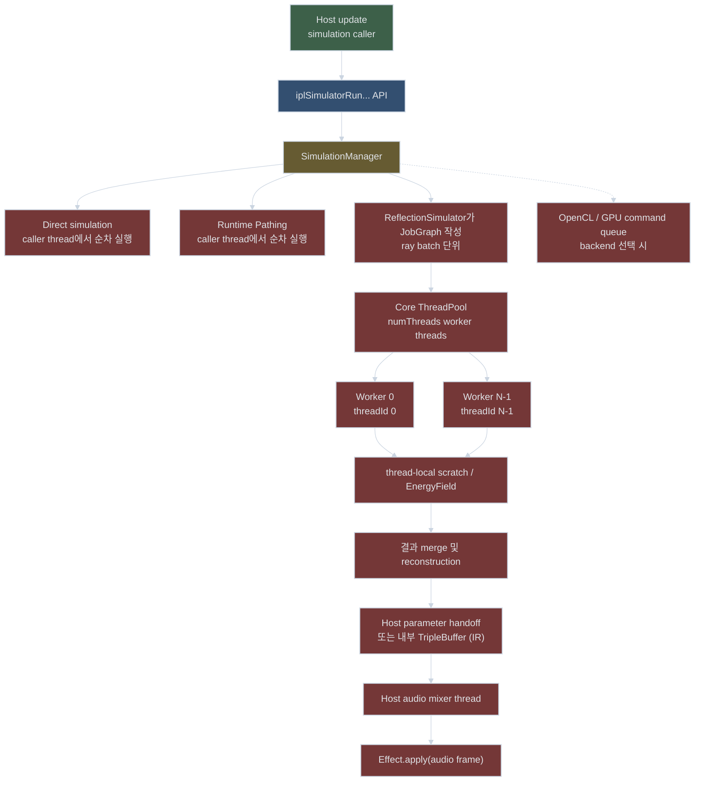

---

# 1. 목적과 확인 범위

이 문서는 Steam Audio Core의 multi-threading 구조를 소스 기준으로 정리한다. 
핵심은 “Core는 multi-threaded인가?”라는 단일 질문이 아니라, 
<strong style="color:#ffb15b">어떤 작업이 내부 worker pool로 나뉘는가</strong>
<strong style="color:#ffb15b">어떤 함수는 caller thread에서 동기 실행되는가</strong>
<strong style="color:#ffb15b">결과는 audio thread로 어떻게 넘어가는가</strong>
분리해서 확인하는 것이다.

검토 범위는 로컬 source의 `core/src/core/`와 공개 API 문서(phonon.h [링크](https://github.com/ValveSoftware/steam-audio/blob/v4.8.1/core/src/core/phonon.h),
`core/doc/integration.rst`, `core/doc/guide.rst`)다. 
명확히 확인한 코드 동작과, backend 내부까지는 아직 단정하지 않는 부분을 나눠 적었다.

- 상위 안내 - [[core_00_overview|Core Overview]] 
- <strong style="color:#b3f594">Simulation</strong> - [[core_03_simulation_overview|Simulation Overview]] ·
- <strong style="color:#b3f594">Effect</strong> - [[core_04_effect_overview|Effect Overview]]

---

# 2. 먼저 구분할 실행 모델 네 가지

| 종류                  | 무엇이 병렬인가                                              | Core에서 확인한 예                                          |
| ------------------- | ----------------------------------------------------- | ----------------------------------------------------- |
| Host threads        | 엔진이 update, simulation, audio mixer 일을 다른 thread에서 호출 | Host가 Direct/Reflections/Pathing 결과를 audio thread에 전달 |
| Core CPU ThreadPool | Core가 `std::thread` worker를 만들고 job을 여러 worker에 배분    | 실시간 Reflections, Reflection Bake, Path Bake           |
| GPU command queue   | CPU가 GPU kernel/복사 명령을 OpenCL queue에 넣고 GPU가 실행       | Radeon Rays 및 OpenCL reflection/reconstruction path   |
| SIMD                | 한 CPU 명령이 여러 float lane을 한 번에 계산                      | SSE/AVX/NEON; 이것만으로 별도 thread가 생기는 것은 아님              |

SIMD는 data-level parallelism이고 ThreadPool은 thread-level parallelism이다.
GPU queue는 또 다른 execution domain이다.  이 세 가지를 모두 “Core가 thread를 쓴다”고 
한데 묶으면 호출 주체와 동기화 시점을 놓치게 된다.

---

# 3. 전체 thread 구조



그림에서 `iplSimulatorRunReflections`를 호출한 thread는 Core worker pool과 별개다.
Core가 worker들을 깨워 ray jobs를 처리하는 동안 `ThreadPool::process()`는 
호출 thread를 완료 condition에서 대기시킨다. 
즉 Core가 여러 worker를 쓰더라도 public API 호출 자체는 보통 **동기/blocking 호출**이다.

---

# 4. Core ThreadPool은 어떻게 동작하는가

## 4.1 Worker 생성과 수명

`ThreadPool` 생성자는 전달된 `numThreads` 수만큼 `std::thread`를 만들고, 각 thread는
`threadFunc(threadId)`에 진입해 대기한다. 
작업마다 새 thread를 만드는 구조가 아니라, Pool 수명 동안 worker를 재사용한다.

실제 코드: thread_pool.cpp [링크](https://github.com/ValveSoftware/steam-audio/blob/v4.8.1/core/src/core/thread_pool.cpp)

``` cpp fold title:Steam Audio C++
ThreadPool::ThreadPool(int numThreads)
    : mThreads(numThreads)
    , mCancel(false)
    , mReady(0)
    , mCompleted(0)
    , mJobsCompleted(0)
    , mQuit(false)
    , mJobGraph(nullptr)
{
    for (auto i = 0; i < numThreads; ++i)
    {
        // worker 한 개를 만들고 thread id를 전달한다.
        mThreads[i] = std::move(std::thread(&ThreadPool::threadFunc, this, i));
    }
}
```

`SimulationManager`는 Reflections가 활성화된 경우 설정의 `numThreads`로 ThreadPool을 
생성한다. Reflection/Path Bake API도 각각 bake 설정의 `numThreads`로 별도 
local ThreadPool을 만든다.

## 4.2 Caller가 job graph를 제출하고 대기

``` cpp fold title:Steam Audio C++
void ThreadPool::process(JobGraph& jobGraph)
{
    mJobGraph = &jobGraph;
    std::unique_lock<std::mutex> lock(mMutex);
    mReady = static_cast<int>(mThreads.size(0));
    mCompleted = 0;
    mJobsCompleted = 0;

    // 모든 worker를 깨운 뒤, worker 수만큼 완료될 때까지 caller는 대기한다.
    mCondVarReady.notify_all();
    mCondVarComplete.wait(lock, [this]() {
        return (mCompleted == mThreads.size(0));
    });
}
```

이 때문에 `ThreadPool::process()`를 audio thread에서 호출하면 
worker computation이 병렬이어도 audio thread는 완료될 때까지 막힌다. 
병렬 처리와 non-blocking 호출은 같은 뜻이 아니다.

## 4.3 Worker는 atomic index로 다음 job을 가져온다

`JobGraph`는 먼저 job들을 추가해 두고, 여러 worker가 `processNextJob()`을 호출해 
다음 job index를 가져가는 간단한 shared queue다. 
이 구현은 dependency edge를 실행하는 복잡한 DAG scheduler가 아니라,
준비된 callback 목록을 worker들이 나눠 수행하는 job list에 가깝다.

``` cpp fold title:Steam Audio C++
bool JobGraph::processNextJob(int threadId, std::atomic<bool>& cancel)
{
    auto jobQueueSize = static_cast<int>(mJobs.size());
    if (jobQueueSize == 0 || mJobConsumerIndex >= jobQueueSize - 1)
        return false;

    // atomic index로 worker별 서로 다른 callback을 가져온다.
    auto consumerIndex = ++mJobConsumerIndex;
    if (consumerIndex < jobQueueSize)
    {
        mJobs[consumerIndex].process(threadId, cancel);
    }
    return true;
}
```

각 callback에는 `threadId`와 cancellation atomic reference가 전달된다. 
Reflection code는 `threadId`로 thread별 scratch state를 선택한다.

`JobGraph` 주석은 job을 처리하기 전에 목록 전체를 추가하는 producer-one/consumer-many 
모델이라고 설명한다. 따라서 worker가 이미 실행 중일 때 graph를 동적으로 수정하는 
scheduler로 보지 않는다.

## 4.4 Cancellation은 강제 thread 종료가 아니다

`ThreadPool::cancel()`은 atomic cancel flag를 설정한다. 
Worker가 현재 callback을 즉시 죽이는 것이 아니라, callback이 받은 flag를 확인하거나 
callback이 끝난 뒤 worker loop가 취소 상태를 확인하는 방식이다.
따라서 취소 응답 시간은 현재 실행 중인 job이 flag를 얼마나 자주 확인하는지에 달려 있다.

Bake 경로는 progress/cancel API를 제공한다. 
`ThreadPool::process(jobGraph,progressFn)`은 caller가 대기 중인 동안 진행률 callback을 
호출해 진행 상태를 전달할 수 있다.
UI callback은 그 호출 thread에서 실행된다는 <strong style="color:#b3f594">ThreadPool</strong> 주석에 유의한다.

---

# 5. 어느 작업이 실제로 Core thread를 쓰는가

<strong style="color:#b3f594">Runtime Direct Simulation</strong> 
- `SimulationManager::simulateDirect()`가 source 목록을 순회하며
  `DirectSimulator::simulate()`를 직접 호출
- manager 경로에는 `ThreadPool`/`JobGraph` 제출이 없어 caller thread에서 순차 실행

<strong style="color:#b3f594">Runtime Reflections</strong> 
- `simulateRealTimeReflections()`가 reflection simulator에 ray-batch jobs를 추가한 뒤
   `mThreadPool->process(mJobGraph)`를 호출
- Core CPU worker들이 병렬로 처리하고, 호출 thread는 전체 pool 작업이 끝날 때까지 대기

<strong style="color:#b3f594">Reflection 후속 단계</strong> 
- ray 작업이 끝나면 manager가 reconstruction, reverb, estimation, IR partition 
  단계를 순서대로 실행
- 확인한 `SimulationManager` 경로에서는 이 단계들을 같은 ThreadPool JobGraph에 
  추가하지  않음 OpenCL/TAN backend에는 별도 GPU 경로가 있을 수 있음

<strong style="color:#b3f594">Runtime Pathing</strong> 
- `SimulationManager::simulatePathing()`가 source별 neighborhood/query를 수행
- `PathSimulator::findPaths()`를 직접 호출. 
- 이 manager 경로에는 ThreadPool 제출이 없어 caller thread에서 동기 계산

<strong style="color:#b3f594">Reflection Bake</strong> 
- `ReflectionBaker::bake()`가 local `ThreadPool(numThreads)`를 만들어 
  reflection ray-batch jobs를 실행
- 이는 offline 작업이며 Bake API는 한 번에 bake 하나만 진행하도록 제한

<strong style="color:#b3f594">Path Bake</strong> 
- `PathBaker::bake()`의 local ThreadPool이 visibility graph 작성
- probe 시작점별 shortest-path 계산을 병렬 수행
- `PathFinder`는 worker마다 부모/비용 배열과 priority queue scratch

<strong style="color:#b3f594">Scene Commit</strong> 
- Scene geometry 변경을 반영
- -Public API는 어떤 simulation 함수와도 동시에 호출하지 말도록 규정

<strong style="color:#b3f594">Effect apply</strong> 
- effect는 per-frame AudioBuffer를 처리한다. 
- 확인한 Core 경로에서는 `apply`를 별도 ThreadPool에 제출하지 않으며, 
  Host audio processing thread에서 호출.
- 결과 parameter 전달과 특정 GPU effect의 실행 규칙은 Host/backend integration에 위임

> [!warning] ThreadPool 경로와 API 사용 제약을 구분
> 
> Runtime Direct Simulation과 Pathing의 Core manager 경로에는 worker pool 제출이 없다.
>  Reflection runtime과 bake는 job을 pool에 제출한다. 
>  <strong style="color:#b3f594">Occlusion</strong>/transmission이 켜진 direct simulation은
>  audio thread에서 호출하지 말라는 API 제약도 별도로 적용된다.

## 5.1 코드에서 확인되는 dispatch 경계

### Direct: source loop에서 직접 계산

simulation_manager.cpp [링크](https://github.com/ValveSoftware/steam-audio/blob/v4.8.1/core/src/core/simulation_manager.cpp)의 runtime Direct 경로는 source 목록을 순회해 
계산 함수를 부른다.

``` cpp fold title:Steam Audio C++
void SimulationManager::simulateDirect()
{
    for (auto& source : mSourceData[0])
    {
        simulateDirect(*source);
    }
}
```

이 함수 안에서 JobGraph를 만들거나 ThreadPool을 호출하지 않는다.

### <strong style="color:#b3f594">Reflections</strong>: JobGraph를 만든 뒤 pool에 제출

`simulateRealTimeReflections()`는 reflection backend에 job을 추가하도록 요청한 뒤,
`mThreadPool->process()`로 실행한다.

``` cpp fold title:Steam Audio C++
mJobGraph.reset();
mReflectionSimulator->simulate(*mScene, static_cast<int>(mRealTimeSources.size()),
                               mRealTimeSources.data(), 1,
                               &mSharedData->reflection.listener,
                               mRealTimeDirectivities.data(),
                               mSharedData->reflection.numRays,
                               mSharedData->reflection.numBounces,
                               mSharedData->reflection.duration,
                               mSharedData->reflection.order,
                               mSharedData->reflection.irradianceMinDistance,
                               mRealTimeEnergyFields.data(), mJobGraph);
mThreadPool->process(mJobGraph); // caller waits until all workers finish
accumulateEnergyFields();
```

`ReflectionSimulator::simulate()` 및 backend 구현에서 ray batches를 
`jobGraph.addJob(...)`으로 나눈다. 
ThreadPool의 worker가 callback을 실행하고 끝난 뒤, manager는 에너지 누적 후속 작업을 
진행한다.

### Runtime <strong style="color:#b3f594">Pathing</strong>: 직접 findPaths 호출

simulation_manager.cpp [링크](https://github.com/ValveSoftware/steam-audio/blob/v4.8.1/core/src/core/simulation_manager.cpp)의 `SimulationManager::simulatePathing()`는 
source별 probe neighborhood를 준비한 뒤 `PathSimulator::findPaths(...)`를 
호출해 결과를 기록한다. 
이 runtime manager method에도 <strong style="color:#b3f594">JobGraph</strong> 또는 ThreadPool 제출이 없다. 
Pathing은 caller가 별도 thread에 배치할 수 있지만, Core의 이 method가 자체 
worker pool을 시작하지는 않는다.

## 5.2 Direct가 자동으로 병렬화되지 않는 점

`SimulationManager`가 모든 simulation 유형을 같은 worker pool에 넣지는 않는다.
현재 확인한 `simulateDirect()`는 source별 for-loop이고, 각 source의 계산은 
`DirectSimulator::simulate()`에서 끝난다. 
사용자가 `iplSimulatorRunDirect`를 어느 thread에서 호출하는지는 Host의 결정이다.

Public guide는 direct occlusion이 source 이동 직후 바로 반영되어야 하는 경우 
main update thread에서 실행하는 선택지도 제시한다. 
다만 Core API는 occlusion/transmission을 켠 direct run을 audio processing thread에서 
호출하지 말라고 한다. 
결국 Host는 최신성, main-thread frame cost, audio deadline 사이에서 실행 위치를
선택해야 한다.

## 5.3 Runtime Pathing과 Path Bake는 별개다

**Runtime Pathing**:
- baked path 정보를 사용해 현재 source/listener에 맞는 경로를 평가
- 확인한 `SimulationManager` 호출은 순차적이며, API 문서가 별도 thread 실행을 권장

**Path Bake**
- 모든 probe pair visibility 및 probe 시작점별 shortest paths 계산을 대량 job으로 나누고 
  Core ThreadPool로 병렬화한다.

`PathFinder` 
- 생성자에 `numThreads`가 들어가는 이유는 주로 bake job들의 worker별 
  scratch storage를 미리 확보
- 이것만 보고 runtime Pathing도 자동 병렬이라고 결론 내리면 안됨

---

# 6. Reflection ray batch가 안전하게 합쳐지는 방식

Real-time reflection simulation은 ray 수를 batch 크기로 나누어 job을 만든다.
각 worker는 자기 `threadId`에 해당하는 ray scratch와 `EnergyField`를 사용하고, 
target 결과에 곧바로 동시에 더하지 않는다.

```mermaid
%%{init: {"theme":"base","themeVariables":{"background":"#111827","darkMode":true,"primaryColor":"#3d6049","primaryTextColor":"#dfe2e6","primaryBorderColor":"#cbd5e1","secondaryColor":"#334f70","secondaryTextColor":"#dfe2e6","secondaryBorderColor":"#cbd5e1","tertiaryColor":"#665b32","tertiaryTextColor":"#dfe2e6","tertiaryBorderColor":"#cbd5e1","clusterBkg":"#743737","clusterBorder":"#cbd5e1","lineColor":"#cbd5e1","textColor":"#dfe2e6","nodeTextColor":"#dfe2e6","actorBkg":"#303943","actorBorder":"#cbd5e1","actorTextColor":"#dfe2e6","actorLineColor":"#cbd5e1","signalColor":"#cbd5e1","signalTextColor":"#dfe2e6","labelBoxBkgColor":"#743737","labelBoxBorderColor":"#cbd5e1","labelTextColor":"#dfe2e6","activationBkgColor":"#334f70","activationBorderColor":"#cbd5e1","noteBkgColor":"#665b32","noteBorderColor":"#cbd5e1","noteTextColor":"#dfe2e6"}}}%%
flowchart LR
    Rays[listener rays]
    Split[ray batches]
    JG[JobGraph callbacks]
    W0[worker 0]
    W1[worker 1]
    WN[worker N]
    E0[thread 0 local EnergyField]
    E1[thread 1 local EnergyField]
    EN[thread N local EnergyField]
    Merge[last batch completion]
    Target[per-source EnergyField]

    Rays --> Split --> JG
    JG --> W0 --> E0
    JG --> W1 --> E1
    JG --> WN --> EN
    E0 --> Merge
    E1 --> Merge
    EN --> Merge --> Target
    classDef level1 fill:#3d6049,stroke:#cbd5e1,color:#dfe2e6,stroke-width:1.5px;
    classDef level2 fill:#334f70,stroke:#cbd5e1,color:#dfe2e6,stroke-width:1.5px;
    classDef level3 fill:#665b32,stroke:#cbd5e1,color:#dfe2e6,stroke-width:1.5px;
    classDef level4 fill:#743737,stroke:#cbd5e1,color:#dfe2e6,stroke-width:1.5px;
    class Rays level1;
    class Split level2;
    class JG level3;
    class W0,W1,WN,E0,E1,EN,Merge,Target level4;
```



Built-in `BatchedReflectionSimulator`는 thread별 EnergyField를 만든다.
ray batch job 중 마지막으로 완료되는 job이 thread-local field를 source output field에 더한다.
Embree implementation도 thread별 EnergyField를 준비하고 마지막 batch 완료 뒤 merge한다.
이 방식은 여러 worker가 같은 output buffer에 동시에 쓰는 일을 피한다.

Source 위치/Listener 위치/Scene 변경이 누적 상태를 무효화할 수 있어 
manager는 조건에 따라 누적 field를 reset하거나 이전 frame energy와 결합한다. 
이는 thread scheduling과 별개로 결과를 여러 simulation frame에 걸쳐 누적하는 로직이다.

---

# 7. Simulation 결과와 Audio thread 사이의 handoff

## 7.1 대부분의 파라미터는 Host가 전달한다

Steam Audio의 public integration guide는 game/update 또는 simulation thread에서 
만든 결과를 audio mixer thread로 전달하는 방식을 Host가 구현해야 한다고 명시한다. 
엔진의 parameter automation, thread-safe command queue 또는 자체 snapshot 구조를 
사용할 수 있다.

```text
Host update / simulation thread
   └─ iplSimulatorRunDirect / RunPathing / RunReflections
        └─ iplSourceGetOutputs
             └─ publish parameter snapshot
                    │ Host-owned synchronization
                    ▼
Host audio mixer thread
   └─ iplDirectEffectApply / indirect/path effect processing
```

`iplSourceSetInputs`와 `iplSimulatorSetSharedInputs`의 API docs는 Direct와 Reflections를
 별도 thread에서 실행하는 경우 flags를 나눠 설정하면 서로 다른 simulation 입력을 
 각 thread에서 설정할 수 있다고 명시한다. 
 이는 문서가 보장하는 특정 사용 방식이지, 모든 API 객체의 모든 함수를 아무 thread에서
 동시에 호출해도 된다는 뜻은 아니다.

## 7.2 <strong style="color:#b3f594">Convolution</strong> IR에는 Core 내부 TripleBuffer가 있다

Core는 convolution IR partition을 교체할 때 `TripleBuffer<OverlapSaveFIR>`를 사용한다.

```text
Simulation / IR partitioning side         Audio convolution side
──────────────────────────────             ──────────────────────
writeBuffer에 새 IR partition 작성
        │
commitWriteBuffer()
        │ swap(writeBuffer, shareBuffer)
        └───────────────► shareBuffer
                                      updateReadBuffer()
                                      │ swap(readBuffer, shareBuffer)
                                      ▼
                                  새 readBuffer
                                      │
                                      └─ convolution apply/crossfade
```

`SimulationManager::partitionImpulseResponses()`는 새 partition을 write buffer에 만들고
`commitWriteBuffer()`를 호출한다. 
`OverlapSaveConvolutionEffect::apply()`는 audio processing 시 `updateReadBuffer()`를 
확인한다. 새 IR이 도착하면 이전/신규 IR 결과를 crossfade하는 경로가 있다.

TripleBuffer는 시간 순서가 보장되는 일반 message queue가 아니다. 
최신 처리 가능한 IR을 공유하기 위한 buffer 교환 구조이며, 오디오 block을 여러 개 
누적하는 FIFO로 보면 안 된다.

---

# 8. API 문서에서 확인되는 thread 제약

| API/작업                       | Source에 명시된 조건                                                                      |
| ---------------------------- | ----------------------------------------------------------------------------------- |
| `iplSimulatorRunDirect`      | Occlusion/transmission simulation이 켜져 있으면 audio processing thread에서 호출하지 않는다.       |
| `iplSimulatorRunReflections` | CPU intensive할 수 있어 audio thread와 game main update thread를 막지 않도록 별도 thread에서 호출한다. |
| `iplSimulatorRunPathing`     | CPU intensive할 수 있어 audio thread와 game main update thread를 막지 않도록 별도 thread에서 호출한다. |
| `iplSceneCommit`             | 어떤 simulation 함수와도 concurrent하게 호출하지 않는다.                                           |
| `iplHRTFCreate`              | 비용이 있고 thread-safe하지 않으므로 audio thread에서 만들지 말고, 여러 thread에서 동시에 호출하지 않는다.          |
| Reflections/Pathing bake     | API 문서는 한 번에 하나의 bake만 진행 가능하다고 명시한다.                                               |
| `iplSourceSetInputs`         | flags를 나눠 Direct/Reflections 입력을 별도 thread에서 설정하는 사용 패턴을 허용한다고 명시한다.                |

Steam Audio API object가 reference counted라는 사실은 객체 lifetime 관리에 도움을 준다.
그것만으로 각 operation의 동시 호출이 모두 thread-safe하다고 해석하지 말고
개별 API 주석의 제한을 따른다.

---

# 9. CPU thread, GPU queue, <strong style="color:#b3f594">SIMD</strong>: 확인된 경계와 미확정 영역

## 확인된 내용

- Core `ThreadPool`은 `std::thread`, mutex, condition variable, atomic counter를 사용한다.
- 실시간 Reflections의 CPU batch job, Reflection Bake, Path Bake가 이 pool을 사용한다.
- Default ray tracer와 Embree가 multithreading을 지원한다고 phonon.h [링크](https://github.com/ValveSoftware/steam-audio/blob/v4.8.1/core/src/core/phonon.h) Scene type 
  문서가 명시한다.
- Runtime Direct와 runtime Pathing의 확인한 `SimulationManager` 경로에는 
  해당 Core ThreadPool submit이 없다.
- Radeon Rays/OpenCL implementation은 `clEnqueueNDRangeKernel`, buffer map/copy 
  등 OpenCL command queue API를 사용한다.
- SIMD 구현은 vector lane 단위 최적화이며 자체적으로 CPU thread를 생성하지 않는다.

## 이 문서에서 단정하지 않는 내용

- Embree library 내부가 `rtcCommitScene` 또는 각 query에서 자체 worker를 추가 생성하는지 
  여부는 여기서 전체 Embree library 동작까지 감사하지 않았다.
- GPU driver/device scheduling은 Core의 `std::thread` pool과 다른 실행 영역이다. 
  OpenCL enqueue 위치와 일부 blocking read/map은 확인했지만, 
  모든 backend별 queue flush/finish와 실제 동기화 지점을 전부 정리한 것은 아니다.
- TrueAudio Next SDK 내부의 worker 수/queue scheduling은 Steam Audio Core 소스만으로 
  모두 확정하지 않았다.
- effect별 plugin wrapper가 Host audio middleware의 자체 thread model과 어떻게 결합하는
  지는 각 integration 구현을 추가로 확인해야 한다.

따라서 `numThreads`가 GPU worker 수를 뜻하거나, `iplSimulatorRunReflections`가 background에서 즉시 return한다고 해석하면 안 된다. 
`numThreads`는 Simulation settings의 real-time reflection worker 수를 말하고, 
공개 API 호출 자체는 내부 pool 완료를 기다리는 동기 호출이다.

---

# 10. 소스를 따라가는 순서

## <strong style="color:#b3f594">ThreadPool 핵심</strong>

1. thread_pool.h [링크](https://github.com/ValveSoftware/steam-audio/blob/v4.8.1/core/src/core/thread_pool.h) / thread_pool.cpp [링크](https://github.com/ValveSoftware/steam-audio/blob/v4.8.1/core/src/core/thread_pool.cpp)
	- <strong style="color:#b3f594">worker 생성</strong>, <strong style="color:#b3f594">wait/wake</strong>, <strong style="color:#b3f594">작업 완료 barrier</strong>, <strong style="color:#b3f594">cancellation</strong>
	- 
2. job.h [링크](https://github.com/ValveSoftware/steam-audio/blob/v4.8.1/core/src/core/job.h), job_graph.h [링크](https://github.com/ValveSoftware/steam-audio/blob/v4.8.1/core/src/core/job_graph.h) / job_graph.cpp [링크](https://github.com/ValveSoftware/steam-audio/blob/v4.8.1/core/src/core/job_graph.cpp)
	- <strong style="color:#b3f594">callback 저장</strong>과 <strong style="color:#b3f594">atomic job index 기반 분배</strong>
	
3. simulation_manager.cpp [링크](https://github.com/ValveSoftware/steam-audio/blob/v4.8.1/core/src/core/simulation_manager.cpp)
	- <strong style="color:#b3f594">Pool 생성 조건</strong>, <strong style="color:#b3f594">Reflection job 실행 단계</strong>, <strong style="color:#b3f594">후처리 순서</strong>

## <strong style="color:#b3f594">Reflection 병렬 job</strong>

1. reflection_simulator.cpp [링크](https://github.com/ValveSoftware/steam-audio/blob/v4.8.1/core/src/core/reflection_simulator.cpp)
	- <strong style="color:#b3f594">ray batch 생성</strong>, <strong style="color:#b3f594">thread-local state</strong>, <strong style="color:#b3f594">마지막 batch merge</strong>
	
2. embree_reflection_simulator.cpp [링크](https://github.com/ValveSoftware/steam-audio/blob/v4.8.1/core/src/core/embree_reflection_simulator.cpp)
	- <strong style="color:#b3f594">ISPC job 분배</strong>와 <strong style="color:#b3f594">thread별 EnergyField merge</strong>
	
3. simulation_data.h [링크](https://github.com/ValveSoftware/steam-audio/blob/v4.8.1/core/src/core/simulation_data.h)
	- <strong style="color:#b3f594">source별 IR handoff</strong>에 사용하는 `TripleBuffer`
	
4. overlap_save_convolution_effect.cpp [링크](https://github.com/ValveSoftware/steam-audio/blob/v4.8.1/core/src/core/overlap_save_convolution_effect.cpp)
	- <strong style="color:#b3f594">audio side buffer 갱신</strong>과 <strong style="color:#b3f594">crossfade</strong>

## <strong style="color:#b3f594">Bake 병렬화</strong>

1. reflection_baker.cpp [링크](https://github.com/ValveSoftware/steam-audio/blob/v4.8.1/core/src/core/reflection_baker.cpp):
	- ocal pool로 <strong style="color:#b3f594">probe batch별 Reflection 병렬 처리</strong>
	
2. path_data.cpp [링크](https://github.com/ValveSoftware/steam-audio/blob/v4.8.1/core/src/core/path_data.cpp)
	- local pool에서 <strong style="color:#b3f594">visibility graph</strong>와 <strong style="color:#b3f594">probe별 shortest path job</strong> 실행
	
3. path_visibility.cpp [링크](https://github.com/ValveSoftware/steam-audio/blob/v4.8.1/core/src/core/path_visibility.cpp)
	- <strong style="color:#b3f594">adjacency row 단위 job 분할</strong>
	
4. path_finder.cpp [링크](https://github.com/ValveSoftware/steam-audio/blob/v4.8.1/core/src/core/path_finder.cpp)
	- <strong style="color:#b3f594">thread별 scratch</strong>와 <strong style="color:#b3f594">Dijkstra/A* 탐색</strong>

## <strong style="color:#b3f594">API thread contract</strong>

1. phonon.h [링크](https://github.com/ValveSoftware/steam-audio/blob/v4.8.1/core/src/core/phonon.h)
	- `RunDirect/RunReflections/RunPathing`, `numThreads`, 
	- <strong style="color:#b3f594">Scene commit</strong>, <strong style="color:#b3f594">HRTF 생성 API</strong> 주석
	
2. `core/doc/integration.rst`
	- Host가 <strong style="color:#b3f594">simulation 결과를 audio thread로 전달</strong>하는 integration 설명
	
3. `core/doc/guide.rst`
	- <strong style="color:#b3f594">simulation thread 실행 예시</strong>와 <strong style="color:#b3f594">bake 설정</strong> 설명

---
