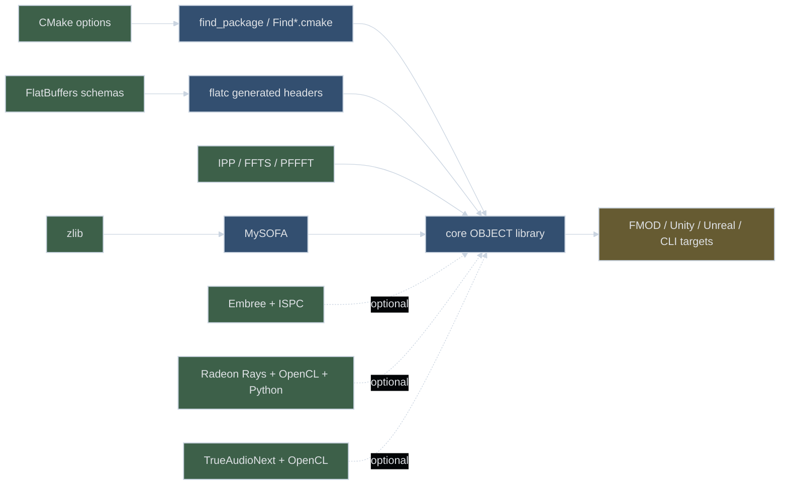

---

# 1. Introduction

Steam Audio Core는 음향 계산을 담당하는 내부 C++ 코드와 외부 라이브러리·플랫폼 기능을 
조합해 빌드된다. Dependency를 읽을 때는 <strong style="color:#ffb15b">항상 필요한 라이브러리</strong>와 CMake option이 
켜진 경우에만 필요한 <strong style="color:#b3f594">선택형 backend</strong>를 분리해야 한다.

> [!info] 분석 범위
> 기준 파일은 `core/CMakeLists.txt`, `core/src/core/CMakeLists.txt`, `core/build/Find*.cmake`다. 
> 현재 checkout의 CMake 선언을 기준으로 설명하며, dependency
> 버전과 실제 배포 구성은 checkout 및 빌드 옵션에 따라 달라질 수 있다.

# 2. 빌드 흐름에서 dependency가 연결되는 위치



최상위 `CMakeLists.txt`에서 feature option을 선언하고 `find_package`를 수행한다.
`src/core/CMakeLists.txt`는 선택 상태에 따라 source를 `core` OBJECT library에 넣고
`target_link_libraries`로 실제 link dependency를 연결한다. 
따라서 `deps/` 디렉터리에 파일이 있다는 사실만으로 해당 기능이 항상 빌드된다고 볼 수 없다.

# 3. 항상 필요한 Core dependencies

`core/CMakeLists.txt`에서 필수 package discovery는 다음처럼 선언한다.

``` cmake fold title:core CMake 필수 dependencies
find_package(MySOFA REQUIRED)
find_package(FlatBuffers REQUIRED)
```

처음 두 package는 configure 단계에서 반드시 찾아야 한다.
둘 중 하나라도 없으면 Core 구성을 완료할 수 없다.

반면 Embree나 Radeon Rays 같은 가속 backend는 option이 켜져 있을 때만 탐색한다.
찾지 못하면 해당 backend 기능을 끌 수 있다.

### <strong style="color:#b3f594">FlatBuffers</strong>: 데이터 형식을 C++ 코드로 생성

`FlatBuffers`는 저장할 데이터의 구조를 `.fbs` schema로 정의하고,
`flatc`가 그 schema를 C++ header로 변환하게 한다.
Core는 생성된 코드를 사용해 Scene, mesh, energy field, Probe, path 데이터를 
직렬화하고 읽는다.
즉, 의존성에는 C++ header만 있는 것이 아니다. 
빌드 중 schema를 변환하는 `flatc` 실행 파일도 필요하다.
`core/src/core/CMakeLists.txt`의 `compile_fbs` 함수가 이 변환 단계를 실행한다.

### <strong style="color:#b3f594">MySOFA</strong>와 zlib: SOFA 형식의 HRTF 읽기

`MySOFA`는 SOFA 형식으로 저장된 <strong style="color:#b3f594">HRTF</strong> 데이터베이스를 읽는 라이브러리다.
Core의 최상위 CMake는 `find_package(MySOFA REQUIRED)`로 이를 필수 의존성으로 찾는다.

zlib은 Core가 별도로 직접 찾는 package라기보다 `MySOFA`가 필요로 하는 의존성이다.
`FindMySOFA.cmake`가 `find_package(ZLIB REQUIRED)`를 호출하고,
`MySOFA::MySOFA` target이 `ZLIB::ZLIB`를 link dependency로 전달한다.

### <strong style="color:#b3f594">FFT backend</strong>: 후보 중 하나를 선택

Convolution과 frequency-domain DSP를 실행하려면 FFT 구현이 필요하다.
Core는 공통 FFT interface를 두고, 설정된 `FFT_LIBRARY`에 맞는 구현을 연결한다.

- IPP 선택: ipp_fft.cpp [링크](https://github.com/ValveSoftware/steam-audio/blob/v4.8.1/core/src/core/ipp_fft.cpp)
- FFTS 선택: ffts_fft.cpp [링크](https://github.com/ValveSoftware/steam-audio/blob/v4.8.1/core/src/core/ffts_fft.cpp)
- PFFFT 선택: pffft_fft.cpp [링크](https://github.com/ValveSoftware/steam-audio/blob/v4.8.1/core/src/core/pffft_fft.cpp)

이 세 라이브러리를 모두 동시에 요구하는 구조가 아니다.
IPP나 FFTS가 선택되지 않으면 CMake가 `find_package(PFFFT REQUIRED)`를 실행해
PFFFT를 기본 제공자로 선택한다.
macOS의 Accelerate/vDSP 연결은 플랫폼과 선택된 FFT 구현에 따른 별도 CMake 조건이다.

### <strong style="color:#b3f594">C/C++ 표준 라이브러리와 OS system libraries</strong>

표준 C/C++ runtime은 선택한 compiler/toolchain이 제공한다.
그 밖에 필요한 OS library는 플랫폼별 CMake 설정에서 직접 link한다.
예를 들어 Linux는 `m`, `dl`, `pthread`를, Android는 `log`, `android`를 연결한다.
Windows에서는 `delayimp`를 연결한다.

이 라이브러리들은 thread, 수학 연산, 동적 라이브러리 로딩,
플랫폼 logging 등 Core의 기본 실행 기능을 제공한다.

> [!tip] dependency 확인 방법
> configure 결과에서 CMake가 출력하는 “Disabling …” 메시지와 `STEAMAUDIO_ENABLE_*` 
> 최종 값을 함께 확인한다. option의 기본값만 보고 실제 빌드에 포함된 backend를 
> 단정하지 않는다.
> 


## 3.1 Platform별 기본 option

| Option                                                                | CMake 기본값이 설정되는 플랫폼          | 기본값 |
| --------------------------------------------------------------------- | ---------------------------- | --- |
| `STEAMAUDIO_ENABLE_AVX`                                               | Windows/Linux x86·x64        | ON  |
| `STEAMAUDIO_ENABLE_IPP`                                               | Windows/Linux x86·x64, macOS | ON  |
| `STEAMAUDIO_ENABLE_MKL`                                               | 위 IPP와 같은 대상                 | OFF |
| `STEAMAUDIO_ENABLE_EMBREE`                                            | 위 IPP와 같은 대상                 | ON  |
| `STEAMAUDIO_ENABLE_FFTS`                                              | Android                      | OFF |
| `STEAMAUDIO_ENABLE_RADEONRAYS`, <br>`STEAMAUDIO_ENABLE_TRUEAUDIONEXT` | Windows x64                  | ON  |
| `STEAMAUDIO_ENABLE_OCTAVE_BANDS`                                      | 전체                           | OFF |

이 값들은 option의 기본 상태다.  package discovery 실패나 `STEAMAUDIO_ENABLE_OCTAVE_BANDS` 제약에 따라 실제 상태가 바뀔 수 있다.

# 4. 선택형 계산 backend

### <strong style="color:#b3f594">Embree</strong>

Embree는 CPU ray tracing backend다.
기본 option은 Windows/Linux x86·x64와 macOS에서 켜져 있다.

이 backend를 쓰려면 Embree 4와 정확히 ISPC 1.12를 찾아야 한다.
둘 중 하나라도 없으면 CMake가 `STEAMAUDIO_ENABLE_EMBREE`를 끈다.
ISPC는 reflection kernel을 여러 CPU vector target용 object로 생성한다.

- embree_scene.cpp [링크](https://github.com/ValveSoftware/steam-audio/blob/v4.8.1/core/src/core/embree_scene.cpp)
- embree_reflection_simulator.cpp [링크](https://github.com/ValveSoftware/steam-audio/blob/v4.8.1/core/src/core/embree_reflection_simulator.cpp)
- embree_reflection_simulator.ispc [링크](https://github.com/ValveSoftware/steam-audio/blob/v4.8.1/core/src/core/embree_reflection_simulator.ispc)

### <strong style="color:#b3f594">Radeon Rays</strong>

Radeon Rays는 지원 GPU에서 ray tracing과 reflection 계산을 수행한다.
이 option은 Windows x64에서 기본적으로 켜져 있다.

CMake는 Radeon Rays package와 Python interpreter를 찾는다.
둘 중 하나라도 없으면 `STEAMAUDIO_ENABLE_RADEONRAYS`를 끈다.
Python은 `EmbedKernels.py`가 OpenCL kernel을 generated header에 넣을 때 사용한다.

- radeonrays_reflection_simulator.cpp [링크](https://github.com/ValveSoftware/steam-audio/blob/v4.8.1/core/src/core/radeonrays_reflection_simulator.cpp)
- radeonrays_reflection_simulator.cl [링크](https://github.com/ValveSoftware/steam-audio/blob/v4.8.1/core/src/core/radeonrays_reflection_simulator.cl)

### <strong style="color:#b3f594">TrueAudio Next (TAN)</strong>

TrueAudio Next는 지원 GPU에서 convolution 계산을 가속한다.
이 option은 Windows x64에서 기본적으로 켜져 있으며,
CMake가 `TrueAudioNext` package를 찾지 못하면 비활성화된다.

- tan_device.h [링크](https://github.com/ValveSoftware/steam-audio/blob/v4.8.1/core/src/core/tan_device.h) / tan_device.cpp [링크](https://github.com/ValveSoftware/steam-audio/blob/v4.8.1/core/src/core/tan_device.cpp)
- tan_convolution_effect.h [링크](https://github.com/ValveSoftware/steam-audio/blob/v4.8.1/core/src/core/tan_convolution_effect.h) / tan_convolution_effect.cpp [링크](https://github.com/ValveSoftware/steam-audio/blob/v4.8.1/core/src/core/tan_convolution_effect.cpp)

Windows x64에서는 관련 runtime DLL을 delay-load한다.

### <strong style="color:#b3f594">Intel IPP</strong>

IPP는 vector math와 FFT 구현을 제공한다.
option은 지원되는 Windows/Linux x86·x64와 macOS에서 기본적으로 켜져 있다.
IPP package를 찾지 못하면 CMake가 option을 끈다.

- ipp_array_math.cpp [링크](https://github.com/ValveSoftware/steam-audio/blob/v4.8.1/core/src/core/ipp_array_math.cpp)
- ipp_fft.cpp [링크](https://github.com/ValveSoftware/steam-audio/blob/v4.8.1/core/src/core/ipp_fft.cpp)

### <strong style="color:#b3f594">FFTS</strong>

FFTS는 선택 가능한 FFT 구현이다.
기본 option은 Android에서 OFF이며, 켜져 있을 때 package를 찾지 못하면
CMake가 FFTS option을 끈다.

- ffts_fft.cpp [링크](https://github.com/ValveSoftware/steam-audio/blob/v4.8.1/core/src/core/ffts_fft.cpp)

IPP나 FFTS가 FFT 제공자로 선택되지 않으면 필수 의존성인 PFFFT가 fallback으로 선택된다.

### <strong style="color:#b3f594">MKL</strong>

MKL은 선형대수 계산을 위한 선택 기능이며 기본값은 OFF다.
사용하도록 설정해도 MKL package를 찾지 못하면 CMake가 option을 끈다.

- matrix.h [링크](https://github.com/ValveSoftware/steam-audio/blob/v4.8.1/core/src/core/matrix.h)
- spherical_harmonics.cc [링크](https://github.com/ValveSoftware/steam-audio/blob/v4.8.1/core/src/core/sh/spherical_harmonics.cc)

`STEAMAUDIO_ENABLE_OCTAVE_BANDS`가 켜지면 현재 CMake는 Radeon Rays와 TAN을 비활성화한다.
따라서 backend는 개별 package의 유무뿐 아니라 feature 조합에도 영향을 받는다.

상세한 backend 연결은 [[core_08_foundation_backend_overview|Foundation & Backend Overview]]와
[[detail/backend/core_acceleration_backends|Acceleration Backend 상세]]에서 확인한다.

# 5. 테스트·benchmark·도구 dependency

Core library의 필수 dependency와 테스트·문서 제작 도구는 서로 다른 범주다.
아래 도구가 없으면 해당 개발 target만 비활성화된다.

### Unit test

`STEAMAUDIO_BUILD_TESTS`가 켜져 있으면 CMake는 Catch를 찾는다.
Catch를 찾지 못하면 unit test target을 비활성화한다.

### Interactive test

Interactive test에는 `GLFW`, `IMGUI`, `IMPLOT`, `PortAudio`, `DRWAV`가 모두 필요하다.
하나라도 찾지 못하면 CMake가 interactive test target을 비활성화한다.

### Benchmark

`phonon_perf` executable은 `core`와 `hrtf` target을 link한다.
측정 harness는 프로젝트 자체 registry를 사용하고 Google Benchmark에는 의존하지 않는다.
자세한 내용은 [[core_12_benchmark_overview|Benchmark Overview]]에서 확인한다.

### 문서 생성과 `deps/` 디렉터리

문서 생성 target은 Doxygen과 Sphinx 중 하나라도 찾지 못하면 비활성화된다.
`deps/`에는 build script와 prebuilt library가 함께 들어 있을 수 있다.
따라서 그 안의 모든 파일을 runtime dependency로 간주하면 안 된다.

# 6. 사용자가 소비하는 SDK와 내부 dependency의 차이

게임 엔진 integration은 보통 phonon.h [링크](https://github.com/ValveSoftware/steam-audio/blob/v4.8.1/core/src/core/phonon.h)의 C API와 배포 SDK의 
import/static library를  사용한다. 
엔진 프로젝트가 Core 내부의 Embree, FFTS, FlatBuffers 등을 직접 호출하는 것은 아니다.
SDK package가 어떤 binary/library를 함께 배포하는지는 해당 platform package의 
CMake install/copy 규칙을 확인해야 한다.

> [!warning] 런타임 dependency 주의
> CMake link dependency와 실행 시 동적 라이브러리 dependency는 일치하지 않을 수 있다. 
> 특히 GPU backend는 delay-load 설정, driver/runtime 설치, 실제 device 지원 여부가 
> 별도 조건이다.
> 

## Source anchors

- `core/CMakeLists.txt`: option 선언, package discovery, test/benchmark target 설정
- `core/src/core/CMakeLists.txt`: generated schema, conditional source list, target link
- `core/build/Find*.cmake`: 로컬 `deps/`에서 library/header를 찾는 규칙
- `core/THIRDPARTY.md`: third-party license notices

---
