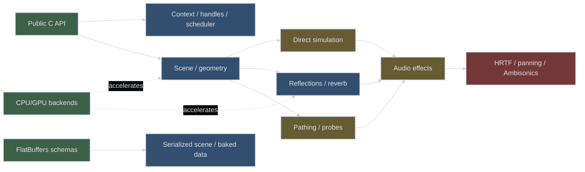

---

# 1. 목적과 범위

이 문서는 `F:/GitHub/steam-audio/core/src/core`에 있는 Core 구현을 
코드 위치 기준으로 찾는 module map이다. 
한 파일이 여러 역할에 관여해도 분류는 문서 탐색을 위한 주된 책임을 기준으로 한다. 
실제 빌드 포함 여부는 [[core_10_dependencies_overview|Dependencies Overview]]와 CMake option을 함께 확인한다.

> [!info] 파일 범위
> CMake에 등록된 public API, runtime, DSP,  scene, simulation, 
> spatial rendering, backend, FlatBuffers schema 및 build helper를 포함한다. 
> 플랫폼별 conditional source도 빠뜨리지 않고 별도 분류한다.

---
# 2. 모듈 가이드

<strong style="color:#b3f594">Public API / handles</strong> 
- [Public C API와 내부 객체 연결](core_public_api.md)는 phonon.h [링크](https://github.com/ValveSoftware/steam-audio/blob/v4.8.1/core/src/core/phonon.h) 
- ABI, `I*`interface, C API 변환/검증, handle lifetime을 설명한다.

<strong style="color:#b3f594">Runtime foundation</strong> 
- [Runtime foundation과 scheduler](core_runtime_subsystems.md)에서 Context, allocation, containers, math,
  profiler, jobs, thread pool을 따라간다.

<strong style="color:#b3f594">Geometry / Scene</strong> 
- [Geometry와 Scene query pipeline](core_geometry_pipeline.md)는 mesh/material/instance, BVH, scene commit, 
  ray query를 묶어 설명한다.

<strong style="color:#b3f594">DSP effects</strong>
- [PCM DSP와 effect modules](core_dsp_modules.md)에서 buffer, direct/indirect/path effects, convolution, filters, 
  FFT를 살펴본다.

<strong style="color:#b3f594">Spatial rendering</strong> 
- [HRTF, panning, Ambisonics rendering](core_spatial_rendering.md)은 speaker layout, 
  HRTF maps, binaural, Ambisonics, virtual surround를 다룬다.

<strong style="color:#b3f594">Direct simulation</strong> 
- [Direct sound simulation modules](core_direct_simulation_modules.md)에서 distance, air absorption, directivity, source state,
  orchestration을 확인한다.

<strong style="color:#b3f594">Reflections / reverb</strong> 
- [Reflections, IR reconstruction, reverb](core_reflections_reverb_modules.md)는 ray energy accumulation, EnergyField, IR, 
  reverb estimation/effects를 연결한다.

<strong style="color:#b3f594">Pathing</strong> 
- [Pathing module index](core_pathing_modules.md)에서 graph shortest path, visibility, baked route data,
  runtime result/effect의 개요를 확인한 뒤 하위 문서로 이동한다.

<strong style="color:#b3f594">Probes / baking</strong> 
- [Probe/Baking Overview](core_probes_baking.md)에서 probe volume, generation, tree, data layer, 
  bake, runtime lookup을 살펴보고 하위 문서로 들어간다.

<strong style="color:#b3f594">Acceleration backend</strong> 
- [CPU/GPU acceleration backends](core_acceleration_backends.md)는 Embree/ISPC, Radeon Rays/OpenCL, 
  TrueAudioNext를 정리한다.

<strong style="color:#b3f594">Serialization</strong> 
- [Serialization schemas and binary objects](core_serialization_formats.md)에서 `.fbs` schemas,  
  `SerializedObject`, content persistence를 살펴본다.

<strong style="color:#b3f594">Build/support files</strong>
- [Build/support files](core_build_support.md)는 `CMakeLists.txt`, precompiled headers, kernel embedding, 
  generated metadata를 설명한다.

---
# 3. 전체 처리 흐름

# 4. 소스 분류 원칙

- `api_*.cpp`는 공개 API 구조체를 내부 C++ 타입으로 바꾸는 경계 코드다. 
  보통 음향 계산 본체는 아니다.
- `scene`, `mesh`, `bvh`, `ray`는 world geometry query 경로에 속한다.
- `simulation_*`와 각 simulator는 공간 계산 및 결과 상태를 조정한다. 
- `*_effect`는 이미 정해진 parameter를 PCM/ambisonic buffer에 적용한다.
- `embree_*`, `radeonrays_*`, `opencl_*`, `tan_*`는 option에 따라 포함되는 backend 코드다.
- `.fbs` 파일은 schema 원본이며 CMake에서 `flatc`로 생성 header를 만든다. 
  generated header는 source 디렉터리 밖 binary directory에 생긴다.

> [!tip] 처음 소스를 읽는 경로
> phonon.h [링크](https://github.com/ValveSoftware/steam-audio/blob/v4.8.1/core/src/core/phonon.h) → api_simulator.cpp [링크](https://github.com/ValveSoftware/steam-audio/blob/v4.8.1/core/src/core/api_simulator.cpp)/api_direct_effect.cpp [링크](https://github.com/ValveSoftware/steam-audio/blob/v4.8.1/core/src/core/api_direct_effect.cpp) →
> simulation_manager.cpp [링크](https://github.com/ValveSoftware/steam-audio/blob/v4.8.1/core/src/core/simulation_manager.cpp) → 개별 <strong style="color:#b3f594">simulator</strong> →
> <strong style="color:#b3f594">effect</strong> 구현 순으로 따라가면 API 경계, 계산, sample 처리의 책임을 구분하기 쉽다. 
> 함수 호출 순서 지도는 [[core_01_architecture_flow|Core Architecture Flow]]를 함께 본다.
> 

# 5. 확인 기준

이 module map의 분류는 `core/src/core/CMakeLists.txt`의 common source와 feature별
`target_sources`를 기준으로 유지한다. 
특정 빌드에 실제 들어가는 파일을 확인할 때는 platform macro, option, package discovery 결과
를 모두 보며, source가 존재한다는 사실만으로 해당 backend가 활성화됐다고 
결론 내리지 않는다.

# 6. Source coverage

현재 checkout의 `core/src/core`를 확장자 기준으로 다시 셌다.
`.h` 152개와 `.cpp` 136개로 요청한 h/cpp 파일은 합계 **288개**다. 
`.cc` 1개를 더한 C/C++ 구현 파일은 289개이며, FlatBuffers `.fbs` 13개와 기타 
build/kernel/resource 파일 8개를 포함한 전체 파일 수는 310개다.

| 확장자                                                          |    파일 수 |
| ------------------------------------------------------------ | ------: |
| `.h`                                                         |     152 |
| `.cpp`                                                       |     136 |
| `.cc`                                                        |       1 |
| `.fbs`                                                       |      13 |
| 기타 (`.cl`, `.in`, `.inl`, `.ispc`, `.natvis`, `.py`, `.txt`) |       8 |
| 합계                                                           | **310** |

루트 디렉터리에는 308개 파일이 있고, 하위 `sh/`의 `spherical_harmonics.cc/.h` 2개를 더하면
재귀 합계가 310개다. 따라서 사용자가 말한 308개는 루트 바로 아래 전체 파일 수와 일치하지만,
`.h`와 `.cpp` 확장자만 센 값은 288개다.
아래 카테고리 수는 전체 파일 분류 합계이며, `.fbs` 등 비 C++ 구현 파일도 포함한다. 
각 상세 페이지의 `Source file inventory`와 `Source file links` 절에서 경로를 대조한다.

> [!success] 전체 소스 코드 대조
> 2026-11-12 기준 `core/src/core` 310개와 `core/src/benchmark` 25개, 
> 합계 335개를 재귀 manifest와 대조했다. 
> 모든 파일이 해당 모듈의 파일 링크 목록에 포함되어 있고, 링크 대상 경로를 대조하면 
> 원본 파일 내용과 일치한다. 
> H/C++ 파일은 Core 288개와 Benchmark 24개다.
> 

| 범주                 | 파일 수 |
| ------------------ | ---: |
| API                |   59 |
| System             |   39 |
| Geometry           |   22 |
| DSP                |   38 |
| Spatialization     |   31 |
| Simulation         |   12 |
| Reflections/Reverb |   26 |
| Pathing            |   12 |
| Probes/Baking      |   18 |
| Backend            |   37 |
| Serialization      |   15 |
| Build tools        |    1 |

---