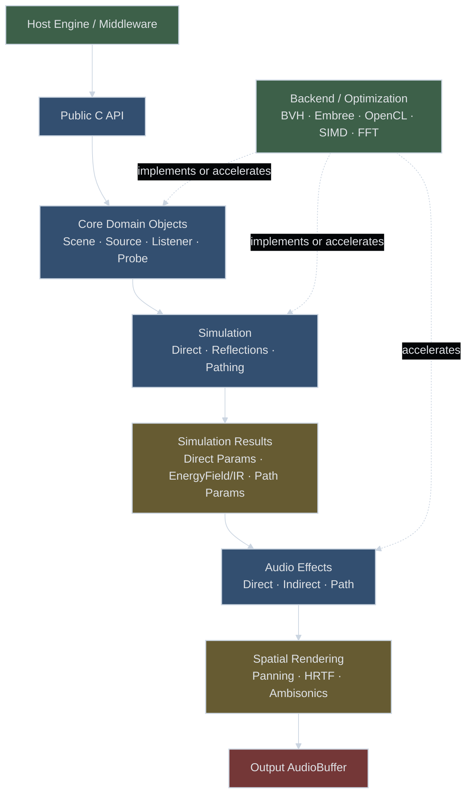

---

# 1. Core는 무엇을 하는가

Steam Audio Core는 게임 엔진이나 오디오 미들웨어가 전달한 공간·재질·소스·리스너 정보를 바탕으로 공간 오디오 결과를 계산하고,
그 결과를 PCM 오디오에 적용하는 C++ 라이브러리다. 외부에서는 C API로 접근하고, 내부에서는 Scene, Simulator,
Effect 등의 C++ 객체가 역할을 나눠 수행한다.

이 문서는 Steam Audio Core 기술 가이드의 <strong style="color:#b3f594">목차이자 전체 구조 지도</strong>다. 각 큰 주제는 독립된 Overview에서 개념과 하위 모듈을
설명하고, 더 깊은 코드는 구현 분석 문서로 연결한다.

> [!tip] 처음 읽는 순서
> 이 문서에서 큰 흐름을 먼저 확인하고, 관심 있는 분야별 Overview로 이동한다.
> Overview에서 개념을 잡은 다음 해당 페이지의 하위 링크를 따라
> 개별 클래스와 `.cpp` 코드를 읽는다.

---

# 2. 최상위 architecture map

여기서 핵심은 <strong style="color:#ffb15b">Simulation은 공간에서 발생할 음향 결과를 계산하고, Effect는  그 결과를 샘플에 적용한다</strong>는 구분이다.
<strong style="color:#b3f594">Panning / HRTF / Ambisonics</strong>는 그 뒤에서 방향 오디오를 speaker나 headphone
출력 형식으로 렌더링한다.

> [!info] 시스템 경계
> Host는 C API로 입력을 전달하고, Core는 시뮬레이션 결과를 Effect와 공간 렌더링 경로에
> 전달한다. 각 경계의 상세 흐름은 아래 Overview 링크를 따라간다.

---

# 3. 분야별 Overview

큰 주제마다 Overview를 따로 두었다. 각 Overview는 해당 영역의 역할, 자료 흐름, 주요 구현 선택지를 설명하고,
더 세부적인 모듈 문서로 연결한다.

| 분야                                                         | Overview                                                                           | 무엇을 설명하는가                                                                                                                                              |
| ---------------------------------------------------------- | ---------------------------------------------------------------------------------- | ------------------------------------------------------------------------------------------------------------------------------------------------------ |
| <strong style="color:#b3f594">Host와 C API</strong>         | [Host ↔ C API Overview](core_02_host_c_api_overview.md)                          | 엔진 데이터가 phonon.h [링크](https://github.com/ValveSoftware/steam-audio/blob/v4.8.1/core/src/core/phonon.h) API를 거쳐 내부 C++ 객체까지 연결되는 과정, 핸들·구조체 변환, 실제 호출 예 |
| <strong style="color:#b3f594">Simulation</strong>          | [Simulation Overview](core_03_simulation_overview.md)                            | Direct/Reflections/Pathing 세 계산 경로와 입력·결과 데이터, SimulationManager의 역할                                                                                   |
| <strong style="color:#b3f594">Effect와 렌더링</strong>         | [Effect & Rendering Overview](core_04_effect_overview.md)                        | 시뮬레이션 결과를 PCM에 적용하는 DSP, Direct/Indirect/Path 효과와 spatial rendering                                                                                    |
| <strong style="color:#b3f594">Reflections와 Reverb</strong> | [Reflections & Reverb Overview](core_05_reflections_reverb_overview.md)          | 반사 ray → EnergyField → IR/reverb parameter → convolution/parametric/hybrid 재생 흐름                                                                       |
| <strong style="color:#b3f594">Probe Pathing</strong>       | [Pathing Overview](core_06_pathing_overview.md)                                  | probe graph, 사전 계산, runtime 경로 선택과 PathEffect 연결                                                                                                       |
| <strong style="color:#b3f594">Scene과 Geometry</strong>     | [Scene & Geometry Overview](core_07_scene_geometry_overview.md)                  | mesh/material/instance, ray query, BVH와 backend에 따른 Scene 구현                                                                                           |
| <strong style="color:#b3f594">Foundation과 Backend</strong> | [Runtime Foundations & Backend Overview](core_08_foundation_backend_overview.md) | 공통 math/container/memory/thread layer와 SIMD/FFT/hardware backend의 관계                                                                                   |
| <strong style="color:#b3f594">Multi-threading</strong>     | [Multi-threading Overview](core_09_multithreading_overview.md)                   | 실제 worker pool 사용 위치, synchronous 호출, Bake 병렬화, audio thread handoff                                                                                   |
| <strong style="color:#b3f594">Dependency 구성</strong>       | [Dependencies Overview](core_10_dependencies_overview.md)                        | 필수 라이브러리, 선택 backend, CMake feature 및 SDK runtime 경계                                                                                                   |
| <strong style="color:#b3f594">Core source 분석</strong>      | [Source Modules Overview](core_11_source_modules_overview.md)                    | `core/src/core` 전체 310개 파일을 12개 모듈로 분류하고 각 상세 문서에서 파일별 공식 소스 링크 제공                                                                                           |
| <strong style="color:#b3f594">Benchmark</strong>           | [Benchmark Overview](core_12_benchmark_overview.md)                              | `phonon_perf` 자체 registry, workloads, 실행 입력과 결과 해석                                                                                                     |

각 분야를 공부할 때 필요한 일반 알고리즘은 [[Programming/Algorithm/algo_00_overview|Algorithm 학습 지도]]에서, block 처리 / filter / convoleution 등
공간 오디오의 DSP 선수 지식은 [[Programming/DSP/dsp_00_overview|DSP 학습 지도]]에서 순서대로 공부할 수 있다.

---

# 4. 소스코드 실행 흐름

분야별 설명과 별도로, 실제 함수 호출을 위에서 아래로 따라가는 코드 중심 문서가 있다.

- [[core_01_architecture_flow|Core Architecture Flow]]:
	- 공개 API, 기반 자료구조, Scene,
	- 세 Simulation 경로, Effect,
	- SimulationManager, backend의 코드 경계를 연결

- 각 개념별로 더 깊게 들어가려면 아래 문서 색인을 이용한다.

---

# 5. 개념에서 구현 문서로 이동

상세 페이지는 주제별로 `detail/` 아래에 분류한다.

- `detail/system/`: Array, Matrix, SIMD, allocator, 공통 유틸리티
- `detail/geometry/`: Scene, Mesh, Instanced Mesh, BVH
- `detail/dsp/`: AudioBuffer와 개별 Effect 구현
- `detail/simulation/`: Direct simulation과 Air Absorption 등 시뮬레이션 모델
- `detail/pathing/`: PathFinder, PathData, PathEffect, visibility와 path simulation
- `detail/benchmark/`: `core/src/benchmark` 25개 파일, 21개 workload source 분석
- `detail/integration/`: Host/엔진과 Steam Audio를 연결하는 실행 순서 메모 — [[UE - SteamAudio 각종 실행 order|UE 실행 순서 분석]]

## 5.1 이미 작성된 상세 분석

| 주제               | 상세 문서                                                                                                                                                                                                                                                                                                                                                                                                                    |
| ---------------- | ------------------------------------------------------------------------------------------------------------------------------------------------------------------------------------------------------------------------------------------------------------------------------------------------------------------------------------------------------------------------------------------------------------------------ |
| Scene과 ray query | [Scene](core_scene.md), [Mesh](core_mesh.md), [Instanced Mesh](core_instanced_mesh.md), [BVH](core_bvh.md)                                                                                                                                                                                                                                       |
| 좌표와 변환           | [Matrix와 좌표 변환](core_matrix.md)                                                                                                                                                                                                                                                                                                                                                                          |
| Direct Effect    | [DirectEffect](core_direct_effect.md), [EQEffect](core_eqeffect.md), [DelayEffect](core_delay_effect.md)                                                                                                                                                                                                                                                                          |
| Air Absorption   | [Air Absorption](core_air_absorption.md)                                                                                                                                                                                                                                                                                                                                                             |
| Path 탐색          | [Pathing Overview](core_06_pathing_overview.md), [PathFinder](core_path_finder.md), [PathData](core_path_data.md), [PathEffect](core_path_effect.md)                                                                                                                                                                                                                |
| Probe 생성과 데이터    | [Probe/Baking Overview](core_probes_baking.md), [ProbeGenerator](core_probe_generator.md), [ProbeBatch](core_probe_batch.md), [ProbeTree](core_probe_tree.md), [ProbeManager](core_probe_manager.md), [ReflectionBaker](core_reflection_baker.md), [BakedReflectionsData](core_baked_reflection_data.md) |
| AudioBuffer와 출력  | [AudioBuffer](core_audiobuffer.md), [PanningEffect](core_panning_effect.md)                                                                                                                                                                                                                                                                                                                    |
| Benchmark 전체 소스  | [25개 benchmark source 파일 분석](core_benchmark_source_analysis.md)                                                                                                                                                                                                                                                                                                                                       |
| SIMD / 공통 기반     | [SIMD](core_simd.md), [Array](core_Array.md), [Memory Allocator](core_memory_allocator.md), [Core Util](core_util.md)                                                                                                                                                                                                                                    |

## 5.2 다음 단계로 확장할 영역

세부 구현 페이지는 분야별 Overview에서 시작할 수 있게 연결한다. 아직 별도의 상세 분석이 없는 분야는 Overview의 소스 파일
지도를 출발점으로 삼는다.

- Direct Simulation model: `direct_simulator.*`, `distance_attenuation.*`, `directivity.*`, `deviation.*`
- Scheduler와 동시성: `simulation_manager.*`, `job.*`, `job_graph.*`, `thread_pool.*`, triple_buffer.h [링크](https://github.com/ValveSoftware/steam-audio/blob/v4.8.1/core/src/core/triple_buffer.h)
- 기반 구조와 최적화: [[core_08_foundation_backend_overview|Runtime Foundations & Backend Overview]]
- Multi-threading 동작과 검증 범위: [[core_09_multithreading_overview|Multi-threading Overview]]
- Reflection와 reconstruction: `reflection_simulator.*`, `energy_field.*`, `reconstructor.*`, `impulse_response.*`
- Reverb 효과: `reverb_estimator.*`, `reverb_effect.*`, `hybrid_reverb_*`, convolution effect들
- Spatialization: `hrtf_*`, `binaural_effect.*`, `ambisonics_*_effect.*`
- API object/serialization: `api_*.cpp`, `Handle<T>`, `serialized_object.*`, `*.fbs`

---

# 6. 추천 학습 경로

## 큰 그림부터

1. 이 문서에서 계층 간 역할을 본다.
2. [[core_01_architecture_flow|Architecture Flow]]에서 실제 실행/데이터 흐름을 따라간다.
3. 관심 분야의 Overview로 이동해 해당 분야 내부의 모듈 경계를 파악한다.
4. Overview에서 연결한 개별 분석 페이지와 원본 코드를 읽는다.

## 직접음부터 구현까지

1. [[core_03_simulation_overview|Simulation Overview]]의 Direct 절
2. [[core_air_absorption|Air Absorption]] 등 개별 모델
3. [[core_direct_effect|DirectEffect]]와 [[core_eqeffect|EQEffect]]
4. [[core_04_effect_overview|Effect Overview]]의 출력/렌더링 경로

## 반사음부터 재생까지

1. [[core_05_reflections_reverb_overview|Reflections & Reverb Overview]]
2. EnergyField와 IR/reverb parameter의 변환
3. [[core_04_effect_overview|Effect Overview]]의 IndirectEffect/convolution 흐름

## Host 연동부터 확인

1. [[core_02_host_c_api_overview|Host ↔ C API Overview]]에서 host 데이터와 public API 계약을 확인한다.
2. phonon.h [링크](https://github.com/ValveSoftware/steam-audio/blob/v4.8.1/core/src/core/phonon.h)의 타입/함수를 찾는다.
3. phonon_interfaces.h [링크](https://github.com/ValveSoftware/steam-audio/blob/v4.8.1/core/src/core/phonon_interfaces.h)와 `api_*.cpp`를 따라 내부 `ipl` 구현으로 내려간다.

---

# 7. 분석 기준

- 분석 소스: `F:\GitHub\steam-audio\core\src\core\`
- 참고 architecture 노트: `F:\GitHub\steam-audio\core\CLAUDE.md`
- 사용자가 공유한 원본 페이지: https://github.com/jsukjin/steam-audio/blob/master/core/CLAUDE.md
- 공개 API 정의: phonon.h [링크](https://github.com/ValveSoftware/steam-audio/blob/v4.8.1/core/src/core/phonon.h), C API forwarding/interface: phonon_interfaces.h [링크](https://github.com/ValveSoftware/steam-audio/blob/v4.8.1/core/src/core/phonon_interfaces.h)

빌드 옵션과 사용할 수 있는 backend는 플랫폼과 revision에 따라 달라질 수 있으므로, backend 사용 여부는 실제
`core/src/core/CMakeLists.txt`와 빌드 설정에서 확인한다.

---
