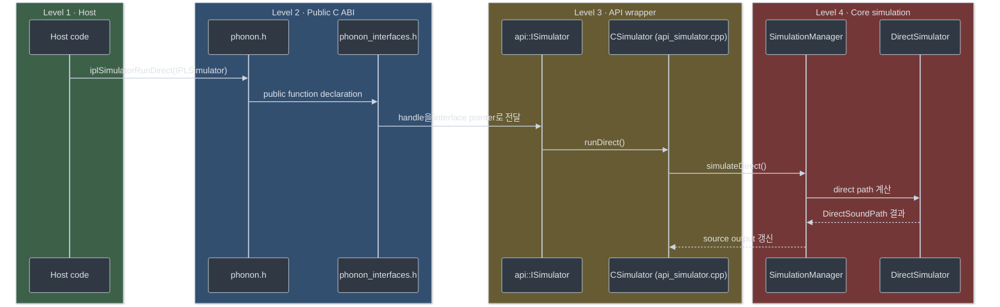

---

# 1. Introduction

Unity, Unreal, FMOD, Wwise 또는 자체 엔진의 소스 코드가 Steam Audio Core의 내부 C++ 클래스와 직접
연결되는 것은 아니다. Host는 phonon.h [링크](https://github.com/ValveSoftware/steam-audio/blob/v4.8.1/core/src/core/phonon.h)에 선언된 C API를 호출한다. 이 문서는 그 호출이 어떤 계층을 지나 내부 객체에
도착하는지, Host가 어떤 정보를 넘기고 결과를 어떻게 오디오 처리에 연결하는지 설명한다.

전체 문서 구조로 돌아가기: [[core_00_overview|Core Overview]] 전체 실행 순서: [[core_01_architecture_flow|Core
Architecture Flow]]

---

# 2. Host와 Core 사이의 경계

## 2.1 Host가 책임지는 데이터

Host 엔진은 게임 월드와 오디오 엔진을 알고 있다. 따라서 아래 정보를 Core가 요구하는 구조와 수명에 맞게 준비해 전달한다.

- <strong style="color:#b3f594">Scene</strong> geometry: 삼각형 정점, 인덱스, material assignment
- Source와 Listener: 위치, 방향, 활성화된 시뮬레이션 종류
- Audio settings: sample rate, frame size
- Input audio: PCM sample과 channel layout
- 출력 방식: stereo/speaker <strong style="color:#b3f594">panning</strong>, binaural <strong style="color:#b3f594">HRTF</strong>,
<strong style="color:#b3f594">Ambisonics</strong> 등

Core는 엔진의 Actor, Component, GameObject, Mixer 객체를 직접 알지 못한다.
Host의 integration 계층이 엔진 고유 객체를 Steam Audio의 `IPL*` 구조체와 handle로 바꾼다.

## 2.2 C API가 제공하는 경계

공개 C API의 기준 헤더는 phonon.h [링크](https://github.com/ValveSoftware/steam-audio/blob/v4.8.1/core/src/core/phonon.h)다. 이 헤더는 함수, enum, plain C 구조체, opaque handle을 제공한다.
Host가 `IPLScene`이나 `IPLSimulator`를 받아도 그 안에 있는 내부 객체에 직접 접근하지 않는다.
오직 `iplSceneCommit`, `iplSimulatorRunDirect` 같은 API 함수를 통해 동작을 요청한다.

```text
Host Engine / Middleware
   │
   │  C-compatible functions, IPL* structs, opaque IPL* handles
   ▼
phonon.h                         public API contract
   │
   ▼
phonon_interfaces.h              C function forwarding / null checks
   │
   ▼
api::IContext / IScene / ISimulator / ISource / IDirectEffect
   │
   ▼
api_*.cpp                        C++ wrapper and IPL* ↔ internal conversion
   │
   ▼
ipl::Context / Scene / SimulationManager / DirectEffect / ...
```

이 분리 덕분에 내부 구현이 `ipl::Array`, `shared_ptr`, template, <strong style="color:#b3f594">SIMD</strong> 구현 등을 바꾸더라도 Public ABI가
유지되는 한 Host 코드의 호출 계약은 고정할 수 있다.

## 2.3 실제 handle forwarding 흐름


예를 들어 Host가 다음을 호출한다고 하자.

``` cpp fold title:Steam Audio C++
iplSimulatorRunDirect(simulator);
```

실제 경계는 대략 다음처럼 내려간다.



실제 구현에서 phonon_interfaces.h [링크](https://github.com/ValveSoftware/steam-audio/blob/v4.8.1/core/src/core/phonon_interfaces.h)는 API 함수가 null handle을 확인한 뒤 handle을
`api::ISimulator*`로 해석하고 interface method를 부르는 경계다. `CSimulator::runDirect()`는
`mHandle`에서 내부 simulator를 얻고 `simulateDirect()`를 호출한다. 내부
<strong style="color:#b3f594">직접음</strong> 알고리즘은 direct_simulator.cpp [링크](https://github.com/ValveSoftware/steam-audio/blob/v4.8.1/core/src/core/direct_simulator.cpp)에 있다.

대표 소스 위치:

- API 선언
	- phonon.h [링크](https://github.com/ValveSoftware/steam-audio/blob/v4.8.1/core/src/core/phonon.h)

- API forwarding
	- phonon_interfaces.h [링크](https://github.com/ValveSoftware/steam-audio/blob/v4.8.1/core/src/core/phonon_interfaces.h)

- API interface 선언
	- phonon_interfaces.h [링크](https://github.com/ValveSoftware/steam-audio/blob/v4.8.1/core/src/core/phonon_interfaces.h)의 `api::IContext`, `api::ISimulator`, `api::ISource` 등

- wrapper 구현
	- api_context.cpp [링크](https://github.com/ValveSoftware/steam-audio/blob/v4.8.1/core/src/core/api_context.cpp), api_simulator.cpp [링크](https://github.com/ValveSoftware/steam-audio/blob/v4.8.1/core/src/core/api_simulator.cpp), api_direct_effect.cpp [링크](https://github.com/ValveSoftware/steam-audio/blob/v4.8.1/core/src/core/api_direct_effect.cpp)
등

- 내부 로직
	- `context.*`, `simulation_manager.*`, `direct_simulator.*`, `direct_effect.*`

> [!info] `api_*.cpp`는 음향 알고리즘이 아니다
> API wrapper는 public 구조체/handle을 내부 타입과 변환하고 메서드를 전달하는 경계다.
> 음향 계산의 핵심은 direct_simulator.cpp [링크](https://github.com/ValveSoftware/steam-audio/blob/v4.8.1/core/src/core/direct_simulator.cpp), reflection_simulator.cpp [링크](https://github.com/ValveSoftware/steam-audio/blob/v4.8.1/core/src/core/reflection_simulator.cpp) 같은
> 내부 모듈에서 찾는다.

---

# 3. API 객체의 생성과 수명

## 3.1 생성 순서가 있는 이유

대부분의 Steam Audio API 객체는 다른 객체를 생성할 때 기반 handle을 요구한다.

```text
IPLContext
  ├─ IPLScene ── IPLStaticMesh / IPLInstancedMesh
  ├─ IPLSimulator ── IPLSource
  ├─ IPLHRTF
  └─ IPL*Effect
```

따라서 Host는 보통 Context를 먼저 생성하고, Scene/<strong style="color:#b3f594">Simulator</strong>/Effect를 만든다. 생성 함수는 `IPLerror`를
돌려주며 성공한 handle을 output parameter로 기록한다. 사용이 끝나면 `ipl...Release(&handle)`로 참조를
해제한다.

``` cpp fold title:Steam Audio C++
IPLContextSettings contextSettings{};
contextSettings.version = STEAMAUDIO_VERSION;

IPLContext context = nullptr;
if (iplContextCreate(&contextSettings, &context) != IPL_STATUS_SUCCESS)
{
    // 초기화 실패 처리
}

// Scene, Simulator, Source, Effect 생성과 사용

// 의존 객체들을 정리한 후 Context 참조 해제
iplContextRelease(&context);
```

`IPLContextSettings::version`은 Host가 컴파일한 API 버전과 로드한 Steam Audio library 간 호환성을
확인하는 값이다. 실제 Host에서는 생성에 실패한 경우 더 진행하지 않고 오류를 전달해야 한다.

## 3.2 Handle과 참조 수명

`IPLContext`, `IPLScene`, `IPLSimulator` 등은 opaque handle이다. 이는 내부 포인터에 해당하는 핸들이지만,
사용자가 구조체를 역참조하거나 메모리를 직접 해제하면 안 된다.

- `ipl...Create(...)`: 객체를 생성하고 handle을 반환한다.
- `ipl...Retain(handle)`: 객체의 참조를 추가한다.
- `ipl...Release(&handle)`: 참조를 해제하고 전달된 handle을 null로 만든다.
- 생성 순서와 참조 관계를 고려해 객체를 해제한다.

내부 `Handle<T>`는 API wrapper와 내부 구현 객체의 생명주기를 연결한다. Host는 `Handle<T>`를 알 필요가 없고 public
retain/release 규칙만 따르면 된다.

---

# 4. Host 데이터가 시뮬레이션 입력이 되는 과정

## 4.1 Scene 만들기

Host는 엔진의 geometry를 Steam Audio static mesh 입력으로 바꾼다. Static mesh settings에는 정점
배열, 삼각형 배열, triangle별 material index, material 배열이 포함된다.

```text
Engine mesh/component
   ├─ world/local vertices ──► IPLVector3[]
   ├─ triangle indices ──────► IPLTriangle[]
   ├─ surface assignment ────► materialIndices[]
   └─ acoustic material ─────► IPLMaterial[]
                                  │
                                  ▼
iplStaticMeshCreate → iplStaticMeshAdd → iplSceneCommit
```

`iplSceneCreate` 자체는 geometry를 담지 않는다. Scene 안에서 static mesh/instance를 생성하고 추가한 다음
`iplSceneCommit`으로 변경을 확정해야 query에서 사용된다. 자세한 geometry 계층은
[[core_07_scene_geometry_overview|Scene & Geometry Overview]]와 [[core_scene|Scene 분석]]에서 다룬다.

시뮬레이터에는 Scene을 연결하고, 처리할 Source를 등록한다. 아래 코드는 simulator가 이미 생성되었다고 가정한 연결 단계다.

``` cpp fold title:Steam Audio C++
// Scene/mesh를 구성한 뒤 geometry 변경 확정
iplSceneCommit(scene);

// Scene 연결도 simulator state 변경이므로 simulator commit
iplSimulatorSetScene(simulator, scene);
iplSimulatorCommit(simulator);

// Source를 만들고 simulation 대상에 등록
IPLSourceSettings sourceSettings{};
sourceSettings.flags = IPL_SIMULATIONFLAGS_DIRECT;

IPLSource source = nullptr;
if (iplSourceCreate(simulator, &sourceSettings, &source) == IPL_STATUS_SUCCESS)
{
    iplSourceAdd(source, simulator);
    iplSimulatorCommit(simulator);
}
```

실제 Scene/mesh 생성에는 geometry arrays와 acoustic material이 필요하다.
이 예시는 생성 이후 **Scene을 simulator에 연결하고 Source를 등록하는 API 관계**만 보여준다.

## 4.2 Source/Listener 입력 만들기

Listener는 `IPLSimulationSharedInputs` 안에 공유 위치/방향으로 설정된다. Source는
`IPLSimulationInputs`에 위치/방향과 직접음, 반사, Pathing에 필요한 모델 설정을 담는다.
어떤 설정을 읽을지는 `IPLSimulationFlags`와 `directFlags` 등에 따라 달라진다.

```text
Engine transforms                 Simulation flags / models
       │                                     │
       ├─ coordinate conversion              ├─ distance model
       ├─ listener coordinate                ├─ air absorption model
       └─ source coordinate                  ├─ directivity / occlusion
                                             └─ probe / reflection settings
       └──────────────────────┬──────────────┘
                              ▼
                   IPLSimulationInputs
                   IPLSimulationSharedInputs
```

Steam Audio는 오른손 좌표계(+X 오른쪽, +Y 위, -Z 앞)를 사용하며 공간 거리는 미터를 기준으로 한다.
게임 엔진과 축/단위/forward 방향이 다르면 Host integration에서 변환한 좌표와 스케일을 전달해야 한다.
변환을 놓치면 소스와 리스너가 반대 방향에 놓이거나 스케일이 틀어져 음향 결과가 잘못된다.

## 4.3 좌표와 입력을 설정하고 결과를 읽기

아래는 이미 생성한 `simulator`와 `source`가 있다고 가정한 최소 <strong style="color:#b3f594">direct simulation</strong> 호출 흐름이다.
`EngineTransform`과 좌표 변환 helper는 Steam Audio 타입이 아니라 Host 쪽에서 엔진에 맞게 구현하는 부분이다.

``` cpp fold title:Steam Audio C++
#include "phonon.h"

// Host 쪽 변환 함수: 엔진 transform을 Steam Audio 좌표계로 바꾼다.
IPLCoordinateSpace3 toSteamAudioCoordinates(const EngineTransform& transform);

void updateDirectPath(IPLSimulator simulator,
                      IPLSource source,
                      const EngineTransform& sourceTransform,
                      const EngineTransform& listenerTransform,
                      IPLSimulationOutputs& outputs)
{
    IPLSimulationSharedInputs shared{};
    shared.listener = toSteamAudioCoordinates(listenerTransform);
    iplSimulatorSetSharedInputs(simulator, IPL_SIMULATIONFLAGS_DIRECT, &shared);

    IPLSimulationInputs inputs{};
    inputs.flags = IPL_SIMULATIONFLAGS_DIRECT;
    inputs.directFlags = IPL_DIRECTSIMULATIONFLAGS_DISTANCEATTENUATION
                       | IPL_DIRECTSIMULATIONFLAGS_AIRABSORPTION
                       | IPL_DIRECTSIMULATIONFLAGS_DIRECTIVITY
                       | IPL_DIRECTSIMULATIONFLAGS_OCCLUSION;
    inputs.source = toSteamAudioCoordinates(sourceTransform);

    inputs.distanceAttenuationModel.type = IPL_DISTANCEATTENUATIONTYPE_DEFAULT;
    inputs.airAbsorptionModel.type = IPL_AIRABSORPTIONTYPE_DEFAULT;
    inputs.directivity.dipoleWeight = 0.0f;
    inputs.directivity.dipolePower = 1.0f;
    inputs.occlusionType = IPL_OCCLUSIONTYPE_RAYCAST;

    iplSourceSetInputs(source, IPL_SIMULATIONFLAGS_DIRECT, &inputs);

    // 시뮬레이션은 audio callback에서 실행하지 말고 별도 update/worker 경로에서 수행한다.
    iplSimulatorRunDirect(simulator);
    iplSourceGetOutputs(source, IPL_SIMULATIONFLAGS_DIRECT, &outputs);
}
```

이 코드는 `directFlags`로 어떤 direct model을 계산할지 선택하고, Listener와 Source transform을
Host에서 변환해 입력 구조체에 넣는다. `iplSimulatorRunDirect`가 결과를 계산한 뒤 `iplSourceGetOutputs`가
`outputs.direct`에 `IPLDirectEffectParams` 값을 채운다.

> [!warning] 시뮬레이션 호출 thread
> `iplSimulatorRunDirect`는 <strong style="color:#b3f594">occlusion</strong>/transmission을 사용할 때
> audio processing thread에서 호출하면 안 된다.
> <strong style="color:#b3f594">Reflections</strong>/<strong style="color:#b3f594">Pathing</strong> API 문서도 CPU intensive한 계산은
> audio thread와
> game main update thread를 막지 않는 별도 thread에서 실행하도록 안내한다.
> Host는 업데이트 주기, worker thread, 결과 snapshot 교환 방식을 설계해야 한다.

---

# 5. 시뮬레이션 결과를 Effect와 오디오 버퍼에 연결하기

## 5.1 <strong style="color:#b3f594">Simulation</strong> 값과 <strong style="color:#b3f594">Effect</strong> 적용 설정을 함께 전달한다

`IPLSimulationOutputs::direct`의 타입은 `IPLDirectEffectParams`다. 두 API가 같은 구조체를 사용하므로
simulation이 계산한 수치를 effect parameter에 복사해 사용할 수 있다. 다만 `CSource::getOutputs`가 채우는
것은 거리 gain, <strong style="color:#b3f594">air absorption</strong>,
<strong style="color:#b3f594">directivity</strong>, occlusion, <strong style="color:#b3f594">transmission</strong> 값이다. **Effect에서
어떤 항목을 적용할지 정하는 `flags`와 `transmissionType`은 Host가 지정해야 한다.**

```text
iplSourceGetOutputs(..., &simulationOutputs)
                  │
                  └── simulationOutputs.direct
                      ├─ simulation 계산값: 거리/대역 gain 등
                      └─ Host 설정값: flags / transmissionType
                              │ IPLDirectEffectParams
                              ▼
iplDirectEffectApply(effect, &directParams, &input, &output)
                              │
                              ▼
                 처리된 IPLAudioBuffer
```

이 연결이 Simulation과 Effect를 분리하는 API 계약이다. Simulation은 공간 파라미터 값을 만들고,
Host는 원하는 적용 항목을 선택한다. Effect는 두 종류의 값과 PCM frame을 받아 DSP를 수행한다.

## 5.2 Host의 audio callback 측 적용

Effect 객체는 초기화 때 만들고 여러 audio frame에 재사용한다. 생성 channel 수는 이후 입력/출력 buffer와 일치해야
한다.

``` cpp fold title:Steam Audio C++
IPLAudioSettings audioSettings{};
audioSettings.samplingRate = 48000;
audioSettings.frameSize = 256;

IPLDirectEffectSettings effectSettings{};
effectSettings.numChannels = 1; // mono input/output

IPLDirectEffect effect = nullptr;
if (iplDirectEffectCreate(context, &audioSettings, &effectSettings, &effect)
    != IPL_STATUS_SUCCESS)
{
    // Effect 생성 실패 처리
}
```

다음은 처리 순서를 보여주는 의사 코드다. `latestOutputs`는 simulation worker가 갱신한 결과를 Host가 안전하게
publish한 snapshot이다.

``` cpp fold title:Steam Audio C++
void processAudioFrame(IPLDirectEffect effect,
                       const IPLSimulationOutputs& latestOutputs,
                       IPLAudioBuffer& input,
                       IPLAudioBuffer& output)
{
    // latestOutputs.direct는 IPLDirectEffectParams 형태의 simulation 결과다.
    auto directParams = latestOutputs.direct;

    // Effect 적용 정책은 Host가 선택한다. Simulation output의 수치와 별개다.
    directParams.flags = IPL_DIRECTEFFECTFLAGS_APPLYDISTANCEATTENUATION
                       | IPL_DIRECTEFFECTFLAGS_APPLYAIRABSORPTION
                       | IPL_DIRECTEFFECTFLAGS_APPLYDIRECTIVITY
                       | IPL_DIRECTEFFECTFLAGS_APPLYOCCLUSION;
    directParams.transmissionType = IPL_TRANSMISSIONTYPE_FREQDEPENDENT;

    iplDirectEffectApply(effect,
                         &directParams,
                         &input,
                         &output);
}
```

실제 엔진에서는 출력 구조체와 audio callback 사이에 thread-safe snapshot, lock-free queue,
engine-owned double buffer 등의 결과 전달이 필요하다. simulation worker가 callback이 읽는 메모리를
동시에 덮어쓰지 않도록 소유권과 교체 시점을 정한다.

## 5.3 AudioBuffer의 메모리 규약

`IPLAudioBuffer`는 채널 수, 채널당 sample 수, 각 채널 데이터 포인터 배열을 가진다. Steam Audio에 전달하는 버퍼는
**<strong style="color:#b3f594">deinterleaved</strong>** 형식이며 sample은 32-bit float PCM이다.

```text
Interleaved stereo:  L0 R0 L1 R1 L2 R2 ...
                         │ deinterleave
                         ▼
IPLAudioBuffer:
  data[0] → L0 L1 L2 ...
  data[1] → R0 R1 R2 ...
```

AudioBuffer sample 메모리의 소유자는 기본적으로 Host다. Host가 이미 deinterleaved 데이터를 사용하면 그
포인터를 전달할 수 있다.
<strong style="color:#b3f594">Interleaved</strong> layout을 사용하면 API의 interleave/deinterleave helper나 Host 변환 코드를
사용해야 한다.

관련 상세 문서: [[core_audiobuffer|AudioBuffer]], [[core_04_effect_overview|Effect & Rendering Overview]], [[core_direct_effect|DirectEffect]]

---

# 6. 데이터 교환과 갱신 경계

## 6.1 Scene commit과 Simulator commit은 같은 객체를 commit하는 함수가 아니다

이름이 비슷해 혼동하기 쉽다.

| API | 확정하는 변경 |
|---|---|
| `iplSceneCommit(scene)` | static mesh/instance/material/transform 등 Scene 변경 |
| `iplSimulatorCommit(simulator)` | simulator에 연결한 Scene 또는 probe batch 변경 |
| `iplSourceSetInputs(source, ...)` | source별 시뮬레이션 입력 설정 |
| `iplSimulatorSetSharedInputs(...)` | listener 등 source 공통 simulation 입력 설정 |

Scene geometry를 바꾸었다면 Scene commit을 한다. Scene을 simulator에 설정하거나 <strong style="color:#b3f594">probe</strong> batch를
추가/제거했다면 Simulator commit이 필요하다. Source 및 shared inputs는 해당 입력 API로 지정한다.
정확한 동기화 제한은 사용 중인 Steam Audio 버전의 phonon.h [링크](https://github.com/ValveSoftware/steam-audio/blob/v4.8.1/core/src/core/phonon.h) API 문서를 따른다.

## 6.2 Host integration 계층의 책임

Host integration은 단순히 함수를 대신 호출하는 얇은 binding만은 아니다. 다음 변환과 수명 관리를 수행한다.

- 엔진의 좌표계와 단위를 Core가 기대하는 공간 표현으로 바꾼다.
- 엔진의 mesh와 acoustic material을 Scene/mesh API에 전달한다.
- simulation 설정과 업데이트 주기를 고른다.
- 고비용 simulation을 오디오 callback 밖에서 수행한다.
- 결과를 안전하게 오디오 처리 쪽으로 전달한다.
- PCM channel layout과 `IPLAudioBuffer` 구조를 맞춘다.
- 생성한 handle을 올바른 순서로 해제한다.

---

# 7. 읽을 코드 순서

Host에서 내부 알고리즘까지 한 경로를 따라갈 때는 다음 순서가 좋다.

1. phonon.h [링크](https://github.com/ValveSoftware/steam-audio/blob/v4.8.1/core/src/core/phonon.h)
	- Host가 호출할 함수 선언과 public structs
2. phonon_interfaces.h [링크](https://github.com/ValveSoftware/steam-audio/blob/v4.8.1/core/src/core/phonon_interfaces.h)
	- C 함수가 opaque handle을 API interface로 전달하는 코드
3. api_context.cpp [링크](https://github.com/ValveSoftware/steam-audio/blob/v4.8.1/core/src/core/api_context.cpp)
	- context와 다른 API object의 생성 경로
4. api_simulator.cpp [링크](https://github.com/ValveSoftware/steam-audio/blob/v4.8.1/core/src/core/api_simulator.cpp)
	- source/shared input 변환, simulation 호출, 결과 복사
5. simulation_manager.cpp [링크](https://github.com/ValveSoftware/steam-audio/blob/v4.8.1/core/src/core/simulation_manager.cpp)
	- 내부 simulator와 결과 흐름의 조정1
6. direct_simulator.cpp [링크](https://github.com/ValveSoftware/steam-audio/blob/v4.8.1/core/src/core/direct_simulator.cpp)
	- 직접음의 구체 음향 계산
7. api_direct_effect.cpp [링크](https://github.com/ValveSoftware/steam-audio/blob/v4.8.1/core/src/core/api_direct_effect.cpp)
	- effect parameter/<strong style="color:#b3f594">audio buffer</strong> 변환
8. direct_effect.cpp [링크](https://github.com/ValveSoftware/steam-audio/blob/v4.8.1/core/src/core/direct_effect.cpp)
	- gain/EQ 생성과 실제 buffer 처리

---


