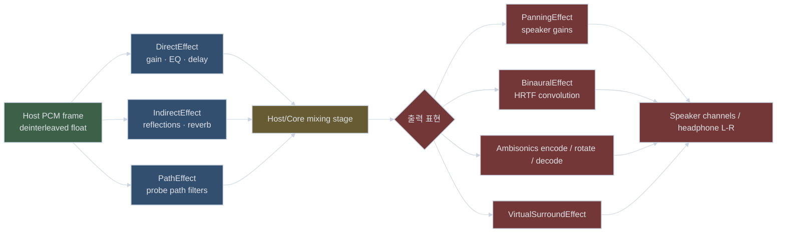

---

# 1. 이 Overview의 범위

Steam Audio Core에서 는 이미 계산된 음향 파라미터를 실제 오디오 샘플에 적용한다. Geometry query와 propagation simulation을 수행하지 않으며, Simulation이 만든 결과와 
Host의 PCM frame을 받아 DSP를 실행한다.

Effect 흐름을 알아야 하는 이유는 시뮬레이션 값이 실제 청취 결과로 바뀌는 지점이 
여기이기  때문이다. 세부 실행 순서는 [[core_01_architecture_flow|Core Architecture Flow]], 각 <strong style="color:#b3f594">Simulation</strong> 결과의 생산은
[[core_03_simulation_overview|Simulation Overview]]를 참고한다.

---

# 2. Effect pipeline 전체



그림은 개념적 연결이다. 실제 Host integration에서 각 Effect를 어느 순서로 만들고 
믹싱하는지 는 사용 중인 API 및 엔진 plugin에 따라 다르다. 
특히 여러 source의 합산과 최종 channel layout이 어느 계층에서 처리되는지 확인해야 한다.

---

# 3. DirectEffect: <strong style="color:#b3f594">직접음</strong> parameter 적용

`DirectEffect`는 `IPLDirectEffectParams`를 이용해 direct level과 spectral character를 
입력 PCM에 적용한다.

| 입력 파라미터               | 주로 적용되는 신호 처리                      |
| --------------------- | ---------------------------------- |
| `distanceAttenuation` | 전체 gain 감소                         |
| `airAbsorption[band]` | 대역별 EQ                             |
| `directivity`         | 전체 gain 변화                         |
| `occlusion`           | 차폐에 따른 gain 변화                     |
| `transmission[band]`  | transmission type 설정에 따른 전체/대역별 변화 |
| flags                 | 어떤 계산 결과를 effect에서 실제 적용할지 선택      |

`DirectSimulator`는 값들을 계산하고 `DirectEffect`가 오디오를 가공한다. 
API 연결은 `iplSourceGetOutputs`의 `outputs.direct`를 `iplDirectEffectApply`의 
`params`에 전달하는 방식으로 이루어진다.


```text
DirectSimulator
      │ IPLDirectEffectParams
      ▼
DirectEffect::apply
      ├─ calculateGainAndEQ
      ├─ EQEffect (frequency-dependent terms)
      ├─ GainEffect (frequency-independent terms)
      └─ per-sample/per-channel processing
```

개별 상세: [[core_direct_effect|DirectEffect]], [[core_eqeffect|EQEffect]], [[core_air_absorption|Air Absorption]]

---

# 4. IndirectEffect: 반사음과 잔향 재생

Indirect Effect는 reflection simulation에서 만들어진 IR이나 <strong style="color:#b3f594">reverb</strong> parameter를 
audio frame에 적용한다. Core는 여러 렌더링 전략을 제공한다.

<strong style="color:#b3f594">Convolution</strong>
- 입력과 IR의 convolution- trade-off 
- 공간 impulse response를 상세하게 반영하지만 계산량·메모리 사용량이 커질 수 있다. 

<strong style="color:#b3f594">Parametric reverb</strong>
- delay/filter network 기반 tail -trade-off
- 상대적으로 효율적이지만 구체적인 IR sample을 그대로 재생하지 않는다.

**<strong style="color:#b3f594">Hybrid reverb</strong>
- <strong style="color:#ffb15b">초기 convolution + 후기 parametric reverb</strong>
- 초반 반사 디테일과 긴 tail 비용을 조절한다.

Convolution은 FFT를 사용하는 partitioned convolution 구현을 포함한다. 
IR 생성·partition과 audio frame convolution이 다른 thread/context에서 수행될 수 있으므로 
새 IR을 audio path로 교체하는 handoff가 중요하다.

반사 simulation과 IR의 생성 단계는 [[core_05_reflections_reverb_overview|Reflections & Reverb Overview]]에서 다룬다.
이 페이지는 만들어진 결과를 샘플에 적용하는 Effect 측에 초점을 둔다.

---

# 5. PathEffect: 다중 <strong style="color:#b3f594">probe</strong> 경로 재생

Pathing은 source와 listener 사이에 여러 probe 경로가 있을 수 있다. 
`PathEffect`는 경로별 attenuation, delay, EQ, 방향 표현을 적용하고 적절히 합산한다. 
따라서 직접 경로 하나에 주로 작동하는 `DirectEffect`와 문제 설정이 다르다.

```text
PathSimulator output
  ├─ path 0: gain / delay / EQ / arrival direction
  ├─ path 1: gain / delay / EQ / arrival direction
  └─ path N: ...
                  │
                  ▼
              PathEffect
                  │
                  ▼
       path contributions combined
```

경로를 어떻게 찾는지는 [[core_06_pathing_overview|Pathing Overview]]와 [[core_path_finder|PathFinder]]를 참고한다.

---

# 6. Spatial Rendering


**방향을 출력 채널로 바꾸기**
Direct/Indirect/Path Effect가 소리를 감쇠하거나 시간/주파수 응답을 바꾸는 것과, 
그 소리를 어느 speaker/귀에 어떻게 분배하는 것은 별도의 관심사다. 
Spatial rendering은 방향 표현과 출력 기기 사이의 연결을 맡는다.

## 6.1 <strong style="color:#b3f594">Panning</strong>

Panning은 source 방향을 speaker 방향과 비교해 각 채널의 gain을 계산한다. 
Stereo나 surround speaker set에서 방향 인상을 채널별 level 분배로 만든다. 
[[core_panning_effect|PanningEffect 상세]]

## 6.2 Binaural/<strong style="color:#b3f594">HRTF</strong>

Binaural rendering은 source 방향에 따라 좌우 귀에 도달하는 신호 차이를 HRTF 필터로 표현한다.
HRTF는 방향별 필터 데이터이고, HRTF database/map은 방향 측정점과 interpolation을 관리한다.
기본 CIPIC 데이터나 SOFA 기반 데이터가 사용될 수 있다.

관련 구현: `hrtf_database.*`, `hrtf_map.*`, `sofa_hrtf_map.*`, `binaural_effect.*`, `cipic_124.inl`.

## 6.3 <strong style="color:#b3f594">Ambisonics</strong>

Ambisonics는 방향 음장을 채널별 speaker signal이 아닌 spherical harmonics 계수로 표현한다.
Core에는 encode, rotate, decode, panning, binaural 처리 모듈이 있다.

```text
directional source → Ambisonics encode → rotate by listener orientation
                   → binaural decode or speaker decode → output channels
```

Ambisonics는 propagation algorithm이 아니라 방향 음장의 표현/회전/재생 형식이다.

---

# 7. <strong style="color:#b3f594">오디오 버퍼</strong> 계약

Steam Audio의 `IPLAudioBuffer`는 32-bit float PCM을 사용하며 모든 채널 데이터는 <strong style="color:#b3f594">deinterleaved</strong> 형식이다.

```text
stereo interleaved:   L0 R0 L1 R1 L2 R2 ...
stereo deinterleaved: data[0] = L0 L1 L2 ...
                      data[1] = R0 R1 R2 ...
```


Effect 생성 설정의 channel 수, 입력/출력 `IPLAudioBuffer`의 channel 수와 frame size는 
일치해야 한다. 입력/출력은 같은 메모리를 이용하는 in-place 처리도 가능한 Effect가 있지만, 
개별 API 주석을 확인한다.
Buffer allocation을 Core helper로 할지 Host가 직접 할지에 따라 메모리 소유권과 
해제 방식도 결정해야 한다.


문서
- [[core_audiobuffer|AudioBuffer]] 
- API 호출 예시: [[core_02_host_c_api_overview#5. 시뮬레이션 결과를 Effect와 오디오


> [!info] 왜 <strong style="color:#b3f594">deinterleaved</strong> 형식을 사용하는가?
> Steam Audio 내부의 많은 DSP 연산은 채널별로 독립된 샘플 구간을 처리한다.
> 채널 샘플이 연속 메모리에 놓이면 루프가 다음 샘플로 순차 접근할 수 있어
> <strong style="color:#b3f594">메모리 접근이 단순하고 SIMD 벡터화에 유리</strong>하다.
>  예) gain 을 변경할때
>  interleave = 같은 채널 샘플사이에 다른 채널 data가 있어서 stride 접근이 필요
>  deinterleave - 한번의 vector operation으로 가능
>  
> 이 선택이 모든 연산에서 항상 빠르다는 뜻은 아니다.
> 채널 간 연산이나 <strong style="color:#b3f594">interleaved</strong> 입출력을 요구하는 Host와 연결할 때는
> 변환 비용이 생길 수 있다.
> 따라서 Steam Audio는 내부 DSP 처리 형식을 deinterleaved로 고정하고,
> Host 형식이 interleaved라면 버퍼 경계에서 명시적으로 변환하도록 계약한다.
> 
> 


---

# 8. Effect 공통 패턴

대부분의 Effect는 다음 단계를 따른다.

1. Context와 audio settings로 생성한다.
2. Effect별 settings에 채널 수, HRTF, speaker layout 등을 전달한다.
3. 매 frame parameters와 input/output `IPLAudioBuffer`를 준비한다.
4. `ipl...Apply`를 호출해 effect state를 처리한다.
5. tail이 있는 Effect라면 입력이 끝난 뒤에도 tail API를 확인해 남은 샘플을 출력한다.
6. 사용 종료 시 해당 handle을 release한다.

Effect는 simulation output이 없더라도 독립적으로 쓸 수 있는 경우가 있다. 
예를 들어 HRTF binauralizer는 input audio, direction/coordinate와 HRTF 데이터로 공간 
렌더링한다. 반대로 `DirectEffect`는 direct simulation에서 계산한 파라미터를 입력받는 
식으로 두 계층이 연동된다.

---

# 9. 주요 파일 지도

<strong style="color:#b3f594">Direct effect</strong>

- direct_effect.h [링크](https://github.com/ValveSoftware/steam-audio/blob/v4.8.1/core/src/core/direct_effect.h) / direct_effect.cpp [링크](https://github.com/ValveSoftware/steam-audio/blob/v4.8.1/core/src/core/direct_effect.cpp)
- gain_effect.h [링크](https://github.com/ValveSoftware/steam-audio/blob/v4.8.1/core/src/core/gain_effect.h) / gain_effect.cpp [링크](https://github.com/ValveSoftware/steam-audio/blob/v4.8.1/core/src/core/gain_effect.cpp)
- eq_effect.h [링크](https://github.com/ValveSoftware/steam-audio/blob/v4.8.1/core/src/core/eq_effect.h) / eq_effect.cpp [링크](https://github.com/ValveSoftware/steam-audio/blob/v4.8.1/core/src/core/eq_effect.cpp)
- delay.h [링크](https://github.com/ValveSoftware/steam-audio/blob/v4.8.1/core/src/core/delay.h) / delay.cpp [링크](https://github.com/ValveSoftware/steam-audio/blob/v4.8.1/core/src/core/delay.cpp)
- delay_effect.h [링크](https://github.com/ValveSoftware/steam-audio/blob/v4.8.1/core/src/core/delay_effect.h) / delay_effect.cpp [링크](https://github.com/ValveSoftware/steam-audio/blob/v4.8.1/core/src/core/delay_effect.cpp)

<strong style="color:#b3f594">Indirect / reverb</strong>

- indirect_effect.h [링크](https://github.com/ValveSoftware/steam-audio/blob/v4.8.1/core/src/core/indirect_effect.h) / indirect_effect.cpp [링크](https://github.com/ValveSoftware/steam-audio/blob/v4.8.1/core/src/core/indirect_effect.cpp)
- reverb_effect.h [링크](https://github.com/ValveSoftware/steam-audio/blob/v4.8.1/core/src/core/reverb_effect.h) / reverb_effect.cpp [링크](https://github.com/ValveSoftware/steam-audio/blob/v4.8.1/core/src/core/reverb_effect.cpp)
- reverb_estimator.h [링크](https://github.com/ValveSoftware/steam-audio/blob/v4.8.1/core/src/core/reverb_estimator.h) / reverb_estimator.cpp [링크](https://github.com/ValveSoftware/steam-audio/blob/v4.8.1/core/src/core/reverb_estimator.cpp)
- hybrid_reverb_effect.h [링크](https://github.com/ValveSoftware/steam-audio/blob/v4.8.1/core/src/core/hybrid_reverb_effect.h) / hybrid_reverb_effect.cpp [링크](https://github.com/ValveSoftware/steam-audio/blob/v4.8.1/core/src/core/hybrid_reverb_effect.cpp)
- hybrid_reverb_estimator.h [링크](https://github.com/ValveSoftware/steam-audio/blob/v4.8.1/core/src/core/hybrid_reverb_estimator.h) / hybrid_reverb_estimator.cpp [링크](https://github.com/ValveSoftware/steam-audio/blob/v4.8.1/core/src/core/hybrid_reverb_estimator.cpp)
- overlap_add_convolution_effect.h [링크](https://github.com/ValveSoftware/steam-audio/blob/v4.8.1/core/src/core/overlap_add_convolution_effect.h) / overlap_add_convolution_effect.cpp [링크](https://github.com/ValveSoftware/steam-audio/blob/v4.8.1/core/src/core/overlap_add_convolution_effect.cpp)
- overlap_save_convolution_effect.h [링크](https://github.com/ValveSoftware/steam-audio/blob/v4.8.1/core/src/core/overlap_save_convolution_effect.h) / overlap_save_convolution_effect.cpp [링크](https://github.com/ValveSoftware/steam-audio/blob/v4.8.1/core/src/core/overlap_save_convolution_effect.cpp)
- tan_convolution_effect.h [링크](https://github.com/ValveSoftware/steam-audio/blob/v4.8.1/core/src/core/tan_convolution_effect.h) / tan_convolution_effect.cpp [링크](https://github.com/ValveSoftware/steam-audio/blob/v4.8.1/core/src/core/tan_convolution_effect.cpp)

<strong style="color:#b3f594">Path effect</strong>

- path_effect.h [링크](https://github.com/ValveSoftware/steam-audio/blob/v4.8.1/core/src/core/path_effect.h) / path_effect.cpp [링크](https://github.com/ValveSoftware/steam-audio/blob/v4.8.1/core/src/core/path_effect.cpp)

<strong style="color:#b3f594">Panning / surround</strong>

- panning_effect.h [링크](https://github.com/ValveSoftware/steam-audio/blob/v4.8.1/core/src/core/panning_effect.h) / panning_effect.cpp [링크](https://github.com/ValveSoftware/steam-audio/blob/v4.8.1/core/src/core/panning_effect.cpp)
- virtual_surround_effect.h [링크](https://github.com/ValveSoftware/steam-audio/blob/v4.8.1/core/src/core/virtual_surround_effect.h) / virtual_surround_effect.cpp [링크](https://github.com/ValveSoftware/steam-audio/blob/v4.8.1/core/src/core/virtual_surround_effect.cpp)
- speaker_layout.h [링크](https://github.com/ValveSoftware/steam-audio/blob/v4.8.1/core/src/core/speaker_layout.h) / speaker_layout.cpp [링크](https://github.com/ValveSoftware/steam-audio/blob/v4.8.1/core/src/core/speaker_layout.cpp)

<strong style="color:#b3f594">Binaural / HRTF</strong>

- binaural_effect.h [링크](https://github.com/ValveSoftware/steam-audio/blob/v4.8.1/core/src/core/binaural_effect.h) / binaural_effect.cpp [링크](https://github.com/ValveSoftware/steam-audio/blob/v4.8.1/core/src/core/binaural_effect.cpp)
- hrtf.cpp [링크](https://github.com/ValveSoftware/steam-audio/blob/v4.8.1/core/src/core/hrtf.cpp)
- hrtf_database.h [링크](https://github.com/ValveSoftware/steam-audio/blob/v4.8.1/core/src/core/hrtf_database.h) / hrtf_database.cpp [링크](https://github.com/ValveSoftware/steam-audio/blob/v4.8.1/core/src/core/hrtf_database.cpp)
- hrtf_map.h [링크](https://github.com/ValveSoftware/steam-audio/blob/v4.8.1/core/src/core/hrtf_map.h) / hrtf_map.cpp [링크](https://github.com/ValveSoftware/steam-audio/blob/v4.8.1/core/src/core/hrtf_map.cpp)
- hrtf_map_factory.h [링크](https://github.com/ValveSoftware/steam-audio/blob/v4.8.1/core/src/core/hrtf_map_factory.h) / hrtf_map_factory.cpp [링크](https://github.com/ValveSoftware/steam-audio/blob/v4.8.1/core/src/core/hrtf_map_factory.cpp)
- sofa_hrtf_map.h [링크](https://github.com/ValveSoftware/steam-audio/blob/v4.8.1/core/src/core/sofa_hrtf_map.h) / sofa_hrtf_map.cpp [링크](https://github.com/ValveSoftware/steam-audio/blob/v4.8.1/core/src/core/sofa_hrtf_map.cpp)
- hrtf2sh.cpp [링크](https://github.com/ValveSoftware/steam-audio/blob/v4.8.1/core/src/core/hrtf2sh.cpp)

<strong style="color:#b3f594">Ambisonics</strong>

- ambisonics_binaural_effect.h [링크](https://github.com/ValveSoftware/steam-audio/blob/v4.8.1/core/src/core/ambisonics_binaural_effect.h) / ambisonics_binaural_effect.cpp [링크](https://github.com/ValveSoftware/steam-audio/blob/v4.8.1/core/src/core/ambisonics_binaural_effect.cpp)
- ambisonics_decode_effect.h [링크](https://github.com/ValveSoftware/steam-audio/blob/v4.8.1/core/src/core/ambisonics_decode_effect.h) / ambisonics_decode_effect.cpp [링크](https://github.com/ValveSoftware/steam-audio/blob/v4.8.1/core/src/core/ambisonics_decode_effect.cpp)
- ambisonics_encode_effect.h [링크](https://github.com/ValveSoftware/steam-audio/blob/v4.8.1/core/src/core/ambisonics_encode_effect.h) / ambisonics_encode_effect.cpp [링크](https://github.com/ValveSoftware/steam-audio/blob/v4.8.1/core/src/core/ambisonics_encode_effect.cpp)
- ambisonics_panning_effect.h [링크](https://github.com/ValveSoftware/steam-audio/blob/v4.8.1/core/src/core/ambisonics_panning_effect.h) / ambisonics_panning_effect.cpp [링크](https://github.com/ValveSoftware/steam-audio/blob/v4.8.1/core/src/core/ambisonics_panning_effect.cpp)
- ambisonics_rotate_effect.h [링크](https://github.com/ValveSoftware/steam-audio/blob/v4.8.1/core/src/core/ambisonics_rotate_effect.h) / ambisonics_rotate_effect.cpp [링크](https://github.com/ValveSoftware/steam-audio/blob/v4.8.1/core/src/core/ambisonics_rotate_effect.cpp)
- sh.h [링크](https://github.com/ValveSoftware/steam-audio/blob/v4.8.1/core/src/core/sh.h) / sh.cpp [링크](https://github.com/ValveSoftware/steam-audio/blob/v4.8.1/core/src/core/sh.cpp)
- spherical_harmonics.h [링크](https://github.com/ValveSoftware/steam-audio/blob/v4.8.1/core/src/core/sh/spherical_harmonics.h) / spherical_harmonics.cc [링크](https://github.com/ValveSoftware/steam-audio/blob/v4.8.1/core/src/core/sh/spherical_harmonics.cc)

<strong style="color:#b3f594">Audio sample storage와 DSP backend</strong>

- audio_buffer.h [링크](https://github.com/ValveSoftware/steam-audio/blob/v4.8.1/core/src/core/audio_buffer.h) / audio_buffer.cpp [링크](https://github.com/ValveSoftware/steam-audio/blob/v4.8.1/core/src/core/audio_buffer.cpp)
- array_math.h [링크](https://github.com/ValveSoftware/steam-audio/blob/v4.8.1/core/src/core/array_math.h) / array_math.cpp [링크](https://github.com/ValveSoftware/steam-audio/blob/v4.8.1/core/src/core/array_math.cpp)
- ipp_array_math.cpp [링크](https://github.com/ValveSoftware/steam-audio/blob/v4.8.1/core/src/core/ipp_array_math.cpp) / vdsp_array_math.cpp [링크](https://github.com/ValveSoftware/steam-audio/blob/v4.8.1/core/src/core/vdsp_array_math.cpp)
- fft.h [링크](https://github.com/ValveSoftware/steam-audio/blob/v4.8.1/core/src/core/fft.h)
- ffts_fft.cpp [링크](https://github.com/ValveSoftware/steam-audio/blob/v4.8.1/core/src/core/ffts_fft.cpp) / ipp_fft.cpp [링크](https://github.com/ValveSoftware/steam-audio/blob/v4.8.1/core/src/core/ipp_fft.cpp)
- pffft_fft.cpp [링크](https://github.com/ValveSoftware/steam-audio/blob/v4.8.1/core/src/core/pffft_fft.cpp) / vdsp_fft.cpp [링크](https://github.com/ValveSoftware/steam-audio/blob/v4.8.1/core/src/core/vdsp_fft.cpp)
- float8_iir.cpp [링크](https://github.com/ValveSoftware/steam-audio/blob/v4.8.1/core/src/core/float8_iir.cpp) / float8_delay.cpp [링크](https://github.com/ValveSoftware/steam-audio/blob/v4.8.1/core/src/core/float8_delay.cpp)
- float8_reverb_effect.cpp [링크](https://github.com/ValveSoftware/steam-audio/blob/v4.8.1/core/src/core/float8_reverb_effect.cpp)

<strong style="color:#b3f594">Public C API wrappers</strong>

- api_direct_effect.h [링크](https://github.com/ValveSoftware/steam-audio/blob/v4.8.1/core/src/core/api_direct_effect.h) / api_direct_effect.cpp [링크](https://github.com/ValveSoftware/steam-audio/blob/v4.8.1/core/src/core/api_direct_effect.cpp)
- api_indirect_effect.h [링크](https://github.com/ValveSoftware/steam-audio/blob/v4.8.1/core/src/core/api_indirect_effect.h) / api_indirect_effect.cpp [링크](https://github.com/ValveSoftware/steam-audio/blob/v4.8.1/core/src/core/api_indirect_effect.cpp)
- api_path_effect.h [링크](https://github.com/ValveSoftware/steam-audio/blob/v4.8.1/core/src/core/api_path_effect.h) / api_path_effect.cpp [링크](https://github.com/ValveSoftware/steam-audio/blob/v4.8.1/core/src/core/api_path_effect.cpp)
- api_panning_effect.h [링크](https://github.com/ValveSoftware/steam-audio/blob/v4.8.1/core/src/core/api_panning_effect.h) / api_panning_effect.cpp [링크](https://github.com/ValveSoftware/steam-audio/blob/v4.8.1/core/src/core/api_panning_effect.cpp)
- api_virtual_surround_effect.h [링크](https://github.com/ValveSoftware/steam-audio/blob/v4.8.1/core/src/core/api_virtual_surround_effect.h) / api_virtual_surround_effect.cpp [링크](https://github.com/ValveSoftware/steam-audio/blob/v4.8.1/core/src/core/api_virtual_surround_effect.cpp)
- api_binaural_effect.h [링크](https://github.com/ValveSoftware/steam-audio/blob/v4.8.1/core/src/core/api_binaural_effect.h) / api_binaural_effect.cpp [링크](https://github.com/ValveSoftware/steam-audio/blob/v4.8.1/core/src/core/api_binaural_effect.cpp)
- api_hrtf.h [링크](https://github.com/ValveSoftware/steam-audio/blob/v4.8.1/core/src/core/api_hrtf.h) / api_hrtf.cpp [링크](https://github.com/ValveSoftware/steam-audio/blob/v4.8.1/core/src/core/api_hrtf.cpp)
- api_ambisonics_binaural_effect.h [링크](https://github.com/ValveSoftware/steam-audio/blob/v4.8.1/core/src/core/api_ambisonics_binaural_effect.h) / api_ambisonics_binaural_effect.cpp [링크](https://github.com/ValveSoftware/steam-audio/blob/v4.8.1/core/src/core/api_ambisonics_binaural_effect.cpp)
- api_ambisonics_decode_effect.h [링크](https://github.com/ValveSoftware/steam-audio/blob/v4.8.1/core/src/core/api_ambisonics_decode_effect.h) / api_ambisonics_decode_effect.cpp [링크](https://github.com/ValveSoftware/steam-audio/blob/v4.8.1/core/src/core/api_ambisonics_decode_effect.cpp)
- api_ambisonics_encode_effect.h [링크](https://github.com/ValveSoftware/steam-audio/blob/v4.8.1/core/src/core/api_ambisonics_encode_effect.h) / api_ambisonics_encode_effect.cpp [링크](https://github.com/ValveSoftware/steam-audio/blob/v4.8.1/core/src/core/api_ambisonics_encode_effect.cpp)
- api_ambisonics_panning_effect.h [링크](https://github.com/ValveSoftware/steam-audio/blob/v4.8.1/core/src/core/api_ambisonics_panning_effect.h) / api_ambisonics_panning_effect.cpp [링크](https://github.com/ValveSoftware/steam-audio/blob/v4.8.1/core/src/core/api_ambisonics_panning_effect.cpp)
- api_ambisonics_rotate_effect.h [링크](https://github.com/ValveSoftware/steam-audio/blob/v4.8.1/core/src/core/api_ambisonics_rotate_effect.h) / api_ambisonics_rotate_effect.cpp [링크](https://github.com/ValveSoftware/steam-audio/blob/v4.8.1/core/src/core/api_ambisonics_rotate_effect.cpp)
- api_audio_buffer.cpp [링크](https://github.com/ValveSoftware/steam-audio/blob/v4.8.1/core/src/core/api_audio_buffer.cpp)

---
