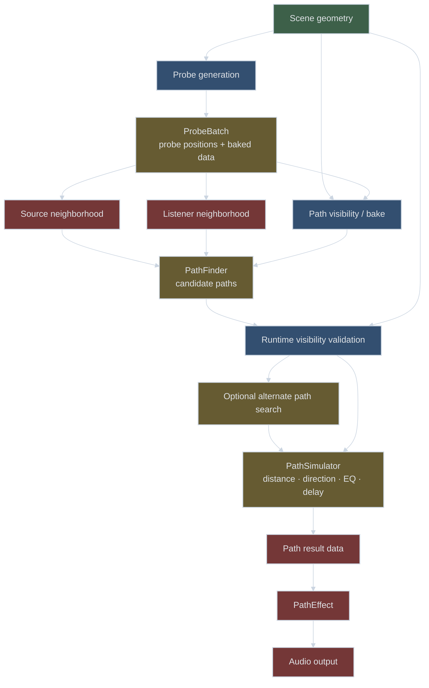

---

# 1. Pathing이 모델링하는 것

Pathing은 source와 listener 사이에 직접 보이지 않는 우회 경로가 있는 경우를 다룬다. 
벽 모서리를 돌아가거나 복도/문을 통해 전달되는 소리는 source-listener 사이의 
직선 ray 하나로 충분히 설명되지 않는다.

Core Pathing은 **<strong style="color:#b3f594">Probe</strong> Batch와 미리 준비한 probe 간 경로/visibility 정보**를 사용해 
후보 경로를 찾고, 현재 source/listener 위치에 해당하는 경로 음향 특성을 계산한다. 
최종 path parameter는 [[core_04_effect_overview|PathEffect]]에서 오디오에 적용된다.

- 상위 안내- [[core_00_overview|Core Overview]] · 
- Simulation내 위치- [[core_03_simulation_overview|Simulation Overview]] 
- 경로 탐색 알고리즘 상세 - [[core_path_finder|PathFinder]]

---

# 2. <strong style="color:#b3f594">Pathing</strong> architecture



이 도식은 개념을 설명한다. 
실제 실행 단계와 probe neighborhood 생성은 설정 및 현재 <strong style="color:#b3f594">scene</strong>/probe 상태에 따라 
달라질 수 있다.

---

# 3. Probe와 <strong style="color:#b3f594">ProbeBatch</strong>

Probe는 공간 안의 샘플 위치다. Probe를 통해 공간 전체의 모든 좌표에서 복잡한 경로 탐색을
처음부터 하는 대신, bake 단계에서 준비한 공간 정보를 runtime lookup의 기반으로 
사용할 수 있다.

<strong style="color:#b3f594">Probe generation</strong>
- 지정한 Scene 영역에 probe 위치를 만든다.

<strong style="color:#b3f594">ProbeBatch</strong>
- probe들과 관련 baked data를 묶어 관리한다.

<strong style="color:#b3f594">Probe neighborhood</strong>
- 현재 source 또는 listener 주위에서 경로 탐색에 참고할 probe 집합이다.

<strong style="color:#b3f594">Probe connectivity/visibility</strong>
- 두 probe 사이 경로 segment가 통과 가능한지를 표현하는 데 사용된다.


Probe spacing은 세밀할수록 공간 변화를 더 잘 포착할 수 있지만, 
생성/저장/탐색할 데이터도  늘어난다. 
장면의 구조와 경로 품질 예산에 맞춰 설정한다.

Probe 위치 생성의 실제 centroid/grid/raycast
- [[core_probe_generator|ProbeGenerator 분석]]

batch와 serialization
- [[core_probe_batch|ProbeBatch 분석]], 

다중 batch neighborhood와 가중치
- [[core_probe_manager|ProbeManager 분석]]

주요 파일: probe.h [링크](https://github.com/ValveSoftware/steam-audio/blob/v4.8.1/core/src/core/probe.h), probe_data.h [링크](https://github.com/ValveSoftware/steam-audio/blob/v4.8.1/core/src/core/probe_data.h), 
`probe_batch.*`, `probe_generator.*`, `probe_manager.*`, `probe_tree.*`, `octree_probes.*`.

---

# 4. Bake 경로와 Runtime 경로 평가

## 4.1 Bake 단계

Bake는 probe 쌍 사이의 visibility/path 관련 정보를 저장한다. 

<strong style="color:#b3f594">visibility graph</strong>
- [[core_path_visibility|ProbeVisibilityGraph 분석]],

<strong style="color:#b3f594">probe pair shortest route와 compact serialized representation</strong>
-  [[core_path_data|PathData / BakedPathData 분석]]

<strong style="color:#b3f594">Probe grid 생성과 batch 등록</strong>
- [[core_probe_generator|ProbeGenerator]]와 [[core_probe_batch|ProbeBatch]]


이후 runtime search가 매번 모든 공간 관계를 새로 평가하지 않도록 정적인 
정보의 일부를  미리 계산한다.

```text
Scene + ProbeBatch
       │
       ├─ candidate probe pair 생성
       ├─ geometry visibility query
       ├─ path/visibility data 구성
       └─ data 저장 또는 ProbeBatch에 연결
```

## 4.2 Runtime 단계

Runtime은 현재 source/listener 위치를 probe neighborhood에 연결하고, 
후보 probe 경로 중 사용할 경로를 찾는다. 
전체 orchestration은 [[core_path_simulator|PathSimulator 코드분석]] 
개별 graph search는 [[core_path_finder|PathFinder 알고리즘과 코드 분석]]에서 확인한다. 
Source/listener가 움직이면 neighborhood와 선택 경로가 달라질 수 있다.

ProbeManager가 여러 batch의 후보를 합치고 <strong style="color:#b3f594">occlusion</strong>/weight를 처리하는 실제 코드는
[[core_probe_manager|ProbeManager와 ProbeNeighborhood]]를 참고한다.

```text
current source/listener transforms
                │
                ▼
      source/listener neighborhoods
                │
                ▼
     path search + visibility checks
                │
                ▼
      path-specific acoustic result
```

사전 계산 정보가 있더라도 runtime 평가가 0이 되는 것은 아니다. 
현재 위치에 대한 query, 보간, dynamic geometry validation 등이 남을 수 있다.

---

# 5. Dijkstra와 A*가 나타나는 이유

Path finding은 probe들을 graph node로, 가시 경로 segment를 edge로 볼 수 있다.


Graph와 A*/Dijkstra 기초는 [[Programming/Algorithm/algo_ProbeVisibilityGraph|Probe
Visibility Graph 학습]]과 [[Programming/Algorithm/algo_AStar_Dijkstra|A*/Dijkstra 학습]]에서 먼저 공부할 수 있다. 
Bake 쪽에서는 다수의 시작 지점에 대한 정보를 미리 계산하는 접근이 필요하고, 
runtime에서는 현재 source/listener와 관련된 목표 경로를 효율적으로 찾는 접근이 유용하다.

`path_finder.*`에는 탐색 목적에 맞춘 Dijkstra/A* 계열 동작이 존재한다. 
실제 priority queue, 비용/부모 scratch 및 path reconstruction은 
[[core_path_finder|PathFinder구현 분석]]에서 함수 단위로 따라간다. 
차이는 단순히 “둘 중 더 빠른 알고리즘”이 아니라, 계산을 언제 수행하고 얼마만큼의 
사전 정보를 활용하는가와 연관된다.

알고리즘과 구현 단계별 설명은 [[core_path_finder|PathFinder 분석]]을 참고한다.

---

# 6. Runtime validation과 alternate path

정적 bake 이후 Scene에 문, 가구, 이동 객체 등이 바뀌면 probe 간에 유효했던 
segment가 차단될 수 있다. Source inputs에는 baked path validation 및 필요할 때 
alternate path를 찾기 위한 설정이 있다.

```text
baked candidate path
        │
        ▼
current scene visibility test
   ┌────┴─────┐
 visible   blocked
   │          │
 use path    optional alternate search
               │
               ▼
          use new path if found
```

Validation은 dynamic geometry 변화를 반영하는 데 도움이 되지만, 
추가 ray/visibility query 비용이 발생한다. 
무조건 모든 path에 같은 강도로 적용하는 기능이 아니라 품질과 실행 예산을 맞추는 설정이다.

---

# 7. 경로의 음향 결과

Path Simulator는 선택한 probe segments와 source/listener의 위치를 바탕으로 경로별 
음향 특성을 계산한다. 

계산 모듈
- [[core_path_simulator|PathSimulator]]

bend angle 모델
- [[core_deviation_model|DeviationModel]],

결과 구조
- [[core_path_data|SoundPath]]

경로 효과에는 다음 종류의 값이 중요하다.
- source에서 첫 probe, probe 사이 segment, 마지막 probe에서 listener까지의 거리/감쇠
- bend angle과 경로 방향 변화에 따른 대역별 deviation attenuation
- 최종 도착 방향 및 <strong style="color:#b3f594">Ambisonics</strong>/SH 방향 정보
- 여러 경로를 구분하기 위한 delay
- frequency-dependent EQ 계수

직접음은 대개 source-listener 단일 path를 대상으로 하고, 
Pathing은 여러 probe segment로 구성된 후보 경로들을 다룬다. 
따라서 `DirectEffect`와 `PathEffect`는 결과 구조와 처리 방식이 다르다. 
PCM 적용 단계는 [[core_path_effect|PathEffect 코드 분석]]에서 볼 수 있다.

---

# 8. 주요 파일을 따라 읽기

| 순서 | 파일 | 살펴볼 내용 |
|---:|---|---|
| 1 | `probe_generator.*` | 공간에 probe 위치를 만드는 방식 |
| 2 | `probe_batch.*`, `probe_manager.*`, `probe_tree.*` | probe와 batch를 저장/lookup하는 구조 |
| 3 | `path_finder.*`, `path_visibility.*` | graph 구성, visibility, 경로 탐색 |
| 4 | `path_simulator.*` | 현재 입력에서 경로별 음향 결과 계산 |
| 5 | `path_effect.*` | path results를 오디오 신호에 적용 |
| 6 | `api_probes.*`, `api_simulator.*`, `api_path_effect.*` | public API부터 내부 implementation까지 연결 |

실제 Core 흐름에서 Pathing이 <strong style="color:#b3f594">SimulationManager</strong> 및 Effect와 연결되는 위치:
[[core_01_architecture_flow#10. Pathing|Architecture Flow: Pathing]]

---
