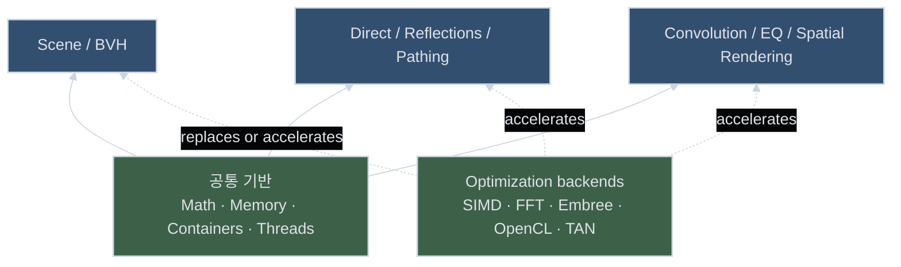

---

# 1. Indtroduction

Core의 geometry, <strong style="color:#b3f594">simulation</strong>, <strong style="color:#b3f594">effect</strong> 코드는 여러 공통 기반 기능을 사용한다.
Vector/Matrix 연산, 메모리 관리, 자료구조, thread scheduling, <strong style="color:#b3f594">SIMD</strong>, FFT는 그 자체로 
음향 기능이기보다 상위 기능들이 사용할 공통 building block이다.



상위 guide: [[core_00_overview|Core Overview]] · 구현 위치와 전파 경로: [[core_01_architecture_flow|Architecture Flow]]

---

# 2. Math와 coordinate system

Core의 Vector, Matrix, Quaternion, Box, Sphere, Triangle 등은 공간 계산과 
geometry query의 기반이다.
<strong style="color:#b3f594">Scene</strong> transform, ray-triangle intersection, source/listener 거리/방향, speaker 방향은 
모두 같은 좌표 convention을 공유해야 한다.

- Vector는 위치, 방향, normal, ray 방향 같은 3차원 값을 표현한다.
- Matrix와 Quaternion은 transform/회전 변환을 다룬다.
- CoordinateSpace는 origin과 orientation basis를 묶어 source/listener 공간을 표현한다.
- Box/Sphere/Triangle은 ray query와 BVH의 geometry primitive다.

좌표 규약이 API boundary와 내부 math에서 일관되지 않으면 
geometry intersection과 source/listener 방향이 어긋난다. 
Dependency가 실제 build에 포함되는 조건은 [[core_10_dependencies_overview|Dependencies Overview]]에서 확인한다. 
상세: [[core_matrix|Matrix/좌표 변환]], [[core_scene|Scene]], [[core_bvh|BVH]]

---

# 3. Container와 memory

Core 내부는 STL만 일률적으로 사용하는 것이 아니라 라이브러리의 allocator, alignment,
custom container들을 함께 사용한다. 
SIMD 데이터는 특정 alignment를 요구할 수 있고, API handle 객체는 Context/Library가 
소유하는 메모리와 함께 정리되어야 한다.

<strong style="color:#b3f594">Array/container</strong>
- contiguous data, custom vector/map/stack 등을 제공 
- [Memory Allocator](core_memory_allocator.md) 

<strong style="color:#b3f594">Memory allocator</strong>
- aligned allocation과 사용자 allocator 연결
- [Memory Allocator](core_memory_allocator.md)

<strong style="color:#b3f594">Utility/error/log</strong>
- 범위 공통의 도우미와 실패 전달 
- [Core Util](core_util.md)

<strong style="color:#b3f594">Triple buffer</strong>
- producer와 audio consumer 사이의 결과 교환 
- triple_buffer.h [링크](https://github.com/ValveSoftware/steam-audio/blob/v4.8.1/core/src/core/triple_buffer.h), [Reflection 결과 전달 설명](core_01_architecture_flow.md)

메모리 소유권을 따라갈 때는 “어느 API가 allocate했는가”, “누가 release해야 하는가”, 
“audio thread가 읽는 동안 writer가 수정하는가”를 같이 확인한다.

---

# 4. JobGraph와 <strong style="color:#b3f594">ThreadPool</strong>

시뮬레이션의 일부 작업은 여러 source, ray batch, probe 등을 기준으로 나누어 실행할 수 있다.
`ThreadPool`은 worker를 제공하고, `Job`/`JobGraph`는 작업과 dependency를 표현한다.
`SimulationManager`는 이 기반 위에서 필요한 계산을 조정한다.

```text
SimulationManager
      │ create job graph
      ├─► Direct / source jobs
      ├─► Reflection ray batches
      ├─► reconstruction jobs
      └─► dependencies / completion
                 │
                 ▼
            ThreadPool workers
```

Audio callback에서 오래 걸리는 ray tracing,  IR generation, partitioning을 바로 수행하지 않도록
\Simulation과 Effect thread를 분리한다. 
실제 job dependency와 result handoff는 [[core_03_simulation_overview|Simulation Overview]]와 [[core_05_reflections_reverb_overview|Reflections & Reverb Overview]]
에서 사용 사례를 볼 수 있다.

---

# 5. SIMD: CPU vector operations

SIMD는 하나의 명령으로 여러 sample/vector lane에 같은 연산을 적용한다. 
Core는 공통 float4/float8 추상화와 CPU별 구현을 둘 수 있다.

| 구현              | 주된 대상                                         |
| --------------- | --------------------------------------------- |
| SSE float4      | x86 128-bit vector path                       |
| NEON float4     | ARM SIMD vector path                          |
| AVX float8      | x86 256-bit vector path, build option에 따라 활성화 |
| Scalar fallback | SIMD 지원이 없거나 비활성인 경우                          |

Context는 startup 설정/CPU capability에 따라 사용할 수 있는 SIMD 수준을 제한하거나
자동 선택할 수 있다. 모든 알고리즘이 SIMD로 구현되는 것은 아니며, vectorizable loops와
DSP/math kernel에서 이점이 크다.

상세 분석: [[core_simd|SIMD 구조]]

---

# 6. FFT와 <strong style="color:#b3f594">convolution</strong> backend

Convolution을 frequency domain에서 계산하면 sample count가 큰 경우 
direct multiply-accumulate 방식보다 유리할 수 있다. 
Core는 공통 <strong style="color:#b3f594">FFT</strong> interface를 두고 플랫폼/빌드에 따라 IPP, FFTS, PFFFT, vDSP 
같은 구현을 연결한다.

```text
Convolution Effect
       │ forward/inverse FFT request
       ▼
      fft.h interface
       ├─ IPP implementation
       ├─ FFTS implementation
       ├─ PFFFT fallback
       └─ vDSP platform implementation
```

FFT backend의 선택은 reflection algorithm과 다른 축이다. 
Reflection Simulation은 어떤 에너지/IR을 만들지 결정하고, FFT backend는 IR과 audio를 
효율적으로 convolution하는 계산 primitive를 제공한다.

---

# 7. Hardware backend

Hardware backend는 상위 기능에 대체 계산 implementation을 제공한다.

<strong style="color:#b3f594">Built-in BVH / CPU</strong>

- bvh.h [링크](https://github.com/ValveSoftware/steam-audio/blob/v4.8.1/core/src/core/bvh.h) / bvh.cpp [링크](https://github.com/ValveSoftware/steam-audio/blob/v4.8.1/core/src/core/bvh.cpp)
- scene.h [링크](https://github.com/ValveSoftware/steam-audio/blob/v4.8.1/core/src/core/scene.h) / scene.cpp [링크](https://github.com/ValveSoftware/steam-audio/blob/v4.8.1/core/src/core/scene.cpp)
- static_mesh.h [링크](https://github.com/ValveSoftware/steam-audio/blob/v4.8.1/core/src/core/static_mesh.h) / static_mesh.cpp [링크](https://github.com/ValveSoftware/steam-audio/blob/v4.8.1/core/src/core/static_mesh.cpp)
- instanced_mesh.h [링크](https://github.com/ValveSoftware/steam-audio/blob/v4.8.1/core/src/core/instanced_mesh.h) / instanced_mesh.cpp [링크](https://github.com/ValveSoftware/steam-audio/blob/v4.8.1/core/src/core/instanced_mesh.cpp)
- reflection_simulator.h [링크](https://github.com/ValveSoftware/steam-audio/blob/v4.8.1/core/src/core/reflection_simulator.h) / reflection_simulator.cpp [링크](https://github.com/ValveSoftware/steam-audio/blob/v4.8.1/core/src/core/reflection_simulator.cpp)

<strong style="color:#b3f594">Embree + ISPC</strong>

- embree_device.h [링크](https://github.com/ValveSoftware/steam-audio/blob/v4.8.1/core/src/core/embree_device.h) / embree_device.cpp [링크](https://github.com/ValveSoftware/steam-audio/blob/v4.8.1/core/src/core/embree_device.cpp)
- embree_scene.h [링크](https://github.com/ValveSoftware/steam-audio/blob/v4.8.1/core/src/core/embree_scene.h) / embree_scene.cpp [링크](https://github.com/ValveSoftware/steam-audio/blob/v4.8.1/core/src/core/embree_scene.cpp)
- embree_static_mesh.h [링크](https://github.com/ValveSoftware/steam-audio/blob/v4.8.1/core/src/core/embree_static_mesh.h) / embree_static_mesh.cpp [링크](https://github.com/ValveSoftware/steam-audio/blob/v4.8.1/core/src/core/embree_static_mesh.cpp)
- embree_instanced_mesh.h [링크](https://github.com/ValveSoftware/steam-audio/blob/v4.8.1/core/src/core/embree_instanced_mesh.h) / embree_instanced_mesh.cpp [링크](https://github.com/ValveSoftware/steam-audio/blob/v4.8.1/core/src/core/embree_instanced_mesh.cpp)
- embree_reflection_simulator.h [링크](https://github.com/ValveSoftware/steam-audio/blob/v4.8.1/core/src/core/embree_reflection_simulator.h) / embree_reflection_simulator.cpp [링크](https://github.com/ValveSoftware/steam-audio/blob/v4.8.1/core/src/core/embree_reflection_simulator.cpp)
- embree_reflection_simulator.ispc [링크](https://github.com/ValveSoftware/steam-audio/blob/v4.8.1/core/src/core/embree_reflection_simulator.ispc)
- api_embree_device.h [링크](https://github.com/ValveSoftware/steam-audio/blob/v4.8.1/core/src/core/api_embree_device.h) / api_embree_device.cpp [링크](https://github.com/ValveSoftware/steam-audio/blob/v4.8.1/core/src/core/api_embree_device.cpp)

<strong style="color:#b3f594">Radeon Rays + OpenCL</strong>

- radeonrays_device.h [링크](https://github.com/ValveSoftware/steam-audio/blob/v4.8.1/core/src/core/radeonrays_device.h) / radeonrays_device.cpp [링크](https://github.com/ValveSoftware/steam-audio/blob/v4.8.1/core/src/core/radeonrays_device.cpp)
- radeonrays_scene.h [링크](https://github.com/ValveSoftware/steam-audio/blob/v4.8.1/core/src/core/radeonrays_scene.h) / radeonrays_scene.cpp [링크](https://github.com/ValveSoftware/steam-audio/blob/v4.8.1/core/src/core/radeonrays_scene.cpp)
- radeonrays_static_mesh.h [링크](https://github.com/ValveSoftware/steam-audio/blob/v4.8.1/core/src/core/radeonrays_static_mesh.h) / radeonrays_static_mesh.cpp [링크](https://github.com/ValveSoftware/steam-audio/blob/v4.8.1/core/src/core/radeonrays_static_mesh.cpp)
- radeonrays_reflection_simulator.h [링크](https://github.com/ValveSoftware/steam-audio/blob/v4.8.1/core/src/core/radeonrays_reflection_simulator.h) / radeonrays_reflection_simulator.cpp [링크](https://github.com/ValveSoftware/steam-audio/blob/v4.8.1/core/src/core/radeonrays_reflection_simulator.cpp)
- radeonrays_reflection_simulator.cl [링크](https://github.com/ValveSoftware/steam-audio/blob/v4.8.1/core/src/core/radeonrays_reflection_simulator.cl)
- api_radeonrays_device.h [링크](https://github.com/ValveSoftware/steam-audio/blob/v4.8.1/core/src/core/api_radeonrays_device.h) / api_radeonrays_device.cpp [링크](https://github.com/ValveSoftware/steam-audio/blob/v4.8.1/core/src/core/api_radeonrays_device.cpp)

<strong style="color:#b3f594">OpenCL compute resources</strong>

- opencl_device.h [링크](https://github.com/ValveSoftware/steam-audio/blob/v4.8.1/core/src/core/opencl_device.h) / opencl_device.cpp [링크](https://github.com/ValveSoftware/steam-audio/blob/v4.8.1/core/src/core/opencl_device.cpp)
- opencl_buffer.h [링크](https://github.com/ValveSoftware/steam-audio/blob/v4.8.1/core/src/core/opencl_buffer.h) / opencl_buffer.cpp [링크](https://github.com/ValveSoftware/steam-audio/blob/v4.8.1/core/src/core/opencl_buffer.cpp)
- opencl_kernel.h [링크](https://github.com/ValveSoftware/steam-audio/blob/v4.8.1/core/src/core/opencl_kernel.h) / opencl_kernel.cpp [링크](https://github.com/ValveSoftware/steam-audio/blob/v4.8.1/core/src/core/opencl_kernel.cpp)
- opencl_energy_field.h [링크](https://github.com/ValveSoftware/steam-audio/blob/v4.8.1/core/src/core/opencl_energy_field.h) / opencl_energy_field.cpp [링크](https://github.com/ValveSoftware/steam-audio/blob/v4.8.1/core/src/core/opencl_energy_field.cpp)
- opencl_impulse_response.h [링크](https://github.com/ValveSoftware/steam-audio/blob/v4.8.1/core/src/core/opencl_impulse_response.h) / opencl_impulse_response.cpp [링크](https://github.com/ValveSoftware/steam-audio/blob/v4.8.1/core/src/core/opencl_impulse_response.cpp)
- opencl_reconstructor.h [링크](https://github.com/ValveSoftware/steam-audio/blob/v4.8.1/core/src/core/opencl_reconstructor.h) / opencl_reconstructor.cpp [링크](https://github.com/ValveSoftware/steam-audio/blob/v4.8.1/core/src/core/opencl_reconstructor.cpp)
- api_opencl_device.h [링크](https://github.com/ValveSoftware/steam-audio/blob/v4.8.1/core/src/core/api_opencl_device.h) / api_opencl_device.cpp [링크](https://github.com/ValveSoftware/steam-audio/blob/v4.8.1/core/src/core/api_opencl_device.cpp)

<strong style="color:#b3f594">TrueAudio Next (TAN)</strong>

- tan_device.h [링크](https://github.com/ValveSoftware/steam-audio/blob/v4.8.1/core/src/core/tan_device.h) / tan_device.cpp [링크](https://github.com/ValveSoftware/steam-audio/blob/v4.8.1/core/src/core/tan_device.cpp)
- tan_convolution_effect.h [링크](https://github.com/ValveSoftware/steam-audio/blob/v4.8.1/core/src/core/tan_convolution_effect.h) / tan_convolution_effect.cpp [링크](https://github.com/ValveSoftware/steam-audio/blob/v4.8.1/core/src/core/tan_convolution_effect.cpp)

<strong style="color:#b3f594">Backend factory</strong>

- scene_factory.h [링크](https://github.com/ValveSoftware/steam-audio/blob/v4.8.1/core/src/core/scene_factory.h) / scene_factory.cpp [링크](https://github.com/ValveSoftware/steam-audio/blob/v4.8.1/core/src/core/scene_factory.cpp)
- reflection_simulator_factory.h [링크](https://github.com/ValveSoftware/steam-audio/blob/v4.8.1/core/src/core/reflection_simulator_factory.h) / reflection_simulator_factory.cpp [링크](https://github.com/ValveSoftware/steam-audio/blob/v4.8.1/core/src/core/reflection_simulator_factory.cpp)

Factory가 concrete backend를 선택하고, public/domain interface가 상위에서 그 차이를 감춘다.
지원 여부는 build options, device availability, API settings에 달려 있다.

Backend 역할: [[core_07_scene_geometry_overview#5. 구현 backend|Scene backend]], [[core_05_reflections_reverb_overview|Reflection/Reverb backend usage]]

---

# 8. Serialization은 연산 backend와 다른 관심사다

FlatBuffers `.fbs` schema는 저장하거나 전달할 데이터의 binary layout을 정의한다. 
Scene/mesh, <strong style="color:#b3f594">ProbeBatch</strong>, baked reflection, energy/path data 등 일부 정보를
serialize/deserialize할 때 사용된다.

```text
runtime object ─serialize─► FlatBuffers data ─load─► runtime object
```

저장 schema는 runtime class와 동일한 계층이 아니다. 저
장 필드와 runtime backend object 생성/복원 경로를 나눠 따라간다. 

관련 코드
- `serialized_object.*`, `*.fbs`, `api_serialized_object.*`.

---

# 9. 읽기 순서

1. [[core_01_architecture_flow|Architecture Flow]]에서 어느 상위 시스템이 공통 기반을 호출하는지 확인한다.
2. 관심 있는 기능에서 math/container/thread abstraction의 사용 위치를 찾는다.
3. 해당 abstraction이 CPU/backend-specific 구현으로 내려가는 factory 또는 
   compile-time guard를 찾는다.
4. 상위 algorithm과 low-level optimization의 책임을 분리해 이해한다.

예를 들어 reflections를 조사한다면 `reflection_simulator`가 ray와 energy를 다루는 
흐름을 먼저 이해하고, Embree/ISPC/OpenCL/float vectors가 어디서 그 작업을 가속하는지 
이어서 본다.

---
