---

# 1. Benchmark가 무엇인가

`core/src/benchmark`는 Steam Audio Core의 대표 workload에 대해 CPU 시간·효과 
생성 시간 ·frame 처리 부하·bake 처리량 등을 비교하는 성능 측정 프로그램이다. 
CMake target 이름은 <strong style="color:#b3f594">`phonon_perf`</strong>이며, correctness unit test나 표준 benchmark framework가
아니다.

> [!warning] 결과 해석
> 개별 benchmark마다 시간 측정 구간, 반복 횟수, 입력 크기, 출력 지표가 다르다. 
> 실행 결과를 서로 다른 benchmark 간에 직접 비교하거나,
> CPU/GPU·driver·build option이 다른 장비 사이의 절대값으로 비교하지 않는다.

---

# 2. 프로그램 구조

```mermaid
%%{init: {"theme":"base","themeVariables":{"background":"#111827","darkMode":true,"primaryColor":"#3d6049","primaryTextColor":"#dfe2e6","primaryBorderColor":"#cbd5e1","secondaryColor":"#334f70","secondaryTextColor":"#dfe2e6","secondaryBorderColor":"#cbd5e1","tertiaryColor":"#665b32","tertiaryTextColor":"#dfe2e6","tertiaryBorderColor":"#cbd5e1","clusterBkg":"#743737","clusterBorder":"#cbd5e1","lineColor":"#cbd5e1","textColor":"#dfe2e6","nodeTextColor":"#dfe2e6","actorBkg":"#303943","actorBorder":"#cbd5e1","actorTextColor":"#dfe2e6","actorLineColor":"#cbd5e1","signalColor":"#cbd5e1","signalTextColor":"#dfe2e6","labelBoxBkgColor":"#743737","labelBoxBorderColor":"#cbd5e1","labelTextColor":"#dfe2e6","activationBkgColor":"#334f70","activationBorderColor":"#cbd5e1","noteBkgColor":"#665b32","noteBorderColor":"#cbd5e1","noteTextColor":"#dfe2e6"}}}%%
flowchart LR
    CLI[phonon_perf command line] --> Registry[FunctionRegistry]
    Registry --> One[One named BENCHMARK]
    Registry --> All[all: registered benchmarks]
    One --> Workload[Create inputs / Core API / timing loop]
    All --> Workload
    Workload --> Print[PrintOutput: stdout]
    Print -. optional second argument .-> File[Text output file]
    Tracy[TRACY_ENABLE] -. optional external profiler hooks .-> Workload
    classDef level1 fill:#3d6049,stroke:#cbd5e1,color:#dfe2e6,stroke-width:1.5px;
    classDef level2 fill:#334f70,stroke:#cbd5e1,color:#dfe2e6,stroke-width:1.5px;
    classDef level3 fill:#665b32,stroke:#cbd5e1,color:#dfe2e6,stroke-width:1.5px;
    classDef level4 fill:#743737,stroke:#cbd5e1,color:#dfe2e6,stroke-width:1.5px;
    class CLI,Tracy level1;
    class Registry,Workload level2;
    class One,All,Print level3;
    class File level4;
```



phonon_perf.h [링크](https://github.com/ValveSoftware/steam-audio/blob/v4.8.1/core/src/benchmark/phonon_perf.h)의 `BENCHMARK(name)` macro는 static benchmark function과
`SelfRegisteringFunction`을 선언한다. 
각 `.cpp`의 static 등록 객체가 실행 전 registry에 함수를 추가하고, 
phonon_perf.cpp [링크](https://github.com/ValveSoftware/steam-audio/blob/v4.8.1/core/src/benchmark/phonon_perf.cpp)가 CLI 인자를 받아 이름 하나 또는 `all`을 실행한다. 
Google Benchmark API의 `BENCHMARK`와  이름은 같지만 
<strong style="color:#ff6b6b">Google Benchmark를 사용하는 코드가 아니다.</strong>

## 2.1 CLI와 출력

``` bash fold title:phonon_perf CLI 사용법
phonon_perf all
phonon_perf panning
phonon_perf reflections results.txt
```

첫 번째 argument는 `all` 또는 registry에 등록된 이름이다. 
두 번째 optional argument가 있으면 그 파일을 열어 표준 출력과 함께 기록한다. 
잘못된 이름이면 사용 가능한 이름을 출력한다. 출력은 사람이 읽는 text table이며, 
별도 JSON/CSV 결과 스키마는 제공하지 않는다.

`SetCoreAffinityForBenchmarking`은 Windows에서 일부 CPU affinity를 제한하는 
helper지만  호출되는 benchmark는 baking, raytracer, reflections의 일부다. 
전체 benchmark에 같은 affinity가 적용된다고 생각하지 않는다.

---
# 3. 어떤 프로그램과 dependency를 쓰는가

| 구성요소                               | 사용 목적                                                                                 |
| ---------------------------------- | ------------------------------------------------------------------------------------- |
| CMake target `phonon_perf`         | 측정 executable. `core`와 `hrtf` target에 link한다.                                         |
| Custom `FunctionRegistry`          | 함수 이름 등록과 실행. 외부 benchmark framework 없이 <br>사용한다.                                     |
| Core public API / internal objects | 실제 effect, simulation, bake, reconstruction workload <br>생성과 수행                       |
| Tracy (`TRACY_ENABLE`)             | 선택 빌드의 외부 profiling hook. 기본 표준 harness가 <br>아니다.                                     |
| Sponza OBJ                         | scene, ray tracing, baking, convolution/pathing 관련 <br>workload 일부                    |
| SOFA files                         | `data/hrtf/sadie_d1.sofa`, `sadie_h12.sofa`를 <br>쓰는 HRTF workload                     |
| GPU/backend runtime                | 특정 case가 Radeon Rays나 TAN을 호출할 때만 필요하며<br>Core feature build와 hardware/runtime 지원에 의존 |

CMake의 `STEAMAUDIO_BUILD_BENCHMARKS`가 target 생성 여부를 조정한다. 
Benchmark executable도 Core를 link하므로 Core configure 옵션 및 필수 dependency를 따른다. 
전체 build dependency는 [[core_10_dependencies_overview|Dependencies Overview]]를 본다.

---
# 4. Workload catalog

각 workload는 `BENCHMARK(name)`으로 등록된 이름 하나에 대응한다.
`phonon_perf`에서 이름을 지정하거나 `all`을 실행해 해당 측정을 선택한다.

### <strong style="color:#b3f594">Spatial audio effects</strong>

이 묶음은 speaker panning, binaural rendering, HRTF 처리,
virtual surround, Ambisonics 렌더링과 effect 생성 비용을 측정한다.

- `panning`: benchmark_panning.cpp [링크](https://github.com/ValveSoftware/steam-audio/blob/v4.8.1/core/src/benchmark/benchmark_panning.cpp)
- `binaural`: benchmark_binaural.cpp [링크](https://github.com/ValveSoftware/steam-audio/blob/v4.8.1/core/src/benchmark/benchmark_binaural.cpp)
- `hrtf`: benchmark_binauralrenderer.cpp [링크](https://github.com/ValveSoftware/steam-audio/blob/v4.8.1/core/src/benchmark/benchmark_binauralrenderer.cpp)
- `virtualsurround`: benchmark_virtualsurround.cpp [링크](https://github.com/ValveSoftware/steam-audio/blob/v4.8.1/core/src/benchmark/benchmark_virtualsurround.cpp)
- `ambisonicsbinaural`: benchmark_ambisonicsbinaural.cpp [링크](https://github.com/ValveSoftware/steam-audio/blob/v4.8.1/core/src/benchmark/benchmark_ambisonicsbinaural.cpp)
- `ambisonicsrotation`: benchmark_ambisonicsrotation.cpp [링크](https://github.com/ValveSoftware/steam-audio/blob/v4.8.1/core/src/benchmark/benchmark_ambisonicsrotation.cpp)
- `binauraleffect`: benchmark_binauraleffect.cpp [링크](https://github.com/ValveSoftware/steam-audio/blob/v4.8.1/core/src/benchmark/benchmark_binauraleffect.cpp)

### <strong style="color:#b3f594">Direct / path effects</strong>

이 workload는 channel 수와 transmission 설정에 따른 PCM effect 처리 비용을 비교한다.

- `directsoundeffect`: benchmark_directsoundeffect.cpp [링크](https://github.com/ValveSoftware/steam-audio/blob/v4.8.1/core/src/benchmark/benchmark_directsoundeffect.cpp)
- `patheffect`: benchmark_patheffect.cpp [링크](https://github.com/ValveSoftware/steam-audio/blob/v4.8.1/core/src/benchmark/benchmark_patheffect.cpp)

### <strong style="color:#b3f594">Scene / ray / path</strong>

여기서는 Scene 초기화와 backend, ray 처리량, 경로 탐색,
Probe visibility와 lookup 등 geometry 및 pathing 작업을 측정한다.

- `scene`: benchmark_scene.cpp [링크](https://github.com/ValveSoftware/steam-audio/blob/v4.8.1/core/src/benchmark/benchmark_scene.cpp)
- `raytracer`: benchmark_raytracer.cpp [링크](https://github.com/ValveSoftware/steam-audio/blob/v4.8.1/core/src/benchmark/benchmark_raytracer.cpp)
- `astar`: benchmark_astar.cpp [링크](https://github.com/ValveSoftware/steam-audio/blob/v4.8.1/core/src/benchmark/benchmark_astar.cpp)
- `pathing`: benchmark_pathing.cpp [링크](https://github.com/ValveSoftware/steam-audio/blob/v4.8.1/core/src/benchmark/benchmark_pathing.cpp)
- `probelookup`: benchmark_probelookup.cpp [링크](https://github.com/ValveSoftware/steam-audio/blob/v4.8.1/core/src/benchmark/benchmark_probelookup.cpp)

### <strong style="color:#b3f594">Reflection / reverb</strong>

Reflection ray 설정과 thread 비용, reverb effect,
hybrid reflection pipeline, impulse response reconstruction을 측정한다.

- `reflections`: benchmark_reflections.cpp [링크](https://github.com/ValveSoftware/steam-audio/blob/v4.8.1/core/src/benchmark/benchmark_reflections.cpp)
- `reverb`: benchmark_reverb.cpp [링크](https://github.com/ValveSoftware/steam-audio/blob/v4.8.1/core/src/benchmark/benchmark_reverb.cpp)
- `hybridreverbsimulator`: benchmark_hybridreverbsimulator.cpp [링크](https://github.com/ValveSoftware/steam-audio/blob/v4.8.1/core/src/benchmark/benchmark_hybridreverbsimulator.cpp)
- `reconstruction`: benchmark_reconstruction.cpp [링크](https://github.com/ValveSoftware/steam-audio/blob/v4.8.1/core/src/benchmark/benchmark_reconstruction.cpp)

### <strong style="color:#b3f594">Baking</strong>

Reflection bake와 path bake에서 설정, Probe 수, thread 수,
실행 시간과 직렬화 결과 크기를 비교한다.

- `baking`: benchmark_baking.cpp [링크](https://github.com/ValveSoftware/steam-audio/blob/v4.8.1/core/src/benchmark/benchmark_baking.cpp)
- `pathingbake`: benchmark_pathingbake.cpp [링크](https://github.com/ValveSoftware/steam-audio/blob/v4.8.1/core/src/benchmark/benchmark_pathingbake.cpp)

### <strong style="color:#b3f594">Convolution</strong>

CPU convolution과 설정 및 지원 여부에 따른 TAN/Radeon Rays 경로를 비교한다.

- `convolution`: benchmark_convolution.cpp [링크](https://github.com/ValveSoftware/steam-audio/blob/v4.8.1/core/src/benchmark/benchmark_convolution.cpp)

# 5. 코드 흐름 분석 

phonon_perf.h [링크](https://github.com/ValveSoftware/steam-audio/blob/v4.8.1/core/src/benchmark/phonon_perf.h)의 실제 registration macro는 정적 초기화 시 이름과 function을 
registry에등록한다.

``` cpp fold title:phonon_perf.h 실제 macro 발췌
#define BENCHMARK(name) \
    static void benchmark_##name(); \
    SelfRegisteringFunction register_benchmark_##name(#name, benchmark_##name); \
    static void benchmark_##name()
```

각 workload는 `BENCHMARK(panning)`처럼 등록되고, CLI는 같은 문자열로 실행 대상을 찾는다.
phonon_perf.cpp [링크](https://github.com/ValveSoftware/steam-audio/blob/v4.8.1/core/src/benchmark/phonon_perf.cpp)의 `RunBenchmarks`는 이름을 registry에 전달하고, 
registry가 benchmark 함수 pointer를 실행한다. 
`PrintOutput`은 같은 formatted output을 stdout과 optional output file에 쓴다. 
각 benchmark 함수가 직접 setup, 반복, 측정, 표 작성을 수행하므로 공통 warm-up/statistical
methodology는 강제되지 않는다.

`LoadObj` helper는 benchmark용 OBJ 입력에서 `v`와 `f` record를 읽어 
vertex/index 배열을 만든다. code는 face에서 3개 token을 읽는 단순 loader이므로 
일반 OBJ loader 전체 기능을 제공하지 않는다. 
데이터 경로가 relative path라 실행 working directory도 맞춰야 한다.

> [!info] profiler와 timer를 구별하기
> 각 workload는 Core의 `Timer` (`core/profiler.h [링크](https://github.com/ValveSoftware/steam-audio/blob/v4.8.1/core/src/core/profiler.h) / profiler.cpp [링크](https://github.com/ValveSoftware/steam-audio/blob/v4.8.1/core/src/core/profiler.cpp))를
>시작·정지해 초/ms/us 단위의 시간을 계산한다. 
>Tracy hook이 있어도 기본 출력 시간과 Tracy  capture가 같은 측정값이라는 뜻은 아니다.
> 

---
# 6. 사용 흐름

1. `STEAMAUDIO_BUILD_BENCHMARKS`가 켜진 CMake 구성에서 Core와 `phonon_perf`를 빌드한다.
2. executable을 data 경로에 맞는 working directory에서 실행한다.
3. 먼저 인자 없이 실행해 registry에 등록된 이름을 확인한다.
4. workload 하나를 실행해 필요한 scene/HRTF/backend 입력이 있는지 확인한다.
5. 설정과 환경을 기록한 뒤 결과 text를 저장하고, 동일한 조건으로 비교한다.

---
# 7. Benchmark를 읽고 확장하는 C++ 패턴

아래 코드는 registry 구조를 이해하기 위한 축약 예제다. 
Steam Audio 원본 benchmark는  함수 본문에서 해당 workload를 만들고 
여러 configuration을 측정한다.

``` cpp fold title:독립 C++ benchmark registry 핵심
using BenchmarkFunction = void (*)();

void runBenchmark(BenchmarkFunction benchmark)
{
    benchmark();
}

void measureExample()
{
    // 실제 workload 초기화와 반복 측정은 benchmark별로 구현한다.
}
```

## Benchmark source inventory

`core/src/benchmark`에는 harness/build 파일 4개와 workload 파일 21개,
총 25개 파일이 있다.

### Build와 benchmark harness

- CMakeLists.txt [링크](https://github.com/ValveSoftware/steam-audio/blob/v4.8.1/core/src/benchmark/CMakeLists.txt): `phonon_perf` target 구성과 link
- pch.h [링크](https://github.com/ValveSoftware/steam-audio/blob/v4.8.1/core/src/benchmark/pch.h): 공통 precompiled header
- phonon_perf.h [링크](https://github.com/ValveSoftware/steam-audio/blob/v4.8.1/core/src/benchmark/phonon_perf.h): registry 타입과 `BENCHMARK` 등록 macro
- phonon_perf.cpp [링크](https://github.com/ValveSoftware/steam-audio/blob/v4.8.1/core/src/benchmark/phonon_perf.cpp): CLI, 실행 dispatcher, 출력과 공통 helper

### Workload benchmark source

아래 21개 파일은 workload를 하나씩 구현한다.
각 workload가 측정하는 항목은 [[#4. Workload catalog|Workload catalog]]를 참고한다.

<strong style="color:#b3f594">Spatial audio effects</strong>

- benchmark_panning.cpp [링크](https://github.com/ValveSoftware/steam-audio/blob/v4.8.1/core/src/benchmark/benchmark_panning.cpp)
- benchmark_binaural.cpp [링크](https://github.com/ValveSoftware/steam-audio/blob/v4.8.1/core/src/benchmark/benchmark_binaural.cpp)
- benchmark_binauralrenderer.cpp [링크](https://github.com/ValveSoftware/steam-audio/blob/v4.8.1/core/src/benchmark/benchmark_binauralrenderer.cpp)
- benchmark_virtualsurround.cpp [링크](https://github.com/ValveSoftware/steam-audio/blob/v4.8.1/core/src/benchmark/benchmark_virtualsurround.cpp)
- benchmark_ambisonicsbinaural.cpp [링크](https://github.com/ValveSoftware/steam-audio/blob/v4.8.1/core/src/benchmark/benchmark_ambisonicsbinaural.cpp)
- benchmark_ambisonicsrotation.cpp [링크](https://github.com/ValveSoftware/steam-audio/blob/v4.8.1/core/src/benchmark/benchmark_ambisonicsrotation.cpp)
- benchmark_binauraleffect.cpp [링크](https://github.com/ValveSoftware/steam-audio/blob/v4.8.1/core/src/benchmark/benchmark_binauraleffect.cpp)

<strong style="color:#b3f594">Direct와 path effect</strong>

- benchmark_directsoundeffect.cpp [링크](https://github.com/ValveSoftware/steam-audio/blob/v4.8.1/core/src/benchmark/benchmark_directsoundeffect.cpp)
- benchmark_patheffect.cpp [링크](https://github.com/ValveSoftware/steam-audio/blob/v4.8.1/core/src/benchmark/benchmark_patheffect.cpp)

<strong style="color:#b3f594">Scene, ray, path</strong>

- benchmark_scene.cpp [링크](https://github.com/ValveSoftware/steam-audio/blob/v4.8.1/core/src/benchmark/benchmark_scene.cpp)
- benchmark_raytracer.cpp [링크](https://github.com/ValveSoftware/steam-audio/blob/v4.8.1/core/src/benchmark/benchmark_raytracer.cpp)
- benchmark_astar.cpp [링크](https://github.com/ValveSoftware/steam-audio/blob/v4.8.1/core/src/benchmark/benchmark_astar.cpp)
- benchmark_pathing.cpp [링크](https://github.com/ValveSoftware/steam-audio/blob/v4.8.1/core/src/benchmark/benchmark_pathing.cpp)
- benchmark_probelookup.cpp [링크](https://github.com/ValveSoftware/steam-audio/blob/v4.8.1/core/src/benchmark/benchmark_probelookup.cpp)

<strong style="color:#b3f594">Reflection와 reverb</strong>

- benchmark_reflections.cpp [링크](https://github.com/ValveSoftware/steam-audio/blob/v4.8.1/core/src/benchmark/benchmark_reflections.cpp)
- benchmark_reverb.cpp [링크](https://github.com/ValveSoftware/steam-audio/blob/v4.8.1/core/src/benchmark/benchmark_reverb.cpp)
- benchmark_hybridreverbsimulator.cpp [링크](https://github.com/ValveSoftware/steam-audio/blob/v4.8.1/core/src/benchmark/benchmark_hybridreverbsimulator.cpp)
- benchmark_reconstruction.cpp [링크](https://github.com/ValveSoftware/steam-audio/blob/v4.8.1/core/src/benchmark/benchmark_reconstruction.cpp)

<strong style="color:#b3f594">Baking와 convolution</strong>

- benchmark_baking.cpp [링크](https://github.com/ValveSoftware/steam-audio/blob/v4.8.1/core/src/benchmark/benchmark_baking.cpp)
- benchmark_pathingbake.cpp [링크](https://github.com/ValveSoftware/steam-audio/blob/v4.8.1/core/src/benchmark/benchmark_pathingbake.cpp)
- benchmark_convolution.cpp [링크](https://github.com/ValveSoftware/steam-audio/blob/v4.8.1/core/src/benchmark/benchmark_convolution.cpp)

## Source anchors

문서를 따라갈 때는 먼저 build 구성을 보고,
그다음 등록·실행 흐름과 개별 workload를 확인한다.

1. CMakeLists.txt [링크](https://github.com/ValveSoftware/steam-audio/blob/v4.8.1/core/src/benchmark/CMakeLists.txt)에서 executable 구성과 link 대상을 확인한다.
2. phonon_perf.h [링크](https://github.com/ValveSoftware/steam-audio/blob/v4.8.1/core/src/benchmark/phonon_perf.h)에서 `BENCHMARK` macro와 registry 구조를 읽는다.
3. phonon_perf.cpp [링크](https://github.com/ValveSoftware/steam-audio/blob/v4.8.1/core/src/benchmark/phonon_perf.cpp)에서 CLI가 registry를 찾아 실행하는 흐름과 출력 helper를 따라간다.
4. 관심 있는 benchmark source에서 입력 준비, 측정 구간, 반복 횟수와 출력 값을 확인한다.

Windows CPU affinity helper와 선택적인 Tracy hook도 `phonon_perf.cpp`의 
실행 경로에서 확인할 수 있다.

각 `.cpp` 파일에서 setup, 타이머 범위, 반복 작업, 출력 수치를 대응해 읽으려면
[[core_benchmark_source_analysis|Benchmark 전체 소스 분석]]을 참고한다.
그 문서는 21개 workload와 harness/build 파일 4개의 구현을 각각 설명한다.

---
