---
# 1. Introduction

`core/src/core`의 API 모듈은 C/C++ 호스트가 호출하는 phonon.h [링크](https://github.com/ValveSoftware/steam-audio/blob/v4.8.1/core/src/core/phonon.h) 계약을 
`api::C*` wrapper와 내부 Core객체로 연결한다. 
공개 API는 C ABI와 opaque handle로 엔진에 안정된 진입점을 주고, 
내부 구현은 C++ interface와 ref-counted handle로 소유권을 관리한다.

Public declaration
- phonon.h [링크](https://github.com/ValveSoftware/steam-audio/blob/v4.8.1/core/src/core/phonon.h), 

interface 계약
- bphonon_interfaces.h [링크](https://github.com/ValveSoftware/steam-audio/blob/v4.8.1/core/src/core/phonon_interfaces.h), 

주요 wrapper 
- api_context.cpp [링크](https://github.com/ValveSoftware/steam-audio/blob/v4.8.1/core/src/core/api_context.cpp), api_simulator.cpp [링크](https://github.com/ValveSoftware/steam-audio/blob/v4.8.1/core/src/core/api_simulator.cpp),
- api_scene.cpp[링크](https://github.com/ValveSoftware/steam-audio/blob/v4.8.1/core/src/core/api_scene.cpp), api_direct_effect.cpp [링크](https://github.com/ValveSoftware/steam-audio/blob/v4.8.1/core/src/core/api_direct_effect.cpp)

---
# 2. 개념과 호출 경계

```mermaid
%%{init: {"theme":"base","themeVariables":{"background":"#111827","darkMode":true,"primaryColor":"#3d6049","primaryTextColor":"#dfe2e6","primaryBorderColor":"#cbd5e1","secondaryColor":"#334f70","secondaryTextColor":"#dfe2e6","secondaryBorderColor":"#cbd5e1","tertiaryColor":"#665b32","tertiaryTextColor":"#dfe2e6","tertiaryBorderColor":"#cbd5e1","clusterBkg":"#743737","clusterBorder":"#cbd5e1","lineColor":"#cbd5e1","textColor":"#dfe2e6","nodeTextColor":"#dfe2e6","actorBkg":"#303943","actorBorder":"#cbd5e1","actorTextColor":"#dfe2e6","actorLineColor":"#cbd5e1","signalColor":"#cbd5e1","signalTextColor":"#dfe2e6","labelBoxBkgColor":"#743737","labelBoxBorderColor":"#cbd5e1","labelTextColor":"#dfe2e6","activationBkgColor":"#334f70","activationBorderColor":"#cbd5e1","noteBkgColor":"#665b32","noteBorderColor":"#cbd5e1","noteTextColor":"#dfe2e6"}}}%%
flowchart LR
    Host[Host C/C++] --> Public[phonon.h: IPL* structs / functions]
    Public --> Handle[opaque IPL handle]
    Handle --> Interface[api::I* interface]
    Interface --> Wrapper[api::C* wrapper]
    Wrapper --> Core[ipl namespace objects / algorithms]
    classDef level1 fill:#3d6049,stroke:#cbd5e1,color:#dfe2e6,stroke-width:1.5px;
    classDef level2 fill:#334f70,stroke:#cbd5e1,color:#dfe2e6,stroke-width:1.5px;
    classDef level3 fill:#665b32,stroke:#cbd5e1,color:#dfe2e6,stroke-width:1.5px;
    classDef level4 fill:#743737,stroke:#cbd5e1,color:#dfe2e6,stroke-width:1.5px;
    class Host level1;
    class Public level2;
    class Handle level3;
    class Interface,Wrapper,Core level4;
```



`IPLContext`, `IPLScene`, `IPLSimulator` 등의 handle은 내부 구현 포인터를 
직접 노출하지 않는다. `api_*` 계층은 입력 구조체를 내부 타입으로 변환하고, 
오류 code를 반환하며, object lifetime을 retain/release로 맞춘다. 
<strong style="color:#ffb15b">API wrapper는 대개 orchestration/adaptation 경계이지 acoustic algorithm 자체가 아니다.</strong>

---
# 3. Steam Audio 코드 분석

api_context.cpp [링크](https://github.com/ValveSoftware/steam-audio/blob/v4.8.1/core/src/core/api_context.cpp)의 export는 public C function에서 내부 factory로 넘기는 작은 경계 예다.

``` cpp fold title:api_context.cpp 실제 코드 발췌
IPLerror IPLCALL iplContextCreate(IPLContextSettings* settings,
                                  IPLContext* context)
{
    return api::CContext::createContext(settings, reinterpret_cast<api::IContext**>(context));
}
```

호출 순서는 public settings → `CContext::createContext` → 내부 interface handle 반환이다.
상세 검증과 context 초기화는 api_context.h [링크](https://github.com/ValveSoftware/steam-audio/blob/v4.8.1/core/src/core/api_context.h) / api_context.cpp [링크](https://github.com/ValveSoftware/steam-audio/blob/v4.8.1/core/src/core/api_context.cpp)의 
`CContext`에서 이어진다.
같은 구조로 API**scene/simulator/effect wrapper**가 내부 객체를  생성하거나 호출한다.

---
# 4. 사용법

Host에서는 `iplContextCreate` 이후 API object를 만들고, 각 object를 사용한 뒤 release한다.
정확한 필수 필드와 create/destroy 순서는 SDK 버전의 phonon.h [링크](https://github.com/ValveSoftware/steam-audio/blob/v4.8.1/core/src/core/phonon.h)를 기준으로 한다.
Scene을 만들고 mesh를 commit한 뒤 simulator input을 갱신하는 예시는
[[core_02_host_c_api_overview#5. 시뮬레이션 결과를 Effect와 오디오 버퍼에 연결하기|Host API guide의 실행 예]]를 참고한다.

---
# 5. 독립 C++ 예제

다음은 C API wrapper의 역할을 설명하기 위한 독립 소유권 예시다. 
Steam Audio 타입이나 SDK 함수를 쓰지 않는다.

``` cpp fold title:독립 C++ opaque handle 예제
#include <memory>

struct EngineContext
{
    int sampleRate = 48000;
};

using ContextHandle = std::shared_ptr<EngineContext>;

ContextHandle createContext()
{
    return std::make_shared<EngineContext>();
}
```

이 예에서 opaque handle은 구현 객체의 소유권을 감추고, factory는 
호스트가 사용할 수 있는 handle만 반환한다.
실제 Steam Audio는 C ABI와 interface/handle machinery를 사용한다.

---
# 6. Source file inventory

이 목록은 API wrapper와 public ABI에 해당하는 Core 파일 60개를 역할별로 나눈 것이다.
조건부 backend wrapper도 포함한다.

> [!info] 파일별 전체 코드와 주석
> API 계약과 Context/Scene/Simulator 구현은 [계약·공통 wrapper 분석](core_public_api_contract_sources.md)에서 확인한다.
> Effect 구현은 [Effect wrapper 분석](core_public_api_effect_sources.md),
> backend와 data wrapper는 [Backend·data wrapper 분석](core_public_api_data_sources.md)을 참고한다.

### <strong style="color:#b3f594">Public ABI와 공통 문서</strong>

- docs.h [링크](https://github.com/ValveSoftware/steam-audio/blob/v4.8.1/core/src/core/docs.h)
- phonon.h [링크](https://github.com/ValveSoftware/steam-audio/blob/v4.8.1/core/src/core/phonon.h)
- phonon_interfaces.h [링크](https://github.com/ValveSoftware/steam-audio/blob/v4.8.1/core/src/core/phonon_interfaces.h)
- types.h [링크](https://github.com/ValveSoftware/steam-audio/blob/v4.8.1/core/src/core/types.h)
- phonon.natvis [링크](https://github.com/ValveSoftware/steam-audio/blob/v4.8.1/core/src/core/phonon.natvis)
- phonon.rc.in [링크](https://github.com/ValveSoftware/steam-audio/blob/v4.8.1/core/src/core/phonon.rc.in)
- phonon_version.h.in [링크](https://github.com/ValveSoftware/steam-audio/blob/v4.8.1/core/src/core/phonon_version.h.in)

### <strong style="color:#b3f594">Context, Scene와 serialization</strong>

- api_context.h [링크](https://github.com/ValveSoftware/steam-audio/blob/v4.8.1/core/src/core/api_context.h)
- api_context.cpp [링크](https://github.com/ValveSoftware/steam-audio/blob/v4.8.1/core/src/core/api_context.cpp)
- api_geometry.cpp [링크](https://github.com/ValveSoftware/steam-audio/blob/v4.8.1/core/src/core/api_geometry.cpp)
- api_scene.h [링크](https://github.com/ValveSoftware/steam-audio/blob/v4.8.1/core/src/core/api_scene.h)
- api_scene.cpp [링크](https://github.com/ValveSoftware/steam-audio/blob/v4.8.1/core/src/core/api_scene.cpp)
- api_serialized_object.h [링크](https://github.com/ValveSoftware/steam-audio/blob/v4.8.1/core/src/core/api_serialized_object.h)
- api_serialized_object.cpp [링크](https://github.com/ValveSoftware/steam-audio/blob/v4.8.1/core/src/core/api_serialized_object.cpp)

### <strong style="color:#b3f594">Simulator와 baking</strong>

- api_simulator.h [링크](https://github.com/ValveSoftware/steam-audio/blob/v4.8.1/core/src/core/api_simulator.h)
- api_simulator.cpp [링크](https://github.com/ValveSoftware/steam-audio/blob/v4.8.1/core/src/core/api_simulator.cpp)
- api_advanced_simulation.cpp [링크](https://github.com/ValveSoftware/steam-audio/blob/v4.8.1/core/src/core/api_advanced_simulation.cpp)
- api_baking.cpp [링크](https://github.com/ValveSoftware/steam-audio/blob/v4.8.1/core/src/core/api_baking.cpp)

### <strong style="color:#b3f594">Effect wrappers</strong>

- api_direct_effect.h [링크](https://github.com/ValveSoftware/steam-audio/blob/v4.8.1/core/src/core/api_direct_effect.h)
- api_direct_effect.cpp [링크](https://github.com/ValveSoftware/steam-audio/blob/v4.8.1/core/src/core/api_direct_effect.cpp)
- api_indirect_effect.h [링크](https://github.com/ValveSoftware/steam-audio/blob/v4.8.1/core/src/core/api_indirect_effect.h)
- api_indirect_effect.cpp [링크](https://github.com/ValveSoftware/steam-audio/blob/v4.8.1/core/src/core/api_indirect_effect.cpp)
- api_path_effect.h [링크](https://github.com/ValveSoftware/steam-audio/blob/v4.8.1/core/src/core/api_path_effect.h) · [PathEffect 상세 분석](core_path_effect.md)
- api_path_effect.cpp [링크](https://github.com/ValveSoftware/steam-audio/blob/v4.8.1/core/src/core/api_path_effect.cpp) · [PathEffect 상세 분석](core_path_effect.md)
- api_panning_effect.h [링크](https://github.com/ValveSoftware/steam-audio/blob/v4.8.1/core/src/core/api_panning_effect.h)
- api_panning_effect.cpp [링크](https://github.com/ValveSoftware/steam-audio/blob/v4.8.1/core/src/core/api_panning_effect.cpp)
- api_binaural_effect.h [링크](https://github.com/ValveSoftware/steam-audio/blob/v4.8.1/core/src/core/api_binaural_effect.h)
- api_binaural_effect.cpp [링크](https://github.com/ValveSoftware/steam-audio/blob/v4.8.1/core/src/core/api_binaural_effect.cpp)
- api_virtual_surround_effect.h [링크](https://github.com/ValveSoftware/steam-audio/blob/v4.8.1/core/src/core/api_virtual_surround_effect.h)
- api_virtual_surround_effect.cpp [링크](https://github.com/ValveSoftware/steam-audio/blob/v4.8.1/core/src/core/api_virtual_surround_effect.cpp)
- api_ambisonics_binaural_effect.h [링크](https://github.com/ValveSoftware/steam-audio/blob/v4.8.1/core/src/core/api_ambisonics_binaural_effect.h)
- api_ambisonics_binaural_effect.cpp [링크](https://github.com/ValveSoftware/steam-audio/blob/v4.8.1/core/src/core/api_ambisonics_binaural_effect.cpp)
- api_ambisonics_decode_effect.h [링크](https://github.com/ValveSoftware/steam-audio/blob/v4.8.1/core/src/core/api_ambisonics_decode_effect.h)
- api_ambisonics_decode_effect.cpp [링크](https://github.com/ValveSoftware/steam-audio/blob/v4.8.1/core/src/core/api_ambisonics_decode_effect.cpp)
- api_ambisonics_encode_effect.h [링크](https://github.com/ValveSoftware/steam-audio/blob/v4.8.1/core/src/core/api_ambisonics_encode_effect.h)
- api_ambisonics_encode_effect.cpp [링크](https://github.com/ValveSoftware/steam-audio/blob/v4.8.1/core/src/core/api_ambisonics_encode_effect.cpp)
- api_ambisonics_panning_effect.h [링크](https://github.com/ValveSoftware/steam-audio/blob/v4.8.1/core/src/core/api_ambisonics_panning_effect.h)
- api_ambisonics_panning_effect.cpp [링크](https://github.com/ValveSoftware/steam-audio/blob/v4.8.1/core/src/core/api_ambisonics_panning_effect.cpp)
- api_ambisonics_rotate_effect.h [링크](https://github.com/ValveSoftware/steam-audio/blob/v4.8.1/core/src/core/api_ambisonics_rotate_effect.h)
- api_ambisonics_rotate_effect.cpp [링크](https://github.com/ValveSoftware/steam-audio/blob/v4.8.1/core/src/core/api_ambisonics_rotate_effect.cpp)

### <strong style="color:#b3f594">Device와 data wrappers</strong>

- api_embree_device.h [링크](https://github.com/ValveSoftware/steam-audio/blob/v4.8.1/core/src/core/api_embree_device.h)
- api_embree_device.cpp [링크](https://github.com/ValveSoftware/steam-audio/blob/v4.8.1/core/src/core/api_embree_device.cpp)
- api_opencl_device.h [링크](https://github.com/ValveSoftware/steam-audio/blob/v4.8.1/core/src/core/api_opencl_device.h)
- api_opencl_device.cpp [링크](https://github.com/ValveSoftware/steam-audio/blob/v4.8.1/core/src/core/api_opencl_device.cpp)
- api_radeonrays_device.h [링크](https://github.com/ValveSoftware/steam-audio/blob/v4.8.1/core/src/core/api_radeonrays_device.h)
- api_radeonrays_device.cpp [링크](https://github.com/ValveSoftware/steam-audio/blob/v4.8.1/core/src/core/api_radeonrays_device.cpp)
- api_tan_device.h [링크](https://github.com/ValveSoftware/steam-audio/blob/v4.8.1/core/src/core/api_tan_device.h)
- api_tan_device.cpp [링크](https://github.com/ValveSoftware/steam-audio/blob/v4.8.1/core/src/core/api_tan_device.cpp)
- api_audio_buffer.cpp [링크](https://github.com/ValveSoftware/steam-audio/blob/v4.8.1/core/src/core/api_audio_buffer.cpp)
- api_energy_field.h [링크](https://github.com/ValveSoftware/steam-audio/blob/v4.8.1/core/src/core/api_energy_field.h)
- api_energy_field.cpp [링크](https://github.com/ValveSoftware/steam-audio/blob/v4.8.1/core/src/core/api_energy_field.cpp)
- api_hrtf.h [링크](https://github.com/ValveSoftware/steam-audio/blob/v4.8.1/core/src/core/api_hrtf.h)
- api_hrtf.cpp [링크](https://github.com/ValveSoftware/steam-audio/blob/v4.8.1/core/src/core/api_hrtf.cpp)
- api_impulse_response.h [링크](https://github.com/ValveSoftware/steam-audio/blob/v4.8.1/core/src/core/api_impulse_response.h)
- api_impulse_response.cpp [링크](https://github.com/ValveSoftware/steam-audio/blob/v4.8.1/core/src/core/api_impulse_response.cpp)
- api_probes.h [링크](https://github.com/ValveSoftware/steam-audio/blob/v4.8.1/core/src/core/api_probes.h)
- api_probes.cpp [링크](https://github.com/ValveSoftware/steam-audio/blob/v4.8.1/core/src/core/api_probes.cpp)
- api_reconstructor.h [링크](https://github.com/ValveSoftware/steam-audio/blob/v4.8.1/core/src/core/api_reconstructor.h)
- api_reconstructor.cpp [링크](https://github.com/ValveSoftware/steam-audio/blob/v4.8.1/core/src/core/api_reconstructor.cpp)

### <strong style="color:#b3f594">Validation</strong>

- api_validation_layer.cpp [링크](https://github.com/ValveSoftware/steam-audio/blob/v4.8.1/core/src/core/api_validation_layer.cpp)

## Source anchors

API 경계를 따라가려면 선언, forwarding 구현, build 연결 순서로 읽는다.

1. Public C API 선언: phonon.h [링크](https://github.com/ValveSoftware/steam-audio/blob/v4.8.1/core/src/core/phonon.h)와 phonon_interfaces.h [링크](https://github.com/ValveSoftware/steam-audio/blob/v4.8.1/core/src/core/phonon_interfaces.h)
2. Context 생성과 handle 연결: api_context.cpp [링크](https://github.com/ValveSoftware/steam-audio/blob/v4.8.1/core/src/core/api_context.cpp)
3. Scene과 Simulator forwarding: api_scene.cpp [링크](https://github.com/ValveSoftware/steam-audio/blob/v4.8.1/core/src/core/api_scene.cpp), api_simulator.cpp [링크](https://github.com/ValveSoftware/steam-audio/blob/v4.8.1/core/src/core/api_simulator.cpp)
4. Effect, device, data wrapper는 위 분류에서 관심 있는 항목을 골라 내부 구현으로 이어간다.

파일별 실제 코드와 주석은 다음 문서에서 확인한다.

- [계약·공통 wrapper 분석](core_public_api_contract_sources.md)
- [Effect wrapper 분석](core_public_api_effect_sources.md)
- [Backend·data wrapper 분석](core_public_api_data_sources.md)

---

