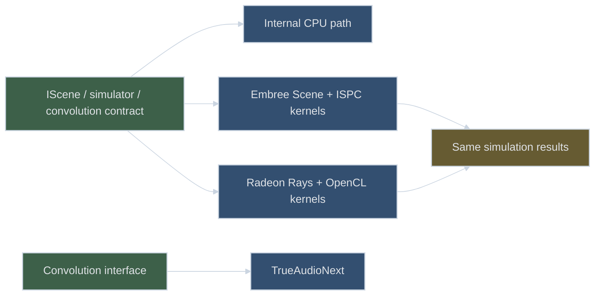

---
# 1. Introduction

Backend layer는 공통 Scene/simulation/effect contract를 특정 ray tracer, instruction set,
GPU runtime에 연결한다.
CPU-only internal path와 optional Embree/ISPC, Radeon Rays/OpenCL,
TrueAudioNext 경로는 build option 및 package 발견 결과에 따라 구성된다.

> [!warning] 활성 상태를 확인
> 파일이 존재한다고 해당 backend가 활성화된 것은 아니다. [[core_10_dependencies_overview|Dependencies Overview]]에서 CMake option과 package 조건을 확인한다.

# 2. 개념



Backend adapter는 geometry upload/build, query dispatch, result conversion
,backend resource lifetime을 맡는다. 
Embree 경로에는 ISPC reflection kernel이 붙을 수 있고, Radeon Rays는 OpenCL kernel을
generated header에 embed한다. TAN은 <strong style="color:#b3f594">convolution</strong> backend path다.

# 3. Steam Audio 코드 분석

embree_scene.cpp [링크](https://github.com/ValveSoftware/steam-audio/blob/v4.8.1/core/src/core/embree_scene.cpp)는 Embree scene을 만들고 
high build quality와 dynamic scene flag를 설정한다.

``` cpp fold title:embree_scene.cpp 실제 코드 발췌
void EmbreeScene::initialize()
{
    mScene = rtcNewScene(mEmbree->device());
    rtcSetSceneBuildQuality(mScene, RTC_BUILD_QUALITY_HIGH);
    rtcSetSceneFlags(mScene, RTC_SCENE_FLAG_DYNAMIC);
}

EmbreeScene::~EmbreeScene()
{
    rtcReleaseScene(mScene);
}
```

Adapter는 Embree handle lifecycle을 관리하고 상위 `IScene` abstraction과 이어진다.
Radeon Rays와 TAN은 같은 concept를 각 API/runtime에 맞게 구현한다.

---
# 4. 사용법

Build에서 backend option/package가 활성화되어야 API device 생성과 
backend scene 사용이 가능하다. Host는 선택 device를 생성하고 Scene 설정에 지정하며, 
지원되지 않는 조건에서는 fallback 또는 create error를 확인한다. 
package/link/runtime은 서로 다른 조건이다.

---
# 5. 독립 C++ 핵심 예제

``` cpp fold title:독립 backend interface 예제
struct RayHit { bool hit = false; float distance = 0.0f; };

class RayQueryBackend
{
public:
    virtual ~RayQueryBackend() = default;
    virtual RayHit trace(float originX, float directionX) const = 0;
};
```

공통 interface는 상위 로직이 구체 **ray tracing library**를 직접 알 필요가 없게 한다.
실제 Steam Audio backend는 훨씬 구체적인 geometry/device handle을 관리한다.

---
# 6. Source file inventory

아래 목록은 `core/src/core`에서 이 문서 범주로 분류한 전체 파일이다. 
조건부 backend 파일도 포함한다.

- **`EmbedKernels.py`**  
- **embree_device.cpp [링크](https://github.com/ValveSoftware/steam-audio/blob/v4.8.1/core/src/core/embree_device.cpp)**   **embree_device.h [링크](https://github.com/ValveSoftware/steam-audio/blob/v4.8.1/core/src/core/embree_device.h)**  
- **embree_instanced_mesh.cpp [링크](https://github.com/ValveSoftware/steam-audio/blob/v4.8.1/core/src/core/embree_instanced_mesh.cpp)**  - **embree_instanced_mesh.h [링크](https://github.com/ValveSoftware/steam-audio/blob/v4.8.1/core/src/core/embree_instanced_mesh.h)**  
- **embree_reflection_simulator.cpp [링크](https://github.com/ValveSoftware/steam-audio/blob/v4.8.1/core/src/core/embree_reflection_simulator.cpp)**  - **embree_reflection_simulator.h [링크](https://github.com/ValveSoftware/steam-audio/blob/v4.8.1/core/src/core/embree_reflection_simulator.h)**
- **`embree_reflection_simulator.ispc`**  
- **embree_scene.cpp [링크](https://github.com/ValveSoftware/steam-audio/blob/v4.8.1/core/src/core/embree_scene.cpp)**  - **embree_scene.h [링크](https://github.com/ValveSoftware/steam-audio/blob/v4.8.1/core/src/core/embree_scene.h)**  
- **embree_static_mesh.cpp [링크](https://github.com/ValveSoftware/steam-audio/blob/v4.8.1/core/src/core/embree_static_mesh.cpp)**  - **embree_static_mesh.h [링크](https://github.com/ValveSoftware/steam-audio/blob/v4.8.1/core/src/core/embree_static_mesh.h)**  -
- **opencl_buffer.cpp [링크](https://github.com/ValveSoftware/steam-audio/blob/v4.8.1/core/src/core/opencl_buffer.cpp)**  - **opencl_buffer.h [링크](https://github.com/ValveSoftware/steam-audio/blob/v4.8.1/core/src/core/opencl_buffer.h)**  
- **opencl_device.cpp [링크](https://github.com/ValveSoftware/steam-audio/blob/v4.8.1/core/src/core/opencl_device.cpp)** - **opencl_device.h [링크](https://github.com/ValveSoftware/steam-audio/blob/v4.8.1/core/src/core/opencl_device.h)** 
- **opencl_energy_field.cpp [링크](https://github.com/ValveSoftware/steam-audio/blob/v4.8.1/core/src/core/opencl_energy_field.cpp)** -**opencl_energy_field.h [링크](https://github.com/ValveSoftware/steam-audio/blob/v4.8.1/core/src/core/opencl_energy_field.h)**   
- **opencl_impulse_response.cpp [링크](https://github.com/ValveSoftware/steam-audio/blob/v4.8.1/core/src/core/opencl_impulse_response.cpp)**  **opencl_impulse_response.h [링크](https://github.com/ValveSoftware/steam-audio/blob/v4.8.1/core/src/core/opencl_impulse_response.h)**  
- **opencl_kernel.cpp [링크](https://github.com/ValveSoftware/steam-audio/blob/v4.8.1/core/src/core/opencl_kernel.cpp)**  **opencl_kernel.h [링크](https://github.com/ValveSoftware/steam-audio/blob/v4.8.1/core/src/core/opencl_kernel.h)**  
- **opencl_reconstructor.cpp [링크](https://github.com/ValveSoftware/steam-audio/blob/v4.8.1/core/src/core/opencl_reconstructor.cpp)**  - **opencl_reconstructor.h [링크](https://github.com/ValveSoftware/steam-audio/blob/v4.8.1/core/src/core/opencl_reconstructor.h)**  
- **radeonrays_device.cpp [링크](https://github.com/ValveSoftware/steam-audio/blob/v4.8.1/core/src/core/radeonrays_device.cpp)**  - **radeonrays_device.h [링크](https://github.com/ValveSoftware/steam-audio/blob/v4.8.1/core/src/core/radeonrays_device.h)** 
- `radeonrays_reflection_simulator.cl`
- **radeonrays_reflection_simulator.cpp[링크](https://github.com/ValveSoftware/steam-audio/blob/v4.8.1/core/src/core/radeonrays_reflection_simulator.cpp)** - **radeonrays_reflection_simulator.h [링크](https://github.com/ValveSoftware/steam-audio/blob/v4.8.1/core/src/core/radeonrays_reflection_simulator.h)** - 
- **radeonrays_scene.cpp [링크](https://github.com/ValveSoftware/steam-audio/blob/v4.8.1/core/src/core/radeonrays_scene.cpp)** - **radeonrays_scene.h [링크](https://github.com/ValveSoftware/steam-audio/blob/v4.8.1/core/src/core/radeonrays_scene.h)** 
- **radeonrays_static_mesh.cpp [링크](https://github.com/ValveSoftware/steam-audio/blob/v4.8.1/core/src/core/radeonrays_static_mesh.cpp)** - **radeonrays_static_mesh.h [링크](https://github.com/ValveSoftware/steam-audio/blob/v4.8.1/core/src/core/radeonrays_static_mesh.h)** 
- **tan_convolution_effect.cpp [링크](https://github.com/ValveSoftware/steam-audio/blob/v4.8.1/core/src/core/tan_convolution_effect.cpp)** - **tan_convolution_effect.h [링크](https://github.com/ValveSoftware/steam-audio/blob/v4.8.1/core/src/core/tan_convolution_effect.h)** 
- **tan_device.cpp [링크](https://github.com/ValveSoftware/steam-audio/blob/v4.8.1/core/src/core/tan_device.cpp)** - **tan_device.h [링크](https://github.com/ValveSoftware/steam-audio/blob/v4.8.1/core/src/core/tan_device.h)**

---
