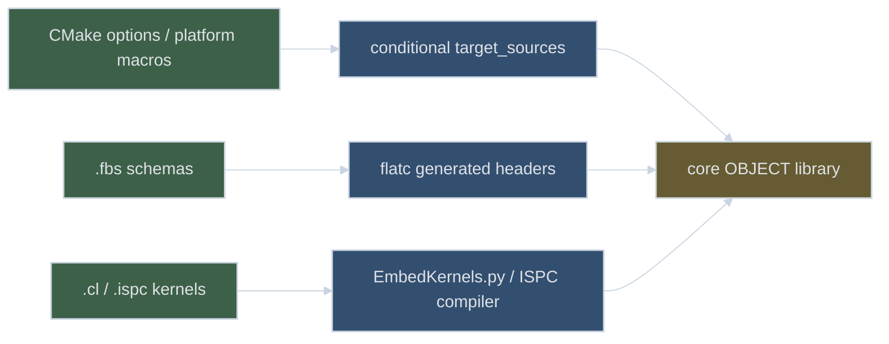

---
# 1. Introduction

Build-support source는 acoustic runtime이 아니라 Core library를 구성하고 
platform-specific source/resource를 준비한다. 
`src/core/CMakeLists.txt`에서 source inclusion은 common, platform, feature option, 
selected **FFT** backend에 따라 달라진다.

# 2. 구성 흐름



`core`는 OBJECT library로 구성되고 SDK/plugin target에서 재사용된다. 
생성 파일은 source tree가 아니라 CMake binary directory에 생긴다. 
feature가 빠지면 해당 implementation file과 link target도 제외된다.

---
# 3. Steam Audio 코드 분석

``` cmake fold title:src/core/CMakeLists.txt schema generation
function (compile_fbs FBS_SOURCE)
    set(FBS_OUTPUT ${FBS_SOURCE}.h)

    add_custom_command(
        OUTPUT ${CMAKE_CURRENT_BINARY_DIR}/${FBS_OUTPUT}
        DEPENDS ${CMAKE_CURRENT_SOURCE_DIR}/${FBS_SOURCE}
        COMMAND ${FlatBuffers_EXECUTABLE} ${FlatBuffers_FLAGS}
                -o ${CMAKE_CURRENT_BINARY_DIR}/ ${CMAKE_CURRENT_SOURCE_DIR}/${FBS_SOURCE}
    )
endfunction()
```

Output header는 binary directory에 생성되어 source tree의 schema와 구분된다.
Core CMake는 `.fbs` 목록에 대해 `flatc` custom command를 정의하고, 
output을 generated source로 표시한 뒤 `fbschemas` target에 연결한다. 
선택 backend의 OpenCL source는 `EmbedKernels.py`가 header로 만든다. 
이 흐름은 [[core_10_dependencies_overview|Dependencies Overview]]의 dependency matrix와 함께 본다.

---
# 4. 사용법

소스 파일이 compile되는지 추적하려면 `src/core/CMakeLists.txt`의 common source list 
및 `if(STEAMAUDIO_ENABLE_...) target_sources` 블록을 찾는다. 
그 다음 최상위 CMake package discovery와 compile definition, target link를 확인한다. 
`#if IPL_USES_*` macro와 CMake option이 함께 조건을 이룰 수 있다.

---
# 5. 독립 C++ 핵심 예제

``` cpp fold title:독립 C++ conditional feature 예제
int selectedBackend()
{
#if defined(ENABLE_FAST_BACKEND)
    return 1;
#else
    return 0;
#endif
}
```

독립 예제는 compile-time 선택의 원리를 보여준다.  Steam Audio의 실제 feature macro와
target source inclusion은  각 CMake/headers에 따라 다르다.

---
# 6. Source file inventory

아래 목록은 `core/src/core`에서 이 문서 범주로 분류한 전체 파일이다. 
조건부 backend 파일도 포함한다.

> [!info] Metadata 파일 전체 원본
> `phonon.natvis`, `phonon.rc.in`, `phonon_version.h.in` 전체는 [Build metadata source](core_build_metadata_sources.md)에서 파일별 설명과 함께 확인한다.

| 파일               |
| ---------------- |
| `CMakeLists.txt` |

---
