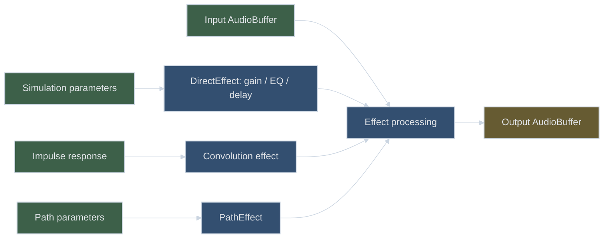

---
# 1. Introduction

DSP layer는 simulation이 계산한 parameter를 오디오 sample에 적용한다. 
입출력의 중심은 channel별  `AudioBuffer`이며 Direct/Indirect/Path effect, 
gain/EQ/delay, convolution 및 FFT/filter가 구성 요소다.

> [!warning] 데이터 단계 구분
> <strong style="color:#b3f594">Simulation</strong> 결과를 계산하는 코드와 PCM을  바꾸는 effect 코드는 역할이 다르다. 
> 큰 처리 흐름은 [[core_04_effect_overview|Effect & Rendering Overview]]에서 본다.****

---

# 2. 개념과 처리 흐름



`array_math`, `iir`, `window_function`, `fft`는 effect가 공통 사용하는 수치 연산이다.
`overlap_add`와 `overlap_save`는 block convolution 전략이고, FFT backend source는 
build option으로 한 구현이 선택된다.

---
# 3. Steam Audio 코드 분석

direct_effect.cpp [링크](https://github.com/ValveSoftware/steam-audio/blob/v4.8.1/core/src/core/direct_effect.cpp)는 DirectSoundPath parameter를 gain/EQ 값으로 변환하고 
channel별 seffect를 적용한다.

``` cpp fold title:direct_effect.cpp 실제 코드 발췌
calculateGainAndEQ(params.directPath, params.flags, params.transmissionType, gain, eqCoeffs);

auto applyEQ = ((params.flags & ApplyAirAbsorption) ||
    ((params.flags & ApplyTransmission) && params.transmissionType == TransmissionType::FreqDependent));

for (auto i = 0; i < mNumChannels; ++i)
{
    AudioBuffer inChannel(in, i);
    AudioBuffer outChannel(out, i);
```

Apply flag와 transmission mode가 주파수 의존 EQ 여부를 결정하고, 이후 gain이 적용된다.
세부 parameter와 실행 예는 [[core_direct_effect|DirectEffect]], [[core_eqeffect|EQEffect]], [[core_delay_effect|DelayEffect]]에서 확인한다.

---
# 4. 사용법

SDK 사용자는 simulation output을 effect parameter에 복사하고, audio callback의 
block buffer를 effect에 전달한다. Buffer channel 수, frame size, sample rate는 effect 생성 시
audio settings와 일치시킨다.
HRTF/ambisonics renderer는 [[core_spatial_rendering|Spatial Rendering 상세]]를 참고한다.

---
# 5. 독립 C++ 예제

``` cpp fold title:독립 C++ gain processing 예제
#include <cstddef>
#include <vector>

void applyGain(const std::vector<float>& input, std::vector<float>& output, float gain)
{
    const auto count = input.size() < output.size() ? input.size() : output.size();
    for (std::size_t i = 0; i < count; ++i)
    {
        output[i] = input[i] * gain;
    }
}
```

이 예제는 buffer에 gain을 곱하는 가장 작은 핵심만 보인다. 
실제 Core effect는 effect state, channel routing, interpolation, tail 및 filter 상태를 관리한다.

---
# 6. Source file inventory

아래 목록은 `core/src/core`에서 이 문서 범주로 분류한 전체 파일이다. 
조건부 backend 파일도 포함한다.

<strong style="color:#b3f594">Buffer</strong> 
- audio_buffer.cpp [링크](https://github.com/ValveSoftware/steam-audio/blob/v4.8.1/core/src/core/audio_buffer.cpp), audio_buffer.h [링크](https://github.com/ValveSoftware/steam-audio/blob/v4.8.1/core/src/core/audio_buffer.h). 
- [AudioBuffer 분석](core_audiobuffer.md)을 참고

<strong style="color:#b3f594">Gain과 panning</strong> 
- gain_effect.cpp [링크](https://github.com/ValveSoftware/steam-audio/blob/v4.8.1/core/src/core/gain_effect.cpp), gain_effect.h [링크](https://github.com/ValveSoftware/steam-audio/blob/v4.8.1/core/src/core/gain_effect.h),
- panning_effect.cpp [링크](https://github.com/ValveSoftware/steam-audio/blob/v4.8.1/core/src/core/panning_effect.cpp), panning_effect.h [링크](https://github.com/ValveSoftware/steam-audio/blob/v4.8.1/core/src/core/panning_effect.h). 
- Panning 세부 설명은 [PanningEffect 분석](core_panning_effect.md)에 있다.

<strong style="color:#b3f594">EQ와 IIR filter</strong> 
- bands.cpp [링크](https://github.com/ValveSoftware/steam-audio/blob/v4.8.1/core/src/core/bands.cpp), bands.h [링크](https://github.com/ValveSoftware/steam-audio/blob/v4.8.1/core/src/core/bands.h), 
- eq_effect.cpp [링크](https://github.com/ValveSoftware/steam-audio/blob/v4.8.1/core/src/core/eq_effect.cpp), eq_effect.h [링크](https://github.com/ValveSoftware/steam-audio/blob/v4.8.1/core/src/core/eq_effect.h)
- iir.cpp [링크](https://github.com/ValveSoftware/steam-audio/blob/v4.8.1/core/src/core/iir.cpp), iir.h [링크](https://github.com/ValveSoftware/steam-audio/blob/v4.8.1/core/src/core/iir.h)
- float8_iir.cpp [링크](https://github.com/ValveSoftware/steam-audio/blob/v4.8.1/core/src/core/float8_iir.cpp). 
- 관련 개념과 구현은 [EQ effect분석](core_eqeffect.md)

<strong style="color:#b3f594">Delay</strong> 
- delay.cpp [링크](https://github.com/ValveSoftware/steam-audio/blob/v4.8.1/core/src/core/delay.cpp), delay.h [링크](https://github.com/ValveSoftware/steam-audio/blob/v4.8.1/core/src/core/delay.h),
- delay_effect.cpp [링크](https://github.com/ValveSoftware/steam-audio/blob/v4.8.1/core/src/core/delay_effect.cpp), delay_effect.h [링크](https://github.com/ValveSoftware/steam-audio/blob/v4.8.1/core/src/core/delay_effect.h)
- float8_delay.cpp [링크](https://github.com/ValveSoftware/steam-audio/blob/v4.8.1/core/src/core/float8_delay.cpp)
- 자세한 동작은 [DelayEffect 분석](core_delay_effect.md)

<strong style="color:#b3f594">Direct effect</strong> 
- direct_effect.cpp [링크](https://github.com/ValveSoftware/steam-audio/blob/v4.8.1/core/src/core/direct_effect.cpp), direct_effect.h [링크](https://github.com/ValveSoftware/steam-audio/blob/v4.8.1/core/src/core/direct_effect.h). 
- 상세 설명은 [DirectEffect 분석](core_direct_effect.md)

<strong style="color:#b3f594">Convolution과 FFT</strong> 
- fft.h [링크](https://github.com/ValveSoftware/steam-audio/blob/v4.8.1/core/src/core/fft.h), ffts_fft.cpp [링크](https://github.com/ValveSoftware/steam-audio/blob/v4.8.1/core/src/core/ffts_fft.cpp),
- ipp_fft.cpp [링크](https://github.com/ValveSoftware/steam-audio/blob/v4.8.1/core/src/core/ipp_fft.cpp)
- pffft_fft.cpp [링크](https://github.com/ValveSoftware/steam-audio/blob/v4.8.1/core/src/core/pffft_fft.cpp)
- vdsp_fft.cpp [링크](https://github.com/ValveSoftware/steam-audio/blob/v4.8.1/core/src/core/vdsp_fft.cpp) 
- overlap_add_convolution_effect.cpp [링크](https://github.com/ValveSoftware/steam-audio/blob/v4.8.1/core/src/core/overlap_add_convolution_effect.cpp) 
- overlap_add_convolution_effect.h [링크](https://github.com/ValveSoftware/steam-audio/blob/v4.8.1/core/src/core/overlap_add_convolution_effect.h)
- overlap_save_convolution_effect.cpp [링크](https://github.com/ValveSoftware/steam-audio/blob/v4.8.1/core/src/core/overlap_save_convolution_effect.cpp),
- overlap_save_convolution_effect.h [링크](https://github.com/ValveSoftware/steam-audio/blob/v4.8.1/core/src/core/overlap_save_convolution_effect.h). 
- FFT backend와 convolution 구현

<strong style="color:#b3f594">SIMD array math</strong> 
- array_math.cpp [링크](https://github.com/ValveSoftware/steam-audio/blob/v4.8.1/core/src/core/array_math.cpp), array_math.h [링크](https://github.com/ValveSoftware/steam-audio/blob/v4.8.1/core/src/core/array_math.h)
- ipp_array_math.cpp [링크](https://github.com/ValveSoftware/steam-audio/blob/v4.8.1/core/src/core/ipp_array_math.cpp)
- vdsp_array_math.cpp [링크](https://github.com/ValveSoftware/steam-audio/blob/v4.8.1/core/src/core/vdsp_array_math.cpp)
- Backend에 따라 선택되는 배열 연산 경로 포함

<strong style="color:#b3f594">Vectorized reverb effect</strong> 
- float8_reverb_effect.cpp [링크](https://github.com/ValveSoftware/steam-audio/blob/v4.8.1/core/src/core/float8_reverb_effect.cpp). 
- Float8 lane 단위로 reverb effect를 처리하는 최적화 구현

<strong style="color:#b3f594">Sampling과 window</strong> 
- sampling.cpp [링크](https://github.com/ValveSoftware/steam-audio/blob/v4.8.1/core/src/core/sampling.cpp), sampling.h [링크](https://github.com/ValveSoftware/steam-audio/blob/v4.8.1/core/src/core/sampling.h)
- window_function.cpp [링크](https://github.com/ValveSoftware/steam-audio/blob/v4.8.1/core/src/core/window_function.cpp), window_function.h [링크](https://github.com/ValveSoftware/steam-audio/blob/v4.8.1/core/src/core/window_function.h)
- Sampling과 spectral processing에서 사용하는 보조 구현

---
# 7. Source file links

아래 목록은 6번 인벤토리에 정리한 DSP 소스 파일 38개의 공식 저장소 링크다.
파일명을 초록색으로 표시하고, 각 파일의 원본은 바로 아래 링크에서 확인할 수 있다.

<strong style="color:#b3f594">Buffer</strong>

<strong style="color:#b3f594">audio_buffer.cpp</strong>
- [audio_buffer.cpp 링크](https://github.com/ValveSoftware/steam-audio/blob/v4.8.1/core/src/core/audio_buffer.cpp)

<strong style="color:#b3f594">audio_buffer.h</strong>
- [audio_buffer.h 링크](https://github.com/ValveSoftware/steam-audio/blob/v4.8.1/core/src/core/audio_buffer.h)

<strong style="color:#b3f594">Gain and panning</strong>

<strong style="color:#b3f594">gain_effect.cpp</strong>
- [gain_effect.cpp 링크](https://github.com/ValveSoftware/steam-audio/blob/v4.8.1/core/src/core/gain_effect.cpp)

<strong style="color:#b3f594">gain_effect.h</strong>
- [gain_effect.h 링크](https://github.com/ValveSoftware/steam-audio/blob/v4.8.1/core/src/core/gain_effect.h)

<strong style="color:#b3f594">panning_effect.cpp</strong>
- [panning_effect.cpp 링크](https://github.com/ValveSoftware/steam-audio/blob/v4.8.1/core/src/core/panning_effect.cpp)

<strong style="color:#b3f594">panning_effect.h</strong>
- [panning_effect.h 링크](https://github.com/ValveSoftware/steam-audio/blob/v4.8.1/core/src/core/panning_effect.h)

<strong style="color:#b3f594">EQ and IIR filter</strong>

<strong style="color:#b3f594">bands.cpp</strong>
- [bands.cpp 링크](https://github.com/ValveSoftware/steam-audio/blob/v4.8.1/core/src/core/bands.cpp)

<strong style="color:#b3f594">bands.h</strong>
- [bands.h 링크](https://github.com/ValveSoftware/steam-audio/blob/v4.8.1/core/src/core/bands.h)

<strong style="color:#b3f594">eq_effect.cpp</strong>
- [eq_effect.cpp 링크](https://github.com/ValveSoftware/steam-audio/blob/v4.8.1/core/src/core/eq_effect.cpp)

<strong style="color:#b3f594">eq_effect.h</strong>
- [eq_effect.h 링크](https://github.com/ValveSoftware/steam-audio/blob/v4.8.1/core/src/core/eq_effect.h)

<strong style="color:#b3f594">iir.cpp</strong>
- [iir.cpp 링크](https://github.com/ValveSoftware/steam-audio/blob/v4.8.1/core/src/core/iir.cpp)

<strong style="color:#b3f594">iir.h</strong>
- [iir.h 링크](https://github.com/ValveSoftware/steam-audio/blob/v4.8.1/core/src/core/iir.h)

<strong style="color:#b3f594">float8_iir.cpp</strong>
- [float8_iir.cpp 링크](https://github.com/ValveSoftware/steam-audio/blob/v4.8.1/core/src/core/float8_iir.cpp)

<strong style="color:#b3f594">Delay</strong>

<strong style="color:#b3f594">delay.cpp</strong>
- [delay.cpp 링크](https://github.com/ValveSoftware/steam-audio/blob/v4.8.1/core/src/core/delay.cpp)

<strong style="color:#b3f594">delay.h</strong>
- [delay.h 링크](https://github.com/ValveSoftware/steam-audio/blob/v4.8.1/core/src/core/delay.h)

<strong style="color:#b3f594">delay_effect.cpp</strong>
- [delay_effect.cpp 링크](https://github.com/ValveSoftware/steam-audio/blob/v4.8.1/core/src/core/delay_effect.cpp)

<strong style="color:#b3f594">delay_effect.h</strong>
- [delay_effect.h 링크](https://github.com/ValveSoftware/steam-audio/blob/v4.8.1/core/src/core/delay_effect.h)

<strong style="color:#b3f594">float8_delay.cpp</strong>
- [float8_delay.cpp 링크](https://github.com/ValveSoftware/steam-audio/blob/v4.8.1/core/src/core/float8_delay.cpp)

<strong style="color:#b3f594">Direct effect</strong>

<strong style="color:#b3f594">direct_effect.cpp</strong>
- [direct_effect.cpp 링크](https://github.com/ValveSoftware/steam-audio/blob/v4.8.1/core/src/core/direct_effect.cpp)

<strong style="color:#b3f594">direct_effect.h</strong>
- [direct_effect.h 링크](https://github.com/ValveSoftware/steam-audio/blob/v4.8.1/core/src/core/direct_effect.h)

<strong style="color:#b3f594">Convolution and FFT</strong>

<strong style="color:#b3f594">fft.h</strong>
- [fft.h 링크](https://github.com/ValveSoftware/steam-audio/blob/v4.8.1/core/src/core/fft.h)

<strong style="color:#b3f594">ffts_fft.cpp</strong>
- [ffts_fft.cpp 링크](https://github.com/ValveSoftware/steam-audio/blob/v4.8.1/core/src/core/ffts_fft.cpp)

<strong style="color:#b3f594">ipp_fft.cpp</strong>
- [ipp_fft.cpp 링크](https://github.com/ValveSoftware/steam-audio/blob/v4.8.1/core/src/core/ipp_fft.cpp)

<strong style="color:#b3f594">pffft_fft.cpp</strong>
- [pffft_fft.cpp 링크](https://github.com/ValveSoftware/steam-audio/blob/v4.8.1/core/src/core/pffft_fft.cpp)

<strong style="color:#b3f594">vdsp_fft.cpp</strong>
- [vdsp_fft.cpp 링크](https://github.com/ValveSoftware/steam-audio/blob/v4.8.1/core/src/core/vdsp_fft.cpp)

<strong style="color:#b3f594">overlap_add_convolution_effect.cpp</strong>
- [overlap_add_convolution_effect.cpp 링크](https://github.com/ValveSoftware/steam-audio/blob/v4.8.1/core/src/core/overlap_add_convolution_effect.cpp)

<strong style="color:#b3f594">overlap_add_convolution_effect.h</strong>
- [overlap_add_convolution_effect.h 링크](https://github.com/ValveSoftware/steam-audio/blob/v4.8.1/core/src/core/overlap_add_convolution_effect.h)

<strong style="color:#b3f594">overlap_save_convolution_effect.cpp</strong>
- [overlap_save_convolution_effect.cpp 링크](https://github.com/ValveSoftware/steam-audio/blob/v4.8.1/core/src/core/overlap_save_convolution_effect.cpp)

<strong style="color:#b3f594">overlap_save_convolution_effect.h</strong>
- [overlap_save_convolution_effect.h 링크](https://github.com/ValveSoftware/steam-audio/blob/v4.8.1/core/src/core/overlap_save_convolution_effect.h)

<strong style="color:#b3f594">SIMD array math</strong>

<strong style="color:#b3f594">array_math.cpp</strong>
- [array_math.cpp 링크](https://github.com/ValveSoftware/steam-audio/blob/v4.8.1/core/src/core/array_math.cpp)

<strong style="color:#b3f594">array_math.h</strong>
- [array_math.h 링크](https://github.com/ValveSoftware/steam-audio/blob/v4.8.1/core/src/core/array_math.h)

<strong style="color:#b3f594">ipp_array_math.cpp</strong>
- [ipp_array_math.cpp 링크](https://github.com/ValveSoftware/steam-audio/blob/v4.8.1/core/src/core/ipp_array_math.cpp)

<strong style="color:#b3f594">vdsp_array_math.cpp</strong>
- [vdsp_array_math.cpp 링크](https://github.com/ValveSoftware/steam-audio/blob/v4.8.1/core/src/core/vdsp_array_math.cpp)

<strong style="color:#b3f594">Vectorized reverb</strong>

<strong style="color:#b3f594">float8_reverb_effect.cpp</strong>
- [float8_reverb_effect.cpp 링크](https://github.com/ValveSoftware/steam-audio/blob/v4.8.1/core/src/core/float8_reverb_effect.cpp)

<strong style="color:#b3f594">Sampling and window</strong>

<strong style="color:#b3f594">sampling.cpp</strong>
- [sampling.cpp 링크](https://github.com/ValveSoftware/steam-audio/blob/v4.8.1/core/src/core/sampling.cpp)

<strong style="color:#b3f594">sampling.h</strong>
- [sampling.h 링크](https://github.com/ValveSoftware/steam-audio/blob/v4.8.1/core/src/core/sampling.h)

<strong style="color:#b3f594">window_function.cpp</strong>
- [window_function.cpp 링크](https://github.com/ValveSoftware/steam-audio/blob/v4.8.1/core/src/core/window_function.cpp)

<strong style="color:#b3f594">window_function.h</strong>
- [window_function.h 링크](https://github.com/ValveSoftware/steam-audio/blob/v4.8.1/core/src/core/window_function.h)
