---
# 1. Introduction

Geometry layer는 host가 제공한 정적 triangle mesh와 instance transform을 
acoustic scene으로 관리하고 ray query를 simulation에 제공한다. 
주요 객체는 `Mesh`/`StaticMesh`, `InstancedMesh`, `Scene`, `BVH` 및 `IScene` 
backend interface다.

> [!tip] 읽기 순서
> [[core_mesh|Mesh]] → [[core_instanced_mesh|Instanced Mesh]] → [[core_bvh|BVH]] → [[core_scene|Scene]] 순으로 보면 데이터에서 query까지 이어진다.

# 2. 개념과 데이터 흐름

```mermaid
%%{init: {"theme":"base","themeVariables":{"background":"#111827","darkMode":true,"primaryColor":"#3d6049","primaryTextColor":"#dfe2e6","primaryBorderColor":"#cbd5e1","secondaryColor":"#334f70","secondaryTextColor":"#dfe2e6","secondaryBorderColor":"#cbd5e1","tertiaryColor":"#665b32","tertiaryTextColor":"#dfe2e6","tertiaryBorderColor":"#cbd5e1","clusterBkg":"#743737","clusterBorder":"#cbd5e1","lineColor":"#cbd5e1","textColor":"#dfe2e6","nodeTextColor":"#dfe2e6","actorBkg":"#303943","actorBorder":"#cbd5e1","actorTextColor":"#dfe2e6","actorLineColor":"#cbd5e1","signalColor":"#cbd5e1","signalTextColor":"#dfe2e6","labelBoxBkgColor":"#743737","labelBoxBorderColor":"#cbd5e1","labelTextColor":"#dfe2e6","activationBkgColor":"#334f70","activationBorderColor":"#cbd5e1","noteBkgColor":"#665b32","noteBorderColor":"#cbd5e1","noteTextColor":"#dfe2e6"}}}%%
flowchart LR
    Vertices[Vertices / triangles / materials] --> Mesh[StaticMesh]
    Mesh --> Scene[Scene staged lists]
    SubScene[Reusable sub-scene] --> Instance[InstancedMesh + transform]
    Instance --> Scene
    Scene --> Commit[commit / backend update]
    Commit --> Query[ray / closest hit / occlusion]
    classDef level1 fill:#3d6049,stroke:#cbd5e1,color:#dfe2e6,stroke-width:1.5px;
    classDef level2 fill:#334f70,stroke:#cbd5e1,color:#dfe2e6,stroke-width:1.5px;
    classDef level3 fill:#665b32,stroke:#cbd5e1,color:#dfe2e6,stroke-width:1.5px;
    classDef level4 fill:#743737,stroke:#cbd5e1,color:#dfe2e6,stroke-width:1.5px;
    class Vertices,SubScene level1;
    class Mesh,Instance level2;
    class Scene level3;
    class Commit,Query level4;
```



Scene은 수정 사항을 staging list에 모으고 `commit()`에서 active state/backend acceleration
structure에 반영한다. Static mesh geometry를 instance별로 복제하지 않고 transform을 
통해  공유할 수 있다. 
Acoustic material은transmission/absorption/scattering 등 simulation 입력을 전달한다.

---
# 3. Steam Audio 코드 분석

scene.cpp [링크](https://github.com/ValveSoftware/steam-audio/blob/v4.8.1/core/src/core/scene.cpp)의 `Scene::commit`는 변경 여부를 확인하고 active 목록과
instance 상태를  갱신한다.

``` cpp fold title:scene.cpp 실제 코드 발췌
if (mHasChanged)
{
    mVersion++;
}

mStaticMeshes[0] = mStaticMeshes[1];
mInstancedMeshes[0] = mInstancedMeshes[1];

for (const auto& instancedMesh : mInstancedMeshes[0])
{
    instancedMesh->commit(*this);
}
```

`mVersion`은 consumer가 scene 변경을 감지하는 기준이다. 
Backend별 Scene 구현은 `scene_factory.*`, `embree_scene.*`, `radeonrays_scene.*`로 
이어진다. 
구조 세부는 [[core_07_scene_geometry_overview|Scene & Geometry Overview]]를 본다.

----
# 4. 사용법

Host는 world vertices/indices/materials를 `iplStaticMeshCreate`로 등록하고 
Scene에 추가한 뒤 `iplSceneCommit`을 수행한다. 
Transform을 바꾼 instance도 commit해야 후속 simulation query에 반영된다. 
이 함수 순서는 [[core_02_host_c_api_overview|Host ↔ C API Overview]]의 Scene 입력 예시를 따른다.

----
# 5. 독립 C++ 예제

``` cpp fold title:독립 C++ scene commit 예제
struct SceneState
{
    bool dirty = false;
    unsigned version = 0;

    void commit()
    {
        if (dirty)
        {
            ++version;
            dirty = false;
        }
    }
};
```

독립 예제는 수정 누적과 commit 시점의 version 변경만 설명한다. 
실제 Core는 mesh 목록, instance transform, material update 및 선택 backend도 함께 갱신한다.

---
# 6. Source file inventory

아래 목록은 이 문서의 geometry pipeline에서 다루는 핵심 소스 파일이다.
각 파일명 옆의 [링크]를 열면 Steam Audio 공식 저장소의 해당 파일을 볼 수 있다.

<strong style="color:#b3f594">BVH and ray primitives</strong>

- <strong style="color:#b3f594">box.h</strong> [링크](https://github.com/ValveSoftware/steam-audio/blob/v4.8.1/core/src/core/box.h)
- <strong style="color:#b3f594">bvh.cpp</strong> [링크](https://github.com/ValveSoftware/steam-audio/blob/v4.8.1/core/src/core/bvh.cpp)
- <strong style="color:#b3f594">bvh.h</strong> [링크](https://github.com/ValveSoftware/steam-audio/blob/v4.8.1/core/src/core/bvh.h)
- <strong style="color:#b3f594">hit.h</strong> [링크](https://github.com/ValveSoftware/steam-audio/blob/v4.8.1/core/src/core/hit.h)
- <strong style="color:#b3f594">ray.cpp</strong> [링크](https://github.com/ValveSoftware/steam-audio/blob/v4.8.1/core/src/core/ray.cpp)
- <strong style="color:#b3f594">ray.h</strong> [링크](https://github.com/ValveSoftware/steam-audio/blob/v4.8.1/core/src/core/ray.h)
- <strong style="color:#b3f594">sphere.h</strong> [링크](https://github.com/ValveSoftware/steam-audio/blob/v4.8.1/core/src/core/sphere.h)

<strong style="color:#b3f594">Mesh and material data</strong>

- <strong style="color:#b3f594">material.h</strong> [링크](https://github.com/ValveSoftware/steam-audio/blob/v4.8.1/core/src/core/material.h)
- <strong style="color:#b3f594">mesh.cpp</strong> [링크](https://github.com/ValveSoftware/steam-audio/blob/v4.8.1/core/src/core/mesh.cpp)
- <strong style="color:#b3f594">mesh.h</strong> [링크](https://github.com/ValveSoftware/steam-audio/blob/v4.8.1/core/src/core/mesh.h)
- <strong style="color:#b3f594">static_mesh.cpp</strong> [링크](https://github.com/ValveSoftware/steam-audio/blob/v4.8.1/core/src/core/static_mesh.cpp)
- <strong style="color:#b3f594">static_mesh.h</strong> [링크](https://github.com/ValveSoftware/steam-audio/blob/v4.8.1/core/src/core/static_mesh.h)
- <strong style="color:#b3f594">triangle.h</strong> [링크](https://github.com/ValveSoftware/steam-audio/blob/v4.8.1/core/src/core/triangle.h)

<strong style="color:#b3f594">Scene and backend lifecycle</strong>

- <strong style="color:#b3f594">custom_scene.cpp</strong> [링크](https://github.com/ValveSoftware/steam-audio/blob/v4.8.1/core/src/core/custom_scene.cpp)
- <strong style="color:#b3f594">custom_scene.h</strong> [링크](https://github.com/ValveSoftware/steam-audio/blob/v4.8.1/core/src/core/custom_scene.h)
- <strong style="color:#b3f594">scene.cpp</strong> [링크](https://github.com/ValveSoftware/steam-audio/blob/v4.8.1/core/src/core/scene.cpp)
- <strong style="color:#b3f594">scene.h</strong> [링크](https://github.com/ValveSoftware/steam-audio/blob/v4.8.1/core/src/core/scene.h)
- <strong style="color:#b3f594">scene_factory.cpp</strong> [링크](https://github.com/ValveSoftware/steam-audio/blob/v4.8.1/core/src/core/scene_factory.cpp)
- <strong style="color:#b3f594">scene_factory.h</strong> [링크](https://github.com/ValveSoftware/steam-audio/blob/v4.8.1/core/src/core/scene_factory.h)

<strong style="color:#b3f594">Instanced geometry</strong>

- <strong style="color:#b3f594">instanced_mesh.cpp</strong> [링크](https://github.com/ValveSoftware/steam-audio/blob/v4.8.1/core/src/core/instanced_mesh.cpp)
- <strong style="color:#b3f594">instanced_mesh.h</strong> [링크](https://github.com/ValveSoftware/steam-audio/blob/v4.8.1/core/src/core/instanced_mesh.h)

<strong style="color:#b3f594">Shared propagation constant</strong>

- <strong style="color:#b3f594">propagation_medium.h</strong> [링크](https://github.com/ValveSoftware/steam-audio/blob/v4.8.1/core/src/core/propagation_medium.h)

---

# 7. Shared propagation constant

`propagation_medium.h`는 `PropagationMedium::kSpeedOfSound`를 340 m/s로 정의한다.
이 값은 geometry 자체를 저장하는 자료형은 아니지만, 거리와 시간에 따른
전파 계산에서 여러 모듈이 함께 참조하는 공통 물리 상수다.

예를 들어 air absorption, distance attenuation, path 및 reflection 계산 코드가 
이 헤더를 포함한다. 따라서 geometry pipeline을 읽을 때는 장면의 공간 구조와 
음파 전파 상수의 역할을 구분해서 보면 좋다.

- <strong style="color:#b3f594">propagation_medium.h</strong> [링크](https://github.com/ValveSoftware/steam-audio/blob/v4.8.1/core/src/core/propagation_medium.h)
- <strong style="color:#b3f594">air_absorption.cpp</strong> [링크](https://github.com/ValveSoftware/steam-audio/blob/v4.8.1/core/src/core/air_absorption.cpp)
- <strong style="color:#b3f594">distance_attenuation.cpp</strong> [링크](https://github.com/ValveSoftware/steam-audio/blob/v4.8.1/core/src/core/distance_attenuation.cpp)
- [Air absorption 상세 분석](core_air_absorption.md)

---

