---

# 1. Introduction

path_data.h [링크](https://github.com/ValveSoftware/steam-audio/blob/v4.8.1/core/src/core/path_data.h) / path_data.cpp [링크](https://github.com/ValveSoftware/steam-audio/blob/v4.8.1/core/src/core/path_data.cpp)는 경로 탐색 알고리즘 자체보다
<strong style="color:#b3f594">경로 결과의 표현과 저장</strong>을 담당한다.
`ProbePath`는 탐색 중 거친 probe index 시퀀스이고, runtime에 필요한 
최소 정보로 압축한 `SoundPath`와 probe pair lookup을 보관하는 `BakedPathData`가 있다.

- Pathing 전체 흐름: [[core_06_pathing_overview|Pathing Overview]]
- 탐색 결과를 만드는 쪽: [[core_path_finder|PathFinder 상세 분석]]
- baked graph schema: [[core_path_visibility|ProbeVisibilityGraph 상세 분석]]
- FlatBuffers 공통 구조: [[core_serialization_formats|Serialization 상세 분석]]

---
# 2. 자료 구조

```mermaid
%%{init: {"theme":"base","themeVariables":{"background":"#111827","darkMode":true,"primaryColor":"#3d6049","primaryTextColor":"#dfe2e6","primaryBorderColor":"#cbd5e1","secondaryColor":"#334f70","secondaryTextColor":"#dfe2e6","secondaryBorderColor":"#cbd5e1","tertiaryColor":"#665b32","tertiaryTextColor":"#dfe2e6","tertiaryBorderColor":"#cbd5e1","clusterBkg":"#743737","clusterBorder":"#cbd5e1","lineColor":"#cbd5e1","textColor":"#dfe2e6","nodeTextColor":"#dfe2e6","actorBkg":"#303943","actorBorder":"#cbd5e1","actorTextColor":"#dfe2e6","actorLineColor":"#cbd5e1","signalColor":"#cbd5e1","signalTextColor":"#dfe2e6","labelBoxBkgColor":"#743737","labelBoxBorderColor":"#cbd5e1","labelTextColor":"#dfe2e6","activationBkgColor":"#334f70","activationBorderColor":"#cbd5e1","noteBkgColor":"#665b32","noteBorderColor":"#cbd5e1","noteTextColor":"#dfe2e6"}}}%%
flowchart LR
    ProbePath[full probe index sequence] --> SoundPath[compressed SoundPath]
    SoundPath --> Unique[unique SoundPath table]
    Pair[probe start/end pair] --> Refs[2D SoundPathRef table]
    Unique --> Refs
    Unique --> Serialize[FlatBuffers BakedPathingData]
    Refs --> Serialize
    classDef level1 fill:#3d6049,stroke:#cbd5e1,color:#dfe2e6,stroke-width:1.5px;
    classDef level2 fill:#334f70,stroke:#cbd5e1,color:#dfe2e6,stroke-width:1.5px;
    classDef level3 fill:#665b32,stroke:#cbd5e1,color:#dfe2e6,stroke-width:1.5px;
    classDef level4 fill:#743737,stroke:#cbd5e1,color:#dfe2e6,stroke-width:1.5px;
    class ProbePath,Pair level1;
    class SoundPath,Refs level2;
    class Unique,Serialize level3;
```



`SoundPath`는 첫/마지막 및 인접 probe, 내부 거리, 누적 deviation을 저장한다. 
`direct`는 probe node가 없는 direct path를 표현한다. 
`BakedPathData`는 같은 path 값을 unique table에 한 번만 넣고, 각 probe pair가
`SoundPathRef` index를 가지게 한다. 
따라서 저장 구조는 full path sequence 전체를 pair마다 복제하지 않는다.

`path_data.fbs`는 `SoundPath`, `BakedPathingData` schema를 선언한다. 
여기의 `path_indices`와 `paths`는 유효한 pair만 sparse하게 저장하는 serialization 
representation이다.

# 3. Steam Audio 코드 분석

`SoundPath` 생성자는 `ProbePath` node sequence에서 양끝 probe를 보관하고, 
각 segment의 길이와 중간 bend angle을 누적 한다.

``` cpp fold title:path_data.cpp 실제 코드 발췌
if (probePath.nodes.size() >= 2)
{
    probeAfterFirst = probePath.nodes[1];
    probeBeforeLast = probePath.nodes[probePath.nodes.size() - 2];
}

for (auto i = 1u; i < probePath.nodes.size(); ++i)
{
    const auto& prevPoint = probes[probePath.nodes[i - 1]].influence.center;
    const auto& curPoint = probes[probePath.nodes[i]].influence.center;
    distanceInternal += (curPoint - prevPoint).length();
}
```

`lookupShortestPath(start, end)`은 reference table에서 unique path를 가져온다.
`start < end`인 경우에는 저장 방향을 반대로 조회하므로 `first/last` 및 앞뒤 
probe index를 swap해 호출자 방향으로 복원한다.

``` cpp fold title:path_data.cpp lookup 방향 처리
if (start < end)
{
    soundPath = mUniqueBakedPaths[mBakedPathRefs[end][start].index];
    std::swap(soundPath.firstProbe, soundPath.lastProbe);
    std::swap(soundPath.probeAfterFirst, soundPath.probeBeforeLast);
}
```

Serializer는 먼저 visibility graph와 unique path table을 쓰고, 유효한 start/end pair만
`(pair index, unique path index)` 배열로 저장한다. 
Loading 시에도 이 sparse reference를 2D table에 복원한다.


<strong style="color:#b3f594">path_data.h</strong>
- [path_data.h 링크](https://github.com/ValveSoftware/steam-audio/blob/v4.8.1/core/src/core/path_data.h)

<strong style="color:#b3f594">path_data.cpp</strong>
- [path_data.cpp 링크](https://github.com/ValveSoftware/steam-audio/blob/v4.8.1/core/src/core/path_data.cpp)

<strong style="color:#b3f594">path_data.fbs</strong>
- [path_data.fbs 링크](https://github.com/ValveSoftware/steam-audio/blob/v4.8.1/core/src/core/path_data.fbs)

---
# 4. 사용법

SDK에서 직접 `SoundPath`를 만들지는 않는다. `iplPathBakerBake`가 path bake를 생성하고,
ProbeBatch의 baked path data가 `PathSimulator`에서 조회된다. 
Probe/scene baking 및 API 연결은 [[core_probes_baking|Probe와 Baking 상세]]에서 이어서 본다. 
Scene/probe 구성이 바뀐 뒤에는 baked data의 identifier와 업데이트 필요 상태를 맞춰야 한다.

---
# 5. 독립 C++ 핵심 예제

``` cpp fold title:독립 unique path reference 예제
#include <vector>

struct PathRef { int index = 0; };

struct PathTable
{
    std::vector<int> uniquePathIds;
    std::vector<PathRef> pairRefs;

    int lookup(std::size_t pairIndex) const
    {
        return uniquePathIds[pairRefs[pairIndex].index];
    }
};
```

이 예제는 중복 path 값을 한 테이블에 저장하고 pair별 index로 참조하는 아이디어만 표현한다. Steam Audio는 방향성, distance/deviation, invalid sentinel 및 serialization 복원도 관리한다.

---
# 6. Source file inventory


<strong style="color:#b3f594">path_data.h </strong> - [링크](https://github.com/ValveSoftware/steam-audio/blob/v4.8.1/core/src/core/path_data.h)
- 역할 :`SoundPath`, `SoundPathRef`, `BakedPathData`, `PathBaker` 계약 

<strong style="color:#b3f594">path_data.cpp</strong> -  [링크](https://github.com/ValveSoftware/steam-audio/blob/v4.8.1/core/src/core/path_data.cpp)
 - 역할 : 경로 압축, distance/deviation 계산, lookup/reconstruct, bake serialization - 

<strong style="color:#b3f594">path_data.fbs</strong>
- 역할 : `SoundPath`와 `BakedPathingData`의 FlatBuffers schema

---
