---
# 1. Introduction

`PathEffect` 구현(path_effect.h [링크](https://github.com/ValveSoftware/steam-audio/blob/v4.8.1/core/src/core/path_effect.h) / path_effect.cpp [링크](https://github.com/ValveSoftware/steam-audio/blob/v4.8.1/core/src/core/path_effect.cpp))은 route를 검색하지 않는다.
`PathSimulator` output의 **EQ 계수와 spherical-harmonic (SH) 계수**를 
dry mono audio에 적용해 speaker channel, binaural headphone, 또는 non-spatialized 
SH output으로 만든다.

- Path result 생산: [[core_path_simulator|PathSimulator 상세 분석]]
- <strong style="color:#b3f594">effect</strong> 전반: [[core_04_effect_overview|Effect & Rendering Overview]]
- C API wrapper: [[core_public_api|Public C API 분석]]

---

# 2. 렌더링 경로

```mermaid
%%{init: {"theme":"base","themeVariables":{"background":"#111827","darkMode":true,"primaryColor":"#3d6049","primaryTextColor":"#dfe2e6","primaryBorderColor":"#cbd5e1","secondaryColor":"#334f70","secondaryTextColor":"#dfe2e6","secondaryBorderColor":"#cbd5e1","tertiaryColor":"#665b32","tertiaryTextColor":"#dfe2e6","tertiaryBorderColor":"#cbd5e1","clusterBkg":"#743737","clusterBorder":"#cbd5e1","lineColor":"#cbd5e1","textColor":"#dfe2e6","nodeTextColor":"#dfe2e6","actorBkg":"#303943","actorBorder":"#cbd5e1","actorTextColor":"#dfe2e6","actorLineColor":"#cbd5e1","signalColor":"#cbd5e1","signalTextColor":"#dfe2e6","labelBoxBkgColor":"#743737","labelBoxBorderColor":"#cbd5e1","labelTextColor":"#dfe2e6","activationBkgColor":"#334f70","activationBorderColor":"#cbd5e1","noteBkgColor":"#665b32","noteBorderColor":"#cbd5e1","noteTextColor":"#dfe2e6"}}}%%
flowchart LR
    Mono[mono PCM] --> EQ[band EQ]
    EQ --> SH[scale by path SH coefficients]
    SH --> Rotate[listener orientation]
    Rotate -->|speaker mode| Pan[Ambisonics panning]
    Pan --> Speakers[speaker channels]
    Rotate -->|binaural mode| HRTF[blend SH HRTF]
    HRTF --> Conv[overlap-add convolution]
    Conv --> Stereo[stereo output]
    SH -->|spatialize false| Ambi[SH output channels]
    classDef level1 fill:#3d6049,stroke:#cbd5e1,color:#dfe2e6,stroke-width:1.5px;
    classDef level2 fill:#334f70,stroke:#cbd5e1,color:#dfe2e6,stroke-width:1.5px;
    classDef level3 fill:#665b32,stroke:#cbd5e1,color:#dfe2e6,stroke-width:1.5px;
    classDef level4 fill:#743737,stroke:#cbd5e1,color:#dfe2e6,stroke-width:1.5px;
    class Mono level1;
    class EQ level2;
    class SH level3;
    class Rotate,Pan,Speakers,HRTF,Conv,Stereo,Ambi level4;
```



`PathEffectSettings::spatialize`는 effect 생성 때 output route를 정한다.
Spatialized mode는 speaker layout/<strong style="color:#b3f594">HRTF</strong> resource를 준비하고, non-spatialized mode는 
SH coefficient 수만큼 gain stage를 준비한다. 
Per-frame `PathEffectParams`에는 EQ, SH, order, binaural flag, HRTF, listener orientation이 온다.

---
# 3. Steam Audio 코드 분석

`PathEffect::apply`는 mono 입력을 먼저 EQ 처리한다. 
Spatialized branch에서는 SH field를 listener orientation에 맞게 회전한 뒤 
binaural convolution 또는 speaker panning을 선택한다.

``` cpp fold title:path_effect.cpp 실제 코드 발췌
EQEffectParams eqParams{};
eqParams.gains = params.eqCoeffs;
mEQEffect.apply(eqParams, in, mEQBuffer);

for (auto i = 0; i < SphericalHarmonics::numCoeffsForOrder(params.order); ++i)
{
    (*mAmbisonicsBuffer)[i][0] = params.shCoeffs[i];
}

AmbisonicsRotateEffectParams ambisonicsRotateParams{};
ambisonicsRotateParams.orientation = params.listener;
ambisonicsRotateParams.order = params.order;
mAmbisonicsRotateEffect->apply(ambisonicsRotateParams, *mAmbisonicsBuffer, *mAmbisonicsBuffer);
```


Binaural일 때는 SH coefficient에 대응하는 HRTF spectrum을 합성하고
`OverlapAddConvolutionEffect`로 처리한다. 
Speaker mode는 Ambisonics panning으로 speaker gain을 얻고 channel별 `GainEffect`를 
사용한다. Tail은 직전 block이 binaural convolution 경로였을 때만 convolution tail을 전달한다.
공개 API `iplPathEffectCreate/Apply/GetTail`은 api_path_effect.cpp [링크](https://github.com/ValveSoftware/steam-audio/blob/v4.8.1/core/src/core/api_path_effect.cpp)에서 
내부 `PathEffect`로 이어진다. 전체 module 분류는 [[core_dsp_modules|DSP module guide]]에도 있다.


<strong style="color:#b3f594">path_effect.h</strong>
- [path_effect.h 링크](https://github.com/ValveSoftware/steam-audio/blob/v4.8.1/core/src/core/path_effect.h)

헤더는 생성 설정(`PathEffectSettings`), block 입력값(`PathEffectParams`), public 내부 메서드,
renderer state의 소유 관계를 정의한다. 
특히 `mPrevBinaural`은 tail 호출이 convolution state를 읽을지 결정하는 상태다.

<strong style="color:#b3f594">path_effect.cpp</strong>
- [path_effect.cpp 링크](https://github.com/ValveSoftware/steam-audio/blob/v4.8.1/core/src/core/path_effect.cpp)

구현은 생성 때 모드를 고정하고, `apply`에서 EQ → SH 채널 구성 → listener 회전 → binaural
convolution 또는 speaker gain 적용 순서로 처리한다. 
각 설명 주석은 코드 독해를 돕기 위해 추가했으며 원본 코드는 그대로 보존했다.

<strong style="color:#b3f594">api_path_effect.h</strong>
- [api_path_effect.h 링크](https://github.com/ValveSoftware/steam-audio/blob/v4.8.1/core/src/core/api_path_effect.h)

<strong style="color:#b3f594">api_path_effect.cpp</strong>
- [api_path_effect.cpp 링크](https://github.com/ValveSoftware/steam-audio/blob/v4.8.1/core/src/core/api_path_effect.cpp)

---
# 4. 사용법

Host는 `IPLSimulationOutputs`에서 path SH/EQ 결과를 받아 `IPLPathEffectParams`로 
전달하고 mono frame을 `iplPathEffectApply`에 넣는다. 
effect 생성 설정의 max order, spatialize, speaker layout, HRTF가 실제 params/output channel과
맞아야 한다. Binaural convolution을 쓴다면 반환 state와 tail 호출도 처리한다.

---

# 5. 독립 C++ 핵심 예제

``` cpp fold title:독립 path gain과 channel render 예제
#include <vector>

void renderPath(float sample, float eqGain, const std::vector<float>& sh,
                std::vector<float>& output)
{
    const float filtered = sample * eqGain;
    const auto count = sh.size() < output.size() ? sh.size() : output.size();
    for (std::size_t i = 0; i < count; ++i)
    {
        output[i] = filtered * sh[i];
    }
}
```

이 예제는 EQ 후 방향별 SH gain을 채널에 곱하는 핵심만 보인다. 
실제 PathEffect는 HRTF convolution, orientation rotation, speaker layout 및 filter state를 
추가한다.

---
# 6. Source file inventory

아래 파일명 옆의 링크를 열면 Steam Audio 공식 저장소에서 원본을 확인할 수 있다.

<strong style="color:#b3f594">path_effect.h</strong>
- [링크](https://github.com/ValveSoftware/steam-audio/blob/v4.8.1/core/src/core/path_effect.h)

<strong style="color:#b3f594">path_effect.cpp</strong>
- [링크](https://github.com/ValveSoftware/steam-audio/blob/v4.8.1/core/src/core/path_effect.cpp)

<strong style="color:#b3f594">api_path_effect.h</strong>
- [링크](https://github.com/ValveSoftware/steam-audio/blob/v4.8.1/core/src/core/api_path_effect.h)

<strong style="color:#b3f594">api_path_effect.cpp</strong>
- [링크](https://github.com/ValveSoftware/steam-audio/blob/v4.8.1/core/src/core/api_path_effect.cpp)

---


