---
# 1. Introduction

<strong style="color:#b3f594">path_simulator.h</strong>[링크](https://github.com/ValveSoftware/steam-audio/blob/v4.8.1/core/src/core/path_simulator.h) / <strong style="color:#b3f594">path_simulator.cpp</strong> [링크](https://github.com/ValveSoftware/steam-audio/blob/v4.8.1/core/src/core/path_simulator.cpp)

현재 source/listener 위치에 대해 <strong style="color:#b3f594">pathing</strong> 계산을 실행하는 orchestration과  acoustic output conversion을 맡는다. BakedPathData에서 probe pair path를 조회하고 현재 scene에서 
검증하며, 필요하면 alternate path를 찾은 뒤 weighted paths를 SH/EQ/방향 결과로 합친다.

- 전체 구조: [[core_06_pathing_overview|Pathing Overview]]
- 입력 graph: [[core_path_visibility|Path visibility 상세 분석]]
- 저장된 route 표현: [[core_path_data|PathData 상세 분석]]
- search algorithm: [[core_path_finder|PathFinder 상세 분석]]
- output renderer: [[core_path_effect|PathEffect 상세 분석]]

---

# 2. Runtime data flow

```mermaid
%%{init: {"theme":"base","themeVariables":{"background":"#111827","darkMode":true,"primaryColor":"#3d6049","primaryTextColor":"#dfe2e6","primaryBorderColor":"#cbd5e1","secondaryColor":"#334f70","secondaryTextColor":"#dfe2e6","secondaryBorderColor":"#cbd5e1","tertiaryColor":"#665b32","tertiaryTextColor":"#dfe2e6","tertiaryBorderColor":"#cbd5e1","clusterBkg":"#743737","clusterBorder":"#cbd5e1","lineColor":"#cbd5e1","textColor":"#dfe2e6","nodeTextColor":"#dfe2e6","actorBkg":"#303943","actorBorder":"#cbd5e1","actorTextColor":"#dfe2e6","actorLineColor":"#cbd5e1","signalColor":"#cbd5e1","signalTextColor":"#dfe2e6","labelBoxBkgColor":"#743737","labelBoxBorderColor":"#cbd5e1","labelTextColor":"#dfe2e6","activationBkgColor":"#334f70","activationBorderColor":"#cbd5e1","noteBkgColor":"#665b32","noteBorderColor":"#cbd5e1","noteTextColor":"#dfe2e6"}}}%%
flowchart LR
    Inputs[Source/listener + neighborhoods] --> Direct[direct visibility test]
    Inputs --> Baked[BakedPathData pair lookup]
    Scene[Current Scene] --> Validate[optional path validation]
    Baked --> Validate
    Validate --> Alternate[optional PathFinder search]
    Alternate --> Paths[weighted SoundPaths]
    Validate --> Paths
    Paths --> SH[distance weighted SH coefficients]
    Paths --> EQ[deviation EQ coefficients]
    SH --> Outputs[Path outputs]
    EQ --> Outputs
    classDef level1 fill:#3d6049,stroke:#cbd5e1,color:#dfe2e6,stroke-width:1.5px;
    classDef level2 fill:#334f70,stroke:#cbd5e1,color:#dfe2e6,stroke-width:1.5px;
    classDef level3 fill:#665b32,stroke:#cbd5e1,color:#dfe2e6,stroke-width:1.5px;
    classDef level4 fill:#743737,stroke:#cbd5e1,color:#dfe2e6,stroke-width:1.5px;
    class Inputs,Scene level1;
    class Direct,Baked,Validate level2;
    class Alternate,Paths level3;
    class SH,EQ,Outputs level4;
```



Pathing은 visibility가 끊겼을 때 후보를 활성화하는 우회 음향 모델이다. 
Listener/source neighborhoods는 probe lookup 결과이고, 계산은 하나 이상의 
source probe와 listener probe 조합을 경유할 수 있다.
Output에는 EQ 계수와 방향 field가 들어간다.

---
# 3. Steam Audio 코드 분석

`findPaths`는 먼저 direct occlusion을 판정한다. 막혔거나 강제 **occlusion** 조건이면 
유효한 neighborhoods와 baked path data가 있는지 확인하고 probe pair route를 조회한다.

``` cpp fold title:path_simulator.cpp 실제 코드 발췌
if (scene.isOccluded(listener, source) || forceDirectOcclusion)
{
    if (sourceProbes.hasValidProbes() && listenerProbes.hasValidProbes())
    {
        BakedDataIdentifier identifier;
        identifier.variation = BakedDataVariation::Dynamic;
        identifier.type = BakedDataType::Pathing;

        if (probes.hasData(identifier))
        {
            const auto& bakedPathData = static_cast<const BakedPathData&>(probes[identifier]);
```

Direct line of sight가 있으면 직접 경로를 `SoundPath::direct`로 넣는다. 
이후 경로별 weight와 virtual source 방향으로 SH coefficient를 누적하고, 
경로 deviation model로 frequency-band EQ를 만든다.
Optional validation/alternate search는 bake 경로를 현재 <strong style="color:#b3f594">scene</strong> 상태에 맞추는 단계다.

<strong style="color:#b3f594">path_simulator.h</strong>
- [path_simulator.h 링크](https://github.com/ValveSoftware/steam-audio/blob/v4.8.1/core/src/core/path_simulator.h)

<strong style="color:#b3f594">path_simulator.cpp</strong>
- [path_simulator.cpp 링크](https://github.com/ValveSoftware/steam-audio/blob/v4.8.1/core/src/core/path_simulator.cpp)

---
# 4. 사용법

SDK 호출은 Simulator input에 source/listener/probes/settings를 넣고 
pathing 계산을 요청한다. 반환된 `IPLSimulationOutputs` path SH/EQ 값을 
`IPLPathEffectParams`로  넘겨 PCM을 처리한다. 

C API 매핑은 아래 파일을 참고
<strong style="color:#b3f594">api_simulator.cpp</strong>[링크](https://github.com/ValveSoftware/steam-audio/blob/v4.8.1/core/src/core/api_simulator.cpp), <strong style="color:#b3f594">api_path_effect.cpp</strong>[링크](https://github.com/ValveSoftware/steam-audio/blob/v4.8.1/core/src/core/api_path_effect.cpp),  <strong style="color:#b3f594">api_baking.cpp</strong>[링크](https://github.com/ValveSoftware/steam-audio/blob/v4.8.1/core/src/core/api_baking.cpp)

---
# 5. 독립 C++ 핵심 예제

``` cpp fold title:독립 baked path 선택 예제
struct CandidatePath
{
    bool valid;
    float weight;
    float distance;
};

CandidatePath choosePath(bool directVisible, CandidatePath baked)
{
    if (directVisible)
        return {true, 1.0f, baked.distance};
    return baked;
}
```

이 예제는 direct path 우선과 baked fallback 관계만 나타낸다. 
Steam Audio는 occlusion, probe neighborhood, multiple route blending, direction, 
deviation/EQ를 계산한다.

---
# 6. Source file inventory

아래 파일명 옆의 링크를 열면 Steam Audio 공식 저장소에서 원본을 확인할 수 있다.

<strong style="color:#b3f594">path_simulator.h</strong>
- [링크](https://github.com/ValveSoftware/steam-audio/blob/v4.8.1/core/src/core/path_simulator.h)

<strong style="color:#b3f594">path_simulator.cpp</strong>
- [링크](https://github.com/ValveSoftware/steam-audio/blob/v4.8.1/core/src/core/path_simulator.cpp)

---


