---
# 1. Introduction

<strong style="color:#b3f594">path_visibility.h</strong> [링크](https://github.com/ValveSoftware/steam-audio/blob/v4.8.1/core/src/core/path_visibility.h) / <strong style="color:#b3f594">path_visibility.cpp</strong>[링크](https://github.com/ValveSoftware/steam-audio/blob/v4.8.1/core/src/core/path_visibility.cpp)
- probe 쌍 사이에 path graph edge를 둘 수 있는지 Sceneray query로 판단한다.
- `path_visibility.fbs`는 이 graph의 adjacency list를 저장한다.
- 경로 search 알고리즘은 [[detail/pathing/core_path_finder|PathFinder]]가 맡고, 최종 path table은 [[detail/pathing/core_path_data|PathData 상세 분석]]에 있다.

---

# 2. Visibility와 graph model

```mermaid
%%{init: {"theme":"base","themeVariables":{"background":"#111827","darkMode":true,"primaryColor":"#3d6049","primaryTextColor":"#dfe2e6","primaryBorderColor":"#cbd5e1","secondaryColor":"#334f70","secondaryTextColor":"#dfe2e6","secondaryBorderColor":"#cbd5e1","tertiaryColor":"#665b32","tertiaryTextColor":"#dfe2e6","tertiaryBorderColor":"#cbd5e1","clusterBkg":"#743737","clusterBorder":"#cbd5e1","lineColor":"#cbd5e1","textColor":"#dfe2e6","nodeTextColor":"#dfe2e6","actorBkg":"#303943","actorBorder":"#cbd5e1","actorTextColor":"#dfe2e6","actorLineColor":"#cbd5e1","signalColor":"#cbd5e1","signalTextColor":"#dfe2e6","labelBoxBkgColor":"#743737","labelBoxBorderColor":"#cbd5e1","labelTextColor":"#dfe2e6","activationBkgColor":"#334f70","activationBorderColor":"#cbd5e1","noteBkgColor":"#665b32","noteBorderColor":"#cbd5e1","noteTextColor":"#dfe2e6"}}}%%
flowchart LR
    Pair[probe pair] --> Range[visRange gate]
    Pair --> Tester[point / volumetric ray tests]
    Scene[IScene ray query] --> Tester
    Tester --> Threshold[visible sample fraction]
    Range --> Edge[weighted adjacency edge]
    Threshold --> Edge
    Edge --> Graph[ProbeVisibilityGraph]
    Graph --> Bake[BakedPathData]
    classDef level1 fill:#3d6049,stroke:#cbd5e1,color:#dfe2e6,stroke-width:1.5px;
    classDef level2 fill:#334f70,stroke:#cbd5e1,color:#dfe2e6,stroke-width:1.5px;
    classDef level3 fill:#665b32,stroke:#cbd5e1,color:#dfe2e6,stroke-width:1.5px;
    classDef level4 fill:#743737,stroke:#cbd5e1,color:#dfe2e6,stroke-width:1.5px;
    class Pair,Scene level1;
    class Range,Tester level2;
    class Threshold,Edge level3;
    class Graph,Bake level4;
```



`ProbeVisibilityTester`는 sample 수가 1 이하이거나 radius가 0이면 probe center 
사이 단일 visibility를 검사하고, 그 외에는 influence sphere에서 sample 조합을 시험한다.
unoccluded sample 비율이 threshold를 넘으면 보이는 edge다. 
`ProbeVisibilityGraph`는 node=probe, edge cost=probe center 간 거리인 무방향 
graph를 보관한다.

---
# 3. Steam Audio 코드 분석

Graph construction은 각 pair를 한 번만 검사한 뒤, 마지막 job이 끝날 때 역방향 
adjacency entry를 추가해 무방향 graph를 완성한다.

``` cpp fold title:path_visibility.cpp 실제 코드 발췌
if (!visTester.areProbesVisible(scene, probes, i, j, radius, threshold))
    continue;

auto cost = (probes[i].influence.center - probes[j].influence.center).length();
mAdjacent[i].push_back(AdjacencyListEntry{j, cost});
```

Job 완료 처리 뒤 `mAdjacent[i]`의 edge를 반대 node adjacency에도 추가한다. 
이렇게 만든 `ProbeVisibilityGraph`는 `BakedPathData`에 저장되고 runtime PathFinder가 
소비한다. `.fbs` schema에는 node마다 edge index 배열이 있다.

<strong style="color:#b3f594">path_visibility.h</strong>
- [path_visibility.h 링크](https://github.com/ValveSoftware/steam-audio/blob/v4.8.1/core/src/core/path_visibility.h)

<strong style="color:#b3f594">path_visibility.cpp</strong>
- [path_visibility.cpp 링크](https://github.com/ValveSoftware/steam-audio/blob/v4.8.1/core/src/core/path_visibility.cpp)

<strong style="color:#b3f594">path_visibility.fbs</strong>
- [path_visibility.fbs 링크](https://github.com/ValveSoftware/steam-audio/blob/v4.8.1/core/src/core/path_visibility.fbs)

---
# 4. 사용법

Visibility graph는 일반적으로 path baking 중 생성된다. 
`numSamples`, radius, threshold, visRange는 edge 판정 품질/비용을 정한다. 
Scene geometry 또는 probe batch가 달라지면 baked graph를 갱신해야 한다. 
공개 bake 경계는 api_baking.cpp [링크](https://github.com/ValveSoftware/steam-audio/blob/v4.8.1/core/src/core/api_baking.cpp)와 [[detail/probes/core_probes_baking|Probe/Baking 상세]]에서 확인한다.

---
# 5. 독립 C++ 핵심 예제

``` cpp fold title:독립 visibility adjacency 예제
#include <vector>

struct Edge { int neighbor; float cost; };
using Graph = std::vector<std::vector<Edge>>;

void addUndirectedEdge(Graph& graph, int a, int b, float cost)
{
    graph[a].push_back({b, cost});
    graph[b].push_back({a, cost});
}
```

예제는 무방향 adjacency 저장만 보여준다. 
Steam Audio는 visibility sampling, ray query, job scheduling, serialization을 함께 수행한다.

---
# 6. Source file inventory

아래 파일명 옆의 링크를 열면 Steam Audio 공식 저장소에서 원본을 확인할 수 있다.

<strong style="color:#b3f594">path_visibility.h</strong>
- [링크](https://github.com/ValveSoftware/steam-audio/blob/v4.8.1/core/src/core/path_visibility.h)

<strong style="color:#b3f594">path_visibility.cpp</strong>
- [링크](https://github.com/ValveSoftware/steam-audio/blob/v4.8.1/core/src/core/path_visibility.cpp)

<strong style="color:#b3f594">path_visibility.fbs</strong>
- [링크](https://github.com/ValveSoftware/steam-audio/blob/v4.8.1/core/src/core/path_visibility.fbs)
