---
# 1. Introduction

Pathing은 direct line-of-sight가 차단된 환경에서 source→listener sound path를 probe graph를
통해 찾는 근사 방법이다.  probe visibility data는 bake될 수 있고 runtime `PathFinder`가 
route를 검색해 path parameter를 만든다.

- 개념 overview: [[core_06_pathing_overview|Pathing Overview]]
- Scene ray query dependency: [[detail/geometry/core_geometry_pipeline|Geometry/Scene query]]
- 결과를 적용하는 Effect : [[detail/dsp/core_dsp_modules|DSP Modules]]

---
# 2. 개념과 알고리즘

```mermaid
%%{init: {"theme":"base","themeVariables":{"background":"#111827","darkMode":true,"primaryColor":"#3d6049","primaryTextColor":"#dfe2e6","primaryBorderColor":"#cbd5e1","secondaryColor":"#334f70","secondaryTextColor":"#dfe2e6","secondaryBorderColor":"#cbd5e1","tertiaryColor":"#665b32","tertiaryTextColor":"#dfe2e6","tertiaryBorderColor":"#cbd5e1","clusterBkg":"#743737","clusterBorder":"#cbd5e1","lineColor":"#cbd5e1","textColor":"#dfe2e6","nodeTextColor":"#dfe2e6","actorBkg":"#303943","actorBorder":"#cbd5e1","actorTextColor":"#dfe2e6","actorLineColor":"#cbd5e1","signalColor":"#cbd5e1","signalTextColor":"#dfe2e6","labelBoxBkgColor":"#743737","labelBoxBorderColor":"#cbd5e1","labelTextColor":"#dfe2e6","activationBkgColor":"#334f70","activationBorderColor":"#cbd5e1","noteBkgColor":"#665b32","noteBorderColor":"#cbd5e1","noteTextColor":"#dfe2e6"}}}%%
flowchart LR
    Probes[Probe locations] --> Graph[Visibility graph]
    Scene[Scene query] --> Graph
    Graph --> Search[A* shortest path]
    Search --> Simplify[Path simplification / deviation]
    Simplify --> Result[Path data]
    Result --> Effect[PathEffect]
    classDef level1 fill:#3d6049,stroke:#cbd5e1,color:#dfe2e6,stroke-width:1.5px;
    classDef level2 fill:#334f70,stroke:#cbd5e1,color:#dfe2e6,stroke-width:1.5px;
    classDef level3 fill:#665b32,stroke:#cbd5e1,color:#dfe2e6,stroke-width:1.5px;
    classDef level4 fill:#743737,stroke:#cbd5e1,color:#dfe2e6,stroke-width:1.5px;
    class Probes,Scene level1;
    class Graph level2;
    class Search level3;
    class Simplify,Result,Effect level4;
```



Probe는 searchable graph node이고 visibility edge는 두 probe 사이의 통과 가능성을 나타낸다.
A*는 누적 path cost와 목표까지의 휴리스틱을 사용해 후보를 우선순위화한다. 
path simplification과 deviation은 경로가 실제 geometry를 따르도록 추가 보정한다.

---
# 3. Steam Audio 코드 분석

Pathfinding은 <strong style="color:#b3f594">probe 사이를 연결한 그래프</strong>에서source와 listener를 잇는 경로를 찾는 과정이다.
이 작업은 한 함수가 전부 처리하지 않고, 그래프 생성·경로 탐색·결과 저장·실시간 반영으로 
나뉜다.

Bake 단계에서는 `path_visibility.cpp`가 서로 이동 가능한 probe들을 찾아 그래프를 만든다.
`path_finder.cpp`는 그 그래프를 탐색하고, 결과는 `path_data.cpp`가 저장하거나 읽는다.
실시간 계산은 `path_simulator.cpp`가 저장된 경로 정보를 현재 scene에 맞춰 확인한 뒤
방향, 가중치, SH 및 EQ 결과를 구성한다.

## 3.1 PathFinder가 탐색 상태를 초기화한다

경로 탐색을 시작할 때 `PathFinder`는 현재 작업에 사용할 비용과 부모 노드 배열을 초기화한다.
아래 발췌에서 `threadIndex`는 각 worker가 자기 탐색 상태를 사용하도록 
배열을 고르는 인덱스다.


```cpp
ProbePath result; // 탐색 결과를 담을 경로 객체
result.start = start; // 시작 probe 번호를 기록
result.end = end; // 목표 probe 번호를 기록

for (auto i = 0; i < probes.numProbes(); ++i)
{
    mParents[threadIndex][i] = -1; // 아직 경로에서 발견하지 않은 노드
    mCosts[threadIndex][i] = std::numeric_limits<float>::infinity(); // 시작점에서의 비용은 아직 무한대
}

mCosts[threadIndex][start] = 0; // 시작 probe까지의 비용은 0
```

`mCosts`에는 시작점부터 각 probe까지 알려진 최저 비용이 들어간다. `mParents`에는 
최단 경로를 복원할 때 따라갈 이전 probe가 기록된다. 시작점을 제외한 노드는 아직 도달하지 
않았으므로 비용을 무한대로 두고, 시작점만 0으로 설정해 탐색을 시작한다.

각 worker가 `mCosts`와 `mParents`의 서로 다른 행을 사용하므로 동시에 여러 source를 
처리해도 탐색 중간 값이 서로 덮어쓰이지 않는다. 이 인덱스 분리는 경로 탐색용 임시 상태에 
적용되며, probe 그래프나 저장된 bake 결과 전체를 worker마다 복제한다는 뜻은 아니다.

## 3.2 모듈 사이에서 경로 데이터가 이동한다

1. <strong style="color:#b3f594">그래프 생성</strong> — [`path_visibility.*` 상세](./core_path_visibility.md)에서
   probe 사이의 가시성을 검사하고 연결 정보를 만든다.
2. <strong style="color:#b3f594">경로 탐색</strong> — [`path_finder.*` 상세](./core_path_finder.md)에서
   그래프의 edge 비용을 누적해 최단 경로를 찾고 부모 노드를 기록한다.
3. <strong style="color:#b3f594">결과 저장</strong> — [`path_data.*` 상세](./core_path_data.md)에서
   bake 경로와 연관 데이터를 저장하고 다시 읽는다.
4. <strong style="color:#b3f594">실시간 반영</strong> — [`path_simulator.*` 상세](./core_path_simulator.md)에서
   현재 source, listener, scene 상태에 맞는 경로 기여도를 계산한다.
5. <strong style="color:#b3f594">오디오 출력</strong> — [`path_effect.*` 상세](./core_path_effect.md)에서
   계산된 SH/EQ 정보를 PCM 오디오에 적용한다.

따라서 `PathFinder`의 결과만으로 소리가 만들어지는 것은 아니다.
탐색 결과가 저장·실시간 검증·effect 처리 단계를 거쳐야 최종 오디오에 반영된다.

# 4. 사용법

Host는 probe batch와 visibility/path baked data를 준비하고 source/listener를 입력해 path
result를 갱신한다. 저장 구조는 [[detail/pathing/core_path_data|PathData]], runtime aggregation은 [[detail/pathing/core_path_simulator|PathSimulator]],
PCM 전달은 [[detail/pathing/core_path_effect|PathEffect]] 문서에서 따라간다. API 시작점은 [[core_02_host_c_api_overview|Host ↔ C API Overview]]다.

# 5. 독립 C++ 핵심 예제

``` cpp fold title:독립 A* cost update 예제
#include <limits>
#include <vector>

void relaxEdge(int current, int next, float edgeCost,
               std::vector<float>& cost, std::vector<int>& parent)
{
    const float candidate = cost[current] + edgeCost;
    if (candidate < cost[next])
    {
        cost[next] = candidate;
        parent[next] = current;
    }
}
```

예제는 shortest-path relaxation만 표현한다. A* priority queue, visibility, heuristic,
per-thread scratch는 포함하지 않는다.

# 6. Source file inventory

아래 파일명 옆의 링크를 열면 Steam Audio 공식 저장소에서 원본을 확인할 수 있다.

<strong style="color:#b3f594">Visibility graph</strong>

<strong style="color:#b3f594">path_visibility.h</strong>
- [링크](https://github.com/ValveSoftware/steam-audio/blob/v4.8.1/core/src/core/path_visibility.h)

<strong style="color:#b3f594">path_visibility.cpp</strong>
- [링크](https://github.com/ValveSoftware/steam-audio/blob/v4.8.1/core/src/core/path_visibility.cpp)

<strong style="color:#b3f594">path_visibility.fbs</strong>
- [링크](https://github.com/ValveSoftware/steam-audio/blob/v4.8.1/core/src/core/path_visibility.fbs)

<strong style="color:#b3f594">Path search and stored data</strong>

<strong style="color:#b3f594">path_finder.h</strong>
- [링크](https://github.com/ValveSoftware/steam-audio/blob/v4.8.1/core/src/core/path_finder.h)

<strong style="color:#b3f594">path_finder.cpp</strong>
- [링크](https://github.com/ValveSoftware/steam-audio/blob/v4.8.1/core/src/core/path_finder.cpp)

<strong style="color:#b3f594">path_data.h</strong>
- [링크](https://github.com/ValveSoftware/steam-audio/blob/v4.8.1/core/src/core/path_data.h)

<strong style="color:#b3f594">path_data.cpp</strong>
- [링크](https://github.com/ValveSoftware/steam-audio/blob/v4.8.1/core/src/core/path_data.cpp)

<strong style="color:#b3f594">path_data.fbs</strong>
- [링크](https://github.com/ValveSoftware/steam-audio/blob/v4.8.1/core/src/core/path_data.fbs)

<strong style="color:#b3f594">Runtime path processing</strong>

<strong style="color:#b3f594">path_simulator.h</strong>
- [링크](https://github.com/ValveSoftware/steam-audio/blob/v4.8.1/core/src/core/path_simulator.h)

<strong style="color:#b3f594">path_simulator.cpp</strong>
- [링크](https://github.com/ValveSoftware/steam-audio/blob/v4.8.1/core/src/core/path_simulator.cpp)

<strong style="color:#b3f594">path_effect.h</strong>
- [링크](https://github.com/ValveSoftware/steam-audio/blob/v4.8.1/core/src/core/path_effect.h)

<strong style="color:#b3f594">path_effect.cpp</strong>
- [링크](https://github.com/ValveSoftware/steam-audio/blob/v4.8.1/core/src/core/path_effect.cpp)

<strong style="color:#b3f594">Path deviation model</strong>

<strong style="color:#b3f594">deviation.h</strong>
- [링크](https://github.com/ValveSoftware/steam-audio/blob/v4.8.1/core/src/core/deviation.h)

<strong style="color:#b3f594">deviation.cpp</strong>
- [링크](https://github.com/ValveSoftware/steam-audio/blob/v4.8.1/core/src/core/deviation.cpp)
