---
# 1. 역할

`BakedReflectionSimulator` namespace 함수들은 reflection bake를 새로 수행하지 않는다.
현재 `ProbeNeighborhood`에서 관련된 batch와 identifier의 baked reflection layer를 찾아 
<strong
style="color:#b3f594">EnergyField</strong> 또는 <strong style="color:#b3f594">Reverb</strong> 결과에 합친다.

# 2. 실행 순서

`findUniqueProbeBatches`는 neighborhood에 등장한 중복 batch pointer를 set으로 축약한다.
이후 `lookupEnergyField` 또는 `lookupReverb`는 유효 probe가 있는 경우 output을 reset하고,

unique batch 중 identifier data를 가진 payload만 evaluate한다.

```mermaid
%%{init: {"theme":"base","themeVariables":{"background":"#111827","darkMode":true,"primaryColor":"#3d6049","primaryTextColor":"#dfe2e6","primaryBorderColor":"#cbd5e1","secondaryColor":"#334f70","secondaryTextColor":"#dfe2e6","secondaryBorderColor":"#cbd5e1","tertiaryColor":"#665b32","tertiaryTextColor":"#dfe2e6","tertiaryBorderColor":"#cbd5e1","clusterBkg":"#743737","clusterBorder":"#cbd5e1","lineColor":"#cbd5e1","textColor":"#dfe2e6","nodeTextColor":"#dfe2e6","actorBkg":"#303943","actorBorder":"#cbd5e1","actorTextColor":"#dfe2e6","actorLineColor":"#cbd5e1","signalColor":"#cbd5e1","signalTextColor":"#dfe2e6","labelBoxBkgColor":"#743737","labelBoxBorderColor":"#cbd5e1","labelTextColor":"#dfe2e6","activationBkgColor":"#334f70","activationBorderColor":"#cbd5e1","noteBkgColor":"#665b32","noteBorderColor":"#cbd5e1","noteTextColor":"#dfe2e6"}}}%%
flowchart LR
    Neighborhood --> Unique[Unique ProbeBatch set]
    Unique --> Match[Identifier layer lookup]
    Match --> Weighted[Probe weights 적용]
    Weighted --> Energy[EnergyField accumulation]
    Weighted --> Reverb[Per-band reverb accumulation]
    classDef level1 fill:#3d6049,stroke:#cbd5e1,color:#dfe2e6,stroke-width:1.5px;
    classDef level2 fill:#334f70,stroke:#cbd5e1,color:#dfe2e6,stroke-width:1.5px;
    classDef level3 fill:#665b32,stroke:#cbd5e1,color:#dfe2e6,stroke-width:1.5px;
    classDef level4 fill:#743737,stroke:#cbd5e1,color:#dfe2e6,stroke-width:1.5px;
    class Neighborhood level1;
    class Unique level2;
    class Match level3;
    class Weighted,Energy,Reverb level4;
```



---

# 3. 코드 분석

``` cpp fold title:unique batch 중 가진 baked layer만 누적
assert(identifier.type == BakedDataType::Reflections);

if (probeNeighborhood.hasValidProbes())
{
    energyField.reset();
    for (const auto* batch : uniqueBatches)
    {
        if (!batch->hasData(identifier))
            continue;

        auto& data = (IBakedReflectionsLookup&) ((*batch)[identifier]);
        data.evaluateEnergyField(probeNeighborhood, energyField);
    }
}
```

첫 assert는 reflections type을 전제로 한다. 유효 probe가 하나도 없으면 output을 
reset하지 않는 코드이므로 호출자는 빈 neighborhood일 때 output 이전 상태를 어떻게 
취급할지 상위 호출 흐름도 읽어야 한다.
data는 `IBakedReflectionsLookup` interface로 캐스팅되어 EnergyField/Reverb 평가를 호출한다.

`lookupReverb`도 같은 조건으로 `Reverb`를 0으로 초기화한 뒤 identifier 일치 layer를 합산한다.
이는 bake simulation을 구동하거나 HRTF로 오디오를 convolution하는 코드가 아니다.

---
# 4. 관련 문서

이 문서는 bake가 끝난 reflection 데이터를 probe 주변에서 조회하는 과정을 다룬다.
아래 문서를 함께 보면 입력 준비부터 bake, 런타임 조회까지 흐름을 이어서 볼 수 있다.

1. <strong style="color:#b3f594">Probe neighborhood 준비</strong> 
	- [ProbeManager 상세](core_probe_manager.md)에서 주변 probe 선택과 가중치 계산을 설명한다.
	
2. <strong style="color:#b3f594">Probe별 결과 저장과 합산</strong> 
	  - [BakedReflectionsData 상세](core_baked_reflection_data.md)에서 EnergyField와 Reverb payload 구조를 설명한다.
	  
3. <strong style="color:#b3f594">Reflection bake 생성</strong> 
	- [ReflectionBaker 상세](core_reflection_baker.md)에서 bake 작업과 결과 기록 흐름을 설명한다.
	
4. <strong style="color:#b3f594">상위 처리 흐름</strong> 
	- [Reflections & Reverb overview](core_reflections_reverb_modules.md)에서 관련 모듈 사이의 전체 흐름을 확인할 수 있다.

---

# 7. Source file links

이 절은 분석 대상 파일을 파일명과 공식 저장소 링크로 정리한다. 
코드 본문은 링크에서 확인할 수 있다.

<strong style="color:#b3f594">baked_reflection_simulator.h</strong>
- [baked_reflection_simulator.h 링크](https://github.com/ValveSoftware/steam-audio/blob/v4.8.1/core/src/core/baked_reflection_simulator.h)

unique batch 추출 및 weighted output lookup API 선언 전체다.

<strong style="color:#b3f594">baked_reflection_simulator.cpp</strong>
- [baked_reflection_simulator.cpp 링크](https://github.com/ValveSoftware/steam-audio/blob/v4.8.1/core/src/core/baked_reflection_simulator.cpp)

unique batch set 생성, energy/reverb lookup 구현 전체다.

---


