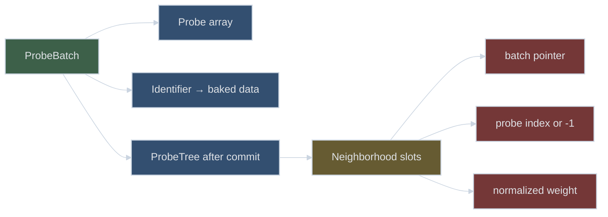

---
# 1. 역할

`ProbeBatch`는 probe 위치 집합과 여러 baked data layer를 함께 소유한다. 
하나의 layer는 `BakedDataIdentifier`로 구분되며 <strong style="color:#b3f594">Reflections</strong> 또는 <strong style="color:#b3f594">Pathing</strong> 데이터를 담는다. 
Batch는 probe를 추가/삭제/이동할 때 보유한 각 `IBakedData`에도 변경을 전달한다.

ProbeBatch와 ProbeManager의 구분: batch 하나는 probe와 data를 소유하고,
[[core_probe_manager|ProbeManager 분석]]은 여러 batch를 scene query에 맞춰 모은다. 
`commit()`은 ProbeTree를 만들어 이후 위치 lookup을 준비한다.

---
# 2. 핵심 자료 구조

`ProbeNeighborhood`에는 batch pointer, probe index, weight가 같은 slot index로 저장된다. 
또한 occlusion query용 ray와 결과 scratch array를 보유한다. 
한 batch에서 최대 8개 probe를 저장하도록 `kMaxProbesPerBatch`가 고정되어 있다.

probe_data.h [링크](https://github.com/ValveSoftware/steam-audio/blob/v4.8.1/core/src/core/probe_data.h)는 layer identity와 mutation 계약을 제공한다. 
`BakedDataIdentifier`는 variation, type, endpoint influence sphere로 구성되고, 
`IBakedData`는 probe 이동/추가/삭제, endpoint 변경, serialized size 응답을 모든 
payload가 구현하도록 한다.

``` cpp fold title:probe_data.h identifier와 baked layer interface
enum class BakedDataVariation { Reverb, StaticSource, StaticListener, Dynamic };
enum class BakedDataType { Reflections, Pathing };

class IBakedData
{
public:
    virtual void updateProbePosition(int index, const Vector3f& position) = 0;
    virtual void addProbe(const Sphere& influence) = 0;
    virtual void removeProbe(int index) = 0;
    virtual void updateEndpoint(const BakedDataIdentifier& identifier,
                               const Probe* probes,
                               const Sphere& endpointInfluence) = 0;
};
```

원본에는 virtual destructor와 `serializedSize()`도 있다. 
`BakedDataIdentifier::operator<`는 variation, type, sphere center 좌표, radius 순으로 
비교해 map key로 쓸 수 있게 한다.





---
# 3. Steam Audio 코드 분석

소스 위치 probe_batch.h [링크](https://github.com/ValveSoftware/steam-audio/blob/v4.8.1/core/src/core/probe_batch.h) / probe_batch.cpp [링크](https://github.com/ValveSoftware/steam-audio/blob/v4.8.1/core/src/core/probe_batch.cpp)를 함께 본다. 
생성/로드 시 serialized probe sphere 배열을 복사하고 각 data layer type에 따라 
구체 구현을 만든다.

``` cpp fold title:ProbeBatch deserialization에서 data layer 복원
if (identifier.type == BakedDataType::Reflections)
{
    data = ipl::make_unique<BakedReflectionsData>(identifier, numProbes,
        serializedObject->data_layers()->Get(i)->reflections_data());
}
else if (identifier.type == BakedDataType::Pathing)
{
    data = ipl::make_unique<BakedPathData>(
        serializedObject->data_layers()->Get(i)->pathing_data());
    static_cast<BakedPathData*>(data.get())->updateVisGraphCosts(*this);
}
addData(identifier, std::move(data));
```

identifier의 variation/type/influence를 복구하고 type에 맞는 payload를 읽는다.
Pathing load 뒤에는 현재 batch probe 배치 기준으로 <strong style="color:#b3f594">visibility graph</strong> 비용을 갱신한다.
이는 serialized graph만 복사하고 끝내는 것이 아니라 로드한 데이터가 실제 probe 배열을 
참조하는 형태로 보정하는 단계다.

## 3.1 Probe 변경과 baked data 동기화

``` cpp fold title:probe position 변경을 각 baked layer에 전달
void ProbeBatch::updateProbePosition(int index, const Vector3f& position)
{
    mProbes[index].influence.center = position;
    for (auto& data : mData)
        data.second->updateProbePosition(index, position);
}

void ProbeBatch::removeProbe(int index)
{
    mProbes.erase(mProbes.begin() + index);
    for (auto& data : mData)
        data.second->removeProbe(index);
}
```

probe 위치 변경과 삭제는 각 baked payload에 전달돼 cache/index를 무효화하거나 
재정렬할 수 있게 한다. `updateProbeRadius`는 influence radius만 바꾸고 
`IBakedData`에는 통보하지 않는다.
실제 영향 범위와 bake validity를 바꿀 때 이 차이를 고려해야 한다.

## 3.2 Commit과 query

``` cpp fold title:commit에서 tree 생성 후 최대 8개 probe query
void ProbeBatch::commit()
{
    mProbeTree = make_unique<ProbeTree>(static_cast<int>(mProbes.size()), mProbes.data());
}

mProbeTree->getInfluencingProbes(point, mProbes.data(),
    ProbeNeighborhood::kMaxProbesPerBatch,
    &neighborhood.probeIndices[offset]);
```

`getInfluencingProbes`는 `mProbeTree`가 준비되어 있다고 assert한다. 
따라서 probe를 편집한 뒤 `commit()`을 호출해야 query 가능하다. 
query 뒤에는 해당 8개 slot의 batch pointer를 모두 `this`로 채우며, 유효한 probe가 없는 
slot은 index `-1` sentinel로 남는다.

probe가 0개인 경우 `ProbeTree` 생성자는 node를 만들지 않고 반환하므로, 
빈 batch를 commit한 뒤 lookup하지 않도록 상위 코드의 유효성 조건도 지킨다.

## 3.3 <strong style="color:#b3f594">Serialization</strong>

`serialize()`는 probe의 `Sphere` 배열을 FlatBuffers struct vector로 만들고 
각 baked layer의 identifier와 type별 payload offset을 쓴다. 
`serializeAsRoot()`는 root table을 finish한 뒤 `SerializedObject::commit()`한다. 
schema는 `probe_batch.fbs`이며 probe sphere 배열과 data layer 배열로 구성된다.

``` cpp fold title:probe_batch.fbs schema 핵심 구조
table BakedDataLayer {
    identifier:BakedDataIdentifier;
    reflections_data:BakedReflectionsData;
    pathing_data:BakedPathingData;
}

table ProbeBatch {
    probes:[Sphere];
    data_layers:[BakedDataLayer];
}
```

schema는 한 layer에 identifier와 reflection/pathing payload slot을 둔다.
내부 C++은 identifier type에 따라 올바른 payload를 만들고 저장한다.

---
# 4. C API 사용 흐름

api_probes.cpp [링크](https://github.com/ValveSoftware/steam-audio/blob/v4.8.1/core/src/core/api_probes.cpp)의 `CProbeBatch`가 create/load/save, probe add/remove, commit을 
감싼다. 간단한 사용 흐름은 다음과 같다.

``` cpp fold title:공개 API로 ProbeBatch 구성하는 형태
IPLProbeBatch* batch = nullptr;
iplProbeBatchCreate(context, &batch);
iplProbeBatchAddProbeArray(batch, probeArray);
iplProbeBatchCommit(batch);
// 이후 해당 batch를 simulator와 bake API에 전달한다.
```

이것은 호출 순서를 설명하는 API 형태 예제이며, 실제 함수 인자와 수명 관리는 사용 중인 
SDK의 phonon.h [링크](https://github.com/ValveSoftware/steam-audio/blob/v4.8.1/core/src/core/phonon.h) 선언을 따른다. 
Core 내부 자료 구조를 독립 구현한 예제가 아니다.

---
# 5. 독립 C++ 핵심 예제


``` cpp fold title:데이터 layer와 probe 수명 동기화
#include <memory>
#include <vector>

struct BakedLayer
{
    virtual ~BakedLayer() = default;
    virtual void onProbeRemoved(std::size_t index) = 0;
};

struct Batch
{
    std::vector<int> probes;
    std::vector<std::unique_ptr<BakedLayer>> layers;

    void removeProbe(std::size_t index)
    {
        probes.erase(probes.begin() + index);
        for (auto& layer : layers)
            layer->onProbeRemoved(index);
    }
};
```

예제는 probe index가 baked layer와 일관되게 유지되어야 한다는 원리만 보여준다. 
Steam Audio는 sphere data, identifiers, commit/tree rebuild, serialization과 
실제 layer별 invalidation을 처리한다.

---

# 6. Source file inventory

아래 파일명 옆의 링크를 열면 Steam Audio 공식 저장소에서 원본을 확인할 수 있다.

<strong style="color:#b3f594">probe_batch.h</strong>
- [링크](https://github.com/ValveSoftware/steam-audio/blob/v4.8.1/core/src/core/probe_batch.h)

<strong style="color:#b3f594">probe_batch.cpp</strong>
- [링크](https://github.com/ValveSoftware/steam-audio/blob/v4.8.1/core/src/core/probe_batch.cpp)

<strong style="color:#b3f594">probe_batch.fbs</strong>
- [링크](https://github.com/ValveSoftware/steam-audio/blob/v4.8.1/core/src/core/probe_batch.fbs)

<strong style="color:#b3f594">probe_data.h</strong>
- [링크](https://github.com/ValveSoftware/steam-audio/blob/v4.8.1/core/src/core/probe_data.h)

<strong style="color:#b3f594">probe_tree.h</strong>
- [링크](https://github.com/ValveSoftware/steam-audio/blob/v4.8.1/core/src/core/probe_tree.h)

<strong style="color:#b3f594">probe_tree.cpp</strong>
- [링크](https://github.com/ValveSoftware/steam-audio/blob/v4.8.1/core/src/core/probe_tree.cpp)

<strong style="color:#b3f594">api_probes.h</strong>
- [링크](https://github.com/ValveSoftware/steam-audio/blob/v4.8.1/core/src/core/api_probes.h)

<strong style="color:#b3f594">api_probes.cpp</strong>
- [링크](https://github.com/ValveSoftware/steam-audio/blob/v4.8.1/core/src/core/api_probes.cpp)

---

