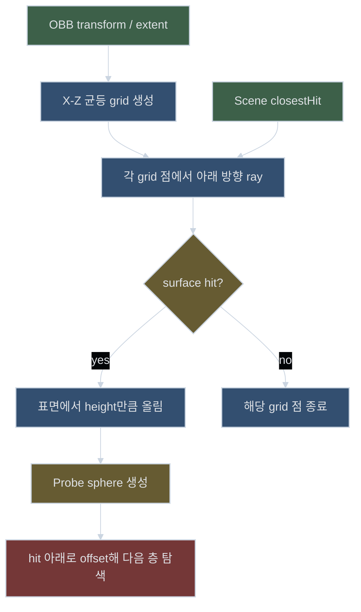

---
# 1. <strong style="color:#b3f594">Probe</strong> 생성이 하는 일

`ProbeGenerator`는 bake 영역(OBB transform)과 Scene query를 받아 
공간을 대표할 probe의 위치와 influence sphere를 만든다. 
`Probe` 자체는 `Sphere influence` 하나를 가진 단순 구조이며, 반사 데이터나 path graph를 
계산하지 않는다. 만들어진 위치를 `ProbeBatch`에 넣은 다음 별도의 bake 과정을 거친다.

생성기 선언과 호출자가 궁금하면 이 문서의 실제 코드 절을 본다. 
Probe를 저장하고 lookup tree를 만드는 단계는
[[core_probe_batch|ProbeBatch 분석]], 위치 query 단계는 [[core_probe_tree|ProbeTree 분석]]에 연결했다.

---

# 2. 생성 방식의 개념

probe.h [링크](https://github.com/ValveSoftware/steam-audio/blob/v4.8.1/core/src/core/probe.h)의 `Probe`는 `Sphere influence` 한 개만 가진다. 
Probe 위치와 주변에서 그 probe가 영향을 미치는 반경을 함께 저장하므로, 
이후 tree query는 “가장 가까운 probe”가 아니라 “point를 포함하는 influence sphere”를 찾는다.

``` cpp fold title:probe.h Probe 데이터 정의
struct Probe
{
    Sphere influence;
};
```

별도 probe id, baked payload, 공간 index는 이 struct에 저장하지 않는다. 
그 데이터는 ProbeBatch와 ProbeTree가 나눠 관리한다.

## 2.1 Centroid

OBB transform의 translation을 probe center로 삼고, transform의 세 축 길이 중 
가장 짧은 값의 절반을 sphere radius로 쓴다. 
Scene 표면이나 바닥을 raycast하지 않는다. 따라서 이 방식은 단일 대표 위치를 만드는 
빠른 단순화이며, 복잡한 공간의 모든 방을 샘플링하지 않는다.

## 2.2 UniformFloor

OBB의 X-Z 바닥면에 spacing 간격으로 ray 시작점을 배치하고 각 점에서 변환된 
local -Y 방향으로 Scene에 ray를 쏜다. 맞은 표면에서 지정 height만큼 띄운 점이 probe가 된다. 
표면이 여러 층이면 hit 이후 origin을 아래로 이동해 추가 표면을 찾는다.





---
# 3. Steam Audio 코드 분석

실제 코드 위치는 probe_generator.h [링크](https://github.com/ValveSoftware/steam-audio/blob/v4.8.1/core/src/core/probe_generator.h) / probe_generator.cpp [링크](https://github.com/ValveSoftware/steam-audio/blob/v4.8.1/core/src/core/probe_generator.cpp)다. 
`generateProbes`는 enum을 분기한다.

``` cpp fold title:ProbeGenerator::generateProbes 실제 코드 발췌
switch (type)
{
case ProbeGenerationType::Centroid:
    generateCentroidProbe(scene, obbTransform, probes);
    break;

case ProbeGenerationType::UniformFloor:
    generateUniformFloorProbes(scene, obbTransform, spacing, height, probes);
    break;

default:
    throw Exception(Status::Initialization);
}
```

헤더 enum에는 `Octree` 값도 정의돼 있지만 이 switch에는 case가 없다. 
`generateOctreeProbes`는 octree_probes.cpp [링크](https://github.com/ValveSoftware/steam-audio/blob/v4.8.1/core/src/core/octree_probes.cpp)의 별도 함수이며, 
현재 검색한 소스에서는 이 dispatch 함수나 C API에서 호출되지 않는다.

따라서 **이 checkout에서 `ProbeGenerationType::Octree`를 `generateProbes`에 
전달하면 default 예외로 간다.** Octree 방식은 [[core_octree_probe_generation|별도 구현 분석]]에서 구분해 본다.

## 3.1 Centroid 코드

``` cpp fold title:centroid probe 위치와 influence radius
probe.influence.center = Vector3f(obbTransform(0, 3),
                                  obbTransform(1, 3),
                                  obbTransform(2, 3));

auto sx = Vector3f(obbTransform(0, 0), obbTransform(1, 0), obbTransform(2, 0)).length();
auto sy = Vector3f(obbTransform(0, 1), obbTransform(1, 1), obbTransform(2, 1)).length();
auto sz = Vector3f(obbTransform(0, 2), obbTransform(1, 2), obbTransform(2, 2)).length();
probe.influence.radius = std::min({ sx / 2.0f, sy / 2.0f, sz / 2.0f });
```

행렬의 translation column이 center이고 첫 3개 basis column의 길이가 
각 OBB 축의 크기를  나타낸다. 
최소 반축 길이를 sphere radius로 골라 OBB 내부에 들어가는 보수적인 구형 influence를 만든다.
입력 OBB의 축 방향 회전은 center와 축 길이에 반영되지만, 
결과 probe는 sphere라 회전 방향을 저장하지 않는다.

## 3.2 UniformFloor grid 코드

``` cpp fold title:UniformFloor grid 간격과 가장자리 여백
auto numProbesX = static_cast<int>(floorf(sx / spacing)) + 1;
auto numProbesZ = static_cast<int>(floorf(sz / spacing)) + 1;
auto residualX = (sx - (numProbesX - 1) * spacing) / 2;
auto residualZ = (sz - (numProbesZ - 1) * spacing) / 2;

auto xPos = -.5f + (i * spacing + residualX) / sx;
auto yPos = .5f;
auto zPos = -.5f + (j * spacing + residualZ) / sz;
auto probePoint4f = Vector4f(obbTransform * Vector4f(xPos, yPos, zPos, 1));
```

`xPos/yPos/zPos`는 OBB local normalized 좌표다. 
grid가 영역을 간격으로 채우고 남긴 길이(residual)를 양 끝에 절반씩 배분한다. 
이후 `w=1` 위치로 변환해 world space ray origin을 구한다. 
축 길이가 아주 작으면 나누기 전에 함수를 반환한다.

## 3.3 바닥 hit와 층 반복

``` cpp fold title:floor hit에서 높이를 띄우고 다음 표면 찾기
Ray downwardRay{ currentOrigin, downVector };
auto floorHit = scene.closestHit(downwardRay, height, distanceFromFloor + height);
if (!floorHit.isValid())
    break;

auto probeLocalPos = currentOrigin + downVector * (floorHit.distance - height);
Probe probe;
probe.influence.center = probeLocalPos;
probe.influence.radius = spacing;
probes.push_back(probe);

currentOrigin += downVector * (floorHit.distance + kDownwardOffset);
distanceFromFloor -= (floorHit.distance + kDownwardOffset);
```

ray의 min distance를 `height`로 두어 origin 바로 근처의 hit를 제외한다. 
hit에서 height를 빼고 내려간 지점이 표면 위쪽의 probe 위치다. 
다음 ray는 hit를 지나 `0.01 m` 더 내려 시작해 같은 면에 반복 hit하지 않도록 한다.
`distanceFromFloor`는 OBB 세로 축 길이 기반 루프 한계다.

> [!warning] 설정의 의미
>`spacing`은 바닥 grid 간격과 probe influence radius에 함께 쓰인다. 
>`height`는 floor에서 probe를 띄우는 거리와
> ray의 최소 hit 거리로 쓰인다. 둘은 서로 다른 용도이므로 동일한 파라미터처럼 
> 취급하면 안 된다.

---
# 4. C API 연결과 사용 흐름

Host는 먼저 `iplProbeArrayCreate`로 probe 배열을 만든다.
`iplProbeArrayGenerateProbes`에 생성 설정을 전달하면
`CProbeArray::generateProbes`가 public 좌표를 내부 좌표로 바꾸고
생성 방식과 `spacing`, `height` 값을 내부 generator로 전달한다.

생성된 probe는 다음 순서로 batch에 넣고 확정한다.

1. `iplProbeArrayCreate`로 배열 생성
2. `iplProbeArrayGenerateProbes`로 probe 생성
3. 생성된 probe 개수와 결과 확인
4. `iplProbeBatchCreate`로 batch 생성
5. `iplProbeBatchAddProbeArray`로 배열을 batch에 추가
6. `iplProbeBatchCommit`으로 batch 상태 확정

Bake를 수행할 때는 commit된 `Scene`과 `ProbeBatch`를 baker에 전달한다.
관련 구현은 <strong style="color:#b3f594">api_probes.cpp</strong> [링크](https://github.com/ValveSoftware/steam-audio/blob/v4.8.1/core/src/core/api_probes.cpp)에서 확인할 수 있다.
공개 함수와 데이터 계약은 [Public API 상세](../api/core_public_api.md),
Host 측 호출 구조는 [Host C API Overview](core_02_host_c_api_overview.md)를 참고한다.

이 문서에서 분석한 `octree_probes.*` 함수는 public 생성 type dispatch에 연결되어 있지 않다.
따라서 일반적인 `iplProbeArrayGenerateProbes` 호출로 octree 방식을 선택할 수 있다고
간주하지 않는다.

---

# 5. 독립 C++ 핵심 예제

``` cpp fold title:균등 간격 grid 위치 계산 독립 예제
#include <cmath>
#include <vector>

std::vector<float> centeredGrid(float extent, float spacing)
{
    std::vector<float> positions;
    if (extent <= 0.0f || spacing <= 0.0f)
        return positions;

    const int count = static_cast<int>(std::floor(extent / spacing)) + 1;
    const float margin = (extent - (count - 1) * spacing) * 0.5f;
    for (int i = 0; i < count; ++i)
        positions.push_back(-extent * 0.5f + margin + i * spacing);
    return positions;
}
```

이 예제는 grid 축 한 개의 간격 배치만 보여준다. 
Steam Audio는 이를 두 축으로 적용하고, OBB transform, raycast, hit 높이, 
다층 surface, influence sphere를 함께 처리한다.

---
# 6. Source file inventory

아래 파일명 옆의 링크를 열면 Steam Audio 공식 저장소에서 원본을 확인할 수 있다.

<strong style="color:#b3f594">probe.h</strong>
- [링크](https://github.com/ValveSoftware/steam-audio/blob/v4.8.1/core/src/core/probe.h)

<strong style="color:#b3f594">probe_generator.h</strong>
- [링크](https://github.com/ValveSoftware/steam-audio/blob/v4.8.1/core/src/core/probe_generator.h)

<strong style="color:#b3f594">probe_generator.cpp</strong>
- [링크](https://github.com/ValveSoftware/steam-audio/blob/v4.8.1/core/src/core/probe_generator.cpp)

<strong style="color:#b3f594">octree_probes.h</strong>
- [링크](https://github.com/ValveSoftware/steam-audio/blob/v4.8.1/core/src/core/octree_probes.h)

<strong style="color:#b3f594">octree_probes.cpp</strong>
- [링크](https://github.com/ValveSoftware/steam-audio/blob/v4.8.1/core/src/core/octree_probes.cpp)

<strong style="color:#b3f594">api_probes.h</strong>
- [링크](https://github.com/ValveSoftware/steam-audio/blob/v4.8.1/core/src/core/api_probes.h)

<strong style="color:#b3f594">api_probes.cpp</strong>
- [링크](https://github.com/ValveSoftware/steam-audio/blob/v4.8.1/core/src/core/api_probes.cpp)

---

