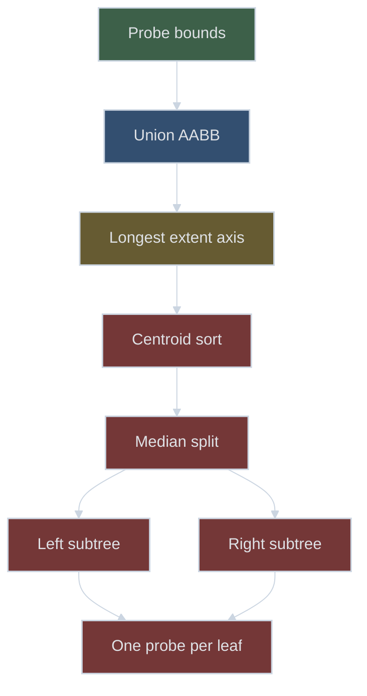

---
# 1. 목적과 데이터

`ProbeTree`는 point 주변의 influence sphere를 찾을 때 모든 probe를 매번 선형 
검사하지 않도록 분할 bounding box를 만든다. 
Tree leaf는 probe index 하나를 가지며 내부 node는 split axis/coordinate와 
두 child offset을 인코딩한다. `ProbeBatch::commit()`에서 tree가 만들어진다.

> [!warning] 최대 반환 개수
> ProbeBatch는 최대 8개 probe slot만 요청한다. 
> Tree는 near child를 먼저 방문하지만, 결과를 거리순 정렬하거나 
> 전체에서 가장 가까운 8개를 고르는 코드는 없다.
>  point를 포함하는 후보가 8개보다 많으면 traversal에서 먼저 발견한 8개가 반환될 수 있다.


이 구조는 Scene 삼각형 BVH와 같은 문제를 푸는 것이 아니라 probe 위치 query를 가속한다. 
생성·소유는 [[core_probe_batch|ProbeBatch]], batch 여러 개의 결과 합성은 [[core_probe_manager|ProbeManager]]를 본다.

---
# 2. Build 흐름

1. 각 probe sphere를 감싸는 AABB와 center를 기록한다.
2. 현재 node 범위 전체의 union AABB를 계산한다.
3. AABB extents 중 가장 긴 축을 split axis로 고른다.
4. 해당 축 center를 정렬하고 절반 지점에서 나눈다.
5. child node를 연속 node array에 배치하고 offset/axis를 parent에 encode한다.
6. 하나의 probe가 남으면 leaf로 저장한다.




---
# 3. 실제 코드 분석

Tree node는 `Box` 안에 split metadata를 겹쳐 저장한다. 
`data()`는 box min 좌표 네 번째 lane에서 정수 metadata를 읽고,
`maxCoordinates`의 4번째 lane은 split coordinate다. 
이런 packed layout은 메모리를 줄이지만 `Box`/**SIMD** storage layout에 의존하므로 
자료 구조 정의를 같이 읽어야 한다.

``` cpp fold title:ProbeTree build의 axis 선택과 median partition
auto splitIndex = (task.endIndex - task.startIndex + 1) / 2;
auto splitAxis = mNodes[task.nodeIndex].box.extents().indexOfMaxComponent();

std::sort(&centroids[splitAxis][task.startIndex],
          &centroids[splitAxis][task.endIndex + 1], compareCentroids);

auto splitCoordinate = centroids[splitAxis][task.startIndex + splitIndex].coordinate;
mNodes[task.nodeIndex].setInternalNodeData(task.leftChildIndex - task.nodeIndex, splitAxis);
mNodes[task.nodeIndex].setSplitCoordinate(splitCoordinate);
```

구현은 재귀 호출 대신 고정 크기 `Stack<ProbeTreeConstructionTask>`로 
반복 작업을 관리한다. Node 배열은 probe N개일 때 `2N-1` 크기로 확보한다.
Median partition은 균형 잡힌 node 수를 만들지만, surface area heuristic으로 query 비용을 
최적화하는 코드는 아니다.

## 3.1 Point query

``` cpp fold title:ProbeTree query의 broad phase와 sphere 최종 검사
if (node->box.contains(point))
{
    if (node->isLeaf())
    {
        if (probes[node->getProbeIndex()].influence.contains(point))
        {
            probeIndices[numInfluencingProbes++] = node->getProbeIndex();
            if (numInfluencingProbes >= maxInfluencingProbes)
                break;
        }
    }
    else
    {
        // query 좌표를 split 좌표와 비교해 near child를 먼저 방문
    }
}
```

node box test는 broad phase이고 leaf에서 원래 sphere를 다시 검사하는 것이 
실제 influence 포함 판정이다. 한 batch당 최대 8개까지만 저장한다. 
query point를  split plane과 비교해 가까운 child부터 방문하되 반대쪽 child도 stack에 
남겨 경계 근처 후보를 놓치지 않는다. 
output array는 함수 초기에 `-1`로 채워 미사용 slot을 표시한다.

---
# 4. 사용 및 제약

ProbeTree를 직접 만드는 공개 API는 없다. 
ProbeBatch가 commit하며 ProbeManager query 경로가 이를 호출한다. 
빈 probe 수이면 생성자가 바로 반환하므로 이후 root를 참조하는 query는 유효하지 않다.
Batch commit/query 호출 계약을 유지한다.

독립 구현 예제 대신 실제 tree 검색의 핵심 비교를 이해하려면 [[Programming/Algorithm/algo_BVH|BVH/공간 분할기초]]를 먼저 보고, 
이 문서의 longest-axis median split과 Core geometry BVH의 분할 전략 차이를 비교한다.

---
# 5. Source file inventory

아래 파일명 옆의 링크를 열면 Steam Audio 공식 저장소에서 원본을 확인할 수 있다.

<strong style="color:#b3f594">probe_tree.h</strong>
- [링크](https://github.com/ValveSoftware/steam-audio/blob/v4.8.1/core/src/core/probe_tree.h)

<strong style="color:#b3f594">probe_tree.cpp</strong>
- [링크](https://github.com/ValveSoftware/steam-audio/blob/v4.8.1/core/src/core/probe_tree.cpp)

<strong style="color:#b3f594">box.h</strong>
- [링크](https://github.com/ValveSoftware/steam-audio/blob/v4.8.1/core/src/core/box.h)

<strong style="color:#b3f594">stack.h</strong>
- [링크](https://github.com/ValveSoftware/steam-audio/blob/v4.8.1/core/src/core/stack.h)

---

