---
# 1. Introduction

<strong style="color:#b3f594">Probe</strong> modules는 공간을 sample할 위치를 생성·관리하고, 위치 query에 영향이 있는 
probe를  찾아 baked indirect data를 runtime simulation에 공급한다. 
Probe creation/lookup과 reflection/path baking은 서로 연결되지만 동일한 계산은 아니다.

상위 위치는 [[core_06_pathing_overview|Pathing Overview]] 및 [[core_05_reflections_reverb_overview|Reflections & Reverb Overview]]에 있다.

---
# 2. 개념과 자료 흐름

```mermaid
%%{init: {"theme":"base","themeVariables":{"background":"#111827","darkMode":true,"primaryColor":"#3d6049","primaryTextColor":"#dfe2e6","primaryBorderColor":"#cbd5e1","secondaryColor":"#334f70","secondaryTextColor":"#dfe2e6","secondaryBorderColor":"#cbd5e1","tertiaryColor":"#665b32","tertiaryTextColor":"#dfe2e6","tertiaryBorderColor":"#cbd5e1","clusterBkg":"#743737","clusterBorder":"#cbd5e1","lineColor":"#cbd5e1","textColor":"#dfe2e6","nodeTextColor":"#dfe2e6","actorBkg":"#303943","actorBorder":"#cbd5e1","actorTextColor":"#dfe2e6","actorLineColor":"#cbd5e1","signalColor":"#cbd5e1","signalTextColor":"#dfe2e6","labelBoxBkgColor":"#743737","labelBoxBorderColor":"#cbd5e1","labelTextColor":"#dfe2e6","activationBkgColor":"#334f70","activationBorderColor":"#cbd5e1","noteBkgColor":"#665b32","noteBorderColor":"#cbd5e1","noteTextColor":"#dfe2e6"}}}%%
flowchart LR
    Geometry[Scene geometry] --> Generate[ProbeGenerator]
    Generate --> Batch[ProbeBatch / Probe data]
    Batch --> Tree[ProbeTree spatial index]
    Batch --> Bake[Reflection / path bake]
    Bake --> Store[Baked data identifier + serialized payload]
    Tree --> Lookup[Runtime influencing probe lookup]
    Store --> Lookup
    Lookup --> Sim[SimulationManager]
    classDef level1 fill:#3d6049,stroke:#cbd5e1,color:#dfe2e6,stroke-width:1.5px;
    classDef level2 fill:#334f70,stroke:#cbd5e1,color:#dfe2e6,stroke-width:1.5px;
    classDef level3 fill:#665b32,stroke:#cbd5e1,color:#dfe2e6,stroke-width:1.5px;
    classDef level4 fill:#743737,stroke:#cbd5e1,color:#dfe2e6,stroke-width:1.5px;
    class Geometry level1;
    class Generate level2;
    class Batch level3;
    class Tree,Bake,Store,Lookup,Sim level4;
```



`ProbeTree`는 공간 검색을 줄이는 index이며 `ProbeManager`는 batch collection/identity looku을
관리한다. Baker는 offline/async 계산과 progress/cancel boundary를 제공하고,baked simulator
는 저장된 data를 runtime result에 합친다.

## 2.1 Probe 위치 생성

`ProbeGenerator`는 OBB를 기준으로 probe 위치를 만들고, 
`ProbeArray`는 결과를 임시 보관한다. Centroid는 한 점을 대표로 만들고 UniformFloor는 
영역 grid에서 아래 방향 ray를 쏴 surface 위에 probe를 놓는다. 
함수별 계산과 파라미터 의미는 [[core_probe_generator|ProbeGenerator 상세 분석]]에서 설명한다. 
Octree leaf를 probe로 바꾸는 별도 구현은 [[core_octree_probe_generation|Octree Probe 생성 분석]]에 있다.

## 2.2 ProbeBatch와 데이터 소유

`ProbeBatch`는 probe 배열과 baked data layer map을 소유한다. 
probe 위치를 바꾸거나 제거할 때 각 `IBakedData`에도 변경을 전달하고, `commit()`에서 
runtime query용 `ProbeTree`를 만든다.

deserialization은 reflection/pathing payload를 identifier type으로 구분한다.
멤버 역할과 실제 코드 흐름은 [[core_probe_batch|ProbeBatch와 serialization 상세]]에서 본다.

## 2.3 Query, neighborhood, 가중치

`ProbeTree`는 point를 포함하는 influence sphere를 찾고, `ProbeManager`는 
여러 batch의 후보를 `ProbeNeighborhood` 하나에 모은다. 
이후 가려진 probe를 Scene ray query로 제거하고 inverse-distance weight를 정규화한다.
[[core_probe_tree|ProbeTree build/query]]와 [[core_probe_manager|ProbeManager와 Neighborhood]]에서 각각 구현을 따라간다.

# 3. Steam Audio 코드 분석

`ProbeTree::getInfluencingProbes`는 output을 sentinel로 초기화하고 
point를 포함하는 tree node를 찾아 영향 probe를 수집한다.

``` cpp fold title:probe_tree.cpp 실제 코드 발췌
for (auto i = 0; i < maxInfluencingProbes; ++i)
{
    probeIndices[i] = -1;
}

auto numInfluencingProbes = 0;
Stack<const ProbeTreeNode*, kProbeLookupStackSize> stack;
const auto* node = &mNodes[0];

while (true)
{
    if (node->box.contains(point))
    {
```

초기 sentinel은 찾은 probe 수가 max capacity보다 작을 때 남은 slot을 식별하는 데 쓰인다.
이후 leaf의 influence region을 추가로 검사한다.

---
# 4. 사용법

Probe batch를 생성하고 geometry 및 baking settings를 연결한 후 bake callback을 
통해 progress/result를 관리한다.  Runtime에는 올바른 baked identifier를 source input에 넣고
probe lookup/simulator가 그 결과를 사용하는지 확인한다. 

C API create/bake/cancel는 api_probes.cpp [링크](https://github.com/ValveSoftware/steam-audio/blob/v4.8.1/core/src/core/api_probes.cpp), api_baking.cpp [링크](https://github.com/ValveSoftware/steam-audio/blob/v4.8.1/core/src/core/api_baking.cpp)에서 확인한다.

---
# 5. 독립 C++ 핵심 예제

``` cpp fold title:독립 probe region lookup 예제
#include <cstddef>
#include <vector>

std::vector<int> findContainingProbes(float x, const std::vector<float>& centers,
                                      float radius)
{
    std::vector<int> result;
    for (std::size_t i = 0; i < centers.size(); ++i)
    {
        if (x >= centers[i] - radius && x <= centers[i] + radius)
        {
            result.push_back(static_cast<int>(i));
        }
    }
    return result;
}
```

이 예제는 선형 구간 검색이다. 
Steam Audio는 3D influence volume과 tree acceleration을 사용한다.

---
# 6. Source file inventory

아래 목록은 이 문서에서 분석하는 Probes/Baking 파일이다.
파일명 옆의 링크를 열면 Steam Audio 공식 저장소에서 원본을 확인할 수 있다.

## 6.1 Probe generation

- <strong style="color:#b3f594">probe.h</strong> [링크](https://github.com/ValveSoftware/steam-audio/blob/v4.8.1/core/src/core/probe.h)
- <strong style="color:#b3f594">probe_generator.h</strong> [링크](https://github.com/ValveSoftware/steam-audio/blob/v4.8.1/core/src/core/probe_generator.h)
- <strong style="color:#b3f594">probe_generator.cpp</strong> [링크](https://github.com/ValveSoftware/steam-audio/blob/v4.8.1/core/src/core/probe_generator.cpp)
- <strong style="color:#b3f594">octree_probes.h</strong> [링크](https://github.com/ValveSoftware/steam-audio/blob/v4.8.1/core/src/core/octree_probes.h)
- <strong style="color:#b3f594">octree_probes.cpp</strong> [링크](https://github.com/ValveSoftware/steam-audio/blob/v4.8.1/core/src/core/octree_probes.cpp)

## 6.2 Probe batch and lookup

- <strong style="color:#b3f594">probe_batch.h</strong> [링크](https://github.com/ValveSoftware/steam-audio/blob/v4.8.1/core/src/core/probe_batch.h)
- <strong style="color:#b3f594">probe_batch.cpp</strong> [링크](https://github.com/ValveSoftware/steam-audio/blob/v4.8.1/core/src/core/probe_batch.cpp)
- <strong style="color:#b3f594">probe_batch.fbs</strong> [링크](https://github.com/ValveSoftware/steam-audio/blob/v4.8.1/core/src/core/probe_batch.fbs)
- <strong style="color:#b3f594">probe_data.h</strong> [링크](https://github.com/ValveSoftware/steam-audio/blob/v4.8.1/core/src/core/probe_data.h)
- <strong style="color:#b3f594">probe_manager.h</strong> [링크](https://github.com/ValveSoftware/steam-audio/blob/v4.8.1/core/src/core/probe_manager.h)
- <strong style="color:#b3f594">probe_manager.cpp</strong> [링크](https://github.com/ValveSoftware/steam-audio/blob/v4.8.1/core/src/core/probe_manager.cpp)
- <strong style="color:#b3f594">probe_tree.h</strong> [링크](https://github.com/ValveSoftware/steam-audio/blob/v4.8.1/core/src/core/probe_tree.h)
- <strong style="color:#b3f594">probe_tree.cpp</strong> [링크](https://github.com/ValveSoftware/steam-audio/blob/v4.8.1/core/src/core/probe_tree.cpp)

## 6.3 Baked reflection data and processing

- <strong style="color:#b3f594">baked_reflection_data.h</strong> [링크](https://github.com/ValveSoftware/steam-audio/blob/v4.8.1/core/src/core/baked_reflection_data.h)
- <strong style="color:#b3f594">baked_reflection_data.cpp</strong> [링크](https://github.com/ValveSoftware/steam-audio/blob/v4.8.1/core/src/core/baked_reflection_data.cpp)
- <strong style="color:#b3f594">baked_reflection_data.fbs</strong> [링크](https://github.com/ValveSoftware/steam-audio/blob/v4.8.1/core/src/core/baked_reflection_data.fbs)
- <strong style="color:#b3f594">baked_reflection_simulator.h</strong> [링크](https://github.com/ValveSoftware/steam-audio/blob/v4.8.1/core/src/core/baked_reflection_simulator.h)
- <strong style="color:#b3f594">baked_reflection_simulator.cpp</strong> [링크](https://github.com/ValveSoftware/steam-audio/blob/v4.8.1/core/src/core/baked_reflection_simulator.cpp)
- <strong style="color:#b3f594">reflection_baker.h</strong> [링크](https://github.com/ValveSoftware/steam-audio/blob/v4.8.1/core/src/core/reflection_baker.h)
- <strong style="color:#b3f594">reflection_baker.cpp</strong> [링크](https://github.com/ValveSoftware/steam-audio/blob/v4.8.1/core/src/core/reflection_baker.cpp)

---
