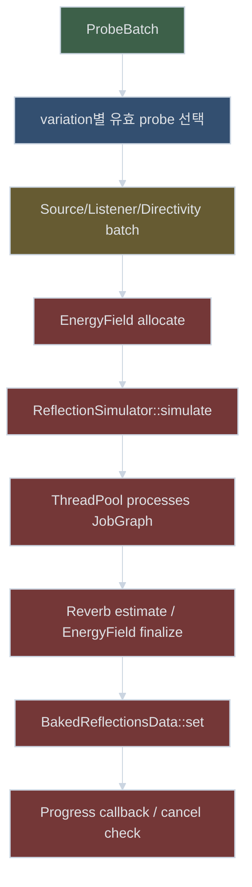

---
# 1. 역할

`ReflectionBaker`는 Scene, reflection simulator, baked identifier, probe batch를 
받아 probe별 반사 결과를 미리 계산한다.  
convolution용 EnergyField와 parametric Reverb를 선택적으로 저장한다. 
Probe 위치/manager를 만드는 [[core_probe_generator|ProbeGenerator]]·[[core_probe_batch|ProbeBatch]]와는 별도 단계다.

---
# 2. Bake variation별 source/listener 배치

| Variation | source | listener | bake할 probe |
|---|---|---|---|
| `Reverb` | probe center | 같은 probe center | 모든 probe |
| `StaticSource` | endpoint influence center | probe center | probe center가 endpoint sphere 안인 경우 |
| `StaticListener` | probe center | endpoint influence center | probe center가 endpoint sphere 안인 경우 |

`Dynamic` variation은 `bake()`에서 assert로 금지된다. 
identifier type도 Reflections만 허용하고,`bakeConvolution || bakeParametric` 조건을 요구한다.

---
# 3. 코드 흐름

1. bake 상태 flag를 켜고 identifier 조건을 확인한다.
2. identifier layer가 없으면 `BakedReflectionsData`를 만들고 출력 format flag를 지정한다.
3. 지정 thread 수의 `ThreadPool`, `JobGraph`, source/listener/directivity와
   EnergyField batch scratch를 만든다.
4. probe를 순회하며 variation에 맞는 source/listener pair를 배열에 채운다.
5. batch가 차거나 마지막 probe면 simulator job을 만들고 pool에서 완료한다.
6. optional GPU result를 host로 복사하고, ReverbEstimator 및/또는 EnergyField를 
   baked data에 저장한다.
7. callback으로 진행률을 알리고 cancel 상태면 loop를 마친다.



## 3.1 실제 <strong style="color:#b3f594">simulation</strong> 호출

``` cpp fold title:ReflectionBaker가 simulation job을 만들고 기다리는 위치
jobGraph.reset();
simulator.simulate(scene, numSources, sources.data(), numListeners, listeners.data(),
                   directivities.data(), numRays, numBounces, simDuration, order,
                   irradianceMinDistance, energyFieldPtrs.data(), jobGraph);

threadPool.process(jobGraph);
```

`simulate`는 job을 구성하고 `threadPool.process`가 그 graph의 완료를 기다리는 구조다.
Bake loop의 callback은 이 batch 처리가 끝난 뒤에 호출된다. 
구체적인 ray job 병렬화는 사용된 `IReflectionSimulator` backend 구현을 따라가야 한다.

## 3.2 Batch size 조정

현재 코드에서 Radeon Rays가 아닌 경우, StaticListener variation을 제외한 bake는
`bakeBatchSize=1`로 강제한다. 
Radeon Rays 분기는 variation에 따라 source/listener 배열의 개수 배치를 다르게 설정한다.

따라서 같은 `bakeBatchSize` 값을 전달해도 backend/variation마다 내부 simulation call
 모양이 다를 수 있다.

## 3.3 결과 저장과 취소

Parametric bake는 각 EnergyField에서 `ReverbEstimator::estimate`를 호출한다.
Convolution bake는 `simDuration == bakeDuration`이면 기존 field를 이동해 저장하고,
다르면 bakeDuration/order 크기의 새 EnergyField를 만든 뒤 복사한다. 
각 결과 저장은 `BakedReflectionsData::set`으로 dirty 상태를 해제한다.

`cancel()`은 `sBakeInProgress`가 true일 때 `sCancel`을 설정한다. 
bake loop가 batch 완료 후 이를 확인하고 flag를 지운 뒤 종료한다. 
즉 현재 batch 안의 job을 중간에 끊는 구현은 이 함수에서 보이지 않는다.

---
# 4. 사용 흐름

Host는 bake 요청에 필요한 설정과 callback, `userData`를 전달한다.
Core의 `ReflectionBaker::bake`는 이 입력으로 작업을 구성하고,
진행 상태와 취소 요청을 callback 경계에서 처리한다.

C API 연결은 [Public API 상세](../api/core_public_api.md)와
[Host C API Overview](core_02_host_c_api_overview.md)에서 확인할 수 있다.

Bake 결과는 [BakedReflectionsData 상세](./core_baked_reflection_data.md)에 저장되고,
런타임 조회는 [BakedReflectionSimulator 상세](./core_baked_reflection_simulator.md)로 이어진다.

# 5. 독립 C++ 핵심 예제

``` cpp fold title:batch 단위 계산 후 progress와 cancel 확인
#include <vector>

template<class Work, class Progress>
void processBatches(int count, int batchSize, Work work,
                    Progress progress, bool& cancel)
{
    for (int begin = 0; begin < count && !cancel; begin += batchSize)
    {
        const int end = (begin + batchSize < count) ? begin + batchSize : count;
        work(begin, end); // batch 계산이 완료될 때까지 실행
        progress(static_cast<float>(end) / count);
    }
}
```

예제는 batch 완료 단위 progress/cancel 개념만 나타낸다. 
Core는 variation별 위치 선택, reflection jobs, thread pool, EnergyField/Reverb format 
및 serialization을 구현한다.

---
# 6. Source file inventory

아래 파일명 옆의 링크를 열면 Steam Audio 공식 저장소에서 원본을 확인할 수 있다.

<strong style="color:#b3f594">reflection_baker.h</strong>
- [링크](https://github.com/ValveSoftware/steam-audio/blob/v4.8.1/core/src/core/reflection_baker.h)

<strong style="color:#b3f594">reflection_baker.cpp</strong>
- [링크](https://github.com/ValveSoftware/steam-audio/blob/v4.8.1/core/src/core/reflection_baker.cpp)

<strong style="color:#b3f594">baked_reflection_data.h</strong>
- [링크](https://github.com/ValveSoftware/steam-audio/blob/v4.8.1/core/src/core/baked_reflection_data.h)

<strong style="color:#b3f594">baked_reflection_data.cpp</strong>
- [링크](https://github.com/ValveSoftware/steam-audio/blob/v4.8.1/core/src/core/baked_reflection_data.cpp)

<strong style="color:#b3f594">baked_reflection_simulator.h</strong>
- [링크](https://github.com/ValveSoftware/steam-audio/blob/v4.8.1/core/src/core/baked_reflection_simulator.h)

<strong style="color:#b3f594">baked_reflection_simulator.cpp</strong>
- [링크](https://github.com/ValveSoftware/steam-audio/blob/v4.8.1/core/src/core/baked_reflection_simulator.cpp)

---

