---
# 1. Introduction

Indirect sound 계층은 반사 에너지를 시뮬레이션하고, EnergyField를 누적한 뒤 
impulse response (IR) 또는 reverb parameter로 변환한다. 
재생 단계에서는 convolution/parametric/hybrid reverb effect가 이 결과를 PCM에 적용한다.

상위 흐름과 각 estimator 역할은 [[core_05_reflections_reverb_overview|Reflections & Reverb Overview]]에서 먼저 본다.

---
# 2. 개념과 pipeline

```mermaid
%%{init: {"theme":"base","themeVariables":{"background":"#111827","darkMode":true,"primaryColor":"#3d6049","primaryTextColor":"#dfe2e6","primaryBorderColor":"#cbd5e1","secondaryColor":"#334f70","secondaryTextColor":"#dfe2e6","secondaryBorderColor":"#cbd5e1","tertiaryColor":"#665b32","tertiaryTextColor":"#dfe2e6","tertiaryBorderColor":"#cbd5e1","clusterBkg":"#743737","clusterBorder":"#cbd5e1","lineColor":"#cbd5e1","textColor":"#dfe2e6","nodeTextColor":"#dfe2e6","actorBkg":"#303943","actorBorder":"#cbd5e1","actorTextColor":"#dfe2e6","actorLineColor":"#cbd5e1","signalColor":"#cbd5e1","signalTextColor":"#dfe2e6","labelBoxBkgColor":"#743737","labelBoxBorderColor":"#cbd5e1","labelTextColor":"#dfe2e6","activationBkgColor":"#334f70","activationBorderColor":"#cbd5e1","noteBkgColor":"#665b32","noteBorderColor":"#cbd5e1","noteTextColor":"#dfe2e6"}}}%%
flowchart LR
    Scene[Scene / materials] --> Rays[Reflection rays]
    Rays --> Field[EnergyField bins]
    Field --> Reconstruct[IR reconstruction]
    Field --> Estimate[Reverb estimation]
    Reconstruct --> IR[ImpulseResponse]
    Estimate --> Params[Reverb parameters]
    IR --> Convolution[Convolution effect]
    Params --> Reverb[Parametric / hybrid effect]
    classDef level1 fill:#3d6049,stroke:#cbd5e1,color:#dfe2e6,stroke-width:1.5px;
    classDef level2 fill:#334f70,stroke:#cbd5e1,color:#dfe2e6,stroke-width:1.5px;
    classDef level3 fill:#665b32,stroke:#cbd5e1,color:#dfe2e6,stroke-width:1.5px;
    classDef level4 fill:#743737,stroke:#cbd5e1,color:#dfe2e6,stroke-width:1.5px;
    class Scene level1;
    class Rays level2;
    class Field level3;
    class Reconstruct,Estimate,IR,Params,Convolution,Reverb level4;
```



`EnergyField`는 channel·frequency band·time bin 형태로 반사 에너지를 저장한다.
Reconstruction은 이를 time-domain IR로 만들고, reverb estimator는 decay 특징을 압축된
effect parameter로 만든다. 
Baking은 계산된 indirect data를 저장해 runtime lookup/재생에서 다시 사용한다.

---
# 3. Steam Audio 코드 분석

energy_field.cpp [링크](https://github.com/ValveSoftware/steam-audio/blob/v4.8.1/core/src/core/energy_field.cpp)의 `EnergyField::add`는 두 field를 channel/bin 범위 내에서 
대역별로 합산한다.

``` cpp fold title:energy_field.cpp 실제 코드 발췌
auto numChannels = std::min({in1.numChannels(), in2.numChannels(), out.numChannels()});
auto numBins = std::min({in1.numBins(), in2.numBins(), out.numBins()});

for (auto i = 0; i < numChannels; ++i)
{
    for (auto j = 0; j < Bands::kNumBands; ++j)
    {
        ArrayMath::add(numBins, in1[i][j], in2[i][j], out[i][j]);
    }
}
```

SimulationManager는 frame 간 energy accumulation을 관리하며 reflection backend가 field를
생산한다. `reconstructor.*`, `impulse_response.*`, `reverb_estimator.*`가 소비 경로이고,
`indirect_effect.*`와 `reverb_effect.*`가 renderer 경로다.

---
# 4. 사용법

Host는 reflection simulation settings를 고르고, 필요하면 probe 기반 bake를 실행한 뒤
 IR/reverb output을 적절한 effect에 전달한다. 
 Runtime/convolution 선택 기준과 API 경계는 
 [[core_02_host_c_api_overview|Host C API Overview]] 및 [[core_04_effect_overview|Effect Overview]]를 확인한다.

---
# 5. 독립 C++ 핵심 예제

``` cpp fold title:독립 energy accumulation 예제
#include <algorithm>
#include <cstddef>
#include <vector>

void addEnergy(const std::vector<float>& a,
               const std::vector<float>& b,
               std::vector<float>& output)
{
    const auto count = std::min({a.size(), b.size(), output.size()});
    for (std::size_t i = 0; i < count; ++i)
    {
        output[i] = a[i] + b[i];
    }
}
```

이 예제는 energy array 누적의 본질만 보인다. 
Core field는 channel, band, bin 축과 backend/bake serialization도 관리한다.

---
# 6. Source file inventory

아래 파일명 옆의 링크를 열면 Steam Audio 공식 저장소에서 원본을 확인할 수 있다.

## 6.1 Energy field

- <strong style="color:#b3f594">energy_field.h</strong> [링크](https://github.com/ValveSoftware/steam-audio/blob/v4.8.1/core/src/core/energy_field.h)
- <strong style="color:#b3f594">energy_field.cpp</strong> [링크](https://github.com/ValveSoftware/steam-audio/blob/v4.8.1/core/src/core/energy_field.cpp)
- <strong style="color:#b3f594">energy_field_factory.h</strong> [링크](https://github.com/ValveSoftware/steam-audio/blob/v4.8.1/core/src/core/energy_field_factory.h)
- <strong style="color:#b3f594">energy_field_factory.cpp</strong> [링크](https://github.com/ValveSoftware/steam-audio/blob/v4.8.1/core/src/core/energy_field_factory.cpp)

## 6.2 Hybrid reverb

- <strong style="color:#b3f594">hybrid_reverb_effect.h</strong> [링크](https://github.com/ValveSoftware/steam-audio/blob/v4.8.1/core/src/core/hybrid_reverb_effect.h)
- <strong style="color:#b3f594">hybrid_reverb_effect.cpp</strong> [링크](https://github.com/ValveSoftware/steam-audio/blob/v4.8.1/core/src/core/hybrid_reverb_effect.cpp)
- <strong style="color:#b3f594">hybrid_reverb_estimator.h</strong> [링크](https://github.com/ValveSoftware/steam-audio/blob/v4.8.1/core/src/core/hybrid_reverb_estimator.h)
- <strong style="color:#b3f594">hybrid_reverb_estimator.cpp</strong> [링크](https://github.com/ValveSoftware/steam-audio/blob/v4.8.1/core/src/core/hybrid_reverb_estimator.cpp)

## 6.3 Impulse response

- <strong style="color:#b3f594">impulse_response.h</strong> [링크](https://github.com/ValveSoftware/steam-audio/blob/v4.8.1/core/src/core/impulse_response.h)
- <strong style="color:#b3f594">impulse_response.cpp</strong> [링크](https://github.com/ValveSoftware/steam-audio/blob/v4.8.1/core/src/core/impulse_response.cpp)
- <strong style="color:#b3f594">impulse_response_factory.h</strong> [링크](https://github.com/ValveSoftware/steam-audio/blob/v4.8.1/core/src/core/impulse_response_factory.h)
- <strong style="color:#b3f594">impulse_response_factory.cpp</strong> [링크](https://github.com/ValveSoftware/steam-audio/blob/v4.8.1/core/src/core/impulse_response_factory.cpp)

## 6.4 Indirect effect

- <strong style="color:#b3f594">indirect_effect.h</strong> [링크](https://github.com/ValveSoftware/steam-audio/blob/v4.8.1/core/src/core/indirect_effect.h)
- <strong style="color:#b3f594">indirect_effect.cpp</strong> [링크](https://github.com/ValveSoftware/steam-audio/blob/v4.8.1/core/src/core/indirect_effect.cpp)

## 6.5 Reconstruction

- <strong style="color:#b3f594">reconstructor.h</strong> [링크](https://github.com/ValveSoftware/steam-audio/blob/v4.8.1/core/src/core/reconstructor.h)
- <strong style="color:#b3f594">reconstructor.cpp</strong> [링크](https://github.com/ValveSoftware/steam-audio/blob/v4.8.1/core/src/core/reconstructor.cpp)
- <strong style="color:#b3f594">reconstructor_factory.h</strong> [링크](https://github.com/ValveSoftware/steam-audio/blob/v4.8.1/core/src/core/reconstructor_factory.h)
- <strong style="color:#b3f594">reconstructor_factory.cpp</strong> [링크](https://github.com/ValveSoftware/steam-audio/blob/v4.8.1/core/src/core/reconstructor_factory.cpp)

## 6.6 Reflection simulation

- <strong style="color:#b3f594">reflection_simulator.h</strong> [링크](https://github.com/ValveSoftware/steam-audio/blob/v4.8.1/core/src/core/reflection_simulator.h)
- <strong style="color:#b3f594">reflection_simulator.cpp</strong> [링크](https://github.com/ValveSoftware/steam-audio/blob/v4.8.1/core/src/core/reflection_simulator.cpp)
- <strong style="color:#b3f594">reflection_simulator_factory.h</strong> [링크](https://github.com/ValveSoftware/steam-audio/blob/v4.8.1/core/src/core/reflection_simulator_factory.h)
- <strong style="color:#b3f594">reflection_simulator_factory.cpp</strong> [링크](https://github.com/ValveSoftware/steam-audio/blob/v4.8.1/core/src/core/reflection_simulator_factory.cpp)

## 6.7 Reverb effect and estimator

- <strong style="color:#b3f594">reverb_effect.h</strong> [링크](https://github.com/ValveSoftware/steam-audio/blob/v4.8.1/core/src/core/reverb_effect.h)
- <strong style="color:#b3f594">reverb_effect.cpp</strong> [링크](https://github.com/ValveSoftware/steam-audio/blob/v4.8.1/core/src/core/reverb_effect.cpp)
- <strong style="color:#b3f594">reverb_estimator.h</strong> [링크](https://github.com/ValveSoftware/steam-audio/blob/v4.8.1/core/src/core/reverb_estimator.h)
- <strong style="color:#b3f594">reverb_estimator.cpp</strong> [링크](https://github.com/ValveSoftware/steam-audio/blob/v4.8.1/core/src/core/reverb_estimator.cpp)

---