---
# 1. Introduction

<strong style="color:#b3f594">Serialization layer</strong> 는 scenegeometry, material, probe, EnergyField, 
baked reflection/path data를 pointer-free binary payload로 저장하고 다시 구성한다. 
`.fbs`는 schema 원본이며 CMake의 `flatc` code generation으로 
C++ accessor/header를 만든다.

---
# 2. 개념과 자료 흐름

```mermaid
%%{init: {"theme":"base","themeVariables":{"background":"#111827","darkMode":true,"primaryColor":"#3d6049","primaryTextColor":"#dfe2e6","primaryBorderColor":"#cbd5e1","secondaryColor":"#334f70","secondaryTextColor":"#dfe2e6","secondaryBorderColor":"#cbd5e1","tertiaryColor":"#665b32","tertiaryTextColor":"#dfe2e6","tertiaryBorderColor":"#cbd5e1","clusterBkg":"#743737","clusterBorder":"#cbd5e1","lineColor":"#cbd5e1","textColor":"#dfe2e6","nodeTextColor":"#dfe2e6","actorBkg":"#303943","actorBorder":"#cbd5e1","actorTextColor":"#dfe2e6","actorLineColor":"#cbd5e1","signalColor":"#cbd5e1","signalTextColor":"#dfe2e6","labelBoxBkgColor":"#743737","labelBoxBorderColor":"#cbd5e1","labelTextColor":"#dfe2e6","activationBkgColor":"#334f70","activationBorderColor":"#cbd5e1","noteBkgColor":"#665b32","noteBorderColor":"#cbd5e1","noteTextColor":"#dfe2e6"}}}%%
flowchart LR
    Runtime[Runtime object] --> Encode[serialize / FlatBufferBuilder]
    Schema[.fbs schema] --> Generated[generated C++ types]
    Generated --> Encode
    Encode --> Object[SerializedObject bytes + size]
    Object --> Persist[Host asset / file]
    Persist --> Decode[verify / deserialize]
    Decode --> Runtime
    classDef level1 fill:#3d6049,stroke:#cbd5e1,color:#dfe2e6,stroke-width:1.5px;
    classDef level2 fill:#334f70,stroke:#cbd5e1,color:#dfe2e6,stroke-width:1.5px;
    classDef level3 fill:#665b32,stroke:#cbd5e1,color:#dfe2e6,stroke-width:1.5px;
    classDef level4 fill:#743737,stroke:#cbd5e1,color:#dfe2e6,stroke-width:1.5px;
    class Schema level1;
    class Generated level2;
    class Encode level3;
    class Runtime,Object,Persist,Decode level4;
```



Runtime object와 schema object는 수명·layout 책임이 다르다. 
`SerializedObject`는 builder ownership, pointer/size view 및 commit 시점을 캡슐화한다.
public API는 serialized object handle을 host asset format에 전달한다.

---
# 3. Steam Audio 코드 분석

serialized_object.cpp [링크](https://github.com/ValveSoftware/steam-audio/blob/v4.8.1/core/src/core/serialized_object.cpp)의 `commit`은 builder가 만든 bytes의 크기와 pointer를 현재 
object view에 반영한다.

``` cpp fold title:serialized_object.cpp 실제 코드 발췌
void SerializedObject::commit()
{
    mSize = mFBB->GetSize();
    mData = mFBB->GetBufferPointer();
}
```

각 object의 `serializeAsRoot`는 root table을 finish한 뒤 commit을 호출한다.
schema version/compatibility와 generated accessors를 볼 때는 해당 `.fbs`, serializer,
loader를 같이 읽는다.

---
# 4. 사용법

Host는 SDK serialized object API에서 data pointer와 size를 읽어 자신이 관리하는 
asset/package에 보관하고, load 시 bytes와 size를 다시 Core에 전달한다. 
object가 참조하는 buffer lifetime과 API release 시점을 지켜야 한다. 
Geometry serializer는 [[core_geometry_pipeline|Geometry/Scene 상세]]를
baking serializer는 [[core_probes_baking|Probe/Baking 상세]]를 참고한다.

---

# 5. 독립 C++ 핵심 예제

``` cpp fold title:독립 length-prefixed binary 예제
#include <cstddef>
#include <cstdint>
#include <vector>

struct BlobView
{
    const std::uint8_t* data = nullptr;
    std::size_t size = 0;
};

BlobView viewOf(const std::vector<std::uint8_t>& bytes)
{
    return {bytes.data(), bytes.size()};
}
```

이 예제는 bytes pointer와 length를 함께 전달해야 하는 기본 계약만 나타낸다. 
실제 Core schema 검증과 FlatBuffers ownership은 포함하지 않는다.

---
# 6. Source file inventory

아래 목록은 `core/src/core`에서 이 문서 범주로 분류한 전체 파일이다. 
조건부 backend 파일도 포함한다.

| 파일 |
|---|
| `baked_reflection_data.fbs` |
| `energy_field.fbs` |
| `material.fbs` |
| `mesh.fbs` |
| [path_data.fbs](core_path_data.md) |
| [path_visibility.fbs](core_path_visibility.md) |
| `probe_batch.fbs` |
| `reverb.fbs` |
| `scene.fbs` |
| serialized_object.cpp [링크](https://github.com/ValveSoftware/steam-audio/blob/v4.8.1/core/src/core/serialized_object.cpp) |
| serialized_object.h [링크](https://github.com/ValveSoftware/steam-audio/blob/v4.8.1/core/src/core/serialized_object.h) |
| `sphere.fbs` |
| `static_mesh.fbs` |
| `triangle.fbs` |
| `vector.fbs` |

---

# 7. Source file links

이 절은 분석 대상 파일을 파일명과 공식 저장소 링크로 정리한다. 코드 본문은 링크에서 확인할 수 있다.


<strong style="color:#b3f594">energy_field.fbs</strong>
- [energy_field.fbs 링크](https://github.com/ValveSoftware/steam-audio/blob/v4.8.1/core/src/core/energy_field.fbs)

<strong style="color:#b3f594">material.fbs</strong>
- [material.fbs 링크](https://github.com/ValveSoftware/steam-audio/blob/v4.8.1/core/src/core/material.fbs)

<strong style="color:#b3f594">mesh.fbs</strong>
- [mesh.fbs 링크](https://github.com/ValveSoftware/steam-audio/blob/v4.8.1/core/src/core/mesh.fbs)

<strong style="color:#b3f594">reverb.fbs</strong>
- [reverb.fbs 링크](https://github.com/ValveSoftware/steam-audio/blob/v4.8.1/core/src/core/reverb.fbs)

<strong style="color:#b3f594">scene.fbs</strong>
- [scene.fbs 링크](https://github.com/ValveSoftware/steam-audio/blob/v4.8.1/core/src/core/scene.fbs)

<strong style="color:#b3f594">serialized_object.cpp</strong>
- [serialized_object.cpp 링크](https://github.com/ValveSoftware/steam-audio/blob/v4.8.1/core/src/core/serialized_object.cpp)

<strong style="color:#b3f594">serialized_object.h</strong>
- [serialized_object.h 링크](https://github.com/ValveSoftware/steam-audio/blob/v4.8.1/core/src/core/serialized_object.h)

<strong style="color:#b3f594">sphere.fbs</strong>
- [sphere.fbs 링크](https://github.com/ValveSoftware/steam-audio/blob/v4.8.1/core/src/core/sphere.fbs)

<strong style="color:#b3f594">static_mesh.fbs</strong>
- [static_mesh.fbs 링크](https://github.com/ValveSoftware/steam-audio/blob/v4.8.1/core/src/core/static_mesh.fbs)

<strong style="color:#b3f594">triangle.fbs</strong>
- [triangle.fbs 링크](https://github.com/ValveSoftware/steam-audio/blob/v4.8.1/core/src/core/triangle.fbs)

<strong style="color:#b3f594">vector.fbs</strong>
- [vector.fbs 링크](https://github.com/ValveSoftware/steam-audio/blob/v4.8.1/core/src/core/vector.fbs)

---

