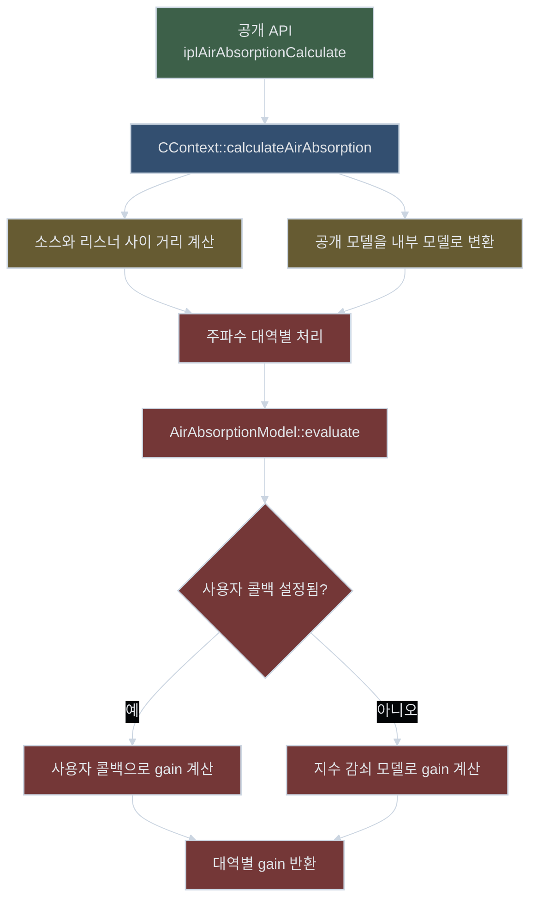

---

# 1. Introduction

Air Absorption은 소리가 공기를 통과하는 동안 거리에 따라 에너지를 잃는 현상을 모델링한다. Steam Audio에서는 이를 **주파수 대역별 gain**으로 표현한다. 
보통 고주파가 저주파보다 더 많이 감쇠하므로, 멀리 있는 소리를 작고 
어둡게 들리게 만드는 데 기여한다.

Air Absorption은 <strong style="color:#b3f594">거리 감쇠</strong>(<strong style="color:#b3f594">Distance Attenuation</strong>)와 역할이 다르다. 
대역별 선형 gain, dB, 필터/EQ의 DSP 기초는 [[Programming/DSP/dsp_iir_filter_basics|dB, IIR Filter와 대역별 EQ]]에서 먼저 익힐 수 있다.

- **Distance Attenuation**: 전체 소리 크기를 거리 함수 하나로 줄인다.
- **Air Absorption**: 저음·중음·고음 대역마다 서로 다른 비율로 줄인다.

![[distance_attenuation_air_absorption.webp|700]]

Steam Audio Core의 `AirAbsorptionModel`은 계수나 사용자 콜백을 이용해 
이 대역별 gain을 계산한다. 그 값은 직접음 시뮬레이션 결과에 들어가고,  
`DirectEffect`의 EQ 처리에서 오디오 신호에 적용된다.
[[core_direct_simulation_modules|Direct Simulation overview]]에서 결과 생성 흐름을, [[core_direct_effect|DirectEffect]]에서 오디오 적용
흐름을 이어서 볼 수 있다.

---

# 2. 개념 소개

## 2.1 소리가 공기에서 감쇠하는 방식

공기 중에서 이동하는 소리의 에너지는 열·점성 등의 작용으로 거리에 따라 줄어든다. 
이 감쇠는 주파수에 따라 달라진다. 
Steam Audio의 기본 모델은 각 주파수 대역에 지수 감쇠를 적용한다.

```text
소스와 리스너 사이 거리 d
             │
             ├── 저주파 계수 c₀ ──→ gain₀ = exp(-c₀ × d)
             ├── 중주파 계수 c₁ ──→ gain₁ = exp(-c₁ × d)
             └── 고주파 계수 c₂ ──→ gain₂ = exp(-c₂ × d)
                                      │
                                      └── 대역별 EQ로 오디오에 적용
```

일반적인 빌드에서는 세 대역을 사용하며 인덱스는 `0 = 저주파`, `1 = 중주파`, `2 = 고주파`다. 
빌드 설정에 따라 octave band를 활성화하면 대역 수가 11개가 될 수 있다. 
따라서 내부 코드의 `Bands::kNumBands`를 기준으로 배열을 다루며, 
공개 API에서는 `IPL_NUM_BANDS`를 사용한다.

## 2.2 수식과 결과 범위

지수 모델의 대역별 gain은 다음과 같다.

```text
gain(band, distance) = exp(-coefficient[band] × distance)
```

여기서 거리는 미터 단위다. 기본 계수는 일반적인 3-band 빌드 기준으로 다음과 같다.

| 대역 | 인덱스 | 기본 계수 |
|---|---:|---:|
| 저주파 | 0 | 0.0002 |
| 중주파 | 1 | 0.0017 |
| 고주파 | 2 | 0.0182 |

예를 들어 고주파 계수 `0.0182`와 거리 `10 m`라면 `exp(-0.0182 × 10) ≈ 0.834`가 된다.
즉 고주파 성분의 선형 gain으로 약 `0.834`가 반환된다.

> [!info] 값은 흡수량이 아니라 남는 gain
> `1.0`은 감쇠 없음, `0.0`은 해당 대역이 완전히 감쇠됨을 뜻한다. 
> 반환값이 작을수록 흡수가 큰 것이다. 이 값은 dB가 아니라 선형 진폭 gain이다.
> 

## 2.3 모델 종류

공개 API `IPLAirAbsorptionModel`은 세 가지 모델을 제공한다.

| 타입 | 계산 방식 | 사용 상황 |
|---|---|---|
| `IPL_AIRABSORPTIONTYPE_DEFAULT` | Steam Audio의 기본 대역별 계수 사용 | 우선 적용해 볼 기본 모델 |
| `IPL_AIRABSORPTIONTYPE_EXPONENTIAL` | 사용자가 제공한 대역별 계수로 지수 감쇠 | 프로젝트에 맞게 감쇠율을 조정할 때 |
| `IPL_AIRABSORPTIONTYPE_CALLBACK` | 거리와 대역을 사용자 함수에 전달 | 환경·게임 상태 등에 따른 임의 감쇠 곡선 |

콜백은 `(거리, 대역 인덱스, userData)`를 받고 `0.0~1.0`의 선형 gain을 반환한다. 
콜백에서 외부 커브나 설정값을 참조한다면 값이 바뀌었을 때 `dirty`를 설정해 
Steam Audio가 시뮬레이션 결과를 갱신하도록 알려야 한다.

## 2.4 Core 내부 호출 흐름



직접음 시뮬레이션에서도 같은 내부 모델의 `evaluate`가 사용된다. 
`DirectSimulator`가 경로의 대역별 값을 계산하고,
[[core_direct_effect|DirectEffect]]가 `ApplyAirAbsorption` 플래그에 따라 EQ 계수로 사용한다.

---

# 3. Steam Audio 코드 분석

## 3.1 내부 모델 선언 - air_absorption.h [링크](https://github.com/ValveSoftware/steam-audio/blob/v4.8.1/core/src/core/air_absorption.h)

실제 코드 위치: air_absorption.h [링크](https://github.com/ValveSoftware/steam-audio/blob/v4.8.1/core/src/core/air_absorption.h)

``` cpp fold title:Steam Audio C++
typedef float (IPL_CALLBACK *AirAbsorptionCallback)(float distance,
                                                    int band,
                                                    void* userData);

class AirAbsorptionModel
{
public:
    float coefficients[Bands::kNumBands];
    AirAbsorptionCallback callback;
    void* userData;

    AirAbsorptionModel();

    AirAbsorptionModel(const float* coefficients,
                       AirAbsorptionCallback callback,
                       void* userData);

    bool isDefault() const;

    float evaluate(float distance,
                   int band) const;

private:
    static const float kDefaultCoefficients[Bands::kNumBands];
};
```

- `coefficients`: 지수 감쇠에 사용하는 대역별 계수 배열이다.
- `callback`: null이 아니면 기본 지수식을 대신해 사용자 함수를 실행한다.
- `userData`: 콜백에 그대로 전달하는 사용자 데이터 포인터다.
- `evaluate`: 특정 거리와 대역의 gain 하나를 계산한다.
- `isDefault`: 계수와 콜백이 기본 모델 상태인지 확인한다.

## 3.2 기본값과 `evaluate` 구현 - air_absorption.cpp [링크](https://github.com/ValveSoftware/steam-audio/blob/v4.8.1/core/src/core/air_absorption.cpp)

실제 코드 위치: air_absorption.cpp [링크](https://github.com/ValveSoftware/steam-audio/blob/v4.8.1/core/src/core/air_absorption.cpp)

``` cpp fold title:Steam Audio C++
#if defined(IPL_ENABLE_OCTAVE_BANDS)
const float AirAbsorptionModel::kDefaultCoefficients[Bands::kNumBands] = {
    0.0f, 0.0f, 0.0f, 0.0f,
    0.00011513f, 0.00034539f, 0.00057565f,
    0.0011513f, 0.0034539f, 0.012089f, 0.041907f
};
#else
const float AirAbsorptionModel::kDefaultCoefficients[Bands::kNumBands] = {
    0.0002f, 0.0017f, 0.0182f
};
#endif

AirAbsorptionModel::AirAbsorptionModel()
    : callback(nullptr)
    , userData(nullptr)
{
    for (auto i = 0; i < Bands::kNumBands; ++i)
    {
        coefficients[i] = kDefaultCoefficients[i];
    }
}

float AirAbsorptionModel::evaluate(float distance, int band) const
{
    if (callback)
    {
        return callback(distance, band, userData);
    }
    else
    {
        return expf(-coefficients[band] * distance);
    }
}
```

기본 생성자는 콜백을 비우고(`nullptr`) 기본 계수를 복사한다. 
`evaluate`는 콜백 유무를 먼저 확인한다.
콜백이 있으면 반환값을 그대로 사용하고, 없으면 해당 대역의 계수로 지수식을 계산한다. 
따라서 callback 모델에서도 반환 범위 `0~1`을 지키는 책임은 콜백 작성자에게 있다.

## 3.3 공개 C API에서 내부 모델로 변환

실제 코드 위치: api_advanced_simulation.cpp [링크](https://github.com/ValveSoftware/steam-audio/blob/v4.8.1/core/src/core/api_advanced_simulation.cpp)의 `CContext::calculateAirAbsorption`

``` cpp fold title:Steam Audio C++
void CContext::calculateAirAbsorption(IPLVector3 source,
                                      IPLVector3 listener,
                                      IPLAirAbsorptionModel* model,
                                      IPLfloat32* airAbsorption)
{
    if (!model || !airAbsorption)
        return;

    auto _source = *reinterpret_cast<Vector3f*>(&source);
    auto _listener = *reinterpret_cast<Vector3f*>(&listener);

    AirAbsorptionModel _model{};
    switch (model->type)
    {
    case IPL_AIRABSORPTIONTYPE_DEFAULT:
        _model = AirAbsorptionModel{};
        break;
    case IPL_AIRABSORPTIONTYPE_EXPONENTIAL:
        _model = AirAbsorptionModel(model->coefficients, nullptr, nullptr);
        break;
    case IPL_AIRABSORPTIONTYPE_CALLBACK:
        _model = AirAbsorptionModel(nullptr, model->callback, model->userData);
        break;
    }

    auto distance = (_source - _listener).length();

    for (auto i = 0; i < Bands::kNumBands; ++i)
    {
        airAbsorption[i] = _model.evaluate(distance, i);
    }
}
```

실행 순서는 다음과 같다.

1. 모델 포인터와 출력 배열이 유효한지 확인한다.
2. 공개 API의 위치를 내부 `Vector3f`로 해석한다.
3. 모델 타입에 따라 기본 계수, 사용자 계수, 또는 콜백을 담은 내부 모델을 만든다.
4. 두 위치의 유클리드 거리를 계산한다.
5. 빌드에 설정된 모든 대역을 순회하며 `evaluate` 결과를 출력 배열에 기록한다.

> [!warning] 공개 API와 내부 구현의 대역 수
> 이 문서의 예제는 일반적인 3-band 빌드를 기준으로 한다. 배열을 직접 고정 크기 `3`으로 가정하기보다, 공개 API 코드에서는
> `IPL_NUM_BANDS`, 내부 코드를 수정할 때는 `Bands::kNumBands`를 사용해야 한다.

<strong style="color:#b3f594">air_absorption.h</strong>
- [air_absorption.h 링크](https://github.com/ValveSoftware/steam-audio/blob/v4.8.1/core/src/core/air_absorption.h)

<strong style="color:#b3f594">air_absorption.cpp</strong>
- [air_absorption.cpp 링크](https://github.com/ValveSoftware/steam-audio/blob/v4.8.1/core/src/core/air_absorption.cpp)

---
# 4. Steam Audio 사용법

이 절에서는 앞서 분석한 모델을 Steam Audio의 공개 C API로 사용하는 방법을 본다. 
`context`는 앞 단계에서 생성한 유효한 `IPLContext`라고 가정한다. 
Core API의 전체 사용 순서는 phonon.h [링크](https://github.com/ValveSoftware/steam-audio/blob/v4.8.1/core/src/core/phonon.h) 선언을 기준으로 한다.

## 4.1 기본 모델로 대역별 감쇠 계산

``` cpp fold title:Steam Audio C++
#include "phonon.h"

void calculateDefaultAirAbsorption(IPLContext context)
{
    IPLVector3 source{ 0.0f, 0.0f, 0.0f };
    IPLVector3 listener{ 10.0f, 0.0f, 0.0f };

    IPLAirAbsorptionModel model{};
    model.type = IPL_AIRABSORPTIONTYPE_DEFAULT;

    IPLfloat32 gains[IPL_NUM_BANDS]{};
    iplAirAbsorptionCalculate(context, source, listener, &model, gains);

    // 각 gains[i]는 해당 대역에서 남는 선형 gain (0.0 ~ 1.0)
}
```

## 4.2 지수 모델의 계수 지정하기

``` cpp fold title:Steam Audio C++
#include "phonon.h"

void calculateCustomAirAbsorption(IPLContext context)
{
    IPLVector3 source{ 0.0f, 0.0f, 0.0f };
    IPLVector3 listener{ 20.0f, 0.0f, 0.0f };

    IPLAirAbsorptionModel model{};
    model.type = IPL_AIRABSORPTIONTYPE_EXPONENTIAL;

    // 3-band 빌드의 예: 고주파에 더 큰 감쇠 계수를 지정
    model.coefficients[0] = 0.0002f;
    model.coefficients[1] = 0.0017f;
    model.coefficients[2] = 0.0182f;

    IPLfloat32 gains[IPL_NUM_BANDS]{};
    iplAirAbsorptionCalculate(context, source, listener, &model, gains);
}
```

## 4.3 사용자 곡선을 콜백으로 적용하기

``` cpp fold title:Steam Audio C++
#include "phonon.h"
#include <algorithm>
#include <cmath>

struct AirAbsorptionSettings
{
    float coefficient[IPL_NUM_BANDS];
};

float airAbsorptionCallback(IPLfloat32 distance, IPLint32 band, void* userData)
{
    const auto* settings = static_cast<const AirAbsorptionSettings*>(userData);
    const auto gain = std::exp(-settings->coefficient[band] * distance);
    return std::clamp(gain, 0.0f, 1.0f);
}

void calculateCallbackAirAbsorption(IPLContext context)
{
    AirAbsorptionSettings settings{};
    settings.coefficient[0] = 0.0002f;
    settings.coefficient[1] = 0.0017f;
    settings.coefficient[2] = 0.0182f;

    IPLAirAbsorptionModel model{};
    model.type = IPL_AIRABSORPTIONTYPE_CALLBACK;
    model.callback = airAbsorptionCallback;
    model.userData = &settings;
    model.dirty = IPL_FALSE;

    IPLVector3 source{ 0.0f, 0.0f, 0.0f };
    IPLVector3 listener{ 10.0f, 0.0f, 0.0f };
    IPLfloat32 gains[IPL_NUM_BANDS]{};

    iplAirAbsorptionCalculate(context, source, listener, &model, gains);
}
```

> [!warning] 예제의 대역 개수
> 콜백 예제의 세 계수 초기화는 기본 3-band 빌드에 대한 예다. 
> octave band 빌드도 지원하는 코드라면 `IPL_NUM_BANDS` 전체를 초기화하고, 
> 실제 프로젝트의 대역 설정에 맞는 계수를 준비해야 한다. 
> Steam Audio SDK의 ` iplAirAbsorptionCalculate`를 사용할 때는 SDK가 제공하는 
> 
> phonon.h [링크](https://github.com/ValveSoftware/steam-audio/blob/v4.8.1/core/src/core/phonon.h)의 선언과 해당 SDK 버전의 API를 기준으로 한다.
> 
> 

---

# 5. 핵심 로직을 직접 구현하기

아래 코드는 Steam Audio를 호출하지 않는다. 
앞 절의 `exp(-계수 × 거리)` 원리만 표준 C++로 옮긴 최소 구현이다.
게임이나 오디오 프로그램에서 소스와 리스너 사이 거리를 구한 다음, 각 대역 gain을 
계산하는 흐름을 확인할 수 있다.

``` cpp fold title:Steam Audio C++
#include <array>
#include <cmath>
#include <iostream>

class AirAbsorption
{
public:
    // 저주파, 중주파, 고주파의 감쇠 계수 (1 / meter)
    std::array<float, 3> coefficients{ 0.0002f, 0.0017f, 0.0182f };

    float gain(float distanceMeters, int band) const
    {
        // 계수와 거리가 클수록 지수식의 결과가 작아진다.
        return std::exp(-coefficients[band] * distanceMeters);
    }
};

int main()
{
    const float distanceMeters = 10.0f;
    const AirAbsorption airAbsorption{};

    for (int band = 0; band < 3; ++band)
    {
        const float bandGain = airAbsorption.gain(distanceMeters, band);
        std::cout << "band " << band << ": " << bandGain << '\n';
    }
}
```

`gain()`은 대역 하나의 gain을 계산하고, 반복문은 모든 대역을 계산한다. 
계산된 값은 실제 오디오 처리에서 해당 대역의 신호 크기에 곱해 사용한다. 
예를 들어 gain이 `0.8`이면 그 대역 신호가 원래 크기의 80%로 전달된다.

같은 핵심 계산을 사용자 정의 함수로 바꾸면 환경이나 게임 설정에 따라 감쇠 곡선을 
정의할 수 있다.

``` cpp fold title:Steam Audio C++
#include <algorithm>
#include <cmath>

float customAirAbsorption(float distanceMeters, int band, const float* coefficients)
{
    const float gain = std::exp(-coefficients[band] * distanceMeters);
    return std::clamp(gain, 0.0f, 1.0f);
}
```

> [!info] Steam Audio 코드와 대응시키기
> 위 `gain()` 계산이 Core의 `AirAbsorptionModel::evaluate()`에 해당한다. 
> Steam Audio 구현은 여기에 기본 모델·사용자 계수·콜백 선택과 대역 수 관리를
> 더하고, 공개 API에서는 소스/리스너 거리 계산과 결과 배열 출력을 담당한다.

---

# 6. 정리

- Air Absorption은 거리와 주파수 대역에 따라 달라지는 감쇠를 계산한다.
- 지수 모델은 `exp(-coefficient[band] × distance)`로 대역별 선형 gain을 만든다.
- 계산 결과는 감쇠량이 아니라 **남는 gain**이다. `1`은 통과, `0`은 완전 감쇠다.
- Core 구현은 `AirAbsorptionModel::evaluate`에 계산을 모으고, 공개 API가 모델 변환·거리 계산·대역 반복을 맡는다.
- 직접음 효과에서는 이 대역별 결과가 EQ 처리에 사용된다. 자세한 적용 단계는 [[core_direct_effect|DirectEffect]]를 참고한다.

---

# 7. Source file links

아래 파일명 옆의 링크를 열면 Steam Audio 공식 저장소에서 원본을 확인할 수 있다.

<strong style="color:#b3f594">air_absorption.h</strong>
- [링크](https://github.com/ValveSoftware/steam-audio/blob/v4.8.1/core/src/core/air_absorption.h)
- 내부 모델과 계산 인터페이스

<strong style="color:#b3f594">air_absorption.cpp</strong>
- [링크](https://github.com/ValveSoftware/steam-audio/blob/v4.8.1/core/src/core/air_absorption.cpp)
- 대역별 감쇠 계산 구현

<strong style="color:#b3f594">api_advanced_simulation.cpp</strong>
- [링크](https://github.com/ValveSoftware/steam-audio/blob/v4.8.1/core/src/core/api_advanced_simulation.cpp)
- 공개 API에서 내부 모델로 연결

<strong style="color:#b3f594">phonon.h</strong>
- [링크](https://github.com/ValveSoftware/steam-audio/blob/v4.8.1/core/src/core/phonon.h)
- `IPLAirAbsorptionModel`과 `iplAirAbsorptionCalculate` 선언

---

