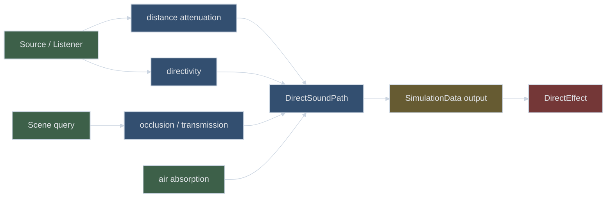

---
# 1. Introduction

Direct simulation은 다음과 같은 계산을 한다

- source/listener 사이의 direct path에 대한 방향, 거리,
- occlusion/transmission
- air absorption,
- directivity 

결과는 per-source simulation state에 기록되고 이후 DirectEffect가 audio sample에 적용한다.

- 전체 simulation 위치: [[core_03_simulation_overview|Simulation Overview]]
- 거리·공기 모델: [[core_air_absorption|Air Absorption 상세 분석]]과 해당 문서의 거리 attenuation 개념
- 결과 적용: [[core_direct_effect|DirectEffect 상세 분석]]

---
# 2. 개념과 데이터 흐름



`DirectSimulator`는 <strong style="color:#b3f594">scene</strong> query와 direct-path model을 조합하고, 
`AirAbsorptionModel` 등은 개별 acoustic response를 계산한다. 
고주파 대역의 air absorption은 거리에 따라 더 빠르게 감소할 수 있다.

---
# 3. Steam Audio 코드 분석

air_absorption.cpp [링크](https://github.com/ValveSoftware/steam-audio/blob/v4.8.1/core/src/core/air_absorption.cpp)에서 callback이 설정되어 있으면 이를 사용하고, 
그렇지 않으면 대역별 coefficient로 exponential gain을 계산한다.

``` cpp fold title:air_absorption.cpp 실제 코드 발췌
float AirAbsorptionModel::evaluate(float distance,
                                   int band) const
{
    if (callback)
    {
        return callback(distance, band, userData);
    }
    else
    {
        return expf(-coefficients[band] * distance);
    }
}
```

반환값은 흡수량이 아니라 남아 있는 band gain이다. 
public helper api_advanced_simulation.cpp [링크](https://github.com/ValveSoftware/steam-audio/blob/v4.8.1/core/src/core/api_advanced_simulation.cpp)와 direct_simulator.cpp [링크](https://github.com/ValveSoftware/steam-audio/blob/v4.8.1/core/src/core/direct_simulator.cpp)가 거리 및
model 결과를 구성하며 direct_effect.cpp [링크](https://github.com/ValveSoftware/steam-audio/blob/v4.8.1/core/src/core/direct_effect.cpp)가 EQ application을 수행한다.

---
# 4. 사용법

SDK 사용자 관점에서 directivity 결과는 simulator input/output와 DirectEffect parameter를 
통해 전달된다. 
독립 public helper `iplAirAbsorptionCalculate`를 사용할 때는 phonon.h [링크](https://github.com/ValveSoftware/steam-audio/blob/v4.8.1/core/src/core/phonon.h)의 모델 타입,
밴드 수, 좌표 단위를 확인한다. 

Host-side 연결은 [[core_02_host_c_api_overview|Host ↔ C API Overview]]에 있다.

---
# 5. 독립 C++ 핵심 예제

``` cpp fold title:독립 air absorption 예제
#include <array>
#include <cstddef>
#include <cmath>

std::array<float, 3> calculateAirGain(float distanceMeters,
                                      const std::array<float, 3>& coefficients)
{
    std::array<float, 3> gains{};
    for (std::size_t band = 0; band < gains.size(); ++band)
    {
        gains[band] = std::exp(-coefficients[band] * distanceMeters);
    }
    return gains;
}
```

이 예제는 Core 의존성 없이 대역별 exponential gain을 계산한다. 
실제 coefficient의 단위와 band ordering은 SDK 설정과 모델 정의에 맞춰야 한다.

---
# 6. Source file inventory

아래 파일명 옆의 링크를 열면 Steam Audio 공식 저장소에서 원본을 확인할 수 있다.

<strong style="color:#b3f594">Air absorption</strong>

- <strong style="color:#b3f594">air_absorption.h</strong> [링크](https://github.com/ValveSoftware/steam-audio/blob/v4.8.1/core/src/core/air_absorption.h)
- <strong style="color:#b3f594">air_absorption.cpp</strong> [링크](https://github.com/ValveSoftware/steam-audio/blob/v4.8.1/core/src/core/air_absorption.cpp)

<strong style="color:#b3f594">Directivity</strong>

- <strong style="color:#b3f594">directivity.h</strong> [링크](https://github.com/ValveSoftware/steam-audio/blob/v4.8.1/core/src/core/directivity.h)
- <strong style="color:#b3f594">directivity.cpp</strong> [링크](https://github.com/ValveSoftware/steam-audio/blob/v4.8.1/core/src/core/directivity.cpp)

<strong style="color:#b3f594">Direct simulation</strong>

- <strong style="color:#b3f594">direct_simulator.h</strong> [링크](https://github.com/ValveSoftware/steam-audio/blob/v4.8.1/core/src/core/direct_simulator.h)
- <strong style="color:#b3f594">direct_simulator.cpp</strong> [링크](https://github.com/ValveSoftware/steam-audio/blob/v4.8.1/core/src/core/direct_simulator.cpp)

<strong style="color:#b3f594">Distance attenuation</strong>

- <strong style="color:#b3f594">distance_attenuation.h</strong> [링크](https://github.com/ValveSoftware/steam-audio/blob/v4.8.1/core/src/core/distance_attenuation.h)
- <strong style="color:#b3f594">distance_attenuation.cpp</strong> [링크](https://github.com/ValveSoftware/steam-audio/blob/v4.8.1/core/src/core/distance_attenuation.cpp)

<strong style="color:#b3f594">Simulation data</strong>

- <strong style="color:#b3f594">simulation_data.h</strong> [링크](https://github.com/ValveSoftware/steam-audio/blob/v4.8.1/core/src/core/simulation_data.h)
- <strong style="color:#b3f594">simulation_data.cpp</strong> [링크](https://github.com/ValveSoftware/steam-audio/blob/v4.8.1/core/src/core/simulation_data.cpp)

<strong style="color:#b3f594">Simulation manager</strong>

- <strong style="color:#b3f594">simulation_manager.h</strong> [링크](https://github.com/ValveSoftware/steam-audio/blob/v4.8.1/core/src/core/simulation_manager.h)
- <strong style="color:#b3f594">simulation_manager.cpp</strong> [링크](https://github.com/ValveSoftware/steam-audio/blob/v4.8.1/core/src/core/simulation_manager.cpp)
