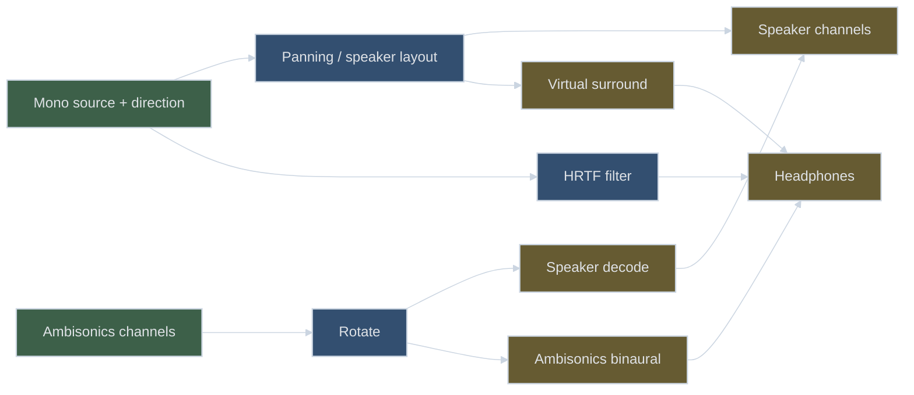

---
# 1. Introduction

Spatial rendering은 방향과 공간 정보를 최종 speaker/headphone channel로 만든다.
Speaker layout을 대상으로 한 panning, HRTF 기반 binaural, 
Ambisonics encode/rotate/decode 및 virtual surround가 주요 경로다.

> [!info] 렌더러 선택
> Stereo headphone의 방향 단서는 binaural/HRTF 경로, 다채널 speaker 출력은 panning/layout 경로,
> scene-independent sound field 교환은 Ambisonics 경로와 연결된다.

---
# 2. 개념과 구조



`hrtf_map` 계층은 SOFA 또는 embedded HRTF data를 map으로 제공하고 
`hrtf_database` 및 binaural effect가 방향별 filter를 사용한다. 
Ambisonics는 spherical harmonics (SH) channel representation과 order에 따라 
channel count/연산량이 달라진다.

---
# 3. Steam Audio 코드 분석

panning_effect.cpp [링크](https://github.com/ValveSoftware/steam-audio/blob/v4.8.1/core/src/core/panning_effect.cpp)는 mono 입력과 layout channel output의 크기를 검증하고 
speaker별 weight를 구해 previous frame과 crossfade한다.

``` cpp fold title:panning_effect.cpp 실제 코드 발췌
assert(in.numChannels() == 1);
assert(out.numChannels() == mSpeakerLayout.numSpeakers);

for (auto i = 0; i < out.numChannels(); ++i)
{
    auto weight = panningWeight(*params.direction, mSpeakerLayout, i, &panningData);
    auto weightPrev = panningWeight(mPrevDirection, mSpeakerLayout, i, &prevPanningData);
```

Direction이 급변할 때 이전/현재 weight를 섞어 artifact를 줄인다. 
상세 코드는 [[detail/dsp/core_panning_effect|PanningEffect 상세]]와 [[detail/dsp/core_audiobuffer|AudioBuffer 상세]]에서 이어진다.

---
# 4. 사용법

실제 SDK는 output layout, sample rate, HRTF 설정, Ambisonics order 및 frame size에 
맞는 effect를 생성하고 매 audio block에 입력한다. C API 생성/적용 예시는
[[core_02_host_c_api_overview|Host↔ C API Overview]]에서 확인한다.

---

# 5. 독립 C++ 예제

``` cpp fold title:독립 equal-power stereo panning 예제
#include <cmath>

void stereoPan(float mono, float pan, float& left, float& right)
{
    constexpr float halfPi = 1.57079632679f;
    const float angle = (pan + 1.0f) * 0.5f * halfPi;
    left = mono * std::cos(angle);
    right = mono * std::sin(angle);
}
```

`pan`은 -1에서 1까지의 좌우 위치다. 이 예는 equal-power 법칙만 보여주며 
HRTF, speaker geometry, Ambisonics encode/decode는 포함하지 않는다.

---
# 6. Source file inventory

아래 파일명 옆의 링크를 열면 Steam Audio 공식 저장소에서 원본을 확인할 수 있다.

## 6.1 Ambisonics and binaural effects

- <strong style="color:#b3f594">ambisonics_binaural_effect.cpp</strong> [링크](https://github.com/ValveSoftware/steam-audio/blob/v4.8.1/core/src/core/ambisonics_binaural_effect.cpp)
- <strong style="color:#b3f594">ambisonics_binaural_effect.h</strong> [링크](https://github.com/ValveSoftware/steam-audio/blob/v4.8.1/core/src/core/ambisonics_binaural_effect.h)
- <strong style="color:#b3f594">ambisonics_decode_effect.cpp</strong> [링크](https://github.com/ValveSoftware/steam-audio/blob/v4.8.1/core/src/core/ambisonics_decode_effect.cpp)
- <strong style="color:#b3f594">ambisonics_decode_effect.h</strong> [링크](https://github.com/ValveSoftware/steam-audio/blob/v4.8.1/core/src/core/ambisonics_decode_effect.h)
- <strong style="color:#b3f594">ambisonics_encode_effect.cpp</strong> [링크](https://github.com/ValveSoftware/steam-audio/blob/v4.8.1/core/src/core/ambisonics_encode_effect.cpp)
- <strong style="color:#b3f594">ambisonics_encode_effect.h</strong> [링크](https://github.com/ValveSoftware/steam-audio/blob/v4.8.1/core/src/core/ambisonics_encode_effect.h)
- <strong style="color:#b3f594">ambisonics_panning_effect.cpp</strong> [링크](https://github.com/ValveSoftware/steam-audio/blob/v4.8.1/core/src/core/ambisonics_panning_effect.cpp)
- <strong style="color:#b3f594">ambisonics_panning_effect.h</strong> [링크](https://github.com/ValveSoftware/steam-audio/blob/v4.8.1/core/src/core/ambisonics_panning_effect.h)
- <strong style="color:#b3f594">ambisonics_rotate_effect.cpp</strong> [링크](https://github.com/ValveSoftware/steam-audio/blob/v4.8.1/core/src/core/ambisonics_rotate_effect.cpp)
- <strong style="color:#b3f594">ambisonics_rotate_effect.h</strong> [링크](https://github.com/ValveSoftware/steam-audio/blob/v4.8.1/core/src/core/ambisonics_rotate_effect.h)
- <strong style="color:#b3f594">binaural_effect.cpp</strong> [링크](https://github.com/ValveSoftware/steam-audio/blob/v4.8.1/core/src/core/binaural_effect.cpp)
- <strong style="color:#b3f594">binaural_effect.h</strong> [링크](https://github.com/ValveSoftware/steam-audio/blob/v4.8.1/core/src/core/binaural_effect.h)

## 6.2 HRTF data and mapping

- <strong style="color:#b3f594">cipic_124.inl</strong> [링크](https://github.com/ValveSoftware/steam-audio/blob/v4.8.1/core/src/core/cipic_124.inl)
- <strong style="color:#b3f594">hrtf.cpp</strong> [링크](https://github.com/ValveSoftware/steam-audio/blob/v4.8.1/core/src/core/hrtf.cpp)
- <strong style="color:#b3f594">hrtf2sh.cpp</strong> [링크](https://github.com/ValveSoftware/steam-audio/blob/v4.8.1/core/src/core/hrtf2sh.cpp)
- <strong style="color:#b3f594">hrtf_database.cpp</strong> [링크](https://github.com/ValveSoftware/steam-audio/blob/v4.8.1/core/src/core/hrtf_database.cpp)
- <strong style="color:#b3f594">hrtf_database.h</strong> [링크](https://github.com/ValveSoftware/steam-audio/blob/v4.8.1/core/src/core/hrtf_database.h)
- <strong style="color:#b3f594">hrtf_map.cpp</strong> [링크](https://github.com/ValveSoftware/steam-audio/blob/v4.8.1/core/src/core/hrtf_map.cpp)
- <strong style="color:#b3f594">hrtf_map.h</strong> [링크](https://github.com/ValveSoftware/steam-audio/blob/v4.8.1/core/src/core/hrtf_map.h)
- <strong style="color:#b3f594">hrtf_map_factory.cpp</strong> [링크](https://github.com/ValveSoftware/steam-audio/blob/v4.8.1/core/src/core/hrtf_map_factory.cpp)
- <strong style="color:#b3f594">hrtf_map_factory.h</strong> [링크](https://github.com/ValveSoftware/steam-audio/blob/v4.8.1/core/src/core/hrtf_map_factory.h)
- <strong style="color:#b3f594">sofa_hrtf_map.cpp</strong> [링크](https://github.com/ValveSoftware/steam-audio/blob/v4.8.1/core/src/core/sofa_hrtf_map.cpp)
- <strong style="color:#b3f594">sofa_hrtf_map.h</strong> [링크](https://github.com/ValveSoftware/steam-audio/blob/v4.8.1/core/src/core/sofa_hrtf_map.h)
- <strong style="color:#b3f594">spherical_harmonics.cc</strong> [링크](https://github.com/ValveSoftware/steam-audio/blob/v4.8.1/core/src/core/sh/spherical_harmonics.cc)
- <strong style="color:#b3f594">spherical_harmonics.h</strong> [링크](https://github.com/ValveSoftware/steam-audio/blob/v4.8.1/core/src/core/sh/spherical_harmonics.h)

## 6.3 Spherical harmonics and output layout

- <strong style="color:#b3f594">sh.cpp</strong> [링크](https://github.com/ValveSoftware/steam-audio/blob/v4.8.1/core/src/core/sh.cpp)
- <strong style="color:#b3f594">sh.h</strong> [링크](https://github.com/ValveSoftware/steam-audio/blob/v4.8.1/core/src/core/sh.h)
- <strong style="color:#b3f594">speaker_layout.cpp</strong> [링크](https://github.com/ValveSoftware/steam-audio/blob/v4.8.1/core/src/core/speaker_layout.cpp)
- <strong style="color:#b3f594">speaker_layout.h</strong> [링크](https://github.com/ValveSoftware/steam-audio/blob/v4.8.1/core/src/core/speaker_layout.h)
- <strong style="color:#b3f594">virtual_surround_effect.cpp</strong> [링크](https://github.com/ValveSoftware/steam-audio/blob/v4.8.1/core/src/core/virtual_surround_effect.cpp)
- <strong style="color:#b3f594">virtual_surround_effect.h</strong> [링크](https://github.com/ValveSoftware/steam-audio/blob/v4.8.1/core/src/core/virtual_surround_effect.h)

---
