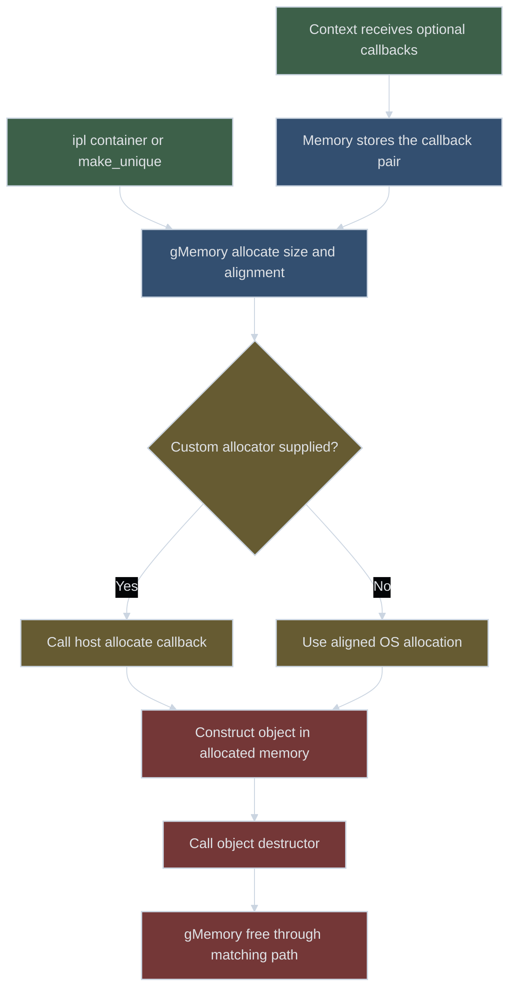

---

# 1. Introduction

Steam Audio Core는 내부 메모리 요청을 한 경로로 모으는 
<strong style="color:#b3f594">Memory system</strong>을 사용한다.
호스트가 메모리 callback을 제공하면 그 callback으로 할당하고, 제공하지 않으면 
운영체제의 정렬 할당 함수를 사용한다.

이 구조는 Core 내부 객체와 컨테이너의 할당·해제를 같은 규칙으로 처리한다.
또한 기본 할당 정렬을 64바이트로 맞춰 SIMD 연산에 필요한 주소 정렬을 지원한다.

핵심은 `std::vector`를 전역에서 바꾸는 기능이 아니다.
Core는 `ipl::vector`처럼 `ipl::allocator`를 지정한 컨테이너와
`ipl::make_unique` 같은 자체 helper를 사용해 메모리 경로를 연결한다.

> [!tip] 이 문서를 읽는 순서
> 먼저 할당과 객체 생명주기가 다른 단계임을 확인한다.
> 그다음 `Memory`가 callback 또는 운영체제 함수를 선택하는 흐름을 보고,
> `allocator`, `unique_ptr`, `shared_ptr`가 그 경로를 어떻게 이용하는지 따라간다.

---

# 2. 개념과 메모리 흐름

메모리 주소를 확보하는 것과 그 주소에 C++ 객체를 만드는 것은 별개의 작업이다.
Steam Audio는 할당한 뒤 placement new로 객체를 만들고,
해제할 때는 소멸자를 호출한 다음 같은 할당 시스템으로 메모리를 돌려준다.



## 2.1 `Memory`: callback과 기본 할당 경로

`Memory`는 callback 두 개를 보관한다.
할당 callback은 요청한 크기와 정렬을 받아 메모리 주소를 반환하고,
해제 callback은 그 주소를 호스트의 allocator에 돌려준다.

callback이 없으면 Windows에서는 `_aligned_malloc` / `_aligned_free`,
POSIX 계열에서는 `posix_memalign` / `free`를 사용한다.
할당에 실패했고 요청 크기가 0보다 크면 Core는 `OutOfMemory` 예외를 던진다.

`gMemory()`는 이 `Memory` 객체를 얻는 전역 접근 함수다.
구현에서 메모리 객체는 `Context::sMemory` 정적 멤버이므로
각 `Memory` 객체가 callback 쌍을 따로 소유하는 구조는 아니다.

## 2.2 `allocator<T>`: STL 컨테이너 연결

`allocator<T>`는 STL이 요구하는 allocator 인터페이스를 구현한다.
컨테이너가 원소 `n`개를 요청하면 `n * sizeof(T)` 바이트를 계산하고,
`gMemory().allocate`에 기본 정렬인 64바이트와 함께 전달한다.

`containers.h`는 이 allocator를 `ipl::vector`, `ipl::map`,
`ipl::list` 같은 별칭에 연결한다. 따라서 Core 코드에서 해당 별칭을 쓰면
컨테이너의 내부 저장 공간도 같은 `Memory` 경로를 이용한다.

`allocate`는 원시 메모리만 확보한다. 각 원소의 생성은 `construct`가,
소멸은 `destroy`가 담당한다. `deallocate`는 블록을 반환하며,
전달받은 원소 개수는 사용하지 않는다.

## 2.3 객체 소유권 helper

`ipl::unique_ptr<T>`는 `std::unique_ptr`에 Core 전용 deleter를 붙인 타입이다.
`ipl::make_unique<T>`는 `gMemory()`로 메모리를 확보하고 객체를 생성한다.
소유권이 끝나면 deleter가 객체 소멸자를 호출하고 같은 메모리 시스템에 반환한다.

배열 버전인 `ipl::make_unique<T[]>(count)`는 원소를 하나씩 생성한다.
deleter는 원소 개수를 기억해 각 소멸자를 호출한 뒤 전체 블록을 한 번에 반환한다.

`ipl::shared_ptr<T>`는 `std::shared_ptr<T>`의 별칭이다.
`ipl::make_shared<T>`는 `std::allocate_shared`에 `ipl::allocator<T>`를 전달해
공유 객체의 저장 공간도 Core allocator를 통하도록 한다.

## 2.4 Callback 사용 시 지켜야 할 점

할당 callback과 해제 callback은 반드시 한 쌍으로 제공해야 한다.
호스트 allocator가 만든 주소를 운영체제 기본 `free`로 해제하거나,
기본 할당 주소를 호스트 callback으로 해제하면 allocator가 서로 달라진다.

할당 callback은 전달받은 `alignment`를 만족하는 주소를 반환해야 한다.
기본 STL allocator는 64바이트 정렬을 요청한다.
또한 callback 시그니처에는 `userData`가 없으므로 상태가 필요한 allocator는
호스트 쪽에서 별도의 안전한 저장 방법을 마련해야 한다.

> [!warning] 전역 callback 상태
> `Context` 생성자는 callback을 정적 `Context::sMemory`에 설정한다.
> 따라서 callback이 Context 인스턴스마다 독립적으로 저장된다고 가정하면 안 된다.
> 서로 다른 allocator callback을 사용하는 Context를 함께 운용할 때는
> 객체 해제 시점에도 올바른 callback이 유지되는지 확인해야 한다.

---

# 3. Steam Audio 코드 분석

## 3.1 Context가 callback을 등록한다

`Context` 생성자는 API 설정에서 받은 callback을 `Memory`에 저장한다.
이후 Core의 `gMemory()` 호출은 이 저장소를 통해 메모리 요청을 보낸다.

``` cpp fold title:context.cpp callback 등록 발췌
Context::Context(LogCallback logCallback,
                 AllocateCallback allocateCallback,
                 FreeCallback freeCallback,
                 SIMDLevel simdLevel,
                 uint32_t apiVersion)
{
    sMemory.init(allocateCallback, freeCallback); // Core 메모리 경로 설정
}
```

`sMemory`가 정적 멤버라는 점이 중요하다.
callback은 개별 allocator 객체에 복사되는 설정값이 아니라
Core의 공용 메모리 경로에 저장된다.

## 3.2 `Memory::allocate`가 사용할 경로를 고른다

아래 흐름은 `memory_allocator.cpp`의 핵심이다.
호스트 callback이 있으면 callback에 크기와 정렬을 전달하고,
없으면 플랫폼 기본 정렬 할당을 사용한다.

``` cpp fold title:memory_allocator.cpp 할당 경로 발췌
void* Memory::allocate(size_t size, size_t alignment)
{
    void* pointer = nullptr;

    if (mAllocateCallback)
        pointer = mAllocateCallback(size, alignment); // 호스트 allocator
    else
    {
#if defined(IPL_OS_WINDOWS)
        pointer = _aligned_malloc(size, alignment);
#else
        posix_memalign(&pointer, alignment, size);
#endif
    }

    if (!pointer && size > 0)
        throw Exception(Status::OutOfMemory);

    return pointer;
}
```

`Memory::free`도 같은 선택 규칙을 반대 방향으로 적용한다.
사용자 callback이 설정되어 있으면 그 callback으로 반환하고,
아니면 Windows 정렬 해제 함수 또는 `free`를 호출한다.

## 3.3 컨테이너 allocator가 메모리를 요청한다

`allocator<T>::allocate`는 컨테이너의 원소 개수를 바이트 크기로 바꾼다.
그 뒤 `Memory::kDefaultAlignment`를 함께 전달한다.

``` cpp fold title:memory_allocator.h STL allocator 발췌
T* allocate(size_t n)
{
    return reinterpret_cast<T*>(
        gMemory().allocate(n * sizeof(T), Memory::kDefaultAlignment));
}

void deallocate(T* p, size_t num)
{
    gMemory().free(p); // allocator가 블록 크기를 추적하므로 num은 사용하지 않음
}
```

객체 생명주기는 별도 메서드가 처리한다.
`construct`는 placement new로 확보된 주소에 객체를 만들고,
`destroy`는 소멸자만 호출한다. 실제 블록 해제는 `deallocate`의 책임이다.

## 3.4 `unique_ptr`도 같은 해제 규칙을 사용한다

`make_unique`는 Core 메모리로 공간을 확보하고 placement new로 객체를 만든다.
deleter는 객체를 파괴한 뒤 `gMemory().free`를 호출한다.

``` cpp fold title:memory_allocator.h unique ownership 발췌
template <typename T>
struct deleter
{
    void operator()(T* p) const
    {
        p->~T();
        gMemory().free(p);
    }
};
```

위 코드는 실제 `deleter<T>` 구현에서 핵심만 발췌했다.
전체 템플릿과 배열 deleter는 아래 공식 소스에서 확인할 수 있다.

---

# 4. SDK에서 사용하는 흐름

호스트는 `IPLContextSettings`에 할당·해제 callback을 설정하고
`iplContextCreate`를 호출한다. 이후 Core 내부 컨테이너와 객체 helper가
등록된 callback 경로를 사용한다.

``` cpp fold title:Context 생성 시 allocator callback 연결
IPLContextSettings settings{};
settings.version = STEAMAUDIO_VERSION;
settings.allocateCallback = &allocateAligned;
settings.freeCallback = &freeAligned;

IPLContext context = nullptr;
const auto status = iplContextCreate(&settings, &context);
```

`allocateAligned`와 `freeAligned`는 5번 예제처럼 같은 allocator 계열을 사용해야 한다.
Context가 소유한 다른 Steam Audio 객체를 먼저 해제한 뒤 Context를 release한다.
공개 설정과 함수 계약은 [Public API 상세](core_public_api.md),
호스트 연결 흐름은 [Host C API Overview](core_02_host_c_api_overview.md)를 참고한다.

---

# 5. 독립 C++ 핵심 예제

다음 예제는 Steam Audio를 호출하지 않고, 할당과 해제를 같은 방식으로 
짝짓는 원리만 보여준다.
Windows에서는 `_aligned_malloc`과 `_aligned_free`, POSIX 계열에서는
`posix_memalign`과 `free`를 한 쌍으로 사용한다.

``` cpp fold title:플랫폼 정렬 메모리 callback 예제
#include "phonon.h"
#include <cstdlib>

#if defined(_WIN32)
#include <malloc.h>
#endif

void* IPLCALL allocateAligned(IPLsize size, IPLsize alignment)
{
#if defined(_WIN32)
    return _aligned_malloc(size, alignment);
#else
    void* memory = nullptr;
    if (posix_memalign(&memory, alignment, size) != 0)
        return nullptr;
    return memory;
#endif
}

void IPLCALL freeAligned(void* memory)
{
#if defined(_WIN32)
    _aligned_free(memory);
#else
    std::free(memory);
#endif
}
```

예제의 두 함수는 반드시 같은 플랫폼 분기를 사용한다.
Core callback으로 연결할 때는 함수 시그니처를 `IPLAllocateFunction`과
`IPLFreeFunction`에 맞추고, Steam Audio가 전달하는 정렬 요청을 그대로 지켜야 한다.

---

# 6. Source file links

아래 파일명 옆의 링크를 열면 Steam Audio 공식 저장소에서 원본을 확인할 수 있다.

<strong style="color:#b3f594">memory_allocator.h</strong>
- [링크](https://github.com/ValveSoftware/steam-audio/blob/v4.8.1/core/src/core/memory_allocator.h)

<strong style="color:#b3f594">memory_allocator.cpp</strong>
- [링크](https://github.com/ValveSoftware/steam-audio/blob/v4.8.1/core/src/core/memory_allocator.cpp)

<strong style="color:#b3f594">containers.h</strong>
- [링크](https://github.com/ValveSoftware/steam-audio/blob/v4.8.1/core/src/core/containers.h)

<strong style="color:#b3f594">context.h</strong>
- [링크](https://github.com/ValveSoftware/steam-audio/blob/v4.8.1/core/src/core/context.h)

<strong style="color:#b3f594">context.cpp</strong>
- [링크](https://github.com/ValveSoftware/steam-audio/blob/v4.8.1/core/src/core/context.cpp)

<strong style="color:#b3f594">api_context.cpp</strong>
- [링크](https://github.com/ValveSoftware/steam-audio/blob/v4.8.1/core/src/core/api_context.cpp)

<strong style="color:#b3f594">phonon.h</strong>
- [링크](https://github.com/ValveSoftware/steam-audio/blob/v4.8.1/core/src/core/phonon.h)

---

