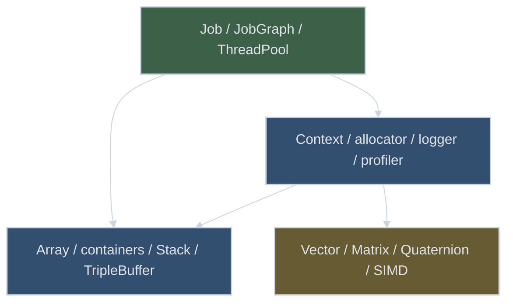

---
# 1. Introduction

Runtime foundation은 음향 알고리즘이 공통으로 쓰는 
메모리·자료구조·수학·오류·로깅·profiling 및 작업 scheduling 기반이다. 
개별 effect나 simulator와 달리 이 모듈은 <strong style="color:#b3f594">대부분의 하위 계층에 횡단 의존</strong>된다.

기존 상세 분석은 [[detail/system/core_Array|Array]], [[detail/system/core_matrix|Matrix]], [[detail/system/core_memory_allocator|Memory Allocator]], [[detail/system/core_simd|SIMD]], [[detail/system/core_util|Core Util]]을 참고한다.

---
# 2. 개념과 계층



`Context`가 allocator/logger/profiler 설정을 모으고, container와 math 계층은 
플랫폼 차이를 숨긴다.
`JobGraph`와 `ThreadPool`은 계산 task의 의존 순서와 실행 worker를 제공한다. 
`TripleBuffer`처럼 audio consumer와 simulation producer 사이의 데이터 교환 구조는
일반 container와 별도 concurrency contract를 가진다.

---

# 3. Steam Audio 코드 분석

array.h [링크](https://github.com/ValveSoftware/steam-audio/blob/v4.8.1/core/src/core/array.h)의 `Array::resize`는 다차원 연속 저장 공간과 dimension metadata/pointer view
를 함께 재구성한다.

``` cpp fold title:array.h 실제 코드 발췌
mSizes[0] = size;
for (auto i = 1; i < N; ++i)
{
    mSizes[i] = sizeArray[i - 1];
}

mSize = sizeArray[N - 2];
auto numElements = size;
for (auto i = 0; i < N - 1; ++i)
{
    numElements *= sizeArray[i];
}

mElements = ipl::make_unique<T[]>(numElements);
```

연속 `mElements`가 실제 값을 보관하고, `mPointers`는 다차원 index 접근용 pointer view를 
만든다. 메모리 allocation 정책은 `memory_allocator.*`, <strong style="color:#b3f594">SIMD</strong> 선택은 `float4/float8`와
platform intrinsic 구현으로 이어진다.

---

# 4. 사용법

알고리즘 구현자는 Core 내부 container/math API를 사용해 allocation·alignment·platform 
선택이 공통 규칙을 따르게 한다. 
job을 추가할 때는 job.h [링크](https://github.com/ValveSoftware/steam-audio/blob/v4.8.1/core/src/core/job.h), `job_graph.*`, `thread_pool.*`, caller인
`simulation_manager.*`를 함께 읽어  queue 실행과 join/synchronization 경계를 확인한다.
Thread 범위는 [[core_09_multithreading_overview|Multi-threading Overview]]에 정리했다.

---

# 5. 독립 C++ 예제

``` cpp fold title:독립 C++ 연속 저장 예제
#include <cstddef>
#include <vector>

class DenseBuffer
{
public:
    explicit DenseBuffer(int width, int height)
        : mWidth(width), mData(static_cast<std::size_t>(width * height)) {}

    float& at(int x, int y) { return mData[static_cast<std::size_t>(y * mWidth + x)]; }

private:
    int mWidth;
    std::vector<float> mData;
};
```

이 예는 다차원 좌표를 row-major 1D index로 변환하는 원리만 보여준다. 
Steam Audio의 `Array`는 여러 차원과 자체 allocator를 지원한다.

## Build-support files

pch.h [링크](https://github.com/ValveSoftware/steam-audio/blob/v4.8.1/core/src/core/pch.h) / pch.cpp [링크](https://github.com/ValveSoftware/steam-audio/blob/v4.8.1/core/src/core/pch.cpp)는 compile precompiled header 구성, `phonon_version.h.in`과
`phonon.rc.in`은 build metadata/resource, `EmbedKernels.py`는 backend kernel 생성에 쓰인다.
이 파일들은 runtime acoustic module이 아니며 CMake 조건부 source selection을 따라간다.


---

# 6. Source file links

이 절은 분석 대상 파일을 파일명과 공식 저장소 링크로 정리한다. 코드 본문은 링크에서 확인할 수 있다.

<strong style="color:#b3f594">containers.h</strong>
- [containers.h 링크](https://github.com/ValveSoftware/steam-audio/blob/v4.8.1/core/src/core/containers.h)

<strong style="color:#b3f594">context.cpp</strong>
- [context.cpp 링크](https://github.com/ValveSoftware/steam-audio/blob/v4.8.1/core/src/core/context.cpp)

<strong style="color:#b3f594">context.h</strong>
- [context.h 링크](https://github.com/ValveSoftware/steam-audio/blob/v4.8.1/core/src/core/context.h)

<strong style="color:#b3f594">coordinate_space.h</strong>
- [coordinate_space.h 링크](https://github.com/ValveSoftware/steam-audio/blob/v4.8.1/core/src/core/coordinate_space.h)

<strong style="color:#b3f594">error.h</strong>
- [error.h 링크](https://github.com/ValveSoftware/steam-audio/blob/v4.8.1/core/src/core/error.h)

<strong style="color:#b3f594">job.h</strong>
- [job.h 링크](https://github.com/ValveSoftware/steam-audio/blob/v4.8.1/core/src/core/job.h)

<strong style="color:#b3f594">job_graph.cpp</strong>
- [job_graph.cpp 링크](https://github.com/ValveSoftware/steam-audio/blob/v4.8.1/core/src/core/job_graph.cpp)

<strong style="color:#b3f594">job_graph.h</strong>
- [job_graph.h 링크](https://github.com/ValveSoftware/steam-audio/blob/v4.8.1/core/src/core/job_graph.h)

<strong style="color:#b3f594">library.cpp</strong>
- [library.cpp 링크](https://github.com/ValveSoftware/steam-audio/blob/v4.8.1/core/src/core/library.cpp)

<strong style="color:#b3f594">library.h</strong>
- [library.h 링크](https://github.com/ValveSoftware/steam-audio/blob/v4.8.1/core/src/core/library.h)

<strong style="color:#b3f594">log.cpp</strong>
- [log.cpp 링크](https://github.com/ValveSoftware/steam-audio/blob/v4.8.1/core/src/core/log.cpp)

<strong style="color:#b3f594">log.h</strong>
- [log.h 링크](https://github.com/ValveSoftware/steam-audio/blob/v4.8.1/core/src/core/log.h)

<strong style="color:#b3f594">math_functions.cpp</strong>
- [math_functions.cpp 링크](https://github.com/ValveSoftware/steam-audio/blob/v4.8.1/core/src/core/math_functions.cpp)

<strong style="color:#b3f594">math_functions.h</strong>
- [math_functions.h 링크](https://github.com/ValveSoftware/steam-audio/blob/v4.8.1/core/src/core/math_functions.h)

<strong style="color:#b3f594">null_profiler.cpp</strong>
- [null_profiler.cpp 링크](https://github.com/ValveSoftware/steam-audio/blob/v4.8.1/core/src/core/null_profiler.cpp)

<strong style="color:#b3f594">null_profiler.h</strong>
- [null_profiler.h 링크](https://github.com/ValveSoftware/steam-audio/blob/v4.8.1/core/src/core/null_profiler.h)

<strong style="color:#b3f594">pch.cpp</strong>
- [pch.cpp 링크](https://github.com/ValveSoftware/steam-audio/blob/v4.8.1/core/src/core/pch.cpp)

<strong style="color:#b3f594">pch.h</strong>
- [pch.h 링크](https://github.com/ValveSoftware/steam-audio/blob/v4.8.1/core/src/core/pch.h)

<strong style="color:#b3f594">platform.h</strong>
- [platform.h 링크](https://github.com/ValveSoftware/steam-audio/blob/v4.8.1/core/src/core/platform.h)

<strong style="color:#b3f594">polar_vector.h</strong>
- [polar_vector.h 링크](https://github.com/ValveSoftware/steam-audio/blob/v4.8.1/core/src/core/polar_vector.h)

<strong style="color:#b3f594">profiler.cpp</strong>
- [profiler.cpp 링크](https://github.com/ValveSoftware/steam-audio/blob/v4.8.1/core/src/core/profiler.cpp)

<strong style="color:#b3f594">profiler.h</strong>
- [profiler.h 링크](https://github.com/ValveSoftware/steam-audio/blob/v4.8.1/core/src/core/profiler.h)

<strong style="color:#b3f594">quaternion.h</strong>
- [quaternion.h 링크](https://github.com/ValveSoftware/steam-audio/blob/v4.8.1/core/src/core/quaternion.h)

<strong style="color:#b3f594">stack.h</strong>
- [stack.h 링크](https://github.com/ValveSoftware/steam-audio/blob/v4.8.1/core/src/core/stack.h)

<strong style="color:#b3f594">thread_pool.cpp</strong>
- [thread_pool.cpp 링크](https://github.com/ValveSoftware/steam-audio/blob/v4.8.1/core/src/core/thread_pool.cpp)

<strong style="color:#b3f594">thread_pool.h</strong>
- [thread_pool.h 링크](https://github.com/ValveSoftware/steam-audio/blob/v4.8.1/core/src/core/thread_pool.h)

<strong style="color:#b3f594">triple_buffer.h</strong>
- [triple_buffer.h 링크](https://github.com/ValveSoftware/steam-audio/blob/v4.8.1/core/src/core/triple_buffer.h)

<strong style="color:#b3f594">types.h</strong>
- [types.h 링크](https://github.com/ValveSoftware/steam-audio/blob/v4.8.1/core/src/core/types.h)

<strong style="color:#b3f594">vector.h</strong>
- [vector.h 링크](https://github.com/ValveSoftware/steam-audio/blob/v4.8.1/core/src/core/vector.h)

---


