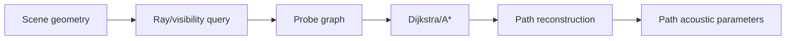

# 1. 학습 목표

Core의 알고리즘을 읽을 때는 수식뿐 아니라 입력 데이터가 어떻게 만들어지는지, scratch state가 어디에 저장되는지, 결과를 어떻게 복원하는지 함께 추적한다.

# 2. 권장 순서

| 순서 | 개념 | 학습 문서 | Core 적용 |
|---:|---|---|---|
| 1 | Graph, Dijkstra, A*와 heuristic | [[algo_AStar_Dijkstra]] | [[Audio/SteamAudio/core/detail/pathing/core_path_finder|PathFinder]] |
| 2 | BVH와 ray/AABB query | [[algo_BVH]] | [[Audio/SteamAudio/core/detail/geometry/core_geometry_pipeline|Geometry pipeline]] |
| 3 | Probe visibility graph와 shortest paths | [[algo_ProbeVisibilityGraph]] | [[Audio/SteamAudio/core/core_06_pathing_overview|Pathing overview]] |
| 4 | 충돌 / ray intersection 기초 | [[algo_collision]] | Scene query와 path visibility |
| 5 | Audio DSP 기초 | [[Programming/DSP/dsp_00_overview|DSP 학습 지도]] | effect와 spatial renderer |

# 3. 자료 구조에서 코드까지

Probe graph는 장면의 모든 점을 저장하는 것이 아니라 bake된 probe node와 연결 edge를 표현한다. Dynamic scene 검증, path simplification, deviation 모델은 별도 단계이며 각각의 소스 문서로 이동한다.
