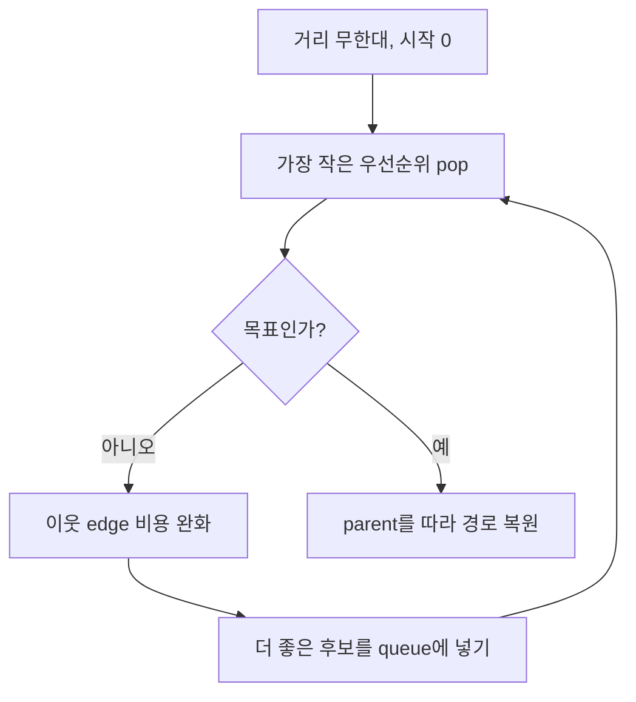

# 1. 그래프 최단 경로

Graph는 node와 edge로 구성된다. edge마다 nonnegative cost가 있을 때 Dijkstra는 시작 node부터의 알려진 누적 비용이 가장 작은 node를 반복해서 확정한다. A*는 `f(n)=g(n)+h(n)`을 priority로 사용한다. `g`는 시작점부터 현재 node까지의 실제 비용이고 `h`는 목표까지 남은 비용의 추정치다.

휴리스틱이 admissible(실제 남은 최소 비용을 초과하지 않음)이면 A*는 최적 경로를 찾을 수 있다. 휴리스틱이 0이면 A*는 Dijkstra와 같은 우선순위가 된다.

# 2. 처리 흐름



# 3. 독립 C++ 완화 단계

``` cpp fold title:가중 그래프의 edge relaxation
#include <vector>

bool relax(int from, int to, float edgeCost,
           const std::vector<float>& distance,
           std::vector<float>& nextDistance,
           std::vector<int>& parent)
{
    const float candidate = distance[from] + edgeCost;
    if (candidate >= nextDistance[to])
        return false;

    nextDistance[to] = candidate;
    parent[to] = from;
    return true;
}
```

실제 구현은 stale priority queue 항목, 재방문, heuristic, thread별 scratch 배열, graph adjacency layout을 처리한다. 위 코드는 핵심 갱신 규칙만 보여준다.

# 4. Steam Audio에서 찾기

[[Audio/SteamAudio/core/detail/pathing/core_path_finder|PathFinder 분석]]에서 queue priority, `mCosts`, `mParents`, thread index와 경로 복원 코드를 따라간다. Probe graph의 edge는 [[algo_ProbeVisibilityGraph|Probe Visibility Graph]] 문서와 [[Audio/SteamAudio/core/detail/pathing/core_path_visibility|Visibility 코드 분석]]을 참고한다.
