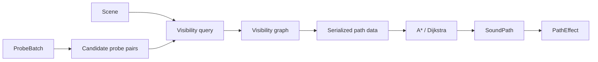

# 1. 그래프 모델

각 probe를 node로, 두 probe 사이에 통과 가능한 연결을 edge로 둔다. 단순 graph의 edge cost는 probe 간 거리일 수 있지만, 실제 acoustics 경로는 거리 이외에 bend와 frequency-dependent deviation도 반영할 수 있다. Visibility는 “두 점 사이 선분이 query상 통과 가능한가”를 나타내며, 소리의 완전한 물리 전달을 보장하는 진술과는 구별한다.

# 2. Bake와 runtime 분리

Bake에서 probe 쌍 visibility 및 경로 결과 일부를 계산·직렬화하고 runtime에서 source/listener의 현재 위치를 연결해 경로를 찾는다. Dynamic scene 변화가 있다면 baked edge를 검증하거나 대체 route를 찾는 추가 비용이 발생할 수 있다.

# 3. 저장 모델

모든 probe pair마다 전체 path object를 중복 저장하는 대신, unique path table과 인덱스/ref table로 중복을 줄일 수 있다. 실제 schema의 배열 의미와 index ordering은 직접 확인한다.

# 4. Core 문서 경로

- graph construction과 ray sample visibility: [[Audio/SteamAudio/core/detail/pathing/core_path_visibility|PathVisibility 구현]]
- 경로 search: [[Audio/SteamAudio/core/detail/pathing/core_path_finder|PathFinder 구현]]
- 경로 object 및 schema: [[Audio/SteamAudio/core/detail/pathing/core_path_data|PathData 구현]]
- runtime orchestration과 acoustic result: [[Audio/SteamAudio/core/detail/pathing/core_path_simulator|PathSimulator 구현]]
- effect: [[Audio/SteamAudio/core/detail/pathing/core_path_effect|PathEffect 구현]]

전반적인 절차는 [[core_06_pathing_overview|Core Pathing Overview]]에 있다. 공부 순서는 graph visibility → shortest path → path data → simulator → audio effect다.
