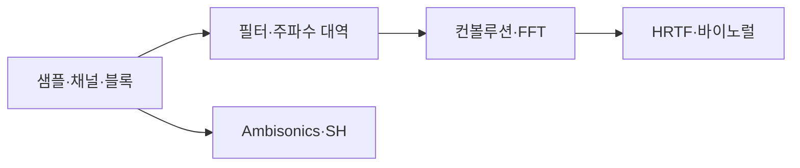

# 1. 이 학습 지도의 목적

이 문서는 Steam Audio 구현을 따라가며 필요한 DSP 개념을 순서대로 공부하기 위한 목차다. 수식과 작은 독립 C++ 예제를 먼저 익힌 뒤, 관련 Core 모듈로 이동한다.

# 2. 권장 학습 순서

| 순서 | 주제 | 학습 문서 | Core에서 연결되는 위치 |
|---:|---|---|---|
| 1 | 샘플, 채널, 프레임, 오디오 블록 | [[dsp_audio_buffer_and_block_processing]] | [[Audio/SteamAudio/core/detail/dsp/core_dsp_modules|Core DSP]] |
| 2 | dB, 주파수 대역, IIR 필터와 EQ | [[dsp_iir_filter_basics]] | [[Audio/SteamAudio/core/detail/simulation/core_air_absorption|Air Absorption]], [[Audio/SteamAudio/core/detail/pathing/core_path_effect|PathEffect]] |
| 3 | 임펄스 응답, 컨볼루션, FFT와 overlap-add | [[dsp_fft_and_convolution]] | [[Audio/SteamAudio/core/detail/dsp/core_dsp_modules|Convolution/FFT]] |
| 4 | HRTF와 binaural rendering | [[dsp_hrtf_binaural]] | [[Audio/SteamAudio/core/detail/spatialization/core_spatial_rendering|Spatial rendering]] |
| 5 | Spherical Harmonics와 Ambisonics | [[dsp_spherical_harmonics_spatial_audio]] | [[Audio/SteamAudio/core/detail/spatialization/core_spatial_rendering|Ambisonics rendering]] |

# 3. 오디오 DSP를 읽는 공통 관점

오디오 처리 코드는 보통 입력 버퍼의 모양, 처리 상태(state), 블록마다 호출되는 알고리즘, 출력 버퍼 순서로 읽는다. 필터와 FFT는 과거 샘플을 기억하는 state를 가질 수 있으므로, 매 블록마다 객체를 새로 만들면 연속 신호의 결과가 달라진다.

> [!tip] Core 코드 읽기
> 먼저 `numChannels`, `numSamples`, `speakerLayout`, `Ambisonics order`가 어떤 차원을 뜻하는지 확인한다. 이후 state를 초기화하는 Create/Reset 함수와 실제 블록을 처리하는 Apply/Process 함수를 나눠 읽는다.

# 4. 연결된 알고리즘 학습

DSP에서 쓰는 자료구조와 신호 알고리즘 외에 공간 질의와 경로 탐색도 필요하다. [[Programming/Algorithm/algo_00_overview|Algorithm 학습 지도]]에서 그래프 탐색, BVH, 근접 probe lookup과 ray visibility로 이어서 공부한다.
