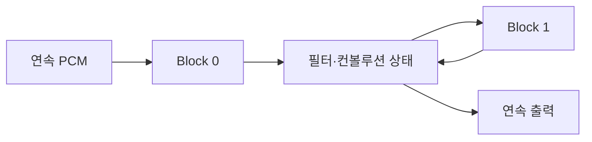

# 1. 개념

한 시점의 모든 채널 샘플 묶음을 frame이라고 부른다. 샘플레이트가 48 kHz이면 1초에 시간축 frame이 48,000개다. 스테레오 frame 하나에는 좌·우 샘플 두 개가 들어간다. `numSamples`는 많은 API에서 채널별 frame 개수를 뜻하므로, 총 scalar 샘플 수 `numSamples * numChannels`와 구별한다.

Planar 저장은 채널별 연속 배열이고 interleaved 저장은 한 frame의 채널 값을 차례로 저장한다. 예를 들어 L0,R0,L1,R1은 interleaved, L0,L1,... 및 R0,R1,...는 planar다. 포인터 배열을 받는 API가 항상 planar인지 확인하고 stride 규칙을 함께 읽어야 한다.

# 2. 블록 처리

실시간 오디오는 큰 스트림을 일정한 frame 길이의 블록으로 나눠 처리한다. 블록이 작으면 호출 빈도와 scheduling 부담이 커질 수 있고, 블록이 크면 지연과 임시 작업량이 증가할 수 있다. 알고리즘의 state는 블록 경계를 넘어 유지돼야 한다.



# 3. 독립 C++ 예제

``` cpp fold title:planar 오디오 블록의 채널별 gain
#include <cstddef>

void applyGain(float* const* channels, int numChannels,
               int numFrames, float gain)
{
    for (int channel = 0; channel < numChannels; ++channel)
    {
        for (int frame = 0; frame < numFrames; ++frame)
            channels[channel][frame] *= gain;
    }
}
```

이 코드는 Steam Audio API가 아니라 planar 데이터의 차원과 루프 순서를 보여준다. 실제 시스템에서는 버퍼 용량, alias 여부, SIMD 정렬, block-to-block DSP state를 추가로 확인한다.

# 4. Core와 연결

Core의 AudioBuffer/AudioBufferPool, effect `apply` 함수, C API의 `IPLAudioBuffer` 변환을 이 모델로 읽는다. [[core_dsp_modules|DSP module 분석]] 및 [[core_02_host_c_api_overview|Host C API Overview]]를 참고한다.
