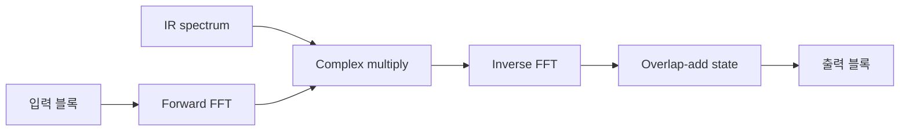

# 1. 임펄스 응답과 컨볼루션

선형 시불변 시스템은 입력 `x[n]`과 임펄스 응답 `h[n]`의 컨볼루션으로 출력 `y[n]`을 표현한다: `y[n] = Σ x[k] h[n-k]`. 짧은 필터는 직접 곱셈/누산으로 계산할 수 있지만 filter 길이와 입력 길이가 커지면 FFT 기반 처리가 효율적일 수 있다.

# 2. FFT 기반 처리

주파수 영역에서 시간 컨볼루션은 스펙트럼 곱셈으로 계산한다. 블록 FFT는 블록 간 overlap 상태를 관리해야 하며, 일반적인 길이 N FFT의 원형 컨볼루션 결과를 선형 컨볼루션에 맞추려면 zero padding 또는 overlap-add/overlap-save 구조가 필요하다.



# 3. 독립 C++ 의사코드

``` cpp fold title:overlap-add block 경계의 핵심
void addBlock(float* output, const float* transformedBlock,
              const float* savedTail, int blockSize)
{
    for (int i = 0; i < blockSize; ++i)
        output[i] = transformedBlock[i] + savedTail[i];
}
```

실제 구현은 FFT padding, transform scaling, tail 길이, partitioned convolution, latency와 state buffer를 포함한다. 위 코드는 저장된 이전 tail이 다음 출력에 더해진다는 핵심만 나타낸다.

# 4. Steam Audio 연결

`convolution.*`, HRTF binaural renderer, reflection IR 처리에서 convolution 및 partitioning을 살펴본다. [[core_dsp_modules|Core DSP overview]]와 [[dsp_hrtf_binaural|HRTF 문서]]를 함께 읽는다. GPU backend 사용 여부는 build option에 따라 달라진다.
