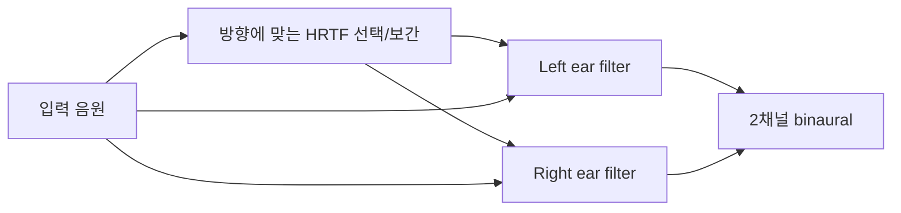

# 1. 개념

HRTF는 소리가 특정 방향에서 왔을 때 머리·몸통·귓바퀴가 양쪽 귀 신호에 주는 주파수 및 시간 응답을 나타낸다. 방향과 사람에 따라 응답이 달라진다. Binaural rendering은 모노/공간 음원을 좌우 귀에 맞는 두 신호로 변환해 헤드폰에서 방향감을 만든다.

# 2. 신호 흐름



시간영역에서 각 귀는 해당 방향의 임펄스 응답과 입력을 컨볼루션한다. 실제 엔진은 block FFT, partitioned IR, 방향 간 보간, filter crossfade, tail 처리 등을 사용해 비용과 움직임 artifact를 관리할 수 있다.

# 3. HRTF 선택의 의미

HRTF dataset은 방향별 응답을 제공한다. 사용 방향이 측정 방향과 다르면 주변 응답을 보간하거나 적절한 필터를 선택한다. 개인화되지 않은 HRTF는 사용자에 따라 전후/상하 위치감이 다르게 느껴질 수 있다. 좌표계 handedness, forward/up 축, listener transform 적용 순서를 코드에서 확인한다.

# 4. 학습할 최소 C++ 모델

``` cpp fold title:두 귀의 직접 FIR convolution 개념
void fir(const float* input, const float* impulse,
         float* output, int frames, int taps)
{
    for (int n = 0; n < frames; ++n)
    {
        float sum = 0.0f;
        for (int k = 0; k < taps && k <= n; ++k)
            sum += input[n - k] * impulse[k];
        output[n] = sum;
    }
}
```

이 독립 예제는 한 귀 FIR의 계산 구조만 보여준다. 두 귀에 서로 다른 filter를 적용하고 block 사이의 이전 입력 tail을 보존해야 연속 스트림을 처리할 수 있다. Steam Audio 구현은 [[dsp_fft_and_convolution|FFT/Convolution 문서]]에서 학습한다.

# 5. Core 코드 연결

[[Audio/SteamAudio/core/detail/spatialization/core_spatial_rendering|Spatial rendering 분석]]에서 HRTF object, binaural effect, HRTF interpolation 및 출력 buffer를 추적한다. Mono object rendering과 Ambisonics binaural decoding은 입력 표현이 다르므로 [[dsp_spherical_harmonics_spatial_audio|Ambisonics 문서]]도 이어서 본다.
