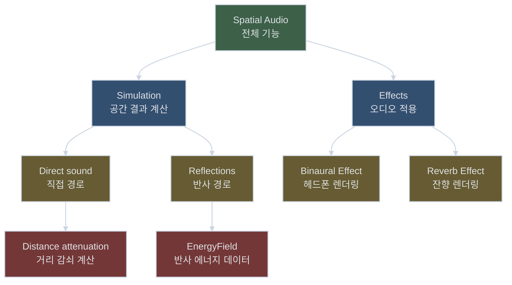
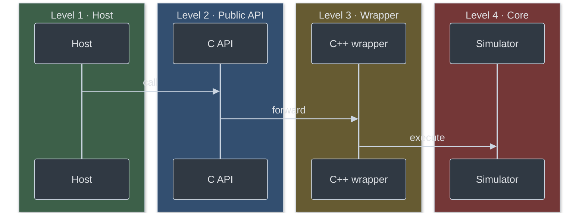

---

# 1. 제목


---

<font color="#b3f594">1. 역할 분리</font>
<font color="#b3f594">1. 역할 분리</font>
<font color="#b3f594">1. 역할 분리</font>
<font color="#b3f594">1. 역할 분리</font>


들여쓰기

<details>
  <summary>여기를 클릭해서 내용을 확인하세요 (제목)</summary>
  <div markdown="1">
    
    이곳에 펼쳐질 내용을 작성합니다.
    - 리스트도 가능하고
    - **굵은 글씨**도 가능합니다.

  </div>
</details>


%% 옵시디언에서만 보이는 주석 %%


<font color="#2ecc71">초록색 텍스트</font>
<font color="#3498db">파란색 텍스트</font>
<font color="#ff4d4d">빨간색 텍스트</font>
<font color="#ffa500">주황색 텍스트</font>
<font color="#f1c40f">노란색 텍스트</font>

<font color="#b3f594">■ 이미지의 그 초록색 (연두)</font>
<font color="#80dfff">■ 시원한 밝은 파란색</font>
<font color="#ff6b6b">■ 예쁜 다홍빛 빨간색</font>
<font color="#ffb15b">■ 질문하신 주황색</font>
<font color="#ffff80">■ 눈 안 아픈 부드러운 노란색</font>

<strong style="color:#b3f594">연두색 (이미지 속 그 색상)</strong>
<strong style="color:#80dfff">밝은 하늘색 (정보/참고)</strong>
<strong style="color:#ff6b6b">다홍색 (주의/경고)</strong>
<strong style="color:#ffb15b">주황색 (핵심 키워드)</strong>
<strong style="color:#ffff80">부드러운 노란색 (강조)</strong>

# Code Example
``` cpp fold title:Cmd
au.3dVisualize.Listeners 1
```

``` cpp fold title:subject
int a = 1;
int b = 2;
a + b 3;
```


# Callout Example
> [!info] info
> Contents

> [!todo] todo
> Contents

> [!error] Title
> Contents

> [!question] Title
> Contents

> [!example] Title
> Contents

> [!tip] 팁 (보통 민트/연초록)
> 내용을 입력하세요.

> [!success] 성공 (보통 초록/민트)
> 완료된 항목이나 긍정적인 내용을 넣기 좋습니다.

> [!check] 체크 (success와 비슷함)
> 확인이 필요한 내용에 사용하세요.


## Diagram 예제 — 계층 단계별 색상

가장 상위 개념에서 하위 구현 단계로 내려갈수록 <strong style="color:#3d6049">초록 → <span style="color:#334f70">파랑 → <span style="color:#665b32">노랑 → <span style="color:#743737">빨강</span></span></span></strong> 순서로 표시합니다. 어두운 배경, 밝은 글자와 테두리, 동일한 선 굵기를 사용합니다.



각 박스 안에는 `<br/>`을 넣어 제목 아래에 간단한 설명을 쓸 수 있습니다.

- <strong style="color:#3d6049">초록 — 전체 개념 / 최상위 시스템</strong>
- <strong style="color:#334f70">파랑 — 하위 시스템 / 큰 기능 영역</strong>
- <strong style="color:#665b32">노랑 — 세부 모듈 / 처리 경로</strong>
- <strong style="color:#743737">빨강 — 가장 구체적인 구현 단계 / 데이터 처리</strong>

### sequenceDiagram — 가로 계층 그룹

참여자끼리 계층을 나타낼 때는 Mermaid의 `box`로 참여자를 묶고 각 box에 해당 단계 색을 지정합니다. 참여자 상자 자체는 어두운 중립색으로 두어 그룹 색이 잘 보이게 합니다.


